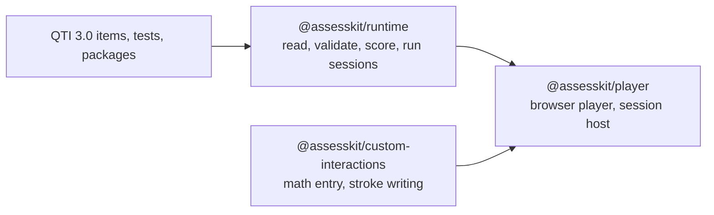

# assesskit

QTI 3.0 runtime and player for JavaScript and TypeScript: read, validate, score and deliver assessment items and tests, with
adaptive testing.

| Package                                                                                         | What it is                                                                                                      |
| ----------------------------------------------------------------------------------------------- | --------------------------------------------------------------------------------------------------------------- |
| [`@assesskit/runtime`](https://assesskit.wakan.dev/_assesskit/runtime/)                         | Reads, writes, validates and scores QTI 3.0 content, converts GIFT and Moodle XML, and runs test sessions       |
| [`@assesskit/player`](https://assesskit.wakan.dev/_assesskit/player/)                           | Renders the interactions in the browser, hosts portable custom interactions, serves sessions and adaptive tests |
| [`@assesskit/custom-interactions`](https://assesskit.wakan.dev/_assesskit/custom-interactions/) | Math entry and stroke writing as portable custom interactions                                                   |

The guides, the evidence of each package and the API are at [assesskit.wakan.dev](https://assesskit.wakan.dev/). Two sibling families
build on the same rules: [measurekit](https://measurekit.wakan.dev/) for psychometrics and knowledge tracing, and
[interopkit](https://interopkit.wakan.dev/) for the standards that learning platforms exchange data by.

QTI® is a trademark of 1EdTech® Consortium, Inc. (1edtech.org).
assesskit is not affiliated with, endorsed by or approved by 1EdTech Consortium, Inc.
