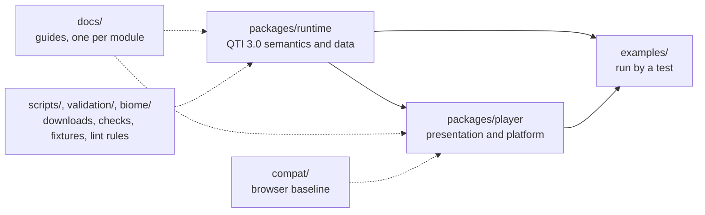

# AGENTS.md

The working rules of this repository for people and coding agents. The gates enforce most of them (`pnpm lint`,
`check:standards`, `typecheck`, `knip`, `compat`, `docs:api`); this file holds the rest. The workspace's engineering standards
apply, and the deviations from them are recorded below.

## Terms

Use these words with these meanings in code, comments and docs.

| Term                      | Meaning                                                                                                                            |
| ------------------------- | ---------------------------------------------------------------------------------------------------------------------------------- |
| item                      | One question or task: a `qti-assessment-item` with interactions, declarations and processing.                                      |
| test                      | A `qti-assessment-test`: items arranged in test parts and sections.                                                                |
| test part                 | A major division of a test, with a navigation mode and a submission mode.                                                          |
| section                   | A group of item references and sections, with selection, ordering and visibility rules.                                            |
| item ref                  | A `qti-assessment-item-ref`: the reference from a section to an item.                                                              |
| item instance             | One occurrence of an item in a test session; selection with replacement makes several of one item.                                 |
| item session              | The state of one item instance for one candidate: variables, attempts and status.                                                  |
| attempt                   | One cycle of responding that ends when the responses go to response processing.                                                    |
| candidate session         | The delivery of one test, or one item, to one candidate.                                                                           |
| draft, submitted response | A draft is what the candidate has entered; a submitted response is what response processing reads. Only submitted responses count. |
| outcome                   | A variable that processing sets, such as `SCORE`.                                                                                  |
| template variable         | A variable that template processing sets once for an item instance.                                                                |
| context variable          | A variable that a test declares and its items read.                                                                                |
| NULL                      | The absence of a value (INFO section 2.2.2). In code it is `null`, never `undefined`.                                              |
| container                 | A value of cardinality `multiple`, `ordered` or `record`.                                                                          |
| interaction               | An element that presents a task and binds a response variable.                                                                     |
| choice                    | An option of a choice-based interaction.                                                                                           |
| action                    | An input to the delivery engine, with the time it happened.                                                                        |
| refusal                   | The engine's answer to a well-formed action that the rules do not allow; the state stays unchanged.                                |
| pending work              | A request the engine makes to its host and waits for, such as an external score.                                                   |
| cover                     | The runtime convention that names the items an externally scored outcome of a test covers.                                         |

## Layout

| Path                                             | Holds                                                                                                                                                                      |
| ------------------------------------------------ | -------------------------------------------------------------------------------------------------------------------------------------------------------------------------- |
| `packages/runtime/src/<module>/`                 | One folder per module: `index.ts`, `internal.ts` where other modules or the tests need more, a file per concept                                                            |
| `packages/runtime/src/{errors,checks,random}.ts` | The errors, the checks of one value, the random number generator; the subpaths `errors` and `checks` serve the player                                                      |
| `packages/runtime/test/`                         | `<module>.test.ts` for each source folder; `fixtures/` (oracle output, stored states); `differential/` (the harness against Longsight `qti3-core`)                         |
| `packages/player/src/`                           | `errors.ts`, `checks.ts`, `messages/`, `protocol/`, `player/`, `client/`, `server/`, `scoring/`, `cat/`, `cat-rest/`                                                       |
| `packages/player/{player.css,scripts/,test/}`    | The stylesheet of a content root; `build-static.ts` (the PCI frame and the recording worklet); `<folder>.test.ts`, `fixtures/` (servers and commands of the browser tests) |
| `examples/<package>/<name>/`                     | A runnable example, a package of its own; its `test/` runs it                                                                                                              |
| `docs/<package>/`                                | The guides of a package, one per module, with architecture, evidence and supported; TypeDoc publishes them                                                                 |
| `compat/`, `scripts/`, `validation/`, `biome/`   | The browser baseline; downloads, generators and CI checks (`check-*.ts`, `rules/`); fixture scripts (Python); GritQL lint rules                                            |

[Layers](docs/runtime/architecture.md#layers) and [player layers](docs/player/architecture.md#layers) are rows of tables that
Biome enforces, folder by folder.

## Commands

| Command                          | Does                                                                                                                                                                     |
| -------------------------------- | ------------------------------------------------------------------------------------------------------------------------------------------------------------------------ |
| `pnpm install`                   | Installs the dependencies and the git hooks                                                                                                                              |
| `pnpm lint`, `pnpm format`       | Biome and cspell; `format` fixes formatting                                                                                                                              |
| `pnpm check:standards`           | The standards that a tool can check; `node scripts/check-standards.ts <path>...` reports the files below the paths                                                       |
| `pnpm typecheck`                 | `tsc` over every package, example and the tooling                                                                                                                        |
| `pnpm knip`                      | Unused files, exports and dependencies                                                                                                                                   |
| `pnpm test`                      | Vitest in Node, offline: no browser, corpus, XSD or benchmark project                                                                                                    |
| `pnpm test:coverage`             | The Node tests with the coverage floors of `vitest.config.ts`                                                                                                            |
| `pnpm test:browser`              | The browser tests in Chromium, Firefox and WebKit; needs `pnpm exec playwright install`, `pnpm schemas`, `pnpm corpus`                                                   |
| `pnpm test:coverage:browser`     | The browser tests in Chromium with the floors of the folders that draw a page and of the client                                                                          |
| `pnpm test:corpus`               | The tests that read the corpus; needs `pnpm corpus`                                                                                                                      |
| `pnpm test:xsd`                  | The tests that read the official XSDs; needs `pnpm schemas` and `pnpm corpus`                                                                                            |
| `pnpm bench`                     | The benchmarks of the runtime, and the mount time of the player in Chromium with the CPU slowed 4 times, against budgets                                                 |
| `pnpm build`                     | `tsc -b` after deleting `dist/`, so that no stale output ships                                                                                                           |
| `pnpm check:packages`            | publint and Are the Types Wrong on the packed packages                                                                                                                   |
| `pnpm check:release`             | Fails when a package that a changeset releases is private or lacks `publishConfig.access`                                                                                |
| `pnpm check:tarballs`            | Installs the packed packages into a scratch project, imports every subpath and type-checks it with `bundler` and `node16`                                                |
| `pnpm check:licenses`            | Fails on a production dependency whose license is not MIT, Apache-2.0, BSD or ISC                                                                                        |
| `pnpm check:audit`               | `pnpm audit` of the production dependencies at any severity and of all dependencies at high; needs the network                                                           |
| `pnpm check:rules`               | Removes each security rule of `scripts/rules/` from a copy of the code and fails when its test still passes; needs Chromium; takes the source files whose rules to check |
| `pnpm docs:api`                  | TypeDoc into `docs/api`; fails on undocumented exports                                                                                                                   |
| `pnpm compat`                    | The built JavaScript and the CSS of the player stay inside the browser baseline                                                                                          |
| `pnpm compat:engines`            | The smoke test in the pinned old browsers; needs Docker                                                                                                                  |
| `pnpm corpus`, `pnpm schemas`    | Download the 1EdTech examples into `.cache/corpus` and the XSDs into `.cache/schemas`; `corpus:pin` and `schemas:pin` write new hashes                                   |
| `pnpm unicode`, `pnpm asi-table` | Regenerate the Unicode tables of `values` and the element table of `asi` (needs `pnpm schemas`) from the pinned files                                                    |

- A gate that reads `dist/` builds it first, so a fresh clone passes every gate.
- Run the gates that the change touches before finishing; [CONTRIBUTING.md](CONTRIBUTING.md#before-opening-a-pull-request) says which.
- Development needs Node.js 22.18+ and pnpm 12. The scripts in `compat/` and `scripts/` are TypeScript that Node runs
  directly, so their relative imports end in `.ts`. The packages run on Node.js 22 and later, and CI tests 22 and 24.
- The Firefox of Playwright does not start on some macOS versions (it did not on macOS 27): run the browser tests in the Linux
  container of [evidence.md](docs/player/evidence.md#tests-in-a-browser) there.

## Releases

- Changesets version and publish the packages, each on its own version. A release has one changeset per package in
  `.changeset/`; a change made before the release extends it.
- A pull request from a `changeset-release/` branch runs `pnpm changeset version`; after it merges, the maintainer runs the
  Release workflow by hand, which builds and publishes the versions not yet on npm.
- No workflow opens pull requests, and Dependabot version updates are off.
- Changesets, docs and TSDoc describe current behavior only.

## Boundary between the runtime and the player

[architecture.md](docs/runtime/architecture.md#boundary-with-the-player) says who owns what.

- Semantics belong to the runtime: validity, visibility, the choice of a variant, processing, the rules of a session, time limits,
  the flow of scoring and the view without answer keys. The player never evaluates an expression, decides what is visible or
  valid, chooses a variant, or holds an answer key outside the runtime's solution view.
- A rule that the player needs and the runtime lacks is a change in the runtime, with its test, never a workaround in the player.

## Dependencies

- `scripts/schemas.ts` imports `packages/runtime/src/cli/fetch-schemas.ts` by relative path, so that `pnpm schemas` and
  `assesskit schemas fetch` run one implementation. Node runs that file directly and does not resolve the `.js` specifiers of
  an `internal.ts`, so it imports only `node:*` modules and types; `scripts/asi-table.ts` imports only types, through
  `asi/internal.ts`.
- Dependencies are pinned to exact versions, development ones too, and the runtime dependencies are recorded in
  [SECURITY.md](SECURITY.md#runtime-dependencies).
- The player gets `AssesskitError` and `DataError` from `@assesskit/runtime/errors` and its checks from
  `@assesskit/runtime/checks`, never from the root of the runtime, which loads every module.
- `Date.now` appears only in `packages/player/src/client/clock.ts` and `packages/player/src/server/clock.ts`.
- `examples/player/cat-with-measurekit` links `@measurekit/psychometrics` from `../measurekit` until measurekit is on npm; CI checks
  it out at the commit of `scripts/measurekit.lock.json`, so that file changes with the measurekit that the example needs.
- The JSON of the bodies of the CAT REST binding is written once, in `packages/player/src/cat-rest/binding.ts`, and the client
  and the handler both use it.

## Deviations from the engineering standards

| Standard                                                            | What the repository does                                                                                                                                                                                              | Reason                                                                                                                                                                                     |
| ------------------------------------------------------------------- | --------------------------------------------------------------------------------------------------------------------------------------------------------------------------------------------------------------------- | ------------------------------------------------------------------------------------------------------------------------------------------------------------------------------------------ |
| Code that two packages of a family need goes in the family's `core` | The checks of one value and `untilAborted`, which the runtime and the player share, are `@assesskit/runtime/checks`; no `@assesskit/core` exists                                                                      | The family has two packages and the player depends on the runtime already, so a third package would add a release and a boundary for plain functions. Approved by the owner on 2026-11-01. |
| Names of functions are verbs                                        | A pure accessor, and a constructor of a value, is named for what it returns: `partOf`, `timeLimits`, `lomGeneral`, `rubricScoreRange`, `single`, `container`; a function that builds a block or a document has a verb | The names are those of the terms of QTI and of the types they return, and a verb in front of each would say nothing more. Approved by the owner on 2026-11-01.                             |

## Naming

- QTI names keep their spelling in the model: `qti-assessment-item` becomes `AssessmentItem`, and the attribute `max-attempts`
  becomes `maxAttempts`.
- Options are `<Name>Options`; limits are `<Name>Limits`, with `DEFAULT_<NAME>_LIMITS` for the defaults.
- Labels are string unions in kebab-case (`"very-good"`).

## Code

- No `as` casts except where untyped data enters and is validated next.
- Entry points check their input deeply, once, where the public function reads it, with the `check*` functions of `checks.ts`,
  and throw `DataError` with a full sentence: `<Label> must be a positive integer, found <value>.` An option's label is
  `The option <name>`, and a value is shown with `describe`. Inner functions validate shallowly, so that a call does not cost
  the size of the model.
- JSON and objects that a host passes in are read with a valibot schema named `<name>Schema` and `parseWith(schema, input, label)`,
  which throws the `DataError` of the first issue with its path. `check*` calls stay for the arguments of inner functions and
  for the options of the player, which hold DOM objects and callbacks.
- A rule that a schema cannot express is a `check` or a `rawCheck` with a message of its own, or code after the parse; code
  that throws `DataError` joins a schema with `transformWith`.
- `strictObject` where nothing else is allowed; `mapSchema` where property names are data (valibot's `record` skips
  `__proto__`); `recordSchema` before an object whose entries are all optional (valibot reads an array as such an object).
- A function that valibot calls to make a default is wrapped, `() => fn`.
- No valibot grapheme action (`graphemes`, `minGraphemes`, `maxGraphemes`): they use `Intl.Segmenter`, which the browser baseline bans.
- Options and optional fields are destructured with their defaults, so that a value set to `null` is checked and rejected, never
  taken as absent.
- Validation returns `Issue`s with a stable `code` and a message and does not throw. A refusal of the engine has a `code` and a
  message too, listed in the [delivery guide](docs/runtime/delivery.md).
- Identifier-keyed data lives in `Map`s, never in plain objects, so that an identifier such as `__proto__` stays data.
- Every semantic rule names its specification with `@see` in the TSDoc of the code that applies it, and not in an issue.

## The state format

`DeliveryState` is stored by hosts. [delivery.md](docs/runtime/delivery.md#state-across-releases) states the rule for users.

- A new optional field leaves `STATE_VERSION` as it is, with a test that a state without it still reads and advances as before.
- At 1.0 only version 1 exists, so the reader has no upgrade step. The first bump widens `stateSchema` in `state-json.ts` to accept
  the version it replaces, adds the step that maps that state to the new one, and adds a fixture of its own beside
  `test/fixtures/state-1.json`. A fixture is never written again.
- The test `a state that an earlier release wrote` in `delivery.corpus.test.ts` reads each fixture and compares every step with a
  replay from the seed.

## Browser baseline

The shared and browser folders of the player and every stylesheet run in Chromium 111, Firefox 115 and Safari 16.4, and later
versions ([baseline.md](docs/player/baseline.md)). The `browserslist` of `packages/player/package.json`, the esbuild targets and
the `lib` of the browser tsconfig name them. Do not guard a feature that a baseline browser lacks with a support check: the code would be dead
in some browsers and untested in the others.

## Comments and docs

- A TSDoc comment starts with one sentence: a noun phrase for a type or a constant, a third-person verb phrase for a function
  ("Returns ..."), a short phrase for a property.
- A code sample in a guide is complete: it shows its imports and holds no TypeScript syntax, so that it runs as it is. It gives its
  result as `// => result`, and `runGuideSamples` of `test/guide-samples.ts` runs the samples in the test file of the module and
  fails on a result that differs. The guides of the player are imported with `?raw`, and a guide whose samples need a page runs in
  `guides.browser.test.ts`.
- What a call throws goes into a table of errors, not into a sample.
- The Example of `packages/runtime/README.md` is the file `packages/runtime/test/readme-example.ts`, and `readme.test.ts` fails
  when they differ; the Quick start of `packages/player/README.md` runs in `protocol.test.ts`.
- One purpose for each document: `README.md` for users, `docs/<package>/` for guides, `CONTRIBUTING.md` for the process,
  `AGENTS.md` for conventions, `SECURITY.md` for deployment security, `validation/README.md` for the fixture scripts.

## Evidence and tests

| File                       | Runs with           | Holds                                                                                                                                              |
| -------------------------- | ------------------- | -------------------------------------------------------------------------------------------------------------------------------------------------- |
| `*.test.ts`                | `pnpm test`         | Behavior in Node; one file for each source folder, named after it                                                                                  |
| `*.corpus.test.ts`         | `pnpm test:corpus`  | Tests that read the corpus, in Node                                                                                                                |
| `*.browser.test.ts`        | `pnpm test:browser` | Tests in the three engines                                                                                                                         |
| `*.browser.corpus.test.ts` | `pnpm test:corpus`  | The corpus in a browser                                                                                                                            |
| `*.xsd.test.ts`            | `pnpm test:xsd`     | Tests that read the official XSDs; every writer test passes its output to `validateXmlFiles` of `node` with a `SchemaSet` that the file loads once |
| `*.bench.ts`               | `pnpm bench`        | Benchmarks that fail above their budget in `test/budgets.ts` or `test/mount-budgets.ts` ([performance.md](docs/runtime/performance.md))            |

- Completeness comes from the specifications, not from a list that the repository keeps: tests derive the elements, attributes,
  expressions and interactions to cover from the schemas, the element table and the runtime's own descriptors, and fail when
  something is missing ([evidence.md](docs/runtime/evidence.md#completeness)).
- A file's `describe` blocks follow the order of the folder's source files, with a closing `properties` block; within a block,
  the comparisons with the oracle and the main behavior come first, then the options, then errors and edge cases.
- Every public function has a test of input of other types, as JavaScript or JSON pass it: `null` options and arguments, a string
  for a number, an object for an array. Such input comes from `JSON.parse`, not from a cast.
- Properties that hold for any input are tested with fast-check, and its generators are in `test/arbitraries/`, a file for each module.
- Fuzz tests of readers use `FUZZ` of `test/fuzz.ts`: a fixed seed and a bounded number of runs, so that CI runs the inputs a laptop
  does. A reader of documents is tested with `fuzzReader`, which mutates valid documents (`mutations` of `test/arbitraries/xml.ts`)
  and accepts a result, a `ReadError` or a `SecurityError`, nothing else.
- A browser test waits for a condition with `waitFor` of `test/wait.ts`, never with `vi.waitFor`, whose limit of one second a busy
  host does not meet; for media it waits for the events of the recording and moves the timers by hand, never for a time.
- The browser files of the player have size budgets in `packages/player/test/size-budgets.ts`; `size.test.ts` bundles each entry
  point and fails when a file is above its budget after gzip ([size.md](docs/player/size.md)).

## Where things go

- A construct of the specifications: its test, and a line of `supported.md` of the package when what is supported changes.
- A runtime module: a folder in `src/` with `index.ts`, a subpath in `package.json` `exports`, `export *` in `src/index.ts` unless
  it is `node` or `cli`, a test file, a guide in `docs/`, import rules in `biome.json`, its row in the table of
  [architecture.md](docs/runtime/architecture.md#layers) and in the API table of `packages/runtime/README.md`. `node` and `cli`
  also get an entry point in `packages/runtime/typedoc.json`.
- A player folder: its row in the table of [architecture.md](docs/player/architecture.md#layers), its Biome overrides and its entry in
  `lint.test.ts`, a subpath in `package.json` `exports` and in `typedoc.json` when the host imports it, a test file and a guide in `docs/`.
- A check shared by modules: of a value of a JavaScript type in `checks.ts`; of a value that a module defines, in the `internal.ts` of
  that module.
- A place where the specifications contradict themselves or are silent: its resolution in [spec-gaps.md](docs/runtime/spec-gaps.md), a
  test, and a mention in the guide of the module.
- Something the runtime defines because QTI does not: [conventions.md](docs/runtime/conventions.md), built from QTI's own elements
  so that documents stay valid.
- A difference from Longsight `qti3-core` that the specification settles: the list in `packages/runtime/test/differential/accepted.ts`.
