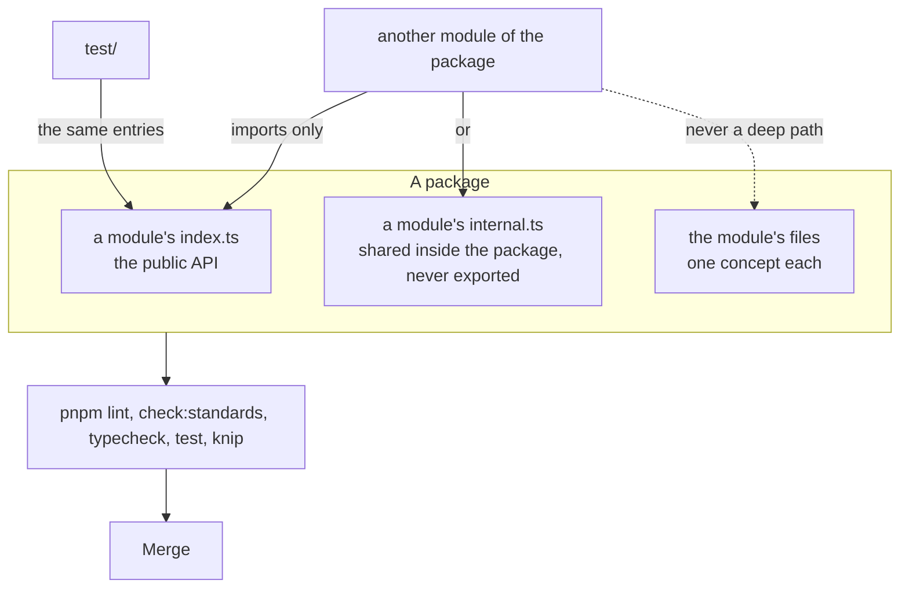

# AGENTS.md

Conventions for people and coding agents working in this repository. Read this before changing anything. Most rules are
enforced by `pnpm lint` (Biome and cspell), `pnpm check:standards`, `pnpm typecheck`, `pnpm knip`, `pnpm compat` and
`pnpm docs:api`; the rest are checked in review.

assesskit is a toolkit for QTI 3.0 in JavaScript and TypeScript, in one repository: `@assesskit/runtime` is the QTI 3.0 runtime,
and `@assesskit/player` is the player built on it. [docs/runtime/architecture.md](docs/runtime/architecture.md) and
[docs/player/architecture.md](docs/player/architecture.md) state the design principles; follow them.

## Terms

Use these words with these meanings in code, comments and docs.

| Term                      | Meaning                                                                                                                            |
| ------------------------- | ---------------------------------------------------------------------------------------------------------------------------------- |
| item                      | One question or task: a `qti-assessment-item` with interactions, declarations and processing.                                      |
| test                      | A `qti-assessment-test`: items arranged in test parts and sections.                                                                |
| test part                 | A major division of a test, with a navigation mode and a submission mode.                                                          |
| section                   | A group of item references and sections, with selection, ordering and visibility rules.                                            |
| item ref                  | A `qti-assessment-item-ref`: the reference from a section to an item.                                                              |
| item instance             | One occurrence of an item in a test session; selection with replacement makes several of one item.                                 |
| item session              | The state of one item instance for one candidate: variables, attempts and status.                                                  |
| attempt                   | One cycle of responding that ends when the responses go to response processing.                                                    |
| candidate session         | The delivery of one test, or one item, to one candidate.                                                                           |
| draft, submitted response | A draft is what the candidate has entered; a submitted response is what response processing reads. Only submitted responses count. |
| outcome                   | A variable that processing sets, such as `SCORE`.                                                                                  |
| template variable         | A variable that template processing sets once for an item instance.                                                                |
| context variable          | A variable that a test declares and its items read.                                                                                |
| NULL                      | The absence of a value (INFO section 2.2.2). In code it is `null`, never `undefined`.                                              |
| container                 | A value of cardinality `multiple`, `ordered` or `record`.                                                                          |
| interaction               | An element that presents a task and binds a response variable.                                                                     |
| choice                    | An option of a choice-based interaction.                                                                                           |
| action                    | An input to the delivery engine, with the time it happened.                                                                        |
| refusal                   | The engine's answer to a well-formed action that the rules do not allow; the state stays unchanged.                                |
| pending work              | A request the engine makes to its host and waits for, such as an external score.                                                   |
| cover                     | The runtime convention that names the items an externally scored outcome of a test covers.                                         |

## Layout

| Path                             | Holds                                                                                                                                                                                                                                                                                                                                                                                                                                                                                                                                                                                                                                                 |
| -------------------------------- | ----------------------------------------------------------------------------------------------------------------------------------------------------------------------------------------------------------------------------------------------------------------------------------------------------------------------------------------------------------------------------------------------------------------------------------------------------------------------------------------------------------------------------------------------------------------------------------------------------------------------------------------------------- |
| `packages/runtime/`              | The QTI 3.0 runtime                                                                                                                                                                                                                                                                                                                                                                                                                                                                                                                                                                                                                                   |
| `packages/runtime/src/index.ts`  | Re-exports the modules, the errors and the random number generator                                                                                                                                                                                                                                                                                                                                                                                                                                                                                                                                                                                    |
| `packages/runtime/src/errors.ts` | `AssesskitError`, `DataError`, `ReadError`, `SecurityError`, `ProcessingError` and `Issue`; the subpath `errors` exports them without the rest of the package, for the player                                                                                                                                                                                                                                                                                                                                                                                                                                                                         |
| `packages/runtime/src/checks.ts` | Checks of one value, which `@assesskit/runtime/checks` exports to the packages built on the runtime: `describe`, `isRecord`, and `checkRecord`, `checkArray`, `checkOptions`, `checkFunction`, `checkProperties`, `checkString`, `checkNonEmptyString`, `checkBytes`, `checkBoolean`, `checkChoice`, `checkFinite`, `checkNonNegative`, `checkNonNegativeInteger`, `checkPositiveInteger`, `checkPositive`, `checkSeed`, `checkSynchronous`; and the valibot side: `parseWith`, `transformWith`, `mapSchema`, `recordSchema`, `looseRecord`, `strictRecord`, `guardSchema`, `functionSchema`, `methodsSchema` and the schemas of a number or a string |
| `packages/runtime/src/random.ts` | `Random`, `SeededRandom`, `createRandom`, `restoreRandom`                                                                                                                                                                                                                                                                                                                                                                                                                                                                                                                                                                                             |
| `packages/runtime/src/<module>/` | One folder per module, with `index.ts`, `internal.ts` where other modules or the tests need more, and one file per concept                                                                                                                                                                                                                                                                                                                                                                                                                                                                                                                            |
| `packages/runtime/test/`         | `<module>.test.ts` for each source folder; `fixtures/` holds oracle output; `differential/` holds the harness that compares the runtime with Longsight `qti3-core`, a development dependency                                                                                                                                                                                                                                                                                                                                                                                                                                                          |
| `packages/player/`               | The player                                                                                                                                                                                                                                                                                                                                                                                                                                                                                                                                                                                                                                            |
| `packages/player/src/index.ts`   | Re-exports the errors and the messages                                                                                                                                                                                                                                                                                                                                                                                                                                                                                                                                                                                                                |
| `packages/player/src/errors.ts`  | `AccessError`, `LtiError`, `ServiceError`; they extend the runtime's `AssesskitError`, and the player throws the runtime's `DataError`                                                                                                                                                                                                                                                                                                                                                                                                                                                                                                                |
| `packages/player/src/checks.ts`  | The checks of the player that the runtime does not have: `checkHttpsUrl` and `httpsUrlSchema`, the absolute `https` URLs that LTI, the CAT binding and Caliper require                                                                                                                                                                                                                                                                                                                                                                                                                                                                                |
| `packages/player/src/messages/`  | `Messages`, the English and Indonesian catalogs, `selectMessages`                                                                                                                                                                                                                                                                                                                                                                                                                                                                                                                                                                                     |
| `packages/player/src/protocol/`  | `Caller`, `ActionEnvelope`, `ViewEnvelope` and `Submission`, with their checks                                                                                                                                                                                                                                                                                                                                                                                                                                                                                                                                                                        |
| `packages/player/src/<folder>/`  | `player/`, `client/`, `server/`, `scoring/`, `cat/`, `lti/` and `caliper/`                                                                                                                                                                                                                                                                                                                                                                                                                                                                                                                                                                            |
| `packages/player/player.css`     | The stylesheet of a content root: themes, the QTI 3 shared vocabulary, the PNP presentation                                                                                                                                                                                                                                                                                                                                                                                                                                                                                                                                                           |
| `packages/player/scripts/`       | `build-static.ts` writes the static files of the player: the PCI frame and the recording worklet                                                                                                                                                                                                                                                                                                                                                                                                                                                                                                                                                      |
| `packages/player/test/`          | `<folder>.test.ts` for each source folder; `lint.test.ts` runs Biome on the layering and the GritQL rules; `*.browser.test.ts` render in Chromium, Firefox and WebKit; `fixtures/` holds the servers and commands of the browser tests                                                                                                                                                                                                                                                                                                                                                                                                                |
| `examples/<package>/`            | Runnable examples, one folder each, a package of its own with the dependencies that only it needs; the `test/` of an example runs it, and `pnpm test` includes it                                                                                                                                                                                                                                                                                                                                                                                                                                                                                     |
| `docs/runtime/`, `docs/player/`  | The guides of each package, one per module, with architecture, evidence and supported; TypeDoc publishes them with the API reference                                                                                                                                                                                                                                                                                                                                                                                                                                                                                                                  |
| `compat/`                        | The browser baseline: the lint of the built code, the smoke test and the pinned engines                                                                                                                                                                                                                                                                                                                                                                                                                                                                                                                                                               |
| `scripts/`                       | Corpus and schema downloads, the pinned corpus, the Unicode and element table generators, and the standards check                                                                                                                                                                                                                                                                                                                                                                                                                                                                                                                                     |
| `validation/`                    | Python scripts that write fixtures                                                                                                                                                                                                                                                                                                                                                                                                                                                                                                                                                                                                                    |
| `biome/`                         | Biome GritQL plugins                                                                                                                                                                                                                                                                                                                                                                                                                                                                                                                                                                                                                                  |

## Commands

| Command                | Does                                                                                                                                             |
| ---------------------- | ------------------------------------------------------------------------------------------------------------------------------------------------ |
| `pnpm install`         | Installs the dependencies and the git hooks                                                                                                      |
| `pnpm lint`            | Biome and cspell; `pnpm format` fixes formatting                                                                                                 |
| `pnpm check:standards` | The rules of the engineering standards that a tool can check; `node scripts/check-standards.ts <path>...` reports only the files below the paths |
| `pnpm typecheck`       | `tsc` over every package and the tooling                                                                                                         |
| `pnpm test`            | Vitest, offline                                                                                                                                  |
| `pnpm test:browser`    | The browser tests of the player in Chromium, Firefox and WebKit; run `pnpm exec playwright install`, `pnpm schemas` and `pnpm corpus` first      |
| `pnpm test:corpus`     | Tests that read the corpus; run `pnpm corpus` first                                                                                              |
| `pnpm test:xsd`        | Tests that read the official XSDs; run `pnpm schemas` and `pnpm corpus` first                                                                    |
| `pnpm bench`           | The benchmarks of the runtime against their budgets                                                                                              |
| `pnpm schemas`         | Downloads the XSDs into `.cache/schemas`; `pnpm schemas:pin` writes new hashes                                                                   |
| `pnpm unicode`         | Regenerates the Unicode tables of `values` from the pinned files                                                                                 |
| `pnpm asi-table`       | Regenerates the element table of `asi` from the pinned ASI schema; run `pnpm schemas` first                                                      |
| `pnpm knip`            | Unused files, exports and dependencies                                                                                                           |
| `pnpm compat`          | The built JavaScript and the CSS of the player stay inside the browser baseline; run `pnpm build` first                                          |
| `pnpm compat:engines`  | The smoke test in the pinned old browsers, in Docker; run `pnpm build` first                                                                     |
| `pnpm build`           | `tsc -b` after deleting `dist/`, so that no stale output ships                                                                                   |
| `pnpm check:packages`  | Builds, then publint and Are the Types Wrong on the packed packages                                                                              |
| `pnpm docs:api`        | TypeDoc into `docs/api`; fails on undocumented exports                                                                                           |

Run all of them before finishing a change. Development needs Node.js 22.18+ and pnpm 12. The scripts in `compat/` and
`scripts/` are TypeScript that Node runs directly, so their relative imports end in `.ts`. `pnpm compat:engines`
also needs Docker. `pnpm test:browser` runs all three engines, and the Firefox of Playwright does not start on some macOS
versions (it did not on macOS 27): run the suite in the Linux container of
[evidence.md](docs/player/evidence.md#tests-in-a-browser) there.

## Releases

Changesets version and publish the packages, each on its own version. A release has one changeset per package in
`.changeset/`; changes made before the release extend it. To release, a pull request from a `changeset-release/` branch
runs `pnpm changeset version`, which bumps the versions, writes `CHANGELOG.md` and consumes the changesets. After it is
merged, the maintainer runs the Release workflow by hand: it builds and publishes the versions not yet on npm. No
workflow opens pull requests, and Dependabot version updates are off. Changesets, docs and TSDoc describe current
behavior only, and never how it came to be.

## Boundary between the runtime and the player

The runtime owns everything QTI defines that is not presentation or platform; the player owns presentation and the platform
([architecture.md](docs/runtime/architecture.md#boundary-with-the-player) lists who owns what).

- Semantics belong to the runtime: validity, visibility, the choice of a variant, processing, the rules of a session, time limits,
  the flow of scoring and the view without answer keys. The player asks the runtime and never evaluates an expression, decides what is
  visible or valid, chooses a variant, or holds an answer key outside the runtime's solution view.
- Presentation and the platform belong to the player: rendering, the host of portable custom interactions, accessibility in the
  interface, URLs, clocks and timers, storage, and the network (LTI, CAT adapters, Caliper). The runtime never renders, reads a
  clock, builds a URL or fetches, apart from `assesskit schemas fetch`. The policy about which actions a client may send is
  the player's.
- A rule that the player needs and the runtime lacks is a change in the runtime, with its test, and not a workaround in
  the player.
- The packages meet in JSON: views, actions and state, with values as `WireValue`. They have their own versions.

## Dependencies

- A module imports only the modules in its row of the table in
  [architecture.md](docs/runtime/architecture.md#layers); every module may import `errors.ts`, `checks.ts` and
  `random.ts`. Biome enforces the rows, and imports never form cycles.
- The runtime core uses no platform API: no `node:*`, `fetch`, timers, DOM or `process`. Only `node/` and `cli/` may.
- A module imports another module of its package only through that module's `index.ts` (its public API) or its `internal.ts`
  (what the package's other modules and its tests share and the package does not export), never by a deep file path. A file
  directly in `src/`, such as `errors.ts` and `checks.ts`, is not in a module. `pnpm check:standards` enforces it, for `src/`
  and `test/`.
- `scripts/schemas.ts` imports `packages/runtime/src/cli/fetch-schemas.ts` by relative path, so that `pnpm schemas` and
  `assesskit schemas fetch` run one implementation. Node runs that file directly and does not resolve the `.js` specifiers of an
  `internal.ts`, so the file imports only `node:*` modules and types. `scripts/asi-table.ts` imports only types, through
  `asi/internal.ts`.
- `packages/runtime` never imports `@assesskit/player`. `@assesskit/player` and the other packages import the runtime by package name and subpath, never
  by a relative path into `src/` or `dist/`.
- Runtime dependencies are listed in the `package.json` of the package that loads them, pinned, and recorded in `SECURITY.md`.
- Packages of different families never import each other. A package defines a port (the runtime's `CatPort`) or speaks an open
  standard, and an adapter to another family's library lives in `examples/`, never in a package.
- A player folder imports only the folders in its row of the table in
  [architecture.md](docs/player/architecture.md#layers); `errors.ts`, `checks.ts` and `messages/` are below all
  of them. Biome enforces the rows. `fetch` appears only as an option parameter.
- The player's shared folders use no DOM or Node, its browser folders no Node, and its server folders no DOM. Time comes from
  a clock that the caller passes: `Date.now` appears only in `client/clock.ts` and `server/clock.ts`.
- The player gets `AssesskitError` and `DataError` from `@assesskit/runtime/errors` and its checks from
  `@assesskit/runtime/checks`, never from the root of the runtime: the root loads every module, and the subpaths load none.
  A check that both packages need is written once, in the runtime.
- Browser folders import from `@assesskit/runtime/delivery` only `viewFromJson`, `actionToJson` and types, because the
  engine holds the answer keys: `client/local.ts` alone loads the engine, with `import()`, for practice on a device.

## Naming

- Files: kebab-case. One concept per file, named after it. Group files in folders by module.
- Values and functions: camelCase. Module-level constant data: SCREAMING_SNAKE. Object keys may also be SCREAMING_SNAKE,
  for the identifiers of QTI variables such as `SCORE`.
- Types: PascalCase. Type parameters: `T` or `T` plus a name.
- QTI names keep their spelling in the model: `qti-assessment-item` becomes `AssessmentItem`, and attribute `max-attempts`
  becomes `maxAttempts`.
- Function options are `<Name>Options`; limits are `<Name>Limits` with `DEFAULT_<NAME>_LIMITS` for the defaults.
- Labels are string unions in kebab-case (`"very-good"`).

## Code

- TypeScript strict, ESM, named exports only, `.js` extensions in relative imports of `src/`, `import type` for types.
- No `as` casts except where untyped data enters and is validated next. No non-null assertions.
- Entry points validate their input deeply and throw `DataError` with a full sentence that says what is wrong and what is
  expected, e.g. `A seed must be a safe integer, found 1.5.` Input may come from plain JavaScript or JSON, so every
  argument is checked for its type before it is read, once, where the public function reads it, with a `check` function of
  `checks.ts`: options with `checkOptions`, arrays with `checkArray`, objects with `checkRecord`, a function with
  `checkFunction`, a string with `checkString`, a number with `checkFinite`, `checkNonNegative`,
  `checkNonNegativeInteger` or `checkPositiveInteger`, a seed with `checkSeed`, a boolean with `checkBoolean` and a
  string option with `checkChoice`: `<Label> must be a positive integer, found <value>.` An option's label is
  `The option <name>`. Inner functions validate shallowly, so that a call does not cost the size of the model. Other
  messages show values with `describe`.
- JSON and objects that a host passes in are read with a valibot schema, named `<name>Schema`, and not with a chain of
  `check` calls; those stay for the arguments of inner functions and for the options of the player, which hold DOM
  objects and callbacks whose results are checked. `parseWith(schema, input, label)` throws the `DataError` for the
  first issue, naming its path:
  `<Label> is invalid at items[0].name: expected a string, found 5.` A rule that a schema cannot express is a `check` or
  a `rawCheck` with a message of its own, or code after the parse; code that throws `DataError` joins a schema with
  `transformWith`. Use `strictObject` where nothing else is allowed, `mapSchema` where property names are data (valibot's
  `record` skips `__proto__`), and `recordSchema` before an object whose entries are all optional (valibot reads an array
  as such an object). A function that valibot calls to make a default is wrapped, `() => fn`. Not the actions that count
  graphemes (`graphemes`, `minGraphemes`, `maxGraphemes`): they use `Intl.Segmenter`, which the browser baseline bans.
- Options and optional fields are destructured with their defaults, so that a value set to `null` is checked and rejected,
  never taken as absent.
- Validation returns `Issue`s and does not throw. An issue has a stable `code` and a message; a refusal of the engine is its
  `code` and a message, and the codes are in the table of the delivery guide. The specification of a rule is cited in the
  TSDoc of the code that applies it, and not in the issue.
- Never use `Math.random`, read a clock, or construct a `RegExp`. Take a `Random` or a time from the caller, and compile
  author patterns with the linear-time automaton of `values`. `pnpm lint` fails on all three in `packages/runtime/src`.
- Identifier-keyed data lives in `Map`s, never in plain objects, so that an identifier such as `__proto__` stays data.
- Every semantic rule names its specification in the TSDoc of the code that applies it, with `@see`.
- A number with a meaning is a named constant with its source.
- No speculative options, abstractions or modules. Add a method only when a real use needs it, with its validation.

## Browser baseline

The player runs in Chromium 111, Firefox 115 and Safari 16.4, and later versions. This covers the shared and browser folders:
`errors.ts`, `checks.ts`, `messages/`, `protocol/`, `player/` and `client/`, and every stylesheet. The `lib` of the browser
tsconfig is `ES2023`, `DOM` and `DOM.Iterable`, so that TypeScript rejects later built-ins; the `browserslist` of
`packages/player/package.json` and the esbuild targets of the bundles name the three browsers.

- `pnpm compat` lints the built JavaScript with eslint-plugin-compat and the stylesheets with
  stylelint-no-unsupported-browser-features, for the browsers of the `browserslist`: it fails on a feature that one of them
  lacks, on the data of caniuse and MDN. It runs after `pnpm build`.
- `pnpm compat:engines` runs the smoke test of `compat/smoke.ts` in Chromium 111, Firefox 115 and WebKit 16.4, in Docker.
  [baseline.md](docs/player/baseline.md) describes both.

Do not guard a feature that a baseline browser lacks with a support check: the code would be dead in some browsers and
untested in the others.

## Comments and docs

- Every export has a TSDoc comment that starts with one sentence: a noun phrase for a type or a constant, a third-person
  verb phrase for a function ("Returns ...", "Builds ..."), a short phrase for a property. A function adds `@param`,
  `@returns` and `@throws`, an option adds `@defaultValue`, a longer explanation goes under `@remarks`, and a specification
  is cited with `@see {@link url | name}`. A comment carries no history, no section sign and no code of a review or a
  ticket.
- `//` comments only explain why something non-obvious is done: an ambiguity of a specification, a numerical trap, an
  invariant. No commented-out code.
- US English. Docs state facts in short sentences; prefer a table or list to prose. Code samples are complete: they
  show their imports and hold no TypeScript syntax, so that they run as they are. A guide gives the result of a sample as
  `// => result`, and `runGuideSamples` of `test/guide-samples.ts` runs the samples in the test file of the module and fails on
  a result that differs. The guides of the player are imported with `?raw`, and a guide whose samples need a page (the client)
  runs in `guides.browser.test.ts`. What a call throws goes into a table of errors, not into a sample. No marketing language,
  emojis or filler. The Example of `packages/runtime/README.md` is the file `packages/runtime/test/readme-example.ts`, and
  `readme.test.ts` fails when the README shows other code or other output; the Quick start of `packages/player/README.md` runs
  in `protocol.test.ts`.
- Visualization comes first, then tables, then short prose. Every README, `CONTRIBUTING.md` and guide opens with a Mermaid
  diagram of the architecture, the flow or the states that it describes (`pnpm check:standards` fails without one). GitHub
  renders the diagrams, and the Mermaid plugin of TypeDoc renders them on the docs site (`typedoc.json` pins the version of
  Mermaid that the site loads).
- Each document has one purpose: `README.md` for users, `docs/<package>/` for guides, `CONTRIBUTING.md` for the contribution
  process, `AGENTS.md` for conventions, `SECURITY.md` for deployment security, `validation/README.md` for running the
  fixture scripts.

## Evidence and tests

- A test title is a plain sentence about behavior, such as `it("shares the places at a tied boundary equally")`. It carries no
  identifier of a row, a unit or a success criterion; where a WCAG success criterion is the point of a test, the title says it in
  words ("meets the 24-pixel target size").
- Completeness comes from the specifications, not from a list that the repository keeps: tests derive the elements,
  attributes, expressions and interactions to cover from the schemas, the element table and the runtime's own descriptors, and
  fail when something is missing ([evidence.md](docs/runtime/evidence.md#completeness)).
- Expected values come from an oracle, never from the code under test: the specification's own statements and worked
  examples, an independent implementation, or a script in `validation/`. Typed by hand only for edge cases small enough to
  derive exactly.
- One test file per source folder, named after it: `xml.test.ts` for `src/xml/`. A file's `describe` blocks follow the
  order of the folder's source files, with a closing `properties` block; within a block, the comparisons with the
  oracle and the main behavior come first, then the options, then errors and edge cases.
- Every public function has a test of input of other types, as JavaScript or JSON pass it: `null` options and
  arguments, a string for a number, an object for an array. Pass such input with `JSON.parse`, not a cast.
- Properties that hold for any input are tested with fast-check.
- Fuzz tests of readers use `FUZZ` of `test/fuzz.ts`: a fixed seed and a bounded number of runs, so that CI runs the
  inputs a laptop does. A reader of documents is tested with `fuzzReader`, which mutates valid documents (`mutations` of
  `test/arbitraries/xml.ts`) and accepts a result or a `ReadError` or `SecurityError`, nothing else. A defect that fuzzing
  finds gets a regression test with the input that exposed it.
- Fast-check generators are in `test/arbitraries/`, one file for each module.
- Tests that read the corpus are in files named `*.corpus.test.ts` and run with `pnpm test:corpus`; those of the player that
  also need a browser are named `*.browser.corpus.test.ts`.
- Tests that run in browsers are in files named `*.browser.test.ts` and run with `pnpm test:browser`. They wait for a
  condition with `waitFor` of `test/wait.ts`, never with `vi.waitFor`, whose limit of one second a busy host does not
  meet, and for media they wait for the events of the recording and move the timers by hand, never for a time.
- Benchmarks are in files named `*.bench.ts` and run with `pnpm bench`. They build their inputs with the arbitraries and the
  builders of the tests, and a fastest sample above its budget in `test/budgets.ts` fails them
  ([performance.md](docs/runtime/performance.md)).
- The browser files of the player have size budgets in `packages/player/test/size-budgets.ts`. `size.test.ts` bundles each entry
  point as a host's bundler does and fails when a file is above its budget after gzip; `pnpm test` runs it
  ([size.md](docs/player/size.md)).
- Tests that validate against or read the official XSDs are in files named `*.xsd.test.ts` and run with `pnpm test:xsd`. Every
  writer test passes its output to `validateXmlFiles` of `node` with a `SchemaSet` that the file loads once.

## Where things go

- A construct of the specifications: its test, and a line of `supported.md` of the package when what is supported changes.
- A runtime module: a folder in `src/` with `index.ts`, a subpath in `package.json` `exports`, `export *` in `src/index.ts`
  unless it is `node` or `cli`, a test file, a guide in `docs/`, import rules in `biome.json` and the table in
  [architecture.md](docs/runtime/architecture.md#layers), and a row in the API table of `packages/runtime/README.md`.
  `node` and `cli`, which the root does not re-export, also get an entry point in `packages/runtime/typedoc.json`.
- A player folder: its row in the table of [architecture.md](docs/player/architecture.md#layers), its Biome
  overrides and its entry in `lint.test.ts` when it is not one of the folders there, a subpath in `package.json`
  `exports` and `typedoc.json` when the host imports it, a test file and a guide in `docs/`.
- Checks shared by modules: of one value in `checks.ts`; otherwise with the data they check.
- A place where the specifications contradict themselves or are silent: the resolution in
  [spec-gaps.md](docs/runtime/spec-gaps.md), a test, and a mention in the guide of the module.
- Something the runtime defines because QTI does not: [conventions.md](docs/runtime/conventions.md), built from QTI's own
  elements so that documents stay valid.
- A difference from Longsight `qti3-core` that the specification settles: the list in `packages/runtime/test/differential/accepted.ts`.
