# Contributing

Contributions in English or Bahasa Indonesia are welcome. Everyone taking part is expected to follow the
[Code of Conduct](CODE_OF_CONDUCT.md).

```mermaid
flowchart LR
  subgraph repo["The repository"]
    runtime["packages/runtime<br/>src, test"]
    player["packages/player<br/>src, test"]
    interactions["packages/custom-interactions<br/>src, scripts, test"]
    docs["docs/runtime, docs/player, docs/custom-interactions<br/>guides that run in tests"]
    examples["examples<br/>run by a test"]
    tooling["scripts, validation, compat"]
  end
  change["Your change"] --> local["Local gates<br/>lint, check:standards, check:duplication, typecheck, test, knip"]
  local --> hooks["Pre-commit: Biome formats<br/>Pre-push: typecheck, test, knip"]
  hooks --> pr["Pull request<br/>with a changeset"]
  pr --> ci["CI: check, then the jobs that read<br/>the packages the change reaches"]
  ci --> review["Review"]
  review --> merge["Merge"]
  repo -.- change
```



## Setup

Node.js 22.18+ and pnpm 12 are required. One command sets the repository up, and it also installs the Lefthook git hooks:

```bash
pnpm install
```

`examples/player/cat-with-measurekit` needs measurekit and `examples/player/lms-integration` needs interopkit beside this repository, in
`../measurekit` and `../interopkit`, each built with `pnpm install && pnpm build` there, until both are on npm. CI checks them out at
the commits of `scripts/measurekit.lock.json` and `scripts/interopkit.lock.json`.

[AGENTS.md](AGENTS.md) lists the commands and the conventions for layout, naming, code, docs and tests;
[architecture.md](docs/runtime/architecture.md) states the design principles.

## Issues

| Kind            | What to give                                                                                                                                                                      |
| --------------- | --------------------------------------------------------------------------------------------------------------------------------------------------------------------------------- |
| Bug report      | The document or the sequence of actions that fails, as the smallest code that runs as pasted, and the section of the specification that defines the behavior you expected         |
| Feature request | Only for something that belongs to a section of the specifications, an extension point or a runtime convention ([conventions.md](docs/runtime/conventions.md)); name that section |
| Vulnerability   | A private report, as [SECURITY.md](SECURITY.md) describes                                                                                                                         |

## Semantics and evidence

A change to semantics cites the specification section in the pull request and adds or updates its test
([evidence.md](docs/runtime/evidence.md)).

| Rule                                                                 | What it means                                                                                                                                                                                                                                                  |
| -------------------------------------------------------------------- | -------------------------------------------------------------------------------------------------------------------------------------------------------------------------------------------------------------------------------------------------------------- |
| Test titles                                                          | A plain sentence about behavior, with no identifier of a row, a unit or a clause                                                                                                                                                                               |
| Fixtures                                                             | They come from oracles, never typed by hand except for edge cases derivable exactly. Extend the script in `validation/`, regenerate the fixtures as [validation/README.md](validation/README.md) describes, and commit them; CI runs only the TypeScript tests |
| A difference from Longsight `qti3-core` or Amp-up `qti3-item-player` | Goes into the list in `packages/runtime/test/differential/accepted.ts` or `accepted-amp-up.ts` with its reason, when the specification settles it                                                                                                              |
| A gap in the specifications                                          | A place where they contradict themselves or are silent gets a resolution in [spec-gaps.md](docs/runtime/spec-gaps.md) and a test. Changing a resolution is a breaking change                                                                                   |

## Before opening a pull request

| Run                                                                                                                                                                                                                                    | When                                                                                                                                                                                           |
| -------------------------------------------------------------------------------------------------------------------------------------------------------------------------------------------------------------------------------------- | ---------------------------------------------------------------------------------------------------------------------------------------------------------------------------------------------- |
| The steps of the `check` job: `pnpm lint`, `check:standards`, `check:duplication`, `knip`, `check:packages`, `check:release`, `check:tarballs`, `check:licenses`, `compat:baseline`, `docs:api`, `check:site`; and `typecheck`, `test` | Always; `check:tarballs` installs the packed packages into a scratch project with npm                                                                                                          |
| `pnpm test:coverage`, `pnpm test:coverage:browser`, `pnpm test:coverage:xsd`                                                                                                                                                           | A change to code or tests: the floors of `vitest.config.ts` hold, for each module and for each package; the XSD run needs `pnpm schemas` and `pnpm corpus`                                     |
| `pnpm check:rules`                                                                                                                                                                                                                     | A change to a security rule, a limit or their tests, or a new limit, which needs its rule in `scripts/rules/` ([evidence](docs/runtime/evidence.md#mutation-of-the-limits)); it needs Chromium |
| `pnpm check:audit`                                                                                                                                                                                                                     | A change to the dependencies; it needs the network                                                                                                                                             |
| `pnpm test:browser`                                                                                                                                                                                                                    | A change to the code that runs in a browser; it needs `pnpm exec playwright install`, `pnpm schemas` and `pnpm corpus`                                                                         |
| `pnpm compat:engines`                                                                                                                                                                                                                  | The same change; it needs Docker ([baseline](docs/player/baseline.md))                                                                                                                         |
| `pnpm compat:runtimes`                                                                                                                                                                                                                 | A change to the runtime or the handler of the CAT binding; it needs Deno and Bun                                                                                                               |
| `pnpm corpus`, `pnpm test:corpus`                                                                                                                                                                                                      | A change to what the corpus tests read (those of the player also need the browsers)                                                                                                            |
| `pnpm schemas`, `pnpm test:xsd`                                                                                                                                                                                                        | A change to what is validated against the official XSDs                                                                                                                                        |

CI runs `check` on every change and each other job only when the change reaches a package it reads
([AGENTS.md](AGENTS.md#commands)); the mutation rules run each week and before a release.

- A change to a package goes into the pending release's changeset in `.changeset/`, or a new one made with `pnpm changeset`
  when none is pending ([AGENTS.md](AGENTS.md#releases)).
- A change to behavior also changes the TSDoc of what it touches and the guide of the module in `docs/`. A change to what is
  supported also changes `supported.md` of the package.
- A sample of a guide or a README runs in the test file of its module, and its `// => result` must match; the Quick start of
  `packages/runtime/README.md` is the file `packages/runtime/test/readme-example.ts`, so change the two together. `pnpm test`,
  or `pnpm test:browser` for the player's guides that run in a page, fails until they agree.
- The pre-commit hook formats staged code, JSON, Markdown and YAML with Biome; the pre-push hook runs the type check, the tests
  and Knip.

## License of contributions

assesskit is licensed under the [Apache License 2.0](LICENSE). As its section 5 states, a contribution you submit for
inclusion is licensed under the same terms, unless you state otherwise. There is no contributor license agreement; you keep the
copyright in your contributions. Do not contribute files you do not have the right to license: the repository contains no
1EdTech schema, example or test package.
