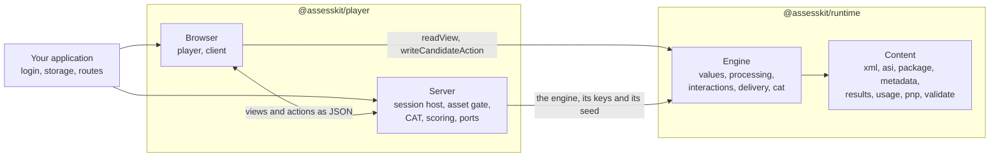

# assesskit

QTI 3.0 runtime and player for JavaScript and TypeScript: read, validate, score and deliver assessment items and tests, with adaptive testing. This repository holds a runtime that reads, writes, validates and executes QTI 3.0 assessments, a player that delivers them to candidates, and portable custom interactions that items may use.



## Which package

| Package                                                                                         | What it is                                                                                                                                                                                                                                                                                  |
| ----------------------------------------------------------------------------------------------- | ------------------------------------------------------------------------------------------------------------------------------------------------------------------------------------------------------------------------------------------------------------------------------------------- |
| [`@assesskit/runtime`](https://assesskit.wakan.dev/_assesskit/runtime/)                         | QTI 3.0 runtime for JavaScript and TypeScript: reads, writes, validates and scores assessment items, tests, content packages and results, converts items to and from GIFT and Moodle XML, and runs test sessions, adaptive ones included, without a user interface on a server or a device. |
| [`@assesskit/player`](https://assesskit.wakan.dev/_assesskit/player/)                           | QTI 3.0 player for JavaScript and TypeScript, built on @assesskit/runtime: renders the 20 standard interactions in the browser, hosts portable custom interactions, and serves test sessions and adaptive tests from a server.                                                              |
| [`@assesskit/custom-interactions`](https://assesskit.wakan.dev/_assesskit/custom-interactions/) | QTI 3.0 portable custom interactions for JavaScript and TypeScript: math entry for formulas in LaTeX and stroke writing for characters, each an AMD module that loads entirely from the item's package.                                                                                     |

```bash
npm install @assesskit/runtime
npm install @assesskit/player
npm install @assesskit/custom-interactions
```

assesskit holds no 1EdTech certification. What each package supports, and what it does not, is in
[Supported](https://assesskit.wakan.dev/_assesskit/runtime/supported/) for the runtime and
[Supported](https://assesskit.wakan.dev/_assesskit/player/supported/) for the player, and
[Conformance](https://assesskit.wakan.dev/_assesskit/runtime/conformance/) takes every feature ID of the 1EdTech conformance document
to its guide and its test. The claim is scoped: items differentially tested; test sessions specification-tested.

To read, validate, process or run QTI content in your own code or pipeline, use the runtime. To deliver tests to candidates in a
browser, use the player, which depends on the runtime.

The runtime owns what QTI defines that is not presentation or platform. The player owns presentation and the platform. The player
never evaluates an expression, decides what is visible or valid, chooses a variant, or holds an answer key outside the runtime's
solution view.

| Concern                                                                | runtime                             | player                                                                        |
| ---------------------------------------------------------------------- | ----------------------------------- | ----------------------------------------------------------------------------- |
| Reading, writing and validating content, packages, results, usage data | yes                                 | uses                                                                          |
| Response, template and outcome processing                              | yes                                 |                                                                               |
| Navigation, submission, time limits, attempts, variants                | the engine                          | applies it on a device, hosts it on a server                                  |
| Rendering, MathML, stylesheets, accessibility in the interface         |                                     | yes                                                                           |
| Portable custom interactions                                           | the data, the codec and the state   | loading and API                                                               |
| The candidate view, without answer keys                                | builds it                           | transports and shows it                                                       |
| External scoring, computer adaptive testing                            | requests, covers, scorer view, port | scorer interface, adapters to engines                                         |
| LTI 1.3 with grade services, Caliper                                   | results and events                  | ports; [interopkit](https://github.com/interopkit/interopkit) implements them |
| The validator command line                                             | yes                                 |                                                                               |

The two meet in JSON: views, actions and state, with values in a self-describing form, so nothing needs a declaration to be
decoded. On a server, the player hosts the runtime's engine: clients hold only views and send actions, and the answer keys and the
seed never leave. For practice, the engine runs in the browser. [Architecture](https://assesskit.wakan.dev/_assesskit/runtime/architecture/#boundary-with-the-player)
has the full list of who owns what, and [Delivery](https://assesskit.wakan.dev/_assesskit/runtime/delivery/#modes) the two modes.

## Documentation

The docs site, [assesskit.wakan.dev](https://assesskit.wakan.dev/), holds the READMEs, the guides and the API reference
generated by TypeDoc; `pnpm docs:api` builds it into `docs/api`.

| Where                                                                                                                                               | What it holds                                                                                          |
| --------------------------------------------------------------------------------------------------------------------------------------------------- | ------------------------------------------------------------------------------------------------------ |
| [Runtime guides](https://assesskit.wakan.dev/_assesskit/runtime/#documentation)                                                                     | One guide for each module of the runtime, with its architecture, performance, evidence and conformance |
| [Player guides](https://assesskit.wakan.dev/_assesskit/player/#documentation)                                                                       | One guide for each part of the player, with its architecture, size, evidence and the browser baseline  |
| [Custom interactions](https://assesskit.wakan.dev/_assesskit/custom-interactions/#documentation)                                                    | One guide for each interaction, with the architecture of the package                                   |
| [Supported: runtime](https://assesskit.wakan.dev/_assesskit/runtime/supported/), [player](https://assesskit.wakan.dev/_assesskit/player/supported/) | What each package supports, and what it does not                                                       |
| [Conformance](https://assesskit.wakan.dev/_assesskit/runtime/conformance/)                                                                          | Every feature ID of the 1EdTech conformance document, with its guide and its test                      |
| [Spec gaps](https://assesskit.wakan.dev/_assesskit/runtime/spec-gaps/)                                                                              | Where the specifications contradict themselves or are silent, and what the runtime does                |

## Development

Node.js 22.18+ and pnpm 12 are required. One command sets up the repository: `pnpm install`.

| Command                  | Does                                                                                      |
| ------------------------ | ----------------------------------------------------------------------------------------- |
| `pnpm lint`              | Biome and cspell                                                                          |
| `pnpm check:standards`   | The rules of the engineering standards that a tool can check                              |
| `pnpm check:duplication` | Fails on a repeat in `packages/*/src` that AGENTS.md does not list (jscpd)                |
| `pnpm typecheck`         | Every package, and the tooling at the root                                                |
| `pnpm test`              | Vitest, offline                                                                           |
| `pnpm test:browser`      | The tests of the player that need a browser; run `pnpm exec playwright install` first     |
| `pnpm test:corpus`       | Tests that read the corpus; run `pnpm corpus` first                                       |
| `pnpm test:xsd`          | Tests that validate against the XSDs; run `pnpm schemas` first                            |
| `pnpm bench`             | The benchmarks of the runtime against their budgets                                       |
| `pnpm knip`              | Unused files, exports and dependencies                                                    |
| `pnpm build`             | The built packages                                                                        |
| `pnpm check:packages`    | publint and Are the Types Wrong on the packed packages                                    |
| `pnpm compat:baseline`   | The built code of the player stays inside its browser baseline                            |
| `pnpm compat:engines`    | The smoke test in the pinned old browsers, in Docker                                      |
| `pnpm compat:runtimes`   | The built runtime gives the same results on Node.js, Deno, Bun and workerd                |
| `pnpm docs:api`          | TypeDoc into `docs/api`; fails on undocumented exports                                    |
| `pnpm check:site`        | The built docs site: titles, descriptions, canonical URLs, Markdown copies and `llms.txt` |
| `pnpm corpus`            | Downloads the 1EdTech examples and the W3C regular expression suite                       |
| `pnpm schemas`           | Downloads the published XSDs (about 140 MB) into `.cache/schemas`                         |
| `pnpm unicode`           | Regenerates the Unicode tables of the regular expressions                                 |

[AGENTS.md](https://github.com/assesskit/assesskit/blob/main/AGENTS.md) states the conventions, [CONTRIBUTING.md](https://github.com/assesskit/assesskit/blob/main/CONTRIBUTING.md) the process and
[SECURITY.md](https://github.com/assesskit/assesskit/blob/main/SECURITY.md) how to report a vulnerability and how to deploy safely.

## Layout

| Folder                          | Holds                                                                                                         |
| ------------------------------- | ------------------------------------------------------------------------------------------------------------- |
| `packages/runtime/`             | The QTI 3.0 runtime                                                                                           |
| `packages/player/`              | The player                                                                                                    |
| `packages/custom-interactions/` | The portable custom interactions and the build of their modules                                               |
| `docs/runtime/`                 | Guides of the runtime                                                                                         |
| `docs/player/`                  | Guides of the player                                                                                          |
| `docs/custom-interactions/`     | Guides of the custom interactions                                                                             |
| `examples/`                     | Runnable examples, each a package of its own, run by a test                                                   |
| `compat/`                       | Private packages: the browser baseline of the player, its lint and the pinned old browsers                    |
| `scripts/`                      | Corpus and schema downloads, the pinned corpus, the Unicode and element table generators, the standards check |
| `validation/`                   | Python scripts that write fixtures                                                                            |
| `biome/`                        | GritQL lint rules                                                                                             |

## License

[Apache License 2.0](https://github.com/assesskit/assesskit/blob/main/LICENSE). Copyright Fariz Wakan; see the NOTICE of each package.

QTI® is a trademark of 1EdTech® Consortium, Inc. (1edtech.org).
LTI® is a trademark of 1EdTech® Consortium, Inc. (1edtech.org).
Caliper Analytics® is a trademark of 1EdTech® Consortium, Inc. (1edtech.org).
W3C® is a trademark of the World Wide Web Consortium.
assesskit is not affiliated with, endorsed by or approved by 1EdTech Consortium, Inc. or W3C.
