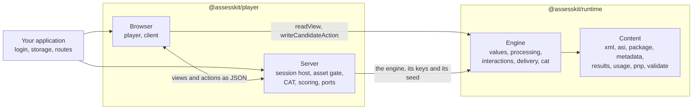

# assesskit

QTI 3.0 runtime and player for JavaScript and TypeScript: read, validate, score and deliver assessment items and tests, with adaptive testing.



## Which package

| Package                                                                                         | What it is                                                                                                                                                                                                                                                                                  |
| ----------------------------------------------------------------------------------------------- | ------------------------------------------------------------------------------------------------------------------------------------------------------------------------------------------------------------------------------------------------------------------------------------------- |
| [`@assesskit/runtime`](https://assesskit.wakan.dev/_assesskit/runtime/)                         | QTI 3.0 runtime for JavaScript and TypeScript: reads, writes, validates and scores assessment items, tests, content packages and results, converts items to and from GIFT and Moodle XML, and runs test sessions, adaptive ones included, without a user interface on a server or a device. |
| [`@assesskit/player`](https://assesskit.wakan.dev/_assesskit/player/)                           | QTI 3.0 player for JavaScript and TypeScript, built on @assesskit/runtime: renders the 20 standard interactions in the browser, hosts portable custom interactions, and serves test sessions and adaptive tests from a server.                                                              |
| [`@assesskit/custom-interactions`](https://assesskit.wakan.dev/_assesskit/custom-interactions/) | QTI 3.0 portable custom interactions for JavaScript and TypeScript: math entry for formulas in LaTeX and stroke writing for characters, each an AMD module that loads entirely from the item's package.                                                                                     |

```bash
npm install @assesskit/runtime
npm install @assesskit/player
npm install @assesskit/custom-interactions
```

To read, validate, process or run QTI content in your own code or pipeline, use the runtime. To deliver tests to candidates in a
browser, use the player, which depends on the runtime. assesskit holds no 1EdTech certification: the claim is scoped, items
differentially tested and test sessions specification-tested, and
[Conformance](https://assesskit.wakan.dev/_assesskit/runtime/conformance/) takes every feature ID of the 1EdTech conformance
document to its guide and its test.

The runtime owns what QTI defines that is not presentation or platform; the player owns presentation and the platform.

The two meet in JSON: views, actions and state, with values in a self-describing form that needs no declaration to decode. On a
server the player hosts the engine, so clients hold only views and send actions, and the answer keys and the seed never leave;
for practice the engine runs in the browser. [Architecture](https://assesskit.wakan.dev/_assesskit/runtime/architecture/#boundary-with-the-player)
lists who owns what for each concern, and [Delivery](https://assesskit.wakan.dev/_assesskit/runtime/delivery/#modes) the two modes.

## Documentation

The docs site, [assesskit.wakan.dev](https://assesskit.wakan.dev/), holds the READMEs, the guides and the API reference
generated by TypeDoc; `pnpm docs:api` builds it into `docs/api`.

| Where                                                                                                                                                                                                                                             | What it holds                                                                                          |
| ------------------------------------------------------------------------------------------------------------------------------------------------------------------------------------------------------------------------------------------------- | ------------------------------------------------------------------------------------------------------ |
| [Runtime guides](https://assesskit.wakan.dev/_assesskit/runtime/#documentation)                                                                                                                                                                   | One guide for each module of the runtime, with its architecture, performance, evidence and conformance |
| [Player guides](https://assesskit.wakan.dev/_assesskit/player/#documentation)                                                                                                                                                                     | One guide for each part of the player, with its architecture, size, evidence and the browser baseline  |
| [Custom interactions](https://assesskit.wakan.dev/_assesskit/custom-interactions/#documentation)                                                                                                                                                  | One guide for each interaction, with the architecture of the package                                   |
| Supported: [runtime](https://assesskit.wakan.dev/_assesskit/runtime/supported/), [player](https://assesskit.wakan.dev/_assesskit/player/supported/), [custom interactions](https://assesskit.wakan.dev/_assesskit/custom-interactions/supported/) | What each package supports, and what it does not                                                       |
| Choosing: [runtime](https://assesskit.wakan.dev/_assesskit/runtime/choosing/), [player](https://assesskit.wakan.dev/_assesskit/player/choosing/), [custom interactions](https://assesskit.wakan.dev/_assesskit/custom-interactions/choosing/)     | When each package fits, and what other libraries have that it lacks, with dates                        |
| Evidence: [runtime](https://assesskit.wakan.dev/_assesskit/runtime/evidence/), [player](https://assesskit.wakan.dev/_assesskit/player/evidence/), [custom interactions](https://assesskit.wakan.dev/_assesskit/custom-interactions/evidence/)     | The counts of tests with their commit and date, the references and the comparisons                     |
| [Conformance](https://assesskit.wakan.dev/_assesskit/runtime/conformance/)                                                                                                                                                                        | Every feature ID of the 1EdTech conformance document, with its guide and its test                      |
| [Spec gaps](https://assesskit.wakan.dev/_assesskit/runtime/spec-gaps/)                                                                                                                                                                            | Where the specifications contradict themselves or are silent, and what the runtime does                |

## Development

Node.js 22.18+ and pnpm 12 are required. One command sets the repository up and, in a git clone, installs the git hooks:

```bash
pnpm install
```

[AGENTS.md](https://github.com/assesskit/assesskit/blob/main/AGENTS.md) lists every command with the gate it runs and the
conventions, [CONTRIBUTING.md](https://github.com/assesskit/assesskit/blob/main/CONTRIBUTING.md) the process and which gates a
change runs, and [SECURITY.md](https://github.com/assesskit/assesskit/blob/main/SECURITY.md) how to report a vulnerability and
deploy safely.

## Layout

| Folder                          | Holds                                                                                                                  |
| ------------------------------- | ---------------------------------------------------------------------------------------------------------------------- |
| `packages/runtime/`             | The QTI 3.0 runtime                                                                                                    |
| `packages/player/`              | The player                                                                                                             |
| `packages/custom-interactions/` | The portable custom interactions and the build of their modules                                                        |
| `docs/runtime/`                 | Guides of the runtime                                                                                                  |
| `docs/player/`                  | Guides of the player                                                                                                   |
| `docs/custom-interactions/`     | Guides of the custom interactions                                                                                      |
| `examples/`                     | Runnable examples, each a package of its own, run by a test                                                            |
| `compat/`                       | Private packages: the browser baseline of the player, its lint and the pinned old browsers                             |
| `scripts/`                      | Downloads with their pins, the generators of the Unicode and element tables, the checks of CI, the guide-sample runner |
| `validation/`                   | Python scripts that write fixtures                                                                                     |
| `biome/`                        | GritQL lint rules                                                                                                      |

## License

[Apache License 2.0](https://github.com/assesskit/assesskit/blob/main/LICENSE). Copyright Fariz Wakan; see the NOTICE of each package.

QTI® is a trademark of 1EdTech® Consortium, Inc. (1edtech.org).
W3C® is a trademark of the World Wide Web Consortium.
assesskit is not affiliated with, endorsed by or approved by 1EdTech Consortium, Inc. or W3C.
