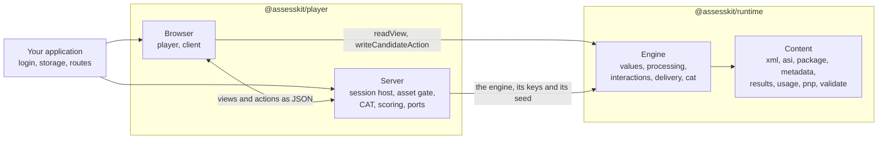

# assesskit

TypeScript packages for QTI 3.0 assessments: a runtime that reads, writes, validates and executes them, and a player that
delivers them to candidates.

| Package                                            | What it is                                                                                                                                                                                                                                                  |
| -------------------------------------------------- | ----------------------------------------------------------------------------------------------------------------------------------------------------------------------------------------------------------------------------------------------------------- |
| [`@assesskit/runtime`](packages/runtime/README.md) | Reads, writes, validates and executes everything in QTI 3.0 that is not presentation or platform, with a headless delivery engine that serves exams on a server and practice on a device.                                                                   |
| [`@assesskit/player`](packages/player/README.md)   | Rendering, the host of portable custom interactions, accessibility applied in the interface, and the server-side session host and integrations. It uses the runtime only through its published subpaths. Its README says what the current version contains. |

To read, validate, process or run QTI content in your own code or pipeline, use the runtime. To deliver tests to candidates in a
browser, use the player, which depends on the runtime.

assesskit is not certified by 1EdTech. What each package supports, and what it does not, is in
[Supported](docs/runtime/supported.md) for the runtime and [Supported](docs/player/supported.md) for the player, and
[Conformance](docs/runtime/conformance.md) takes every feature ID of the 1EdTech conformance document to its guide and its test.
The claim is scoped: items differentially tested; test sessions specification-tested.

## How the two packages split

The runtime owns what QTI defines that is not presentation or platform. The player owns presentation and the platform. The player
never evaluates an expression, decides what is visible or valid, chooses a variant, or holds an answer key outside the runtime's
solution view.

| Concern                                                                | runtime                             | player                                                                        |
| ---------------------------------------------------------------------- | ----------------------------------- | ----------------------------------------------------------------------------- |
| Reading, writing and validating content, packages, results, usage data | yes                                 | uses                                                                          |
| Response, template and outcome processing                              | yes                                 |                                                                               |
| Navigation, submission, time limits, attempts, variants                | the engine                          | applies it on a device, hosts it on a server                                  |
| Rendering, MathML, stylesheets, accessibility in the interface         |                                     | yes                                                                           |
| Portable custom interactions                                           | the data, the codec and the state   | loading and API                                                               |
| The candidate view, without answer keys                                | builds it                           | transports and shows it                                                       |
| External scoring, computer adaptive testing                            | requests, covers, scorer view, port | scorer interface, adapters to engines                                         |
| LTI 1.3 with grade services, Caliper                                   | results and events                  | ports; [interopkit](https://github.com/interopkit/interopkit) implements them |
| The validator command line                                             | yes                                 |                                                                               |

The two meet in JSON: views, actions and state, with values in a self-describing form, so nothing needs a declaration to be
decoded. On a server, the player hosts the runtime's engine: clients hold only views and send actions, and the answer keys and the
seed never leave. For practice, the engine runs in the browser. [Architecture](docs/runtime/architecture.md#boundary-with-the-player)
has the full list of who owns what, and [Delivery](docs/runtime/delivery.md#modes) the two modes.

## Development

Node.js 22.18+ and pnpm 12 are required. One command sets up the repository: `pnpm install`.

| Command                | Does                                                                                  |
| ---------------------- | ------------------------------------------------------------------------------------- |
| `pnpm lint`            | Biome and cspell                                                                      |
| `pnpm check:standards` | The rules of the engineering standards that a tool can check                          |
| `pnpm typecheck`       | Every package, and the tooling at the root                                            |
| `pnpm test`            | Vitest, offline                                                                       |
| `pnpm test:browser`    | The tests of the player that need a browser; run `pnpm exec playwright install` first |
| `pnpm test:corpus`     | Tests that read the corpus; run `pnpm corpus` first                                   |
| `pnpm test:xsd`        | Tests that validate against the XSDs; run `pnpm schemas` first                        |
| `pnpm bench`           | The benchmarks of the runtime against their budgets                                   |
| `pnpm knip`            | Unused files, exports and dependencies                                                |
| `pnpm build`           | The built packages                                                                    |
| `pnpm check:packages`  | publint and Are the Types Wrong on the packed packages                                |
| `pnpm compat`          | The built code of the player stays inside its browser baseline                        |
| `pnpm compat:engines`  | The smoke test in the pinned old browsers, in Docker                                  |
| `pnpm docs:api`        | TypeDoc into `docs/api`; fails on undocumented exports                                |
| `pnpm corpus`          | Downloads the 1EdTech examples and the W3C regular expression suite                   |
| `pnpm schemas`         | Downloads the official XSDs (about 140 MB) into `.cache/schemas`                      |
| `pnpm unicode`         | Regenerates the Unicode tables of the regular expressions                             |

[AGENTS.md](AGENTS.md) states the conventions, [CONTRIBUTING.md](CONTRIBUTING.md) the process and
[SECURITY.md](SECURITY.md) how to report a vulnerability and how to deploy safely.

## Layout

| Folder              | Holds                                                                                                         |
| ------------------- | ------------------------------------------------------------------------------------------------------------- |
| `packages/runtime/` | The QTI 3.0 runtime                                                                                           |
| `packages/player/`  | The player                                                                                                    |
| `docs/runtime/`     | Guides of the runtime                                                                                         |
| `docs/player/`      | Guides of the player                                                                                          |
| `examples/`         | Runnable examples, each a package of its own, run by a test                                                   |
| `compat/`           | Private packages: the browser baseline of the player, its lint and the pinned old browsers                    |
| `scripts/`          | Corpus and schema downloads, the pinned corpus, the Unicode and element table generators, the standards check |
| `validation/`       | Python scripts that write fixtures                                                                            |
| `biome/`            | GritQL lint rules                                                                                             |

## License

[Apache License 2.0](LICENSE). QTI and 1EdTech are trademarks of 1EdTech Consortium, Inc.; see the NOTICE of each package.
