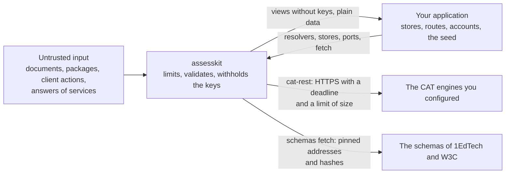

# Security

Report vulnerabilities privately through the repository's security advisory form rather than a public issue. Include the
version, the document or the sequence of actions that shows the problem, and what it lets an attacker do.

Every input is untrusted: packages, documents, personal needs profiles, results, candidate responses, client actions and what
callbacks and resolvers return. The sections below state the controls of the runtime and what a deployment adds; the sections that
start with the player state those of the player.

## Points to be aware of when deploying

The points below are the runtime's; the sections that start with "The player" hold the player's.

- **No I/O.** The runtime core reads no files, makes no network requests, reads no environment variables, reads no clock and
  runs no code it is given. Only the `node` and `cli` modules use Node.js. `node` reads only the paths it is given.
- **No fetching.** Absolute URLs in content are data. The core never fetches them, and callers supply the callbacks that
  resolve references. The only network access in the runtime is the command `assesskit schemas fetch`: it downloads the addresses of
  `SCHEMA_FILES`, which the command line cannot change, and writes a file only when its SHA-256 is the pinned one. A server
  that does not answer or stops sending for 30 seconds cannot hold the command: the download is aborted and tried again twice
  at most.
- **CAT engines.** The core never calls a CAT engine. `qti-adaptive-engine-ref` names the URL prefix of an engine, so a
  document chooses where a host sends a candidate's results. A host that implements `CatPort` checks the prefix against
  the engines it trusts before it sends a request.
- **Untrusted input.** Every input is untrusted: documents, packages, actions and what callbacks return. Entry points
  validate their input and throw `DataError` on malformed data, so data from users or files can be passed in directly.
- **Randomness.** `createRandom` is a seeded generator whose draws are reproducible from the seed. It is not
  cryptographically secure. Selections and shuffles that use it can be reproduced by anyone who knows the seed, so keep the
  seed of an exam session on the server.
- **Regular expressions.** Patterns that authors write, such as `qti-pattern-match` and `pattern-mask`, run on a
  linear-time automaton, never on a backtracking `RegExp`, so no pattern or text can make a match take exponential time.
  `compileXsdRegex` limits the size of the automaton (`maxStates`) and the nesting of the pattern (`maxDepth`); both have
  defaults and a `DataError` reports a pattern above them. The time of a match is linear in the text and the memory a
  match keeps is bounded, whatever the pattern.
- **Processing.** Processing runs no code it is given: a custom operator is a function the caller registers, and what it
  returns is checked like any input. `qti-template-constraint` runs template processing at most 100 times (INFO section 5.150),
  and a container that an expression builds, such as the result of `qti-repeat`, is limited by `maxContainerSize`; a
  larger one is a `SecurityError`. Expressions are no deeper than the document they were read from, which `maxDepth`
  limits.
- **Portable custom interactions.** The core runs no PCI code: module locations are data, and loading and sandboxing the
  modules is the player's. `readModuleResolution` reads JSON only, and a module id such as `__proto__` stays data in a
  `Map`. `decodePciValue` checks everything a module returns before it becomes a value, and refuses a file that is not
  `{ data, mime, name }` and a duration with years or months; the bytes of a file go to a callback of the host and never
  into a value. A package path from a configuration file is still untrusted: the host serves only paths of the package.
- **Other platforms' item formats.** `readGift` and `readMoodleXml` take a file from anywhere; `readMoodleXml` reads it with
  `parseXml`, so a DOCTYPE is refused and the limits of XML hold. It parses the HTML of each text with parse5, as a
  browser does, and keeps only QTI's elements and their attributes of a valid value, and `data-*` attributes: `script`,
  `style`, `iframe`, forms and other documents are left out with what they hold, and an attribute such as `onclick` or `style`
  is left out. It refuses a text of more tags than `maxTextTags` before it parses it, since the parser of HTML mends tags that
  close out of order in time that grows with the square of an element's children. `writeGift` runs each item's response
  processing on the responses that tell its credits apart, under the limits of processing, and calls only the custom
  operators that its caller registers.
- **Printed variables.** A `format` runs on the runtime's own arithmetic, over the exact value of the number, and a width or
  precision above 1,100 is ignored, so that a document cannot make the formatter allocate gigabytes.
- **XML.** `parseXml` rejects every DOCTYPE with a `SecurityError`, so no entity is declared, expanded or read (XXE and
  entity expansion, BPIG section 6.7). It reads only the five predefined entities and character references. It also limits the
  document before and while it builds the tree, and refuses what the parser lets through and a tree could not keep: a lone
  surrogate, a namespace declaration with white space at its start or end, and a qualified name that is not made of two
  names. `resolveIncludes` calls only the resolver the caller passes, rejects `xpointer`, detects loops and counts the nodes
  of the result.
- **Schemas.** The runtime ships no schema. `loadSchemaSet` checks the SHA-256 of every file it reads against the list in
  `SCHEMA_FILES`, and again when it compiles a file. `validateXmlFiles` parses every document with `parseXml` first and
  runs libxml2 with network access and external entities off. A document has no way to name another schema file than the
  pinned ones.
- **Validation.** A validation lists at most `maxFindings` issues, 1,000 by default, over every document it checks, and ends a
  longer list with the error `assesskit/validate/findings-stopped` instead of throwing. Content that is wrong at every
  element of a document at the XML limits makes an issue for each element, up to 300,000 of them, and a package of such
  documents, small once compressed, would hold gigabytes of them. libxml2 still reports every violation of the schema to
  `validateXmlFiles`, so such a document takes minutes there; validate untrusted uploads off the request path.
- **Command line.** `assesskit validate` reads the path it is given and the schema directory, and no other file: an `xi:include`
  of a lone document is not resolved. It refuses a package that breaks a rule of **Packages** below, and an XML file above
  `maxBytes` of `parseXml` before it reads the file, with the exit code 2.
- **Packages.** `readPackage` and `readPackageFile` check a package before they read a file of it (section 2.6, BPIG section 6.7). An archive
  entry whose name is absolute, leaves the package with `..`, or has a backslash, a drive letter or a control character
  rejects the archive (zip-slip), as do two entries with one normalized name, a symbolic link, and an encrypted entry. The
  entry count, the size of the central directory, the declared sizes and the compression ratio are checked from the central
  directory, and the bytes are counted again while an entry inflates, so that a header that understates a size cannot make the
  output larger. `readPackageFile` reads a ZIP file by ranges, the end of the file and its central directory when it opens and the
  bytes of an entry when it is read, so that memory follows the directory and the largest entry opened, and not the size of the
  file. A ZIP file that changes while its package is open gives a `ReadError` or the bytes that it holds then, never more than
  the size an entry declared. A package directory is
  read with `lstat` and `realpath`: a symbolic link or a file that is not a regular file rejects it, and a file replaced by a
  link after the listing is not followed. A reference in a document that leaves the package, and an `xi:include` that names a
  file outside it, are never resolved; a file that many includes of a document name is read and parsed once. A package
  directory that another process can change while the runtime reads it is not protected against a race.
- **Server mode.** The answer keys and the seed of an exam session must not reach the candidate's device. Run the engine on
  the server and send the client views only: the view is built field by field from an allowlist, with no correct response
  (outside the solution state the item session control allows), processing, mapping, outcome or template value, hidden
  content or metadata but the hazards, and a property test searches every view of random sessions for marked key material.
  In device mode the engine, the items with their keys and the seed are in the client, which is fit for practice only.
  `createRandom` is not cryptographic: selections and shuffles are reproducible from the seed.
- **Client actions.** `readCandidateAction` checks the shape, the types and the size of an action from a client (see
  **Default limits**) and refuses the actions of the host (`time`, `supply-scores`, `cat-response`) and any `at`; the server
  stamps the time. The engine checks every action against the rules and answers a refusal, never a state change, and an
  out-of-range integer response is a refusal. `support-settings` changes only the preferences of a support that is on
  (`ADJUSTABLE_SETTINGS`), so a client cannot lift a restriction of reading aloud or turn on a support of the profile, and its
  settings hold the parameters of the support and no other property. The engine does not decide which candidate actions a client may send: it
  applies `suspend` and `resume`, which stop the clock, from whoever sends them, so a deployment that must not let candidates
  pause filters them before it applies them (the exam default of the player does).
- **Names that reach the prototype.** A reader of untrusted input refuses a property named `__proto__`, `prototype` or
  `constructor` with a `DataError`, as a schema's objects would drop it unseen and an assignment would misread it: at any depth
  in an action, an assessment result, the content of a view or a submission, and the body of a request and the answer of an
  engine or a token endpoint in CAT; and on the object it reads in an item stage, a key of `compileScoring`, a call of
  `buildOperatorCall` and a module resolution file. A name that is data stays data, in a `Map` or a list of entries: the
  identifier of an option in `points`, a module id, a variable. The prefixes of the assets of an envelope are directories, so
  only a name that ends in `/` can hold such a word.
- **Readers of trusted input.** `deserializeState` and `readView` have no limit of size, because what they read is not input of
  a client: the first reads the state that `serializeState` wrote, from the host's own store, and the second the view that the
  host's server built with `writeView`. Both check the form strictly (the version and the type of every field, and the depth of
  the content of a view), and the engine built what they read from actions that passed `readCandidateAction` and from documents
  that passed the XML limits. A host never passes them a state or a view that a user or a client sent, and keeps its store as
  private as the seed it holds. A practice session whose state sits in the browser of the candidate reads a state that the
  candidate can change, which matters for nothing but their own practice. A host that must read a state or a view of unknown
  origin parses its text with a limit of its own first, because the memory of `JSON.parse` follows the tokens.
- **Resolvers and callbacks.** The functions a host passes in (`resolvers`, `resolveTemplate`, `customOperators`, the file
  callbacks of PCI values, `CatPort`) are the host's code and run with its authority. What they return is data and is checked
  where it is used. A resolver returns its value synchronously.
- **Scoring.** `scorerView` holds the correct responses. In exam mode it belongs on the server: `SessionHost.session(id)` gives
  full host powers and the correct responses for a bare session identifier, so call it only from the host's rater and service
  endpoints and never with an identifier that a candidate supplies. In practice the device holds the keys already, and
  `LocalSession.host` offers it by design. `supply-scores` is a host action: accept a score only from the scorer or the tool it
  belongs to.
- **Review after the end.** An ended session accepts no action of the candidate, unless the engine is built with
  `reviewAfterEnd`. The option opens the answers of every presented item to the candidate after an exam, as `allow-review`
  of each item allows, and the correct responses where `show-solution` allows: build such an engine on purpose, for a program
  that releases results, and never for a live exam. The engine then reads a state that names a content version only when it
  names the same one, so that a review cannot show content that the candidate did not sit.
- **Scores in events.** The events of a step hold no score. With the engine option `eventOutcomes`, `response-processed`
  carries the outcomes of the item, scores included, to `forward.log` of a session host and to the listeners of
  `subscribeSteps` of a local session, and never to a candidate, who receives views. The host's log, outbox and event sinks
  then hold scores: keep them as it keeps results. `attempt` and `duration` are always present and hold no score.

## The player: the frame of portable custom interactions

A portable custom interaction is code of the package, and it runs in the candidate's browser. The player runs each one in an
`iframe` with `sandbox="allow-scripts"` and no `allow-same-origin`, so the code has an opaque origin: no cookie, storage or
access to the player. The frame sends no referrer, so the code does not learn the address of the page. The frame restricts itself with a content security policy before it loads the code: no connection,
frame, form or `base`, no inline script and no `eval`, and scripts, styles, images, media and fonts only from the asset
origin and the origins the host allows. The frame refuses to start where the browser does not apply the policy.

- Serve `pci-frame/*` and `player.css` from the asset origin, outside the asset gate. They hold no package data.
- Put the origin of `staticUrl` in the `frame-src` of the page that mounts the player. A module can navigate its own frame,
  and that directive stops it from going to another site.
- Allow other origins in `origins` only for hosts that you trust to serve scripts.
- The code is visible to the candidate: keep answer keys in response processing, which the asset gate never serves.
- The policy cannot stop WebRTC or a DNS prefetch, so a module can still send out what the frame holds: its response, its
  state, its markup and the template and context variables bound to it. Bind no personal data to a context variable of an
  interaction whose package you do not trust.
- A module may post messages at any rate and size. Each response goes to the session in `set-responses`, and each new file
  in one goes to `files.upload`: limit the requests and the stored files of a session on the host, and give the remote client
  the `limits` of the session host, so that it refuses a state above `maxPciStateLength` before it sends it.
- Serve `pci-frame/*` from the version of the package that the page runs: a frame from another version may not answer a
  request of the player, which then waits two seconds before an action leaves the item.

## The player: the interactions

An upload interaction can record the candidate's voice, and a WAV recording loads a script into an audio worklet.

- The microphone is asked for when the candidate presses Record in an upload interaction, or when the countdown of an item with
  `data-ak-record-start` begins, and a visible indicator shows while it records. A recording that is under way when the
  candidate leaves the item, or when its time ends, is stopped and its bytes go to the host: the response already names the
  file. Set `hooks.record` to `false` in `mountItem` or `mountDelivery` to offer no recording.
- Put the origin of `staticUrl` in the `script-src` of the page, because a worklet is a script. `recorder-worklet.js` holds no
  package data and reaches no network; serve it from the asset origin, like `pci-frame/*`.
- Recordings and files go only to the host's storage, through `files.fill` and `files.upload`; the state and the results hold
  references. The player writes nothing to `localStorage`.
- The editor of an XHTML answer writes only `p`, `br`, `strong`, `em`, `u`, `ul`, `ol`, `li`, `sub` and `sup`, with no attribute, and a
  response that holds anything else is shown as its text. A host that shows a response to a rater treats it as it treats
  any answer: untrusted text.

## The player: the session host and the asset gate

In an exam the engine, the seeds and the answer keys stay on the server ([server.md](docs/player/server.md)). The
browser code imports only the wire functions of the runtime's `delivery`, and a test fails if the bundle of the player and the remote
session holds any file of the engine. Practice runs the engine on the device, so its keys are visible there.

- The host parses the body of a request, so it limits the size of the body before `JSON.parse`
  ([server.md](docs/player/server.md#handling-a-request)): `limits` of `readCandidateAction` counts what the parse has built.
- The host's authentication gives `{ session, principal }` to every call. Envelopes carry no session identifier, and a
  request for a session that is not bound to the principal, or that does not exist, is the same `AccessError`: map it to 403
  and tell nothing else. `start` never rebinds a session.
- A client may not send `suspend` or `resume` in an exam, because the runtime counts suspended time nowhere. Breaks are the proctor's,
  except for a candidate whose profile has breaks (`environment` with `breaks`), who may pause as CERT asks; a program that wants
  every break through the proctor sets `profileBreaks: false`. The profile comes from the host, never from the client.
  Keep the proctor's and the scheduler's endpoints away from candidates. `maxIdleMs` counts a long gap as a suspension, so
  `createSessionHost` refuses it unless `clientActions` has `suspend`; an exam never sets it.
- The stores must make `create` and `save` atomic across processes, so that a version conflict is a conflict and a session is
  started once.
- Serve package files only through the asset gate ([asset-gate.md](docs/player/asset-gate.md)), from an origin
  without cookies. A token is in the path and names a session, a prefix and an expiry (an hour by default). The gate sends
  `Referrer-Policy: no-referrer` and `X-Content-Type-Options: nosniff`, and `Content-Security-Policy: sandbox` on every
  package file except a PDF, so that a page or a drawing of a hostile package runs no script on the asset origin when a
  link opens it in a tab; do not strip them. Keep the HMAC key out of the browser and rotate it to end every token.
- The gate never serves the manifest, a file of a QTI resource type, a file that an adaptive section names, or an XML file in a
  namespace of QTI data. Keys stay safe by type and content, not by what a view references: a file under a prefix that no view
  references is served, so keep one folder for each item and its media.
- The files of the candidate have tokens of their own, valid for five minutes, and are served in a sandbox.

## The player: CAT engines

`createRestCatPort` of `@assesskit/player/cat-rest` sends a candidate's results and an OAuth bearer token to a remote engine, so
it is built to send them only to the engines that the host configured.

- It serves the engines that the host configures in `engines`, by reference. The `qti-adaptive-engine-ref` of a package is the
  package's word, and it only selects among those engines: a reference that `engines` does not know is a `DataError`, and
  nothing leaves, no candidate data and no token. A function for `engines` is an allowlist from known references to configured
  engines. It never builds an endpoint or a token URL from the reference, and never returns shared credentials for any
  reference: the port sends the client secret and the candidate's data wherever the function points.
- The endpoint and the token URL must be `https`. Redirects are errors, so a redirect cannot carry the token to another
  address or from HTTPS to HTTP. Every request is aborted after `timeoutMs`.
- An answer has at most `maxTokens` tokens of JSON (a million by default), counted before the parse, whose memory follows the
  tokens: 32 MiB of empty objects took 850 MiB without the count. The answer is read whole, so its bytes are the engine's to
  keep within reason, and the host's `fetch` can cap them.
- The personal needs and preferences of a candidate go only to an engine with `sharePnp: true`.
- The client secret goes only to the token URL of its engine, as HTTP Basic credentials. A token is kept for each token URL,
  client and scope, so engines never share one.
- The client secret stays on the server. `cat-rest` is the one folder that takes it, no shared or browser folder of the
  package imports it (lint), and a test checks that the bundles of the candidate and of practice hold none of its files. A
  host's own page is out of the library's sight: keep `credentials` and the import of `@assesskit/player/cat-rest` out of
  it. A page that runs an adaptive section in practice brings its own `CatPort` and deploys with `deployCatSections` of
  `@assesskit/player/cat`.

`createCatRestHandler` is the other end: the engine side of the binding, which receives a candidate's results and answers with the
items to present. It trusts nothing it is sent.

- It serves nothing without the host's `authorize`, which it calls with the request and the operation before it reads a
  body, so that a caller who is not authorized costs one function call. Only `true` or the port of the caller authorizes; a
  callback that throws, or answers anything else, answers 500. A token that lacks the scope of the operation answers 403 and an
  invalid one 401. The handler holds no secret and issues no token, and the host terminates TLS in front of it.
- The handler does not know who a client is. A host that serves several clients on one root answers with the port of the
  caller, built over the shared engine with a check of the owner of every section and session. Without it every client with a
  valid token can read and end every section, and the guide shows the pattern.
- A body must be `application/json`, at most `maxBodyBytes` (32 MiB by default), counted as it arrives, with at most
  `maxTokens` tokens of JSON (a million by default), counted before the parse, whose memory follows the tokens, and valid UTF-8 and
  JSON. A body above a limit is the `SecurityError` of that limit, which the handler answers with 413. Each body is read with
  a strict schema of the binding, so an unknown property is a 400; the assessment result is read by the runtime's codec.
- The status follows the origin of an error. What the caller sent wrong is a 400 that names the path of the caller's own value.
  An error of the port is never shown: a `ServiceError` of status 400, 404 (not for Create Section), 429 or 503 is the refusal that
  the binding has for it, with a fixed text, and any other error, a `DataError` of a gateway that names its upstream address
  among them, is a 500 with a fixed text. Every answer is `Cache-Control: no-store`. The handler logs nothing: `onError` gets
  the error behind every 500, which may hold addresses, tokens or candidate data, so the host decides where it goes.
- The `prefix` that the port receives is set by the host for a public deployment. Without it the handler takes the origin of
  the request, which many servers build from the `Host` header, so a port must not treat it as an identity.
- A request that is aborted ends the wait, cancels the read of the body, and is not answered; the call of the port that has
  begun runs on.

An engine that the host runs in process, behind the runtime's `CatPort`, sends nothing. The `sessionState` that it returns is kept
in the delivery state, so keep it on the server like the seed of an exam session, and keep the engine's own store of the
parameters of the items and the settings of the test there too.

## The player: external scoring

A `Submission` of `buildSubmission` carries what a rater needs to score a response, which includes the correct responses of the
items, the rubric for the scorer and the scoring rubric of the outcome ([scoring.md](docs/player/scoring.md)).

- Give a submission only to authorized raters, through an endpoint that checks the rater: never in a candidate's view, in the
  candidate's session or to the candidate's browser. It is not a view of the candidate.
- `mountSubmission` draws the content of a submission with the renderer of the player, so the content is sanitized as a
  candidate's is. It draws a file that a candidate submitted as an image, audio, video or a link, and never in a frame, because
  the candidate chose its bytes and its media type. The URL of a file comes from the host's `files.url`, which must give an
  `http` or `https` URL. Serve the files of candidates from an origin that is not the host's page, with `nosniff` and a
  `Content-Disposition` that downloads what the display does not play.
- The text of a response is data: the display sets it as text and never as markup.
- `Submission.scoringRubric` goes only to authorized raters, with the rest of the submission: the candidate's view and
  envelopes hold none of its text. `mountRatingForm` sets the texts of the rubric as text, never as markup. The ratings that
  a rater's page sends back are untrusted input: the server computes the score again with `rubricScore` of the runtime
  from the rubric of its own state, and passes it to `buildSupplyScores`.
- `buildSupplyScores` checks a score against the declaration, but the host decides who may score. The engine
  trusts a score it is given, so authenticate the rater and log who supplied it.

## The player: content

The content of an item comes from a package and is untrusted. The renderer builds it with `createElementNS` from the runtime's typed
nodes and never with `innerHTML`, and keeps only the attributes listed in
[content](docs/player/content.md#attributes): no event handler, no `style`, no attribute of another namespace.
An element of any namespace but MathML, SSML and CML is left out with what it holds, so a script, an SVG or a frame in
the content is not built, even from a view that a reader of the runtime would have refused. A reference goes through one policy:
a path in the package is resolved and given to `assets`, an origin must be listed in `origins`, and `javascript:`, `vbscript:`,
`blob:` and every `data:` URL but a raster image are refused. A file embedded by an `object` runs nothing: a page is in a
frame with an empty `sandbox`, and a file of another type is a link.

Item stylesheets are fetched with no credentials and no referrer and are cleaned on their parsed rules (`@import`, rules
for `:host`, and every `url()` and loader outside the stylesheet's origin and `origins` go), and they are adopted into the
shadow root of the item only. Because the root's host has `contain: layout paint` and `isolation: isolate`, the
fixed-position CSS of an item cannot cover the page.

Serve the files of a package from an origin of their own and put it, and the origins in `origins`, in the `img-src`,
`media-src`, `font-src`, `frame-src` and `connect-src` of the page (the last for the stylesheets), and answer the
stylesheets with CORS headers. A page with a strict `style-src` needs nothing for item stylesheets: they are constructed
sheets, not `<style>` elements or attributes.

## The player: MathJax and speech

MathJax is code that the host chooses and serves: the player loads the script from the URL it is given and bundles none. Serve
MathJax and its fonts from the asset origin, from the files of the pinned version of the npm package `mathjax`, and put
that origin in the `script-src`, `font-src` and `connect-src` of the page and `blob:` in its `worker-src`
([math](docs/player/math.md#serving-mathjax)). The player sets MathJax's fonts to the host, so that it reaches no CDN. A
page loads MathJax from one URL.

A speech request is made from the content of the page and goes to the voice of the host. The `ssml` holds only the SSML
elements and attributes of SSML 1.1 that the ASI schema allows, with every value escaped, and an `audio` keeps its source
only for an `http` or `https` URL. Lexicons are parsed by the runtime's XML reader, with its limits, and become `sub` and `phoneme`
in the request, so that a voice fetches no lexicon.

## The player: the LTI frame and the ports

The player shows the tool of an LTI item in a frame, but it launches nothing: the host's route answers the player's `ltiLogin`
hook with a frame, and the library that the host chose builds it ([LTI items](docs/player/lti-items.md)). A tool is code of
another party, and its frame has `allow-same-origin`, so that the tool keeps its own storage.

- The frame of a tool has `sandbox="allow-scripts allow-forms allow-same-origin"`, `referrerpolicy="no-referrer"`, the `allow`
  list of the registration and no other permission. The player refuses a tool or a storage page that is served from the origin
  of the page or of the assets, because a tool with `allow-same-origin` there would have the player's own origin.
- The player checks the first URLs of the frames only; where a tool then navigates its frame, its login included, only the
  `frame-src` of the page limits. Serve the platform's LTI endpoints from an origin other than the page's, as the storage page
  is, and add to `frame-src` their origin and the tools', not the page's own.
- The player checks what the hook answers: absolute `http` or `https` URLs and an allow list of letters, digits, spaces and
  `; * : / . ' -`. A `javascript:` or `data:` URL is never a frame URL.
- The hook takes a `signal` that aborts when the candidate leaves the item, and the player drops an answer that comes late.
- The ports `forward.log` and `createToolScoreIntake` receive data that the host's adapter already checked. The intake supplies
  only a `final` score, keeps the latest by `timestampMs`, and trusts the adapter to bind a score to the session and the item of
  its launch. `buildSessionScore` reads a report only if the session host branded it as official.
- The hints, the line item identifiers and the tokens of a library are the library's: see its security notes.

## Default limits

Every limit is a positive integer that a caller can replace per call, field by field, with the option named above its table;
a limit left out keeps its default. Input over a limit is a `SecurityError` whose `limit` is the limit's name, except a
regular expression, which is a `DataError` from `compileXsdRegex` and a `ProcessingError` in processing. Each default is a safety factor over the largest value among the
1EdTech QTI 3.0 examples, where the examples have one, and the factor is as large as the memory allows: the limits are set so that the worst
input within all of them peaks at 224 MiB of heap or less in every reader, under a budget of 256 MiB ([Peak memory](#peak-memory)).

XML (`XmlLimits`; option `limits` of `parseXml`, `resolveIncludes`, `readAsi`, `readManifest` and the other readers, and
`xmlLimits` of `readPackage`, `openPackage` and `readPackageFile`):

| Limit             | Default    | Unit       | Largest example | Applies to                                                                  |
| ----------------- | ---------- | ---------- | --------------- | --------------------------------------------------------------------------- |
| `maxBytes`        | 10,485,760 | bytes      | 32 KiB          | One XML document.                                                           |
| `maxDepth`        | 256        | levels     | 16              | The nesting of elements in a document, and in a document with its includes. |
| `maxAttributes`   | 256        | attributes | 12              | One element.                                                                |
| `maxNodes`        | 300,000    | nodes      | 1,126           | A tree, and a tree with its includes resolved.                              |
| `maxIncludeDepth` | 8          | levels     | none            | The nesting of `xi:include`.                                                |

Archives and package directories (`ZipLimits`; option `limits` of `readPackage` and `readPackageFile`):

| Limit           | Default       | Unit    | Largest example | Applies to                                                                                               |
| --------------- | ------------- | ------- | --------------- | -------------------------------------------------------------------------------------------------------- |
| `maxEntries`    | 100,000       | entries | 99              | Entries of an archive, directories included; files and directories of a package directory.               |
| `maxEntryBytes` | 67,108,864    | bytes   | 5.0 MiB         | The uncompressed bytes of one file.                                                                      |
| `maxTotalBytes` | 2,147,483,648 | bytes   | 11.0 MB         | The uncompressed bytes of all files.                                                                     |
| `maxRatio`      | 250           | ratio   | 27.9            | The uncompressed size of an entry over its compressed size; entries of 102,400 bytes or less are exempt. |

The ratio 27.9 is that of a 7.5 KB entry; the entries above the exemption reach 3.6.

Processing (`ProcessingLimits`; option `limits` of the processing context and of `createEngine`):

| Limit              | Default | Unit   | Largest example | Applies to                                                     |
| ------------------ | ------- | ------ | --------------- | -------------------------------------------------------------- |
| `maxContainerSize` | 10,000  | values | 9               | The values of a container that a processing expression builds. |

Test plans (`PlanLimits`; option `limits` of `createEngine`, which takes both kinds of limits):

| Limit          | Default | Unit  | Largest example | Applies to                                                                                         |
| -------------- | ------- | ----- | --------------- | -------------------------------------------------------------------------------------------------- |
| `maxPlanNodes` | 10,000  | nodes | 24              | The sections and items of a test plan, so that a selection with replacement cannot exhaust memory. |

Results (`ResultsJsonLimits`; option `limits` of `readResultsJson`, which reads the JSON of an assessment result that a CAT engine
or a host sent):

| Limit           | Default   | Unit       | Largest example | Applies to                                                                                                                                    |
| --------------- | --------- | ---------- | --------------- | --------------------------------------------------------------------------------------------------------------------------------------------- |
| `maxResultSize` | 8,388,608 | JSON nodes | none            | One result: each string, number, boolean, `null`, array and object counts 1, and each string and property name adds its length in code units. |

Actions of a client (`ActionLimits`; option `limits` of `readCandidateAction`):

| Limit                  | Default   | Unit       | Largest example | Applies to                                                                                                                                                                                                                                            |
| ---------------------- | --------- | ---------- | --------------- | ----------------------------------------------------------------------------------------------------------------------------------------------------------------------------------------------------------------------------------------------------- |
| `maxActionSize`        | 4,194,304 | JSON nodes | none            | One action: each string, number, boolean, `null`, array and object counts 1, and each string and property name adds its length in code units.                                                                                                         |
| `maxPciStateLength`    | 1,048,576 | characters | none            | The state of one portable custom interaction, in code units.                                                                                                                                                                                          |
| `maxSettingListLength` | 256       | entries    | none            | One list in the settings of a `support-settings` action, such as the font names of `text-appearance`, nested lists included. Reading the settings builds an element of a profile for each entry, and a million entries need more than 192 MB of heap. |

Regular expressions (`XsdRegexLimits`; option `limits` of `compileXsdRegex`, whose defaults `qti-pattern-match` uses):

| Limit       | Default | Unit   | Largest example | Applies to                                                           |
| ----------- | ------- | ------ | --------------- | -------------------------------------------------------------------- |
| `maxStates` | 100,000 | states | none            | The automaton of a pattern, once its counted repeats are expanded.   |
| `maxDepth`  | 100     | levels | none            | The nesting of groups and character class subtractions in a pattern. |

Scoring operators (`OperatorLimits`; option `limits` of `createScoringOperators` and of `compareMathSteps`). A response past a
limit is unreadable, never an error: the operator scores it NULL, `readable` says false and a step check is null; only a key past
a limit throws.

| Limit                | Default | Unit                    | Largest example | Applies to                                                                                                    |
| -------------------- | ------- | ----------------------- | --------------- | ------------------------------------------------------------------------------------------------------------- |
| `maxInputLength`     | 2,000   | characters (code units) | none            | All the strings of one response together, a line of worked steps, and a key's expression; capped at 20,000.   |
| `maxExpressionDepth` | 64      | levels                  | none            | The groups, fractions, roots, exponents, function arguments and bars of an expression, nested; capped at 128. |
| `maxSolutions`       | 16      | values                  | none            | The values of a solution set once `\pm` is expanded; capped at 64.                                            |
| `maxEditBand`        | 64      | edits                   | none            | The widest edit distance that a credit tier of a text key measures; capped at 256.                            |

Keys (`DEFAULT_KEY_LIMITS` of `keys`, fixed for the operators and `compileScoring`): `entries`, 1,000 entries of one key
(keys, options, pairs, choices, answers, their texts and patterns together, units, tiers, intervals, components, areas, and
the coordinates of the areas in fours), and `patternLength`, 1,000 characters of one pattern; a key past either is a
`SecurityError`. `compileScoring` takes `responses`, 256 responses of an item; it counts the entries of a key before it reads
it. `compareMathSteps` takes at most `maxSteps` lines, 200 by default, and refuses more with a `SecurityError`.

Item formats (`ItemFormatLimits`; option `limits` of `readGift` and `writeGift`):

| Limit          | Default    | Unit     | Largest example | Applies to                                                                                       |
| -------------- | ---------- | -------- | --------------- | ------------------------------------------------------------------------------------------------ |
| `maxBytes`     | 10,485,760 | bytes    | none            | One file, as UTF-8.                                                                              |
| `maxQuestions` | 10,000     | entries  | none            | The questions and changes of category of a file.                                                 |
| `maxAnswers`   | 100        | answers  | none            | The answers of a question; the choices of an interaction, or pairs of a set, that a writer runs. |
| `maxNodes`     | 100,000    | elements | none            | The elements of the items of a file, and the tags of a text before it is parsed.                 |
| `maxTextTags`  | 4,096      | tags     | none            | The tags of one text, before it is parsed.                                                       |
| `maxDepth`     | 64         | levels   | none            | The nesting of HTML elements in a text; capped at 256.                                           |

These numbers are fixed and cannot be replaced:

| Number    | Applies to                                                                                                                                                             |
| --------- | ---------------------------------------------------------------------------------------------------------------------------------------------------------------------- |
| 100       | Runs of template processing for its constraints (INFO section 5.150), fixed by the specification.                                                                      |
| 256       | Levels of the JSON content of a view that `readView` reads, the depth that the XML reader allows.                                                                      |
| 65,536    | Characters of a module resolution file that `readModuleResolution` reads; a longer file is a `SecurityError` (`maxModuleResolutionLength`) before it is parsed.        |
| 1,100     | The width and the precision of a printed variable format; a larger one is ignored.                                                                                     |
| 512       | Bytes of the central directory of an archive for each entry that `maxEntries` allows; a longer directory is a `SecurityError` (`maxDirectoryBytes`) before it is read. |
| 1,000,000 | Entries, states and transitions together, that the matcher of a pattern keeps of its automaton; beyond it the matcher starts again.                                    |

### Peak memory

A test pins the peak of each reader of untrusted input on its worst input within these limits
(`scripts/test/peak-memory.test.ts`). Each reading runs in a Node.js process of its own whose heap holds twice the least heap
in which it ended on Node.js 22, 24 and 26, so a regression fails it and the load of the machine cannot; `node
scripts/peak-memory.ts` finds the least heap. The inputs are made in memory outside the heap. Memory follows the nodes and the
attributes that a reader builds, not the bytes: 300,000 paragraphs of 4 bytes take 104 MiB to read as an item, and 300,000
paragraphs of 31 bytes with three attributes each take 200, so `maxNodes` and `maxBytes` are set together. The budget is 256 MiB,
and no reader peaks above 224.

| Reader                  | Worst input within the limits                                                           | Least heap (MiB) |
| ----------------------- | --------------------------------------------------------------------------------------- | ---------------: |
| `parseXml`              | 300,000 nodes                                                                           |               56 |
| `parseXml`              | 10 MiB of elements with 256 attributes each                                             |               96 |
| `parseXml`              | One text of 10 MiB                                                                      |               16 |
| `parseXml`              | 2,400,000 nodes, stopped at the limit                                                   |               64 |
| `readAsi` of an item    | 300,000 nodes; the most choices of one interaction; or 300,000 elements of 3 attributes |       104 to 200 |
| `readAsi` of a test     | The most item references that the limits hold                                           |              136 |
| `readManifest`          | The most resources that 10 MiB hold                                                     |              200 |
| `readResults`           | The most item results with an outcome variable that the limits hold                     |              144 |
| `readUsageData`         | The most statistics that the limits hold                                                |              128 |
| `validateAsi`           | An issue at every node of an item of the limits, stopped at 1,000 issues                |              120 |
| `readPackage`           | 100,000 entries                                                                         |               32 |
| `readPackage`           | A manifest of 10 MiB deflated at the ratio the limit allows                             |              200 |
| `file` of a package     | A file of 64 MiB deflated at the ratio the limit allows                                 |               16 |
| `readPackageFile`       | A ZIP file of 2 GiB with 100,000 entries, and a file of 64 MiB deflated, read from it   |               32 |
| `readPackageFile`       | A ZIP file whose central directory has 512 bytes for each of 100,000 entries            |               80 |
| planning of a test      | A selection with replacement of 9,999 items                                             |               16 |
| `readResultsJson`       | One variable of a million values, the most that `maxResultSize` holds                   |              136 |
| `readCandidateAction`   | The most response entries, or the most integers of one response, that fit               |       144 to 152 |
| `readCandidateAction`   | A settings list of a million names, refused                                             |               24 |
| `compileXsdRegex`       | 100,000 states, matched against 100,000 characters                                      |               64 |
| `readModuleResolution`  | 65,536 characters                                                                       |               16 |
| `createCatRestHandler`  | A body of 32 MiB and a million tokens; or two million tokens, refused                   |        56 and 40 |
| `expression-equivalent` | A key and a response of 2,000 characters, sums of 1,000 terms, at 24 points             |               16 |
| `text-equivalent`       | 1,000 answers whose patterns every word matches, and a response of 1,000 words          |               24 |
| `hotspot-matching`      | 1,000 areas and 1,000 points, each point in every area                                  |               24 |
| `compareMathSteps`      | 200 lines of 2,000 characters                                                           |               32 |
| `compileScoring`        | 256 orders of 1,000 choices scored per position, a condition for each choice            |              224 |
| `readGift`              | 813 questions of 100 answers, or 4,000 of two: the most elements of the items           |        48 and 72 |
| `readGift`              | 47 essays of 4,096 tags of HTML each, to the limit of elements                          |               48 |
| `readGift`              | 8,000 questions of two answers, stopped at the limit of elements                        |               48 |
| `readMoodleXml`         | 4,000 questions of two answers, also padded to the most nodes of the tree               |        56 and 96 |

The bytes of a file and the central directory are outside the heap, so the test bounds the resident memory that these readings
raise at 256 MiB, and they raise 110 to 220: inflating a deflated entry holds the pieces and the joined bytes at once. The
archive that `readPackage` takes is the host's, and `readPackageFile` reads a ZIP file by ranges, so what it holds whole is the
central directory (at most 512 bytes for each entry that `maxEntries` allows, 51 MB by default) and the entry that is opened,
within `maxEntryBytes`. `maxTotalBytes` bounds the size of the ZIP file and the work of a host that reads every file, and costs no
memory.

Without `maxSettingListLength`, the settings list needs 240 MiB. A host with more memory raises a limit and pays for it:

| Limit                           | What raising it costs                                                                                                        |
| ------------------------------- | ---------------------------------------------------------------------------------------------------------------------------- |
| `maxBytes` with `maxNodes`      | Up to 20 MiB of heap for each MiB of `maxBytes` with 30,000 `maxNodes`; doubling both took the manifest from 200 to 384 MiB. |
| `maxEntries`                    | About 0.3 MiB of heap for every 1,000 entries, and 0.8 with the longest paths that the limit allows.                         |
| `maxEntryBytes`                 | Two to three and a half times the file in resident memory while `file` inflates it.                                          |
| `maxActionSize`                 | About 32 MiB for every million nodes.                                                                                        |
| `maxSettingListLength`          | About 0.2 MiB for every 1,000 names.                                                                                         |
| `maxStates`                     | About 0.6 MiB for every 1,000 states.                                                                                        |
| `maxResultSize`                 | About 17 MiB for every million of size.                                                                                      |
| `maxBodyBytes`, `maxTokens`     | The memory of a parse follows the tokens: 32 MiB of empty objects took 850 MiB without the count.                            |
| `responses` of `compileScoring` | About 0.7 MiB for each response of 1,000 choices scored per position; the 256 responses of the default end in 224 MiB.       |

An archive or a container at the limits is bounded by its size: an entry is inflated in steps of 8 KiB of input and
never beyond the size its header declares.

## Runtime dependencies

The packages that the runtime and the player load at run time are pinned to exact versions:

| Package        | Version | License | Used by                                                                                                                                                                                                                                                                                                                                   |
| -------------- | ------- | ------- | ----------------------------------------------------------------------------------------------------------------------------------------------------------------------------------------------------------------------------------------------------------------------------------------------------------------------------------------- |
| `saxes`        | 6.0.0   | ISC     | `xml`: a namespace-aware parser that rejects documents that are not well-formed. It expands no entity but the five predefined ones and reads no DTD. It has not changed since 2021; if a defect needs a fix, the runtime forks it.                                                                                                        |
| `xmlchars`     | 2.2.0   | MIT     | `xml`: the character and name tables of XML 1.0 (a dependency of `saxes`, also used by the writer).                                                                                                                                                                                                                                       |
| `fflate`       | 0.8.3   | MIT     | `package`: inflates the entries of ZIP archives in steps of 8 KiB, so that the output can be counted, and deflates the entries that `writePackage` writes. The runtime reads the central directory itself.                                                                                                                                |
| `libxml2-wasm` | 0.7.2   | MIT     | `node`: libxml2 2.15.1 compiled to WebAssembly, which compiles and runs the XSD schemas.                                                                                                                                                                                                                                                  |
| `parse5`       | 8.0.1   | MIT     | `item-formats`: the HTML parser of the WHATWG standard, which reads the HTML of a question of another platform as a browser does; its one dependency, `entities` 8.1.0 (BSD-2-Clause), decodes character references.                                                                                                                      |
| `valibot`      | 1.5.0   | MIT     | The runtime and the player: the schemas that read untrusted JSON (actions, views, state, envelopes, answers of services, options). One function in `checks.ts` turns the first issue into a `DataError` that names its path. It has no dependency.                                                                                        |
| `@scure/base`  | 2.4.0   | MIT     | `values`: reads and writes base64 and base64url for PCI files, the CAT binding and tokens, and refuses every spelling but the canonical one: non-zero padding bits, white space, a lone digit and excess padding. It has no dependency; Cure53 audited version 1.0.0 in January 2022, and its author audited version 2.2.0 in April 2026. |
| `jose`         | 6.2.12  | MIT     | The player `server`: signs and opens the tokens of the asset gate (HMAC with SHA-256, a compact JWS whose `typ` names the use).                                                                                                                                                                                                           |
| `mathlive`     | 0.111.1 | MIT     | `@assesskit/custom-interactions`, bundled into the module of math entry, which runs in the sandboxed frame of a portable custom interaction. Its fonts, KaTeX's, are under the SIL OFL 1.1 and carry their license.                                                                                                                       |
| `hanzi-writer` | 3.7.3   | MIT     | `@assesskit/custom-interactions`, bundled into the module of stroke writing, in the same frame. It loads a character from its item's package only: the module passes its loader, so it fetches nothing.                                                                                                                                   |
