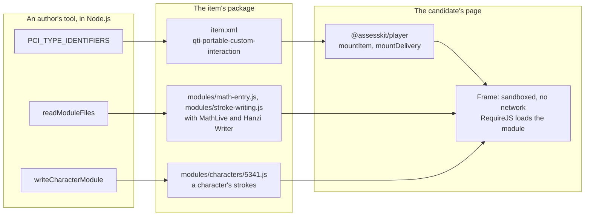

# Architecture of custom-interactions

`@assesskit/custom-interactions` holds portable custom interactions that any QTI item may use. Each is an AMD module, built
from `src/<interaction>/` with what it imports, that the item's package carries and the player's frame loads under the
interaction's type identifier. The package exports the identifiers, a reader of the module files and the writer of a
character's module for an author's tool.

## Why a package of its own

| Rule                                                                                                                                 | What it decides                                                                                                                                                                                                                                                                                      |
| ------------------------------------------------------------------------------------------------------------------------------------ | ---------------------------------------------------------------------------------------------------------------------------------------------------------------------------------------------------------------------------------------------------------------------------------------------------- |
| STANDARDS section 2, Boundaries: a part with dependencies of its own is a package of its own                                         | Each module bundles a library that neither the runtime nor the player has: MathLive for math entry, Hanzi Writer for stroke writing                                                                                                                                                                  |
| The player's budgets: an exam page's first load is 19 KB gzip, and no budget of `@assesskit/player` or `@assesskit/runtime` may move | A host that does not use an interaction installs and loads nothing of it. The modules are not entries of the player or the runtime, and their libraries are not dependencies of either                                                                                                               |
| The frame reaches no network                                                                                                         | A module loads entirely from the item's package, so it is one script with everything it imports, and the files it loads beside it; `readModuleFiles` gives them to the tool that writes the package                                                                                                  |
| The interactions share their glue                                                                                                    | One package holds them: the AMD definition and the configuration of the binding (`src/frame/`), the reader of the files (`src/node/`) and the build (`scripts/build-modules.ts`). Each is a module file of its own, so an item's package carries only the module it uses, and a page loads only that |

## Build and layout

| Path                                       | Holds                                                                                                                              |
| ------------------------------------------ | ---------------------------------------------------------------------------------------------------------------------------------- |
| `src/index.ts`, `src/interaction-types.ts` | The root entry: `PCI_TYPE_IDENTIFIERS` and `InteractionName`                                                                       |
| `src/write-character-module.ts`            | The root entry's `writeCharacterModule` and `CharacterStrokes`, the module of a character for stroke writing                       |
| `src/node/`                                | `@assesskit/custom-interactions/node`: `readModuleFiles`                                                                           |
| `src/frame/`                               | What the modules share in the frame: `defineInteraction`, `notifyChange`, the configuration of the binding                         |
| `src/<interaction>/`                       | The module of an interaction: `module.ts`, its entry, and the files it imports                                                     |
| `scripts/build-modules.ts`                 | Bundles each `module.ts` with esbuild into `modules/<interaction>.js` and copies the files it loads below `modules/<interaction>/` |
| `modules/`                                 | The built modules, which `pnpm build` writes, the package exports as `./modules/*` and `readModuleFiles` reads                     |

A module is one classic script, minified for the browsers of the player's [baseline](../player/baseline.md), that calls the
`define` of RequireJS with `qtiCustomInteractionContext` and `module` as its first dependencies: the frame gives the first,
and the second gives the module its own URL, which locates the files beside it. The script opens with the license of every
package it holds, and the build fails on a package whose license `pnpm check:licenses` does not allow.
`pnpm compat:baseline` lints the built modules as it lints the player.

The module registers the interaction under its type identifier. The frame creates the instance with `getInstance(dom,
configuration, state)`; the instance gives `getResponse`, `getState` and `oncompleted`, fires `qti-interaction-changed` when
its response changes, and takes no input when its status is `closed`, `solution` or `review`.

## Sizes

`test/size.test.ts` holds each built module to its budget in `test/size-budgets.ts`: 1.25 times the size measured, rounded up
to the next 500 bytes. A budget also lists the packages the script holds, so a new dependency fails until it is listed.

| Module           | Script, gzip |  Budget |                                     Files beside it |  Budget | Holds          |
| ---------------- | -----------: | ------: | --------------------------------------------------: | ------: | -------------- |
| `math-entry`     |      230,345 | 288,000 | 264,499: the 20 fonts of MathLive and their license | 331,000 | `mathlive`     |
| `stroke-writing` |       13,159 |  16,500 |             0: the strokes are the item's, not here |       0 | `hanzi-writer` |

The fonts are WOFF2, which is compressed already. A page loads a module once per frame, and a browser caches it by its URL
under the asset gate's prefix.

## Dependencies

Installing the package installs two runtime dependencies: `@assesskit/runtime`, whose checks and errors `readModuleFiles` and
`writeCharacterModule` use, and `valibot`. The libraries of the modules are bundled at build time and are development
dependencies. The tarball carries every module, so a host that uses one interaction still has the others' files on disk.

| Package               | Version | License     | Why                                                                                                                                                                                                                                                                                                                 |
| --------------------- | ------- | ----------- | ------------------------------------------------------------------------------------------------------------------------------------------------------------------------------------------------------------------------------------------------------------------------------------------------------------------- |
| `mathlive`            | 0.111.4 | MIT         | The field and the virtual keyboard of math entry. Pinned exactly (released 2026-10-31)                                                                                                                                                                                                                              |
| `hanzi-writer`        | 3.7.3   | MIT         | The quiz of stroke writing, which matches each stroke's shape, direction and order. Released 2025-09-17, with commits until 2025-12-31 and no advisory; it fetches a character's data from a CDN unless given a loader, and the module gives it the item's character                                                |
| `valibot`             | 1.5.0   | MIT         | Reads the strokes of a character in `writeCharacterModule`, as the runtime and the player read JSON                                                                                                                                                                                                                 |
| The fonts of MathLive | KaTeX's | SIL OFL 1.1 | MathLive draws a formula with KaTeX's 20 fonts and loads them all when a field first shows. The Open Font License lets the fonts travel with software under the copyright and the license, which `fonts/OFL.txt` carries beside them; it is a license of fonts, not one of those STANDARDS section 3 lists for code |

MathQuill, the other field of its kind, is MPL-2.0, outside the licenses that STANDARDS section 3 allows, and has no
virtual keyboard.

## Security

A module runs in the player's frame of a portable custom interaction ([pci](../player/pci.md#the-frame-and-its-limits)):
an opaque origin with no network, no storage and no `eval`, which MathLive runs without. A module is code of the package,
visible to the candidate, so it holds no key: the item's response processing scores what it writes. The interaction reads
its properties and the response it is bound to, which the item and the player give it, and writes only its response and its
state.

## Tests

| File                             | Runs with           | Holds                                                                                                                                                                                                                                                                    |
| -------------------------------- | ------------------- | ------------------------------------------------------------------------------------------------------------------------------------------------------------------------------------------------------------------------------------------------------------------------ |
| `math-entry.test.ts`             | `pnpm test`         | Every key of the keyboard, shifted or not, and every inline shortcut write LaTeX that the reader reads; the words of steps                                                                                                                                               |
| `stroke-writing.test.ts`         | `pnpm test`         | `writeCharacterModule`: the module it writes, its limits and its refusals, and the samples of the guide                                                                                                                                                                  |
| `node.test.ts`                   | `pnpm test`         | `readModuleFiles`, and the samples of the README and of the math entry guide                                                                                                                                                                                             |
| `size.test.ts`                   | `pnpm test`         | The budgets of the modules                                                                                                                                                                                                                                               |
| `math-entry.browser.test.ts`     | `pnpm test:browser` | The built module in the player's frame, in Chromium, Firefox and WebKit: real keys and taps, what MathLive writes, read by the reader and scored end to end; steps, state, status, the files loaded, axe, and the keyboard alone, into the field and out of it both ways |
| `stroke-writing.browser.test.ts` | `pnpm test:browser` | The built module in the player's frame: 十 drawn with the pointer and scored, mistakes, state and status, invalid properties, the files loaded, axe, and Tab and Shift+Tab, which pass the frame                                                                         |
| `items.xsd.test.ts`              | `pnpm test:xsd`     | The items of the interactions against the published ASI schema                                                                                                                                                                                                           |

The browser tests serve the player's frame and the modules, built for the run, from an asset origin of their own
(`test/fixtures/browser-setup.ts`), with the module of 十 written from `test/fixtures/hanzi-writer-data/`, the one character
the repository holds, under the Arphic Public License with its credit; they drive the frame with Playwright's keyboard and
pointer (`test/fixtures/commands.ts`).
