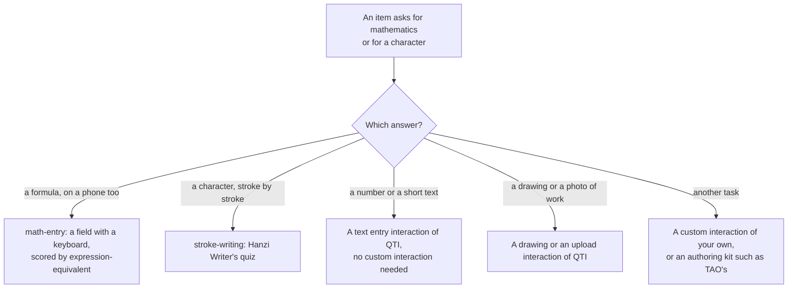

# Choosing custom-interactions

When `@assesskit/custom-interactions` fits an item that needs a formula or a handwritten character, and when another way fits
better. The comparators are delivery and validation libraries, not libraries of custom interactions, each dated by the day its
source was read; none was run.

| You need                                                                          | Use                                                                                                                       |
| --------------------------------------------------------------------------------- | ------------------------------------------------------------------------------------------------------------------------- |
| A formula typed with a virtual keyboard, scored for equivalence                   | This package: [math entry](math-entry.md), with `expression-equivalent` of [operators](../runtime/operators.md)           |
| Worked steps, one line a step, checked line by line                               | This package: [math entry](math-entry.md#worked-steps), with `compareMathSteps`                                           |
| A character written stroke by stroke, with its shape, direction and order checked | This package: [stroke writing](stroke-writing.md)                                                                         |
| A number, a unit or a short text                                                  | A QTI text entry interaction with the operators of the runtime: [operators](../runtime/operators.md); no module is needed |
| The picture of a drawing or of work on paper                                      | A QTI drawing or upload interaction ([interactions](../player/interactions.md))                                           |
| An interaction of another kind, or a kit to build one                             | Your own module, loaded as these are ([pci](../player/pci.md)); TAO has an SDK and a sample library of its own            |

## What the others have that the package lacks

| Comparator, version                                                             | What it has                                                                                                        | Here                                                                                                                                                                                |
| ------------------------------------------------------------------------------- | ------------------------------------------------------------------------------------------------------------------ | ----------------------------------------------------------------------------------------------------------------------------------------------------------------------------------- |
| [TAO](https://github.com/oat-sa/extension-tao-itemqti) (read 2026-11-02)        | A PCI authoring SDK and a sample library, with item and test authoring                                             | Excluded: no authoring ([supported](supported.md#not-included)); two interactions are built                                                                                         |
| [Citolab qti-convert](https://github.com/Citolab/qti-convert) (read 2026-11-02) | A conversion of TAO's portable custom interactions to QTI 3 portable custom interactions                           | Excluded: migration belongs to a dedicated library ([supported](../runtime/supported.md#not-included))                                                                              |
| MathQuill (read 2026-11-04)                                                     | A formula field                                                                                                    | Not used, for its license and its lack of a virtual keyboard ([architecture](architecture.md#dependencies))                                                                         |
| [Hanzi Writer](https://hanziwriter.org/docs.html) 3.7.3                         | A demonstration of the strokes in order before the quiz, and the data of a character fetched from a CDN by default | Not included: a demonstration is the item's content, and the data comes from the item's package, so a character needs its module ([stroke writing](stroke-writing.md#not-included)) |
| [MathLive](https://mathlive.io) 0.111.4                                         | Menus and tooltips in the languages that it ships, and its own light and dark colors                               | Indonesian has no strings in MathLive; the field keeps its own colors ([math entry](math-entry.md#not-included))                                                                    |

The player hosts any portable custom interaction that follows the QTI 3.0 best practices ([pci](../player/pci.md)), and
`@assesskit/runtime` checks them ([pci](../runtime/pci.md)), so an interaction from another source loads the same way.

## Where the evidence is

[Evidence](evidence.md) counts the tests of each module, in Node and in the player's frame in three engines, and gives the sizes held by
budget; [supported](supported.md) says what each interaction responds with and how it is scored, and what is left out.
