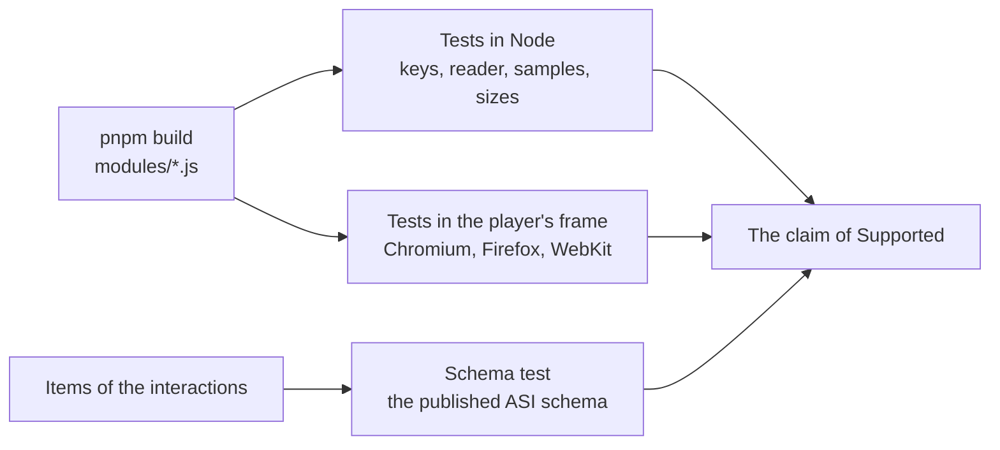

# Evidence for custom-interactions

What shows that `@assesskit/custom-interactions` does what it says. The counts are those of the repository at `1647c74`, run
on 2026-11-05: every test passed, none failed or was skipped. Node tests ran on Node.js 22.23.4 and browser tests in Chromium;
Firefox and WebKit run the same files in the `browsers` job of `.github/workflows/ci.yml`, not counted here. Every other count
comes from the file that the last column names.

| Layer                  | Count                                         | Where                                                                                                                      |
| ---------------------- | --------------------------------------------- | -------------------------------------------------------------------------------------------------------------------------- |
| Tests in Node          | 23 tests in 4 files                           | `pnpm test`, project `custom-interactions`: `math-entry.test.ts`, `stroke-writing.test.ts`, `node.test.ts`, `size.test.ts` |
| Tests in a browser     | 44 tests in 2 files, in Chromium              | `pnpm test:browser`, project `custom-interactions-browser`: `math-entry.browser.test.ts`, `stroke-writing.browser.test.ts` |
| Schema test            | 1 test                                        | `pnpm test:xsd`, `items.xsd.test.ts`: the items of both interactions against the published ASI schema                      |
| Size of math entry     | 230,345 bytes gzip and 264,499 bytes of fonts | `test/size-budgets.ts`, held by `size.test.ts` to budgets of 288,000 and 331,000 bytes                                     |
| Size of stroke writing | 13,159 bytes gzip                             | `test/size-budgets.ts`, held to a budget of 16,500 bytes                                                                   |
| Libraries              | MathLive 0.111.4 and Hanzi Writer 3.7.3, MIT  | `package.json` of the package, pinned exactly; the license of each heads its module                                        |
| Interactions           | 2                                             | `PCI_TYPE_IDENTIFIERS` of `src/interaction-types.ts`                                                                       |

What each test file holds is in [architecture](architecture.md#tests).

The tests of the runtime's reader of LaTeX, which scores what math entry writes, are in the [evidence of the runtime](../runtime/evidence.md).
