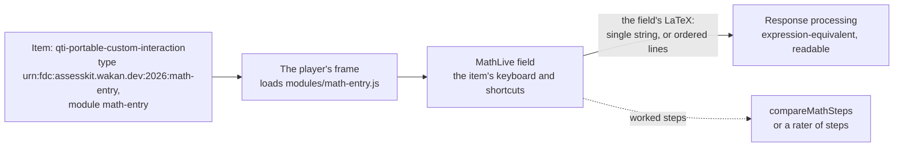

# Math entry

`math-entry` is a portable custom interaction that asks for a formula: a [MathLive](https://mathlive.io) field with a
virtual keyboard, which a candidate on a phone needs. The response is the field's LaTeX, which the `expression-equivalent`
operator of [`@assesskit/runtime/operators`](../runtime/operators.md) scores. Its module is an AMD file of the item's
package, so it runs in the player's frame, which reaches no network.



| Export                                                  | Does                                                                                                                                       |
| ------------------------------------------------------- | ------------------------------------------------------------------------------------------------------------------------------------------ |
| `PCI_TYPE_IDENTIFIERS["math-entry"]`                    | The `custom-interaction-type-identifier`, `urn:fdc:assesskit.wakan.dev:2026:math-entry`.                                                   |
| `readModuleFiles("math-entry", { signal? })` of `/node` | The module, MathLive's fonts and their license, by their paths in the package, under `modules/`; `signal` ends the reading (default none). |
| `modules/math-entry.js`, `modules/math-entry/fonts/*`   | The same files, as files of the npm package, for a tool that copies them.                                                                  |

## Quick start

Write an item that asks for an expression and scores it by its key, and a package that carries the module:

```ts
import { PCI_TYPE_IDENTIFIERS } from "@assesskit/custom-interactions";
import { readModuleFiles } from "@assesskit/custom-interactions/node";
import { readAsi, writeAsi } from "@assesskit/runtime/asi";
import { createScoringOperators } from "@assesskit/runtime/operators";
import { readManifest, readPackage, writePackage } from "@assesskit/runtime/package";
import { compileScoring } from "@assesskit/runtime/scoring";
import { validatePackage } from "@assesskit/runtime/validate";

const { item } = readAsi(`<qti-assessment-item xmlns="http://www.imsglobal.org/xsd/imsqtiasi_v3p0"
    identifier="expand" title="Expand" adaptive="false" time-dependent="false">
  <qti-item-body>
    <qti-portable-custom-interaction response-identifier="RESPONSE" module="math-entry"
        custom-interaction-type-identifier="${PCI_TYPE_IDENTIFIERS["math-entry"]}">
      <qti-prompt>Expand 2(x + 1).</qti-prompt>
      <qti-interaction-modules>
        <qti-interaction-module id="math-entry" primary-path="modules/math-entry"/>
      </qti-interaction-modules>
      <qti-interaction-markup/>
    </qti-portable-custom-interaction>
  </qti-item-body>
</qti-assessment-item>`);
const scoring = compileScoring([{ identifier: "RESPONSE", key: { kind: "expression", expression: "2x+2" } }]);
const { responseDeclarations, outcomeDeclarations, responseProcessing } = scoring;
const xml = writeAsi({
  kind: "item",
  item: { ...item, responseDeclarations, outcomeDeclarations, responseProcessing },
});

const moduleFiles = await readModuleFiles("math-entry");
const listed = [...moduleFiles.keys()].map((path) => `<file href="${path}"/>`).join("");
const manifest =
  readManifest(`<manifest xmlns="http://www.imsglobal.org/xsd/qti/qtiv3p0/imscp_v1p1" identifier="algebra">
  <metadata><schema>QTI Package</schema><schemaversion>3.0.0</schemaversion></metadata>
  <organizations/>
  <resources>
    <resource identifier="expand" type="imsqti_item_xmlv3p0" href="items/expand/item.xml">
      <file href="items/expand/item.xml"/>
    </resource>
    <resource identifier="math-entry" type="webcontent">${listed}</resource>
  </resources>
</manifest>`);
const files = new Map([["items/expand/item.xml", new TextEncoder().encode(xml)], ...moduleFiles]);
const pkg = readPackage(writePackage(manifest, files));
pkg.paths.length; // => 24
pkg.paths.slice(0, 3); // => ["imsmanifest.xml", "items/expand/item.xml", "modules/math-entry.js"]
validatePackage(pkg, { customOperators: createScoringOperators() }); // => []
```

`validatePackage` checks that the module is in the package and listed; it takes the operators as `customOperators`, so that
it knows `expression-equivalent`.

## The item

| Part                                  | Value                                                                                                                                   |
| ------------------------------------- | --------------------------------------------------------------------------------------------------------------------------------------- |
| `custom-interaction-type-identifier`  | `urn:fdc:assesskit.wakan.dev:2026:math-entry`, `PCI_TYPE_IDENTIFIERS["math-entry"]`                                                     |
| `module`, `qti-interaction-module id` | `math-entry`, the id that the module defines                                                                                            |
| `primary-path`                        | The module's path in the package without `.js`, from the root of the package: `modules/math-entry` at the paths `readModuleFiles` gives |
| Response, an answer                   | `cardinality="single" base-type="string"`: the field's LaTeX; NULL while the field is empty                                             |
| Response, worked steps                | `cardinality="ordered" base-type="string"`: one line a step, the empty lines left out; NULL while every line is empty                   |
| `qti-prompt`                          | Names the frame, and the field, for assistive technology                                                                                |

The module reads the cardinality from the response it is bound to, so an `ordered` declaration gives worked steps and needs
no attribute of its own. Keep the module files in a resource of their own, of type `webcontent`, as the Quick start does: the
asset gate gives each portable custom interaction a prefix of its own for its modules, so the item's resource need not depend
on them, and the item's folder stays the prefix of its content ([asset gate](../player/asset-gate.md#prefixes)).

### Properties

| Attribute                | Value                                                                                               | Default                                     |
| ------------------------ | --------------------------------------------------------------------------------------------------- | ------------------------------------------- |
| `data-decimal-separator` | `.`, or `,`, which MathLive writes as `{,}` after a digit. Give the key the same `decimalSeparator` | `.`                                         |
| `data-step-label`        | Names a line of worked steps, before its number                                                     | `Step`, or the item language's word         |
| `data-add-step-label`    | The button that adds a line                                                                         | `Add a step`, or the item language's words  |
| `data-remove-step-label` | Names the button that removes a line, before its number                                             | `Remove step`, or the item language's words |

The words come in English and Indonesian, chosen by the item's language as the frame gives it; an item in another language
words them with the three properties.

## What the field writes

MathLive writes more than the expression subset that the operators read: its defaults write `\int`, `\sum`, `\imaginaryI` and
`\infty`, and its `log` shortcut writes `\log_{}`, which leaves the argument in the base. The module therefore sets:

| MathLive setting  | Value                                                                                                                                                                                                                                                                                                                                                                                                                                                                                                                                                                       |
| ----------------- | --------------------------------------------------------------------------------------------------------------------------------------------------------------------------------------------------------------------------------------------------------------------------------------------------------------------------------------------------------------------------------------------------------------------------------------------------------------------------------------------------------------------------------------------------------------------------- |
| Virtual keyboard  | Four layouts of the subset's keys only. `123`: `x`, `y`, digits, the decimal mark, `+ − × ÷`, the templates of a fraction, a square, a power, a square root and an n-th root, brackets and bars, `π`, `e` (`\exponentialE`), `%`, `°`, `±`, `=`, `<`, `>` and, shifted, `≤`, `≥`, `≠`, the comma (`;` shifted when the decimal mark is the comma), and the keys that move and delete. `f(x)`: `sin cos tan sec csc cot arcsin arccos arctan sinh cosh tanh exp ln log log_b lg`. `abc`: the Latin letters, capitals shifted. `αβγ`: the Greek letters that the reader takes |
| Inline shortcuts  | MathLive's defaults whose LaTeX the reader reads: `sqrt`, `pi`, `sin` and the other function names, the Greek letters, `ee`, `deg`, `xx`, `*`, `>=`, `<=`, `!=`, `+-`, `or`, `frac`, `cbrt`, `nthroot`; `log` writes `\log`; the others removed                                                                                                                                                                                                                                                                                                                             |
| Decimal separator | The item's `data-decimal-separator`                                                                                                                                                                                                                                                                                                                                                                                                                                                                                                                                         |
| Keyboard          | MathLive's own in the frame, shown on a touch device when the field takes the focus, and by the field's toggle on any device; the frame grows to hold it                                                                                                                                                                                                                                                                                                                                                                                                                    |
| Fonts             | `fontsDirectory` beside the module, `math-entry/fonts/`, with `OFL.txt`: the 20 fonts are KaTeX's, under the SIL Open Font License 1.1, whose text goes with them. No sounds (`soundsDirectory` is null), which MathLive would fetch                                                                                                                                                                                                                                                                                                                                        |
| Response          | The field's `value`, its LaTeX; an empty slot stays `\placeholder{}`, which the reader takes as unreadable, so the `readable` operator tells the candidate                                                                                                                                                                                                                                                                                                                                                                                                                  |

Typed with real keys in the player's frame, MathLive 0.111.4 writes, and the browser tests hold:

| Keys                      | LaTeX                                              |
| ------------------------- | -------------------------------------------------- |
| `1/2` →                   | `\frac12`                                          |
| `(x+1)/(x-1)` →           | `\frac{\left(x+1\right)}{\left(x-1\right)}`        |
| `sqrt(x)`                 | `\sqrt{\left(x\right)}`                            |
| `sin(x)`, `tan(x)^2` →    | `\sin\left(x\right)`, `\tan\left(x\right)^2`       |
| `log(x)`, `log_2` → `(8)` | `\log\left(x\right)`, `\log_2\left(8\right)`       |
| `ee^x` →                  | `\exponentialE^{x}`                                |
| `pi*r^2` →                | `\pi\cdot r^2`                                     |
| `x=+-3`, `x=2 or x=3`     | `x=\pm3`, `x=2\lor x=3`                            |
| `30deg`, `50%`, `2xx3`    | `30\degree`, `50\%`, `2\times3`                    |
| `2/`                      | `\frac{2}{\placeholder{}}`, unreadable             |
| `0,25` with the comma     | `0{,}25`                                           |
| `oo`                      | `oo`: MathLive's own shortcut would write `\infty` |

`→` is the right arrow, which leaves a fraction, a power or a root. Two traps of MathLive's that the keys keep: `1 1/2` is
`\frac{11}{2}`, since the field takes no space between numbers, and `|x-1|` typed on a physical keyboard leaves the field
empty in Chromium, so a candidate writes an absolute value with the virtual keyboard's bar key or `abs(x)`.

### Worked steps

With an `ordered` response the interaction is a numbered list of fields, a button that removes each line, and one that adds
a line; Enter in a field adds the next line after it and moves to it. `compareMathSteps` of the operators checks the lines,
each against the nearest earlier line that reads.

## Accessibility

| Need                          | What the interaction does                                                                                                                                                                                   |
| ----------------------------- | ----------------------------------------------------------------------------------------------------------------------------------------------------------------------------------------------------------- |
| A name (WCAG 4.1.2)           | The frame and the field take the prompt; each line of steps is named `Step n`, and its button `Remove step n`                                                                                               |
| Keyboard (WCAG 2.1.1)         | Tab reaches the field from the page; every key of the subset is on the physical keyboard, the arrows move through a formula, and the buttons of steps are buttons                                           |
| No keyboard trap (WCAG 2.1.2) | Tab and Shift+Tab move through the slots of a formula, and where MathLive has nowhere to go they leave the field for the next element in the browser's order: a button of steps, or the page past the frame |
| Speech                        | MathLive announces the formula in words through a live region of the field, which a screen reader speaks                                                                                                    |
| Contrast                      | axe finds no violation of WCAG 2.2 AA with the keyboard shown, nor with worked steps; the keyboard's selected tab takes the color of its text, since MathLive's accent fails the contrast of AA on its gray |
| Pointer                       | The virtual keyboard writes every key of the subset with a tap                                                                                                                                              |

## Limits

The module sets no limit on what a candidate types or on the lines of worked steps. What bounds a response is where it goes:

| Limit                                 | Default                                                         | Applies to                                                                                                                                            |
| ------------------------------------- | --------------------------------------------------------------- | ----------------------------------------------------------------------------------------------------------------------------------------------------- |
| `maxInputLength` of the operators     | 2,000 UTF-16 code units, all the strings of a response together | Scoring: a longer response is unreadable, so `expression-equivalent` gives NULL and `readable` is false ([operators](../runtime/operators.md#limits)) |
| `maxSteps` of `compareMathSteps`      | 200 lines                                                       | Scoring worked steps: more lines are a `SecurityError` ([operators](../runtime/operators.md#limits))                                                  |
| `maxActionSize` of `ActionLimits`     | 4,194,304                                                       | The action that carries the response to the engine                                                                                                    |
| `maxPciStateLength` of `ActionLimits` | 1,048,576 code units                                            | The state of the interaction ([delivery](../runtime/delivery.md#wire-forms))                                                                          |

## Errors

| Error                                  | When                                                                                                     | What to do                                                                 |
| -------------------------------------- | -------------------------------------------------------------------------------------------------------- | -------------------------------------------------------------------------- |
| `DataError` of `readModuleFiles`       | The name is not an interaction of the package, an option is unknown, or `signal` is not an `AbortSignal` | Pass `"math-entry"` and at most `{ signal }`                               |
| `AssesskitError` of `readModuleFiles`  | The package was installed without its built modules                                                      | Install the published package, or run `pnpm build` in a checkout           |
| The signal's reason                    | `signal` aborted the reading                                                                             | Nothing: the caller ended it                                               |
| The frame's `failed` event, `instance` | `data-decimal-separator` is neither `.` nor `,`                                                          | Fix the item                                                               |
| The frame's `failed` event, `modules`  | The module is not at `primary-path` in the package                                                       | Put the files of `readModuleFiles` at the folder that `primary-path` names |

## Not included

| Not included                                       | Why                                                                                                                                                                                                    |
| -------------------------------------------------- | ------------------------------------------------------------------------------------------------------------------------------------------------------------------------------------------------------ |
| A field that refuses what the reader leaves unread | A paste, MathLive's LaTeX mode (`\`) and its menu write any LaTeX; the response is untrusted anyway, and the reader takes what it cannot read as unreadable, which `readable` reports to the candidate |
| MathLive's words in Indonesian                     | MathLive 0.111.4 has no Indonesian strings; its menu and keyboard tooltips fall back to English                                                                                                        |
| A key of the virtual keyboard named in words       | MathLive names a key by the LaTeX it writes; a candidate who needs names types on the physical keyboard, where every key of the subset is                                                              |
| The player's themes in the field and its keyboard  | The frame takes the candidate's presentation from `player.css`, but MathLive draws the field and the keyboard in its own colors, light or dark by the browser's color scheme                           |
| Scoring worked steps                               | The response is the lines; `compareMathSteps` checks them, and a rubric or a rater judges what the checks leave                                                                                        |

## Differences from the references

| Reference           | Difference                                                                                                                                                                                                                                                                                                                                                                                                                                                     |
| ------------------- | -------------------------------------------------------------------------------------------------------------------------------------------------------------------------------------------------------------------------------------------------------------------------------------------------------------------------------------------------------------------------------------------------------------------------------------------------------------- |
| MathLive's defaults | The keyboard and the shortcuts as [What the field writes](#what-the-field-writes) says, so `log`, `oo`, `infinity`, `ii`, `sum` and `int` write what the reader reads or stay as typed; the keyboard is MathLive's own in the frame, which MathLive would send to the top window; Tab at the end of a field moves the focus as the browser does, where MathLive moves it among the elements of the frame alone, which traps a keyboard in a frame of one field |

## Files

| File                            | Concept                                                                                  |
| ------------------------------- | ---------------------------------------------------------------------------------------- |
| `src/math-entry/module.ts`      | The AMD module, which `pnpm build` bundles with MathLive into `modules/math-entry.js`    |
| `src/math-entry/interaction.ts` | The interaction: MathLive's settings, the field or the lines, the response and the state |
| `src/math-entry/keyboard.ts`    | The layouts of the virtual keyboard                                                      |
| `src/math-entry/shortcuts.ts`   | The inline shortcuts                                                                     |
| `src/math-entry/messages.ts`    | The words of worked steps                                                                |

## References

| Reference                                                                                        | Topics                                                                  |
| ------------------------------------------------------------------------------------------------ | ----------------------------------------------------------------------- |
| [QTI 3.0 Best Practices and Implementation Guide](https://www.imsglobal.org/spec/qti/v3p0/impl/) | Portable custom interactions, module resolution, the JSON of a response |
| [MathLive 0.111.4](https://mathlive.io/mathfield/)                                               | The field, its keyboard, shortcuts and decimal separator                |
