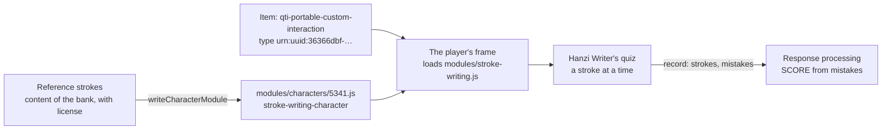

# Stroke writing

`stroke-writing` is a portable custom interaction that asks a candidate to write a character with strokes: a hanzi, a kana,
a kanji or a hangul jamo, drawn with a pointer. [Hanzi Writer](https://hanziwriter.org)'s quiz checks each stroke's shape,
direction and order against the character's reference strokes, and the response is the record `{ strokes, mistakes }`, which
response processing scores with QTI's own expressions; no model is called. Any QTI item may use it. Its module, and the
module of the character, are AMD files of the item's package, so they run in the player's frame of a portable custom
interaction, which reaches no network.



| Export                                                   | Does                                                                                                |
| -------------------------------------------------------- | --------------------------------------------------------------------------------------------------- |
| `INTERACTION_TYPES["stroke-writing"]`                    | The `custom-interaction-type-identifier`, `urn:uuid:36366dbf-22d7-4942-85e7-f334a950edfc`.          |
| `writeCharacterModule(character, strokes)`               | The AMD module of a character, which the item's module resolution names `stroke-writing-character`. |
| `CharacterStrokes`                                       | The reference strokes, in the form of Hanzi Writer's data: `strokes`, `medians` and `radStrokes`.   |
| `readModuleFiles("stroke-writing", options?)` of `/node` | The module, by its path in the package.                                                             |

## Quick start

Write the module of a character, and read the module of the interaction, for an item's package:

```ts
import { INTERACTION_TYPES, writeCharacterModule } from "@assesskit/custom-interactions";
import { readModuleFiles } from "@assesskit/custom-interactions/node";

INTERACTION_TYPES["stroke-writing"]; // => "urn:uuid:36366dbf-22d7-4942-85e7-f334a950edfc"

// One horizontal stroke, as an author draws it in the 1024 box of Hanzi Writer's data.
const character = writeCharacterModule("一", {
  strokes: ["M 100 420 L 924 420 L 924 360 L 100 360 Z"],
  medians: [
    [
      [110, 390],
      [914, 390],
    ],
  ],
});
character; // => 'define({"character":"一","strokes":["M 100 420 L 924 420 L 924 360 L 100 360 Z"],"medians":[[[110,390],[914,390]]]});\n'

const files = await readModuleFiles("stroke-writing");
[...files.keys()]; // => ["modules/stroke-writing.js"]
```

The package holds both, at the paths that the item names:

```xml
<qti-response-declaration identifier="RESPONSE" cardinality="record"/>
<qti-item-body>
  <qti-portable-custom-interaction response-identifier="RESPONSE" module="stroke-writing"
      custom-interaction-type-identifier="urn:uuid:36366dbf-22d7-4942-85e7-f334a950edfc">
    <qti-prompt>Write the character for one.</qti-prompt>
    <qti-interaction-modules>
      <qti-interaction-module id="stroke-writing" primary-path="modules/stroke-writing"/>
      <qti-interaction-module id="stroke-writing-character" primary-path="modules/characters/4e00"/>
    </qti-interaction-modules>
    <qti-interaction-markup/>
  </qti-portable-custom-interaction>
</qti-item-body>
```

## The item

| Part                                                   | Value                                                                                                                                                             |
| ------------------------------------------------------ | ----------------------------------------------------------------------------------------------------------------------------------------------------------------- |
| `custom-interaction-type-identifier`                   | `urn:uuid:36366dbf-22d7-4942-85e7-f334a950edfc`, `INTERACTION_TYPES["stroke-writing"]`                                                                            |
| `module`, `qti-interaction-module id`                  | `stroke-writing`, the id that the module defines                                                                                                                  |
| `qti-interaction-module id="stroke-writing-character"` | The character's module, which `writeCharacterModule` writes; its `primary-path` names the file without `.js`, from the root of the package                        |
| Response                                               | `cardinality="record"`: `strokes`, the strokes written so far, and `mistakes`, the strokes drawn that did not match, both `integer`; NULL before the first stroke |
| `qti-prompt`                                           | Names the frame, and the drawing, for assistive technology                                                                                                        |

Keep the character modules below the modules' folder, such as `modules/characters/`, and list them in a `webcontent`
resource: the asset gate gives the interaction one prefix for its modules, the deepest folder that holds them all
([asset gate](../player/asset-gate.md#prefixes)), so a character beside the module keeps it tight.

### Properties

| Attribute                               | Value                                                                                               | Default |
| --------------------------------------- | --------------------------------------------------------------------------------------------------- | ------- |
| `data-size`                             | The side of the square drawing area, in CSS pixels, at least 100                                    | `300`   |
| `data-show-outline`                     | `true` shows the character's outline under the pen, as practice does; `false` hides it              | `true`  |
| `data-show-hint-after-misses`           | After this many mistakes on a stroke, the stroke flashes as a hint; `0` never                       | `3`     |
| `data-mark-stroke-correct-after-misses` | After this many mistakes on a stroke, the stroke counts as written and the quiz moves on; `0` never | `0`     |
| `data-leniency`                         | How strictly a stroke is matched: below 1 stricter, above 1 more lenient                            | `1`     |

These are the options of Hanzi Writer's quiz. A stroke that is never written keeps the quiz on it, so an item that must end
gives `data-mark-stroke-correct-after-misses`, and its `mistakes` still count each miss.

### Scoring

The item scores the record with QTI's own expressions; it knows the character's number of strokes. The browser tests score
十, of two strokes, with this processing, `STROKES` being an outcome of value 2:

```xml
<qti-response-condition>
  <qti-response-if>
    <qti-is-null><qti-variable identifier="RESPONSE"/></qti-is-null>
    <qti-set-outcome-value identifier="SCORE"><qti-base-value base-type="float">0</qti-base-value></qti-set-outcome-value>
  </qti-response-if>
  <qti-response-else-if>
    <qti-and>
      <qti-equal tolerance-mode="exact">
        <qti-field-value field-identifier="strokes"><qti-variable identifier="RESPONSE"/></qti-field-value>
        <qti-variable identifier="STROKES"/>
      </qti-equal>
      <qti-equal tolerance-mode="exact">
        <qti-field-value field-identifier="mistakes"><qti-variable identifier="RESPONSE"/></qti-field-value>
        <qti-base-value base-type="integer">0</qti-base-value>
      </qti-equal>
    </qti-and>
    <qti-set-outcome-value identifier="SCORE"><qti-base-value base-type="float">1</qti-base-value></qti-set-outcome-value>
  </qti-response-else-if>
  <qti-response-else>
    <qti-set-outcome-value identifier="SCORE"><qti-base-value base-type="float">0</qti-base-value></qti-set-outcome-value>
  </qti-response-else>
</qti-response-condition>
```

The tests' item adds a branch that gives 0.5 for every stroke written with at most two mistakes.

## Reference strokes

The reference strokes are content of the bank, a file for each character, with the license and the credit of their source;
the package of the interaction holds none, and its tests hold one character under its license.

| Source                                                            | Characters                                        | License                                                        | What the bank does                                                                                                                   |
| ----------------------------------------------------------------- | ------------------------------------------------- | -------------------------------------------------------------- | ------------------------------------------------------------------------------------------------------------------------------------ |
| [hanzi-writer-data](https://github.com/chanind/hanzi-writer-data) | 9,574 hanzi, in Hanzi Writer's form               | Arphic Public License, from Make Me a Hanzi and Arphic's fonts | Passes a file, read as JSON, to `writeCharacterModule`; the package carries `ARPHICPL.TXT` and the credit                            |
| [KanjiVG](https://kanjivg.tagaini.net)                            | Kana and kanji, as the center line of each stroke | CC BY-SA 3.0                                                   | Converts each stroke to an outline and a median of Hanzi Writer's form; the converted data stays under CC BY-SA 3.0, with the credit |
| The bank's experts                                                | Hangul jamo and any character the sources lack    | The bank's                                                     | Writes the strokes in the same form                                                                                                  |

The form: each stroke an outline as SVG path data and a median as points from where the pen starts to where it lifts, in a
box of 1024 units whose y axis points up from -124 to 900. `writeCharacterModule` refuses a character of no stroke or more
than 64, a missing median, a path that is not SVG path data or longer than 4,096 characters, and a median of fewer than 2 or
more than 256 points; hanzi-writer-data's largest is 33 strokes, a path of 758 characters and a median of 38 points.

## Accessibility

Writing a character with strokes is a task of a path drawn with a pointer: the shape, the direction and the order of each
stroke are what is assessed. WCAG 2.2 allows it: success criterion 2.1.1 leaves out a function that depends on the path of the
user's movement, with handwriting as its example, and 2.5.1 leaves out a path-based gesture that is essential.

| Need                   | What the interaction does, and what it cannot                                                                 |
| ---------------------- | ------------------------------------------------------------------------------------------------------------- |
| A name (WCAG 4.1.2)    | The frame and the drawing take the prompt; the drawing is an image with that name                             |
| Keyboard (WCAG 2.1.1)  | It cannot be done with a keyboard or a switch: the frame has nothing to focus, so Tab passes it               |
| Screen reader          | It hears the prompt, and nothing of the strokes                                                               |
| Contrast (WCAG 1.4.11) | The outline that guides the pen has 3:1 on white, and the strokes more; axe finds no violation of WCAG 2.2 AA |
| Touch                  | The drawing area takes the finger's strokes and does not scroll the page under them                           |

The author therefore gives a candidate who does not draw with a pointer another item that measures what it can of the same
skill: the order of the strokes in an order interaction, the right stroke among drawn ones in a choice, or the character
recognized among others. The host gives that candidate the other item in its place, by what the candidate needs, or leaves
the item out of the candidate's form; the interaction itself offers no other way to answer.

## Errors

| Error                                  | When                                                                                                                       | What to do                                                    |
| -------------------------------------- | -------------------------------------------------------------------------------------------------------------------------- | ------------------------------------------------------------- |
| `DataError` of `writeCharacterModule`  | The character is empty or longer than 8 code units, or the strokes break a rule of [Reference strokes](#reference-strokes) | Pass a file of Hanzi Writer's form                            |
| The frame's `failed` event, `instance` | A property is not valid, or the character module defines no character                                                      | Fix the item, or write the module with `writeCharacterModule` |
| The frame's `failed` event, `modules`  | The module or the character is not at its `primary-path` in the package                                                    | Put both at the paths the item names                          |

## Not included

| Not included                                 | Why                                                                                                                          |
| -------------------------------------------- | ---------------------------------------------------------------------------------------------------------------------------- |
| A way to answer with a keyboard or a switch  | The task is the path of each stroke; the author gives such a candidate another item, as [Accessibility](#accessibility) says |
| Converting KanjiVG to Hanzi Writer's form    | It is preparation of the bank's content, done once for each character, not delivery                                          |
| Several characters in one interaction        | One interaction is one character; a word is an interaction for each of its characters                                        |
| Showing the strokes in order before the quiz | A demonstration is the item's content, such as an image or a video; the interaction is the answer                            |
| Scoring in the module                        | The module gives what was drawn; the item's response processing scores it, and a module is code that the candidate can read  |

## Differences from the references

| Reference                                       | Difference                                                                                                                                                                                                                                  |
| ----------------------------------------------- | ------------------------------------------------------------------------------------------------------------------------------------------------------------------------------------------------------------------------------------------- |
| QTI 3.0 Best Practices and Implementation Guide | The type identifier is a `urn:uuid:`, where the guide recommends a Federated Content URN, as for [math entry](math-entry.md#differences-from-the-references); `validateAsi` and `validatePackage` warn with `assesskit/pci/type-identifier` |
| Hanzi Writer's defaults                         | Darker colors, so that the outline keeps 3:1 on white; the quiz's options as the properties above, with Hanzi Writer's defaults; the data from the item's package, where Hanzi Writer fetches it from a CDN                                 |

## Files

| File                                | Concept                                                                                       |
| ----------------------------------- | --------------------------------------------------------------------------------------------- |
| `src/stroke-writing/module.ts`      | The AMD module, which `pnpm build` bundles with Hanzi Writer into `modules/stroke-writing.js` |
| `src/stroke-writing/interaction.ts` | The interaction: the quiz, the properties, the response and the state                         |
| `src/write-character-module.ts`     | `writeCharacterModule` and the form of reference strokes                                      |

## References

| Reference                                                                                           | Topics                                                                         |
| --------------------------------------------------------------------------------------------------- | ------------------------------------------------------------------------------ |
| [QTI 3.0 Best Practices and Implementation Guide](https://www.imsglobal.org/spec/qti/v3p0/impl/)    | Portable custom interactions, module resolution, the JSON of a record response |
| [Hanzi Writer 3.7.3](https://hanziwriter.org/docs.html)                                             | The quiz, its options and the form of its data                                 |
| [Understanding WCAG 2.2, 2.1.1 Keyboard](https://www.w3.org/WAI/WCAG22/Understanding/keyboard.html) | The exception for input that depends on the path of the movement               |
