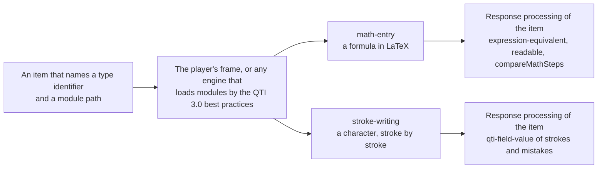

# What custom-interactions supports

What `@assesskit/custom-interactions` gives an item: two portable custom interactions of QTI 3.0, each an AMD module that loads
from the item's package. A cell says Yes, Partly (the note says what is left out) or No (see Not included).

| Interaction      | Type identifier                                   | Response                                                                    | Scored by                                                               | Library            |
| ---------------- | ------------------------------------------------- | --------------------------------------------------------------------------- | ----------------------------------------------------------------------- | ------------------ |
| `math-entry`     | `urn:fdc:assesskit.wakan.dev:2026:math-entry`     | `single` `string`: LaTeX; `ordered` `string`: worked steps, one line a step | `expression-equivalent` and `readable`; the steps by `compareMathSteps` | MathLive 0.111.1   |
| `stroke-writing` | `urn:fdc:assesskit.wakan.dev:2026:stroke-writing` | `record`: `strokes` and `mistakes`, integers                                | QTI's own expressions, by `qti-field-value`                             | Hanzi Writer 3.7.3 |

| Part                                                                                              | Supported | Notes                                                                                                                                                                                |
| ------------------------------------------------------------------------------------------------- | --------- | ------------------------------------------------------------------------------------------------------------------------------------------------------------------------------------ |
| The type identifiers, as `PCI_TYPE_IDENTIFIERS`                                                   | Yes       | A Federated Content URN in `assesskit.wakan.dev`, as QTI recommends                                                                                                                  |
| Reading the module files in Node.js, to put them into an item's package                           | Yes       | `readModuleFiles` of `@assesskit/custom-interactions/node`                                                                                                                           |
| The module of a character for stroke writing                                                      | Yes       | `writeCharacterModule`, from reference strokes in the form of Hanzi Writer's data; the repository holds one character, 十                                                            |
| The player's frame of a portable custom interaction                                               | Yes       | No network, no storage, no `eval`; the modules load from the package                                                                                                                 |
| Another delivery engine that loads modules by the QTI 3.0 Best Practices and Implementation Guide | Partly    | The modules follow the guide, and the tests run them in the player's frame                                                                                                           |
| Keyboard, screen reader and contrast                                                              | Partly    | Math entry: yes, with axe at WCAG 2.2 AA. Stroke writing: a task of a path drawn with a pointer, which WCAG 2.2 allows; the author gives another item to a candidate who cannot draw |
| Languages of the interaction's words                                                              | Partly    | The words of math entry come in English and Indonesian; MathLive's own menu and tooltips are in English                                                                              |
| Browsers                                                                                          | Yes       | Chromium 111, Firefox 115 and Safari 16.4, and later versions, the [baseline](../player/baseline.md) of the player; tested in the current Chromium, Firefox and WebKit               |

## Not included

| Not included                                       | Why                                                                                                                                                                                                           |
| -------------------------------------------------- | ------------------------------------------------------------------------------------------------------------------------------------------------------------------------------------------------------------- |
| Scoring inside a module                            | A module is code that the candidate can read, so it holds no key: the item's response processing scores what it writes                                                                                        |
| A field that refuses what the reader leaves unread | A paste, MathLive's LaTeX mode and its menu write any LaTeX; the response is untrusted anyway, and `readable` reports to the candidate what the reader cannot read ([math entry](math-entry.md#not-included)) |
| MathLive's words in Indonesian                     | MathLive 0.111.1 has no Indonesian strings                                                                                                                                                                    |
| The player's themes in the field and its keyboard  | MathLive draws the field and the keyboard in its own colors, light or dark by the browser's color scheme                                                                                                      |
| A way to answer with a keyboard or a switch        | In stroke writing the task is the path of each stroke; the author gives such a candidate another item ([stroke writing](stroke-writing.md#accessibility))                                                     |
| Several characters in one interaction              | One interaction is one character; a word is an interaction for each of its characters ([stroke writing](stroke-writing.md#not-included))                                                                      |
| Converting KanjiVG to Hanzi Writer's form          | It is preparation of the bank's content, done once for each character, not delivery                                                                                                                           |
| An authoring tool for items that use the modules   | The package gives the type identifiers and the files; the item is the author's tool's ([architecture](architecture.md))                                                                                       |
| Certification by 1EdTech                           | Certification is for products, with member-only test sets. [Conformance](../runtime/conformance.md) says what is implemented, feature by feature                                                              |

The claim is the one of [the player](../player/supported.md#the-claim) for what the frame decides, and [evidence](evidence.md) counts the tests of the modules.
