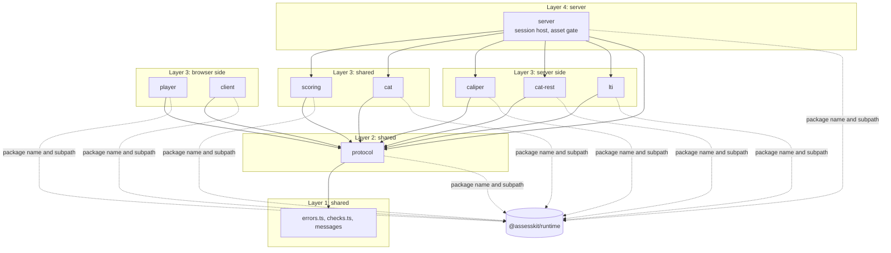

# Architecture

The player is one package with a subpath per side of the wire. These principles hold for every folder; Biome enforces the
ones marked lint, and the rest are checked in review.

| Principle              | Rule                                                                                                                                                                                                            |
| ---------------------- | --------------------------------------------------------------------------------------------------------------------------------------------------------------------------------------------------------------- |
| Thin over the runtime  | The player renders what the runtime's candidate view says. It evaluates no expression, decides no visibility or validity, chooses no variant and reimplements no codec.                                         |
| No keys in the browser | Browser folders import from `@assesskit/runtime/delivery` only `viewFromJson`, `actionToJson` and types (lint). Only `client/local.ts` loads the engine, with `import()`, for practice on a device.             |
| Browser baseline       | Shared and browser code stays inside the [baseline](baseline.md) (lint, and `pnpm compat`).                                                                                                                     |
| Deterministic          | `Math.random` fails lint. `Date.now`, `new Date()` and `performance.now()` fail lint except in `client/clock.ts` and `server/clock.ts`; time comes from a clock that the caller passes.                         |
| No secret in a page    | `cat-rest/` takes the OAuth client secret of a CAT engine. No shared or browser folder imports it (lint), and `bundle.test.ts` checks that the bundles of the candidate and of practice hold none of its files. |
| No hidden network      | `fetch` appears only as an option parameter (lint), so that a caller can replace it.                                                                                                                            |
| Untrusted input        | Every input is untrusted: envelopes, tokens, payloads and messages. Entry points validate their input, with valibot schemas for JSON, and throw `DataError`; inner functions validate shallowly.                |
| Cited rules            | What the specifications and the runtime declare has a test that derives it from them ([evidence](evidence.md#completeness)).                                                                                    |

## Layers

A folder imports only the folders in its row, and imports never form cycles (lint). `errors.ts` and `checks.ts` are
below every folder; `checks.ts` holds the checks of `https` URLs and imports `@assesskit/runtime/checks`, `@assesskit/runtime/errors` and valibot only; the other checks come from `@assesskit/runtime/checks`. The lint knows every folder of the table, so a folder is held
to its row from its first file.

| Layer | Folders                               | Side    | Imports                                     |
| ----- | ------------------------------------- | ------- | ------------------------------------------- |
| 1     | `errors.ts`, `checks.ts`, `messages/` | shared  | none of the folders below                   |
| 2     | `protocol/`                           | shared  | layer 1                                     |
| 3     | `player/`, `client/`                  | browser | layers 1 and 2                              |
| 3     | `scoring/`, `cat/`                    | shared  | layers 1 and 2                              |
| 3     | `caliper/`, `cat-rest/`, `lti/`       | server  | layers 1 and 2                              |
| 4     | `server/`                             | server  | layers 1 to 3, the browser folders excepted |

Shared folders use no DOM, Node.js, timer or network API. Browser folders use the DOM and no Node.js. Server folders use
Node.js or any server runtime, and no DOM. A page that runs practice on a device imports `client`, `scoring` and `cat`, which
the [baseline](baseline.md) covers, and never `cat-rest`. The player imports the runtime by package name and subpath, never by a relative path.

## Subpaths

Each subpath is a folder of `src/` with an `index.ts`, listed in `exports`. The root `.` re-exports the errors and the
messages and nothing of the other subpaths, so that a browser bundle and a server load none of each other's code.

| Subpath      | Side    | Contents                                                                                                                                                                                                                                                                                                                                                                                                                                                                                                       |
| ------------ | ------- | -------------------------------------------------------------------------------------------------------------------------------------------------------------------------------------------------------------------------------------------------------------------------------------------------------------------------------------------------------------------------------------------------------------------------------------------------------------------------------------------------------------- |
| `.`          | shared  | The errors of the player and the interface messages                                                                                                                                                                                                                                                                                                                                                                                                                                                            |
| `client`     | browser | The session clients: the remote session of exam mode with autosave, and the local session of practice ([client](client.md))                                                                                                                                                                                                                                                                                                                                                                                    |
| `player`     | browser | `mountDelivery`, the player with its chrome ([delivery](delivery.md)); the renderer of content and the content root ([content](content.md)), the host of portable custom interactions ([PCI](pci.md)), the rating form of a scoring rubric ([rating](rating.md)), the tools of an item ([tools](tools.md)), mathematics ([math](math.md)), speech ([speech](speech.md)), the interactions ([interactions](interactions.md), [graphics](graphics.md)) and the supports of a candidate ([supports](supports.md)) |
| `protocol`   | shared  | The caller, the envelopes between a browser and a server, the session client, the official result and the submission that a rater reads ([protocol](protocol.md), [scoring](scoring.md))                                                                                                                                                                                                                                                                                                                       |
| `scoring`    | shared  | The submission of a scoring request and the action that supplies its score; `player` shows the submission to a rater ([scoring](scoring.md))                                                                                                                                                                                                                                                                                                                                                                   |
| `cat`        | shared  | The deployment of the adaptive sections of a package to their CAT engines, through any `CatPort` ([CAT](cat.md))                                                                                                                                                                                                                                                                                                                                                                                               |
| `cat-rest`   | server  | The client of a remote CAT engine over the REST binding of CAT 1.0, with the OAuth client secret ([CAT](cat.md))                                                                                                                                                                                                                                                                                                                                                                                               |
| `caliper`    | server  | Caliper 1.2 events from the events of a session, their identifiers, and the sensor that sends them ([Caliper](caliper.md))                                                                                                                                                                                                                                                                                                                                                                                     |
| `lti`        | server  | LTI 1.3: the tool role, with the publication of a score ([lti](lti.md)), and the platform role ([lti-platform](lti-platform.md))                                                                                                                                                                                                                                                                                                                                                                               |
| `server`     | server  | The session host of exam mode and the asset gate ([server](server.md), [asset gate](asset-gate.md)); what the host does with the events of each step: the host's log and Caliper ([Caliper](caliper.md)); the scores of LTI items ([server](server.md#the-scores-of-lti-items))                                                                                                                                                                                                                                |
| `player.css` | browser | The stylesheet of a content root ([styling](styling.md)); a file at the package root, not a folder of `src/`                                                                                                                                                                                                                                                                                                                                                                                                   |

The package also exports static files that a host serves: `pci-frame/*`, the frame of a portable custom interaction, and
`recorder-worklet.js`, the program of the audio worklet of a WAV recording. `pnpm build` writes them to `dist/` with
`scripts/build-static.ts`, which bundles `src/player/pci/frame/bridge.ts` and `src/player/recording/worklet/recorder-worklet.ts`
into classic scripts with esbuild and copies `frame.html` and RequireJS beside the frame.

The player depends on the runtime (`workspace:^`), which browser folders import by package name and subpath. The built `dist/` keeps
those imports, so a page loads the player through a bundler, which also resolves the runtime's own dependencies.

## TypeScript

Five configurations check the package, each with the libraries of its side:

| File                    | Checks                                                                                | `lib` and types                                |
| ----------------------- | ------------------------------------------------------------------------------------- | ---------------------------------------------- |
| `tsconfig.json`         | the tests, their fixtures and `scripts/`                                              | `ES2023`, `DOM`, `DOM.Iterable`, Node.js types |
| `tsconfig.browser.json` | shared and browser folders                                                            | `ES2023`, `DOM`, `DOM.Iterable`                |
| `tsconfig.server.json`  | shared and server folders                                                             | `ES2023`, Node.js types                        |
| `tsconfig.build.json`   | the build of `src/`, which emits `dist/`; the program of the frame is bundled instead | `ES2023`, `DOM`, `DOM.Iterable`, Node.js types |

`ES2023` is the newest library, so that TypeScript rejects built-ins that the baseline browsers lack.

## Errors

The errors of the player extend `AssesskitError` of the runtime, and the player throws the runtime's `DataError`: both come from
`@assesskit/runtime/errors`, which loads no other module, so that browser folders can import it. The messages are full sentences
that say what is wrong and what is expected. The runtime's errors pass through the player unchanged.

| Class          | Thrown when                                                                                                           | Carries             |
| -------------- | --------------------------------------------------------------------------------------------------------------------- | ------------------- |
| `AccessError`  | A caller acts on a session it is not bound to, starts a session that exists, or presents a login hint that is invalid | `reason`            |
| `LtiError`     | An LTI launch, login or service message fails validation, in either role                                              | `reason`            |
| `ServiceError` | A call to the CAT, AGS, JWKS or Caliper service fails, or a store conflict outlasts its retries                       | `status` and `body` |

`DataError` of the runtime is thrown when an argument has the wrong type or is out of range, or untrusted input is not what it should be, such as an
envelope. `reason` is a kebab-case code such as `session-exists`. A host maps `AccessError` to 403. `status` is `0` when a service did
not answer.
