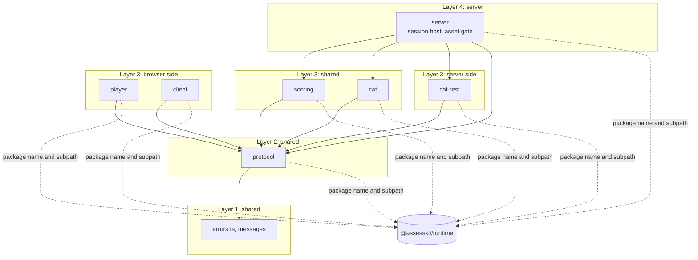
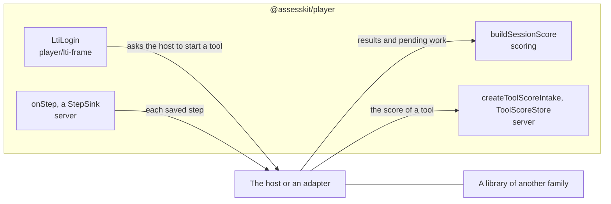
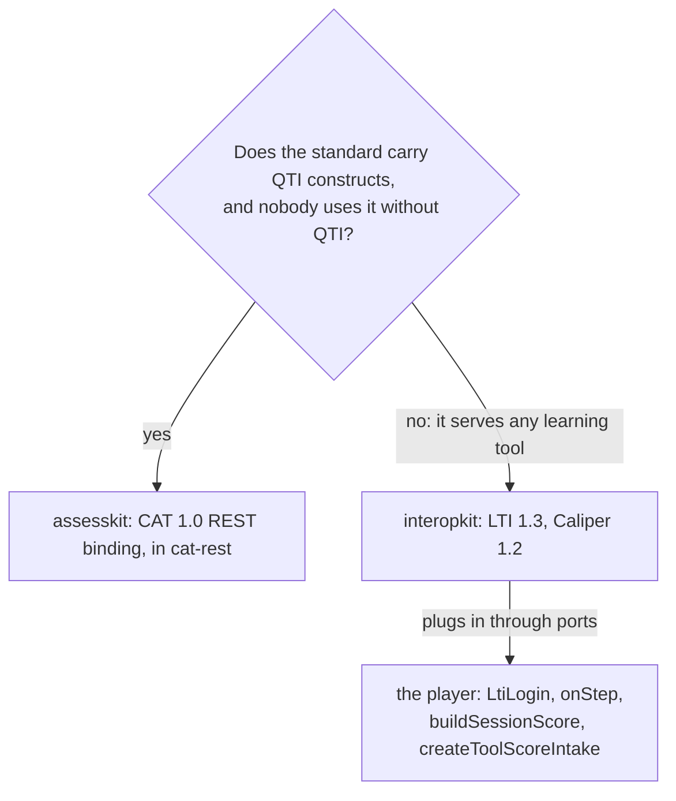

# Architecture of the player

The player is one package with a subpath per side of the wire. These principles hold for every folder; Biome enforces the
ones marked lint, and the rest are checked in review.

| Principle              | Rule                                                                                                                                                                                                                                    |
| ---------------------- | --------------------------------------------------------------------------------------------------------------------------------------------------------------------------------------------------------------------------------------- |
| Thin over the runtime  | The player renders what the runtime's candidate view says. It evaluates no expression, decides no visibility or validity, chooses no variant and reimplements no codec.                                                                 |
| No keys in the browser | Browser folders import only types from `@assesskit/runtime/delivery`, and the wire forms from `@assesskit/runtime/delivery/wire` (lint). Only `client/local/session.ts` loads the engine, with `import()`, for practice on a device.    |
| Browser baseline       | Shared and browser code stays inside the [baseline](baseline.md) (lint, and `pnpm compat:baseline`).                                                                                                                                    |
| Deterministic          | `Math.random` fails lint. `Date.now`, `new Date()` and `performance.now()` fail lint except in `protocol/clock.ts`; time comes from a clock that the caller passes, by default the machine's.                                           |
| No secret in a page    | `cat-rest/` holds the client of a CAT engine, which takes its OAuth client secret. No shared or browser folder imports it (lint), and `bundle.test.ts` checks that the bundles of the candidate and of practice hold none of its files. |
| No hidden network      | `fetch` appears only as an option parameter (lint), so that a caller can replace it.                                                                                                                                                    |
| Untrusted input        | Every input is untrusted: envelopes, tokens, payloads and messages. Entry points validate their input, with valibot schemas for JSON, and throw `DataError`; inner functions validate shallowly.                                        |
| Cited rules            | What the specifications and the runtime declare has a test that derives it from them ([evidence](evidence.md#completeness)).                                                                                                            |

## Layers

A folder imports only the folders in its row, and imports never form cycles (lint). `errors.ts` is
below every folder; the checks come from `@assesskit/runtime/checks`. The lint knows every folder of the table, so a folder is held
to its row from its first file.

| Layer | Folders                  | Side    | Imports                                     |
| ----- | ------------------------ | ------- | ------------------------------------------- |
| 1     | `errors.ts`, `messages/` | shared  | none of the folders below                   |
| 2     | `protocol/`              | shared  | layer 1                                     |
| 3     | `player/`, `client/`     | browser | layers 1 and 2                              |
| 3     | `scoring/`, `cat/`       | shared  | layers 1 and 2                              |
| 3     | `cat-rest/`              | server  | layers 1 and 2                              |
| 4     | `server/`                | server  | layers 1 to 3, the browser folders excepted |

Shared folders use no DOM, Node.js, timer or network API. Browser folders use the DOM and no Node.js. Server folders use
Node.js or any server runtime, and no DOM. A page that runs practice on a device imports `client/local`, `scoring` and `cat`, which
the [baseline](baseline.md) covers, and never `cat-rest`. The player imports the runtime by package name and subpath, never by a relative path.

## Ports to other families

The player speaks to LTI, Caliper and any other learning-platform standard through four ports and imports none of their libraries.
A library such as [interopkit](https://github.com/interopkit/interopkit), or an application's own code, plugs in beside the
player, and an adapter between the two is an [example](https://github.com/assesskit/assesskit/tree/main/examples/player/lms-integration) or the host's code.

[LTI items](lti-items.md) lists the four ports with their guides and shows the three steps that wire them.

## Why the CAT REST binding is in the player

`cat-rest` holds the two sides of the 1EdTech CAT 1.0 REST binding: `createRestCatPort`, which implements the runtime's
`CatPort` over a remote engine, and `createCatRestHandler`, which serves the binding in front of any `CatPort`. CAT 1.0 carries
the adaptive sections of QTI 3: the package names the engine in `qti-adaptive-engine-ref` and its files in
`qti-adaptive-settings-ref`, and the requests carry QTI results, item identifiers and usage data, so nobody uses the binding
without QTI. LTI and Caliper carry launches, grades and events of any learning tool and name no QTI construct.

The subpath stays on servers because `createRestCatPort` holds the OAuth client secret and `createCatRestHandler` serves answer
keys. A host that wants a CAT engine or its client without the rest of the player imports only `@assesskit/player/cat-rest`,
which loads the runtime and no code that draws a page; a package of its own would add a release and a boundary for one subpath.

## Subpaths

Each subpath is a folder of `src/` with an `index.ts`, listed in `exports`; the Indonesian catalog is the subpath `messages-id`, whose source is the folder `messages/id`. The root `.` re-exports the errors and the English messages and nothing of the other subpaths, so that a browser
bundle and a server load none of each other's code; a language other than English is a module of its own, so that the root and
the entries of the browser side do not grow with the languages.

| Subpath        | Side    | Contents                                                                                                                                                                                                                                                                                                                                                                                                                                                                                                                                           |
| -------------- | ------- | -------------------------------------------------------------------------------------------------------------------------------------------------------------------------------------------------------------------------------------------------------------------------------------------------------------------------------------------------------------------------------------------------------------------------------------------------------------------------------------------------------------------------------------------------- |
| `.`            | shared  | The errors of the player and the interface messages                                                                                                                                                                                                                                                                                                                                                                                                                                                                                                |
| `messages-id`  | browser | The interface messages in Indonesian, `ID_MESSAGES`, which a host passes to `selectMessages` or to the option `catalogs` of a mount ([messages](messages.md))                                                                                                                                                                                                                                                                                                                                                                                      |
| `client`       | browser | The session client of exam mode: the remote session with autosave, whose first load holds no engine ([client](client.md))                                                                                                                                                                                                                                                                                                                                                                                                                          |
| `client/local` | browser | The session client of practice: the local session, which loads the runtime's engine with `import()` ([client](client.md#local-session))                                                                                                                                                                                                                                                                                                                                                                                                            |
| `player`       | browser | `mountDelivery`, the player with its chrome, and `mountItem`, the content alone ([delivery](delivery.md)); the renderer of content and the content root ([content](content.md)), the host of portable custom interactions ([PCI](pci.md)), the rating form of a scoring rubric ([rating](rating.md)), the tools of an item ([tools](tools.md)), mathematics ([math](math.md)), speech ([speech](speech.md)), the interactions ([interactions](interactions.md), [graphics](graphics.md)) and the supports of a candidate ([supports](supports.md)) |
| `protocol`     | shared  | The caller, the envelopes between a browser and a server, the session client, the branded result and the submission that a rater reads ([protocol](protocol.md), [scoring](scoring.md))                                                                                                                                                                                                                                                                                                                                                            |
| `scoring`      | shared  | The submission of a scoring request, the action that supplies its score, and the score of a session as plain data; `player` shows the submission to a rater ([scoring](scoring.md))                                                                                                                                                                                                                                                                                                                                                                |
| `cat`          | shared  | The deployment of the adaptive sections of a package to their CAT engines, through any `CatPort` ([CAT](cat.md))                                                                                                                                                                                                                                                                                                                                                                                                                                   |
| `cat-rest`     | server  | Both sides of the REST binding of CAT 1.0: the client of a remote CAT engine, with the OAuth client secret, and the handler that answers for an engine ([CAT](cat.md))                                                                                                                                                                                                                                                                                                                                                                             |
| `server`       | server  | The session host of exam mode and the asset gate ([server](server.md), [asset gate](asset-gate.md)); the host's log of each step's events, and the scores of tool items ([server](server.md#the-scores-of-tool-items))                                                                                                                                                                                                                                                                                                                             |
| `player.css`   | browser | The stylesheet of a content root ([styling](styling.md)); a file at the package root, not a folder of `src/`                                                                                                                                                                                                                                                                                                                                                                                                                                       |

The package also exports static files that a host serves: `pci-frame/*`, the frame of a portable custom interaction, and
`recorder-worklet.js`, the program of the audio worklet of a WAV recording. `pnpm build` writes them to `dist/` with
`scripts/build-static.ts`, which bundles `src/player/pci/frame/bridge.ts` and `src/player/recording/worklet/recorder-worklet.ts`
into classic scripts with esbuild and copies `frame.html` and RequireJS beside the frame.

The player depends on the runtime (`workspace:^`), which browser folders import by package name and subpath. The built `dist/` keeps
those imports, so a page loads the player through a bundler, which also resolves the runtime's own dependencies.

## TypeScript

Four configurations check the package, each with the libraries of its side:

| File                    | Checks                                                                                | `lib` and types                                |
| ----------------------- | ------------------------------------------------------------------------------------- | ---------------------------------------------- |
| `tsconfig.json`         | the tests, their fixtures and `scripts/`                                              | `ES2023`, `DOM`, `DOM.Iterable`, Node.js types |
| `tsconfig.browser.json` | shared and browser folders                                                            | `ES2023`, `DOM`, `DOM.Iterable`                |
| `tsconfig.server.json`  | shared and server folders                                                             | `ES2023`, Node.js types                        |
| `tsconfig.build.json`   | the build of `src/`, which emits `dist/`; the program of the frame is bundled instead | `ES2023`, `DOM`, `DOM.Iterable`, Node.js types |

`ES2023` is the newest library, so that TypeScript rejects built-ins that the baseline browsers lack.

## Errors

`AccessError` is the player's own and extends `AssesskitError` of the runtime; the others come from
`@assesskit/runtime/errors`, which loads no other module, so that browser folders import it and a CAT engine refuses a request
without the player. The runtime's errors pass through unchanged. A message is a full sentence that says what is wrong and what
is expected; every class takes `ErrorOptions` last, and an error that reports another holds it as `cause`, such as the
`ServiceError` of a CAT request whose port failed.

| Class           | Thrown when                                                                                              | Carries                                                           | What to do                                                                    |
| --------------- | -------------------------------------------------------------------------------------------------------- | ----------------------------------------------------------------- | ----------------------------------------------------------------------------- |
| `AccessError`   | A caller acts on a session it is not bound to, or that does not exist, or starts a session that exists   | `reason`, of `AccessErrorReason`: `not-bound` or `session-exists` | Answer 403 and tell nothing else                                              |
| `DataError`     | An argument has the wrong type or is out of range, or untrusted input, such as an envelope, is malformed | The path of the value in the message                              | Fix the call; answer a client's input with 400                                |
| `SecurityError` | Input is above a limit, such as the body of a CAT request                                                | `limit` and `maximum`                                             | Answer 413, or raise the limit ([SECURITY](../../SECURITY.md#default-limits)) |
| `ServiceError`  | A call to a CAT engine fails, or a store conflict outlasts its retries                                   | `status`, `0` when the service did not answer                     | Retry, or report the service as down                                          |
