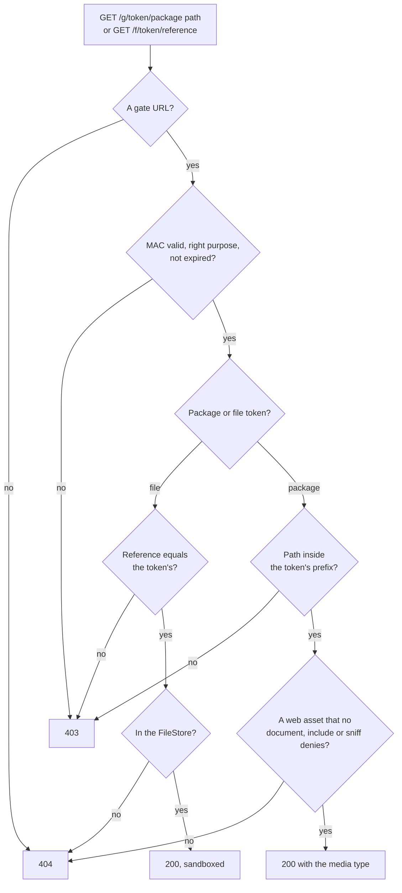

# Asset gate

The asset gate is the one place where package files and candidate files leave the server. A candidate's browser reads files
of the package, such as images, stylesheets and the modules of portable custom interactions, with URLs that carry a signed
token. The package also holds the answer keys, so the gate serves no file that can hold one.



| Export                                              | Purpose                                                                         |
| --------------------------------------------------- | ------------------------------------------------------------------------------- |
| `createAssetGate(options)`                          | Creates the gate: `sign`, `signFile` and `serve`.                               |
| `collectAssetPrefixes(view, pkg)`                   | The prefixes that a view needs.                                                 |
| `AssetGate`, `AssetGateOptions`, `GateResponse`     | The gate, its options and its answer.                                           |
| `DEFAULT_TTL_SECONDS`, `DEFAULT_UPLOAD_TTL_SECONDS` | The default lifetimes of a token for a prefix and for a file: `3600` and `300`. |

```ts
import { openPackage } from "@assesskit/runtime/package";
import { createAssetGate } from "@assesskit/player/server";

const files = new Map(
  Object.entries({
    "imsmanifest.xml": `<manifest xmlns="http://www.imsglobal.org/xsd/qti/qtiv3p0/imscp_v1p1" identifier="package">
      <metadata><schema>QTI Package</schema><schemaversion>3.0.0</schemaversion></metadata>
      <organizations/>
      <resources>
        <resource identifier="q1" type="imsqti_item_xmlv3p0" href="items/q1/item.xml">
          <file href="items/q1/item.xml"/><file href="items/q1/style.css"/>
        </resource>
      </resources>
    </manifest>`,
    "items/q1/item.xml": `<qti-assessment-item xmlns="http://www.imsglobal.org/xsd/imsqtiasi_v3p0" identifier="q1" title="Question"
        adaptive="false" time-dependent="false"><qti-item-body><p>Hello</p></qti-item-body></qti-assessment-item>`,
    "items/q1/style.css": "p { color: #123456; }",
  }).map(([path, text]) => [path, new TextEncoder().encode(text)]),
);
const pkg = openPackage({ paths: [...files.keys()].sort(), read: (path) => files.get(path) });

const key = await crypto.subtle.generateKey({ name: "HMAC", hash: "SHA-256" }, false, ["sign", "verify"]);
const store = { put: async () => ({ reference: "none", mimeType: "text/plain" }), read: async () => undefined };
const gate = createAssetGate({ key, origin: "https://assets.example", packages: async () => pkg, files: store });

const bases = await gate.sign("session-1", ["items/q1/"], 0);
const base = bases["items/q1/"];
base.startsWith("https://assets.example/g/"); // => true

// In the handler of GET /g/* and GET /f/*, with the path of the request and the time:
const style = await gate.serve({ path: new URL(`${base}items/q1/style.css`).pathname }, 1_000);
style.status; // => 200
style.headers["Content-Type"]; // => "text/css; charset=utf-8"
const document = await gate.serve({ path: new URL(`${base}items/q1/item.xml`).pathname }, 1_000);
document.status; // => 404
const expired = await gate.serve({ path: new URL(`${base}items/q1/style.css`).pathname }, 4_000_000);
expired.status; // => 403
```

## Options

`createAssetGate(options)` throws `DataError` when an option is not of its type.

| Option             | Type                               | Meaning                                                                                                                 |
| ------------------ | ---------------------------------- | ----------------------------------------------------------------------------------------------------------------------- |
| `key`              | `CryptoKey`                        | The key that signs tokens: HMAC with SHA-256 and the usages `sign` and `verify`.                                        |
| `origin`           | `string`                           | The origin that serves the gate: `https` and no path, or `http` on `localhost`, `127.0.0.1` or `[::1]` for development. |
| `packages`         | `(session) => Promise<QtiPackage>` | The package that a session delivers.                                                                                    |
| `files`            | `FileStore`                        | The storage of the files that candidates upload.                                                                        |
| `ttlSeconds`       | `number`                           | The seconds a token for a prefix is valid. Default: `3600`.                                                             |
| `uploadTtlSeconds` | `number`                           | The seconds a token for a file of the candidate is valid. Default: `300`.                                               |

## Tokens in the path

A URL has the form `https://<origin>/g/<token>/<package path>`. The token is a compact JWS (RFC 7515) with `alg: HS256`
and the `typ` `asset`, signed with the key. Its payload names the session, a prefix of package paths (a directory that
ends in `/`, or the empty root) and an expiry in epoch milliseconds. The token of a file of the candidate has the `typ`
`file`. A token is refused for any other `alg` or `typ`.

The token is in the path, and not the query, so that relative URLs inherit it: RequireJS resolves a PCI's
`define(["./renderer"], …)` against `baseUrl`, and a stylesheet loaded as text resolves `url(../fonts/x.woff)` against its own
URL. Both stay under the prefix and need no signature of their own.

`sign(session, prefixes, now)` throws `DataError` when a prefix is not a directory in normal form: empty, or segments that
each end in `/`, without `.`, `..`, empty segments, backslashes or control characters. The tokens last `ttlSeconds`, and the
session host renews them with every envelope. A client sends an envelope only when the candidate acts, so a candidate who sends
nothing for longer than `ttlSeconds` gets `403` for what the page loads afterwards, such as a range of a long recording, a card
of a catalog or a module that loads late. Choose `ttlSeconds` above the longest idle that a test allows, or have the page call
`SessionClient.refresh` at an interval below it, which renews the tokens ([client](client.md)).

## Prefixes

`collectAssetPrefixes(view, pkg)` gives the prefixes that a view needs: one for the content root and one for each portable
custom interaction in it.

| Prefix                        | The deepest directory that holds                                                                                                                                                                                                                                                                |
| ----------------------------- | ----------------------------------------------------------------------------------------------------------------------------------------------------------------------------------------------------------------------------------------------------------------------------------------------- |
| The content root              | The documents of the item and its stimuli, the files its content references (`src`, `srcset`, `href`, `data`, `poster`, `longdesc`, `cite`, the card files of catalogs, digital materials), its stylesheets, and the files the manifest lists for its resource and the resources it depends on. |
| A portable custom interaction | Its module resolution files and its modules.                                                                                                                                                                                                                                                    |

The envelope maps each prefix to its base URL. `SessionClient.assets(path)` joins the base of the longest matching prefix with
the package path.

## What the gate serves

| Status | When                                                                                                                                                                                   |
| ------ | -------------------------------------------------------------------------------------------------------------------------------------------------------------------------------------- |
| `403`  | The MAC is wrong, the token is for another purpose, it expired (after `ttlSeconds`), or the path is outside the prefix of the token after `.`, `..` and percent-encoding are resolved. |
| `404`  | The path is not a gate URL, the file does not exist, or the file is never served.                                                                                                      |
| `200`  | Otherwise, with `Content-Type` from the extension.                                                                                                                                     |

A token proves what the host signed: another session's token has another MAC, and a token with a changed payload fails it.

A package holds answer keys, response processing and templates in XML, in documents that the view of a candidate never
loads. Relative URLs resolve against the prefix, so the gate cannot list the files a view loads. It decides by what a file
is, and serves a file only when all of these hold. Anything else is `404`, whatever the token.

1. **The extension is a web asset.** The gate serves HTML, CSS, JavaScript and JSON, text, captions and subtitles, SVG, PLS,
   raster images, audio, video, fonts and PDF, with the media types of `content-type.ts`. `.xml`, a path without an
   extension and any other extension are never served, which keeps every QTI document out by its type.
2. **No resource of the manifest declares it as a document.** The manifest, and the main file of every resource of these
   types, are denied whatever they are named: `imsqti_test_xmlv3p0`, `imsqti_section_xmlv3p0`, `imsqti_item_xmlv3p0`,
   `imsqti_stimulus_xmlv3p0`, `imsqti_resprocessing_xmlv3p0`, `imsqti_rptemplate_xmlv3p0`, `imsqti_outcomes_xmlv3p0`,
   `imsqti_fragment_xmlv3p0`, `qtiusagedata/xml`, `resourcemetadata/xml`, `resourceextmetadata/xml`, `controlfile` and
   `imsbasiclti_xmlv1p3`. The other files that such a resource lists, such as images and stylesheets, are served by rule 1.
3. **No document includes it.** A file named by `xi:include` in a denied document, or in any XML file of the package, is
   denied, and so are the files that it includes in turn. A fragment of an item or test, or a response-processing template,
   is denied even when no resource lists it, or lists it as `webcontent`.
4. **No adaptive section names it.** The files that `qti-adaptive-selection` refers to are denied: its engine, settings,
   item metadata and usage data.
5. **It holds no QTI data.** A file that starts with `<` and declares a namespace that the runtime reads as QTI data (ASI, content
   packaging, results, usage data, QTI metadata, LOM) in its first 4 KiB, written with or without 1EdTech's origin, or is a
   `cartridge_basiclti_link`, is denied. That covers a wrapper element around QTI elements. So is a file that starts with `<`
   and shows no root element in those bytes. This catches the XML that no resource declares, and a file of QTI data that the
   manifest lists as `webcontent`, under an extension that rule 1 serves, such as `.html`, `.svg` or `.txt`. The sniff reads
   UTF-8 or UTF-16 by the byte order mark or, without one, by the zero byte beside the first character, skips white space of
   any length, and then skips the declaration, comments and the document type.

A file under a prefix that no view references is served when it passes these rules, such as another item's image in a shared
folder: that is the price of relative resolution. Keep one folder for each item and its media, which makes prefixes tight.

Files that hold data other than XML, such as a JSON file with the key of an item, are not told apart by their content. Keep
keys in response processing.

## Headers

Every response, whatever its status, carries `Referrer-Policy: no-referrer`, since the token is in the URL, and
`X-Content-Type-Options: nosniff`. A `200` for a package file carries `Content-Security-Policy: sandbox`, except for a PDF,
whose viewer in Chromium refuses to show a sandboxed document.

A package is untrusted content: a link of the content opens its page in a tab, and without the header a script of that page
would run on the asset origin. Under `sandbox` the page has an opaque origin and runs no script, no frame and no form. A page
of a package is therefore static content, and an interaction that needs script is a portable custom interaction. A page or a
drawing that loads a font needs `Access-Control-Allow-Origin`, since an opaque origin sends `Origin: null`.

The gate sets no CORS headers: the host's HTTP layer adds the headers its deployment needs, such as
`Access-Control-Allow-Origin` for the origin of the player when stylesheets are fetched. Serve `pci-frame/*` and `player.css`
from the same origin, outside the gate; they hold no package data.

The code of a portable custom interaction is visible to the candidate: keep answer keys in response processing, which the gate
never serves.

## Files of the candidate

An upload, a recording or a drawing is stored through `FileStore.put`, and the runtime's `FileValue` refers to it. `signFile(session,
file, now)` gives `https://<origin>/f/<token>/<reference>`, a token for one file of one session that lasts
`uploadTtlSeconds`. A request for another reference, or with a token for a prefix, is `403`. The response carries
`Content-Security-Policy: sandbox` besides the headers above, since the bytes are the candidate's.
