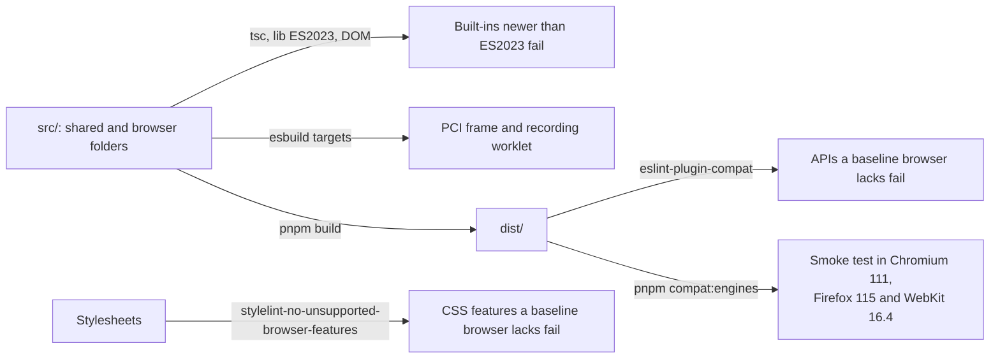

# Browser baseline

The browser code of the player runs in Chromium 111, Firefox 115 and Safari 16.4, and in later versions. The baseline covers
the shared and browser folders (`errors.ts`, `messages/`, `protocol/`, `scoring/`, `cat/`, `player/` and
`client/`) and every stylesheet, so that a page can run practice on a device with `scoring/` and `cat/`. Server folders
(`server/` and `cat-rest/`) are outside it.

## What the baseline allows

These features are in all three browsers and the player uses them:

- custom elements and open shadow roots;
- constructed stylesheets and `adoptedStyleSheets`;
- `<dialog>`, `inert`, `:focus-visible`, container queries and `color-mix()`;
- `ResizeObserver`, `MediaRecorder` and `AudioWorklet`;
- WebCrypto;
- the ES2023 array methods.

## What the baseline excludes

A feature is excluded when at least one of the three browsers lacks it, such as the Popover API, CSS nesting, `:has()`,
`Intl.Segmenter`, iterator helpers and the ES2025 `Set` methods. The data of caniuse and `@mdn/browser-compat-data` decide,
through the tools below, and not a list of the repository.

A feature that a baseline browser lacks is not guarded by a check for its support: the guarded code would be dead in some
browsers and untested in the others.

## How the baseline is enforced

The `browserslist` of `packages/player/package.json` names the three browsers for the tools that read it, and the bundles of
`packages/player/scripts/build-static.ts` and `compat/run-engines.ts` have them as esbuild targets.

| Check                                     | Command                | Catches                                                                                                |
| ----------------------------------------- | ---------------------- | ------------------------------------------------------------------------------------------------------ |
| `tsconfig.browser.json`                   | `pnpm typecheck`       | Built-ins newer than ES2023, because `lib` is `ES2023`, `DOM` and `DOM.Iterable`                       |
| esbuild targets                           | `pnpm build`           | Syntax that a baseline browser cannot parse, in the bundles of the PCI frame and the recording worklet |
| eslint-plugin-compat                      | `pnpm compat:baseline` | Any API of the built JavaScript that a baseline browser lacks, from caniuse and MDN data               |
| stylelint-no-unsupported-browser-features | `pnpm compat:baseline` | Any CSS feature that a baseline browser lacks                                                          |
| The pinned browsers                       | `pnpm compat:engines`  | The [smoke cases](#the-pinned-browsers), in Chromium 111, Firefox 115 and WebKit 16.4                  |

The smoke test runs only the code paths that its cases reach, so the linters, which read every line of the built JavaScript
and every stylesheet, stay. `pnpm compat:baseline` builds, then lints `dist/` of the shared and browser folders, and of the runtime but its `node` and `cli`,
which the player loads in a page, against the `browserslist` of the player. The stylelint
plugin reports `text-indent` as partial for its `each-line` and `hanging` keywords, which the stylesheet does not use, so
`compat/lint.ts` ignores that one feature.

## The pinned browsers

Playwright ships the browsers of its release, and no release has all three at the baseline. Two old releases together do:

| Release | Chromium      | Firefox | WebKit | Used for            |
| ------- | ------------- | ------- | ------ | ------------------- |
| 1.31.2  | 111.0.5563.19 | 109.0   | 16.4   | Chromium and WebKit |
| 1.36.2  | 115.0.5790.75 | 115.0   | 17.0   | Firefox             |

Each release is pinned exactly in a package of its own under `compat/engines/` and runs in the container image of the
same version, `mcr.microsoft.com/playwright:v1.31.2-jammy` and `v1.36.2-jammy`, because old browser builds need the
system libraries of their time. `pnpm compat:engines` runs the smoke cases of `compat/smoke.ts` in both images, with
Docker, and so does the CI job `engines`; pass a pair name (`chromium-webkit` or `firefox`) to run one. Each container takes 2
CPUs, is removed when it ends and is named `<name>-<pair>`, where the name is `CONTAINER_NAME` when it is set, so that a run on a
shared machine names its own (`CONTAINER_NAME=my-unit pnpm compat:engines`), and else `assesskit-engines-` and 8 random
hexadecimal digits.

The player and the protocol import the runtime by package name, which a browser cannot resolve, so before the containers start
`pnpm compat:engines` bundles `dist/player/index.js` and `dist/protocol/index.js` with their dependencies into
`compat/.smoke/player.js` and `compat/.smoke/protocol.js`, which the smoke server serves in their place. Each bundle also exports the names that the package keeps private and the cases drive: the frame of a portable custom interaction, the reading of a range, the renderers of content and of the interactions, and the check of an envelope. The containers run on the `node_modules` of the machine, so esbuild, a native program, runs outside them. The smoke
server also serves MathJax and its fonts from the `mathjax` package that the tests use.

| Smoke case                           | Checks                                                                                                                                                |
| ------------------------------------ | ----------------------------------------------------------------------------------------------------------------------------------------------------- |
| The engine                           | The browser is the baseline version                                                                                                                   |
| Shared modules                       | They load and run                                                                                                                                     |
| `player.css`                         | It styles a content root                                                                                                                              |
| Portable custom interaction          | It runs in its sandboxed frame and reaches no network                                                                                                 |
| Tools                                | The rule, the calculator, the line reader and answer masking are operated by keyboard                                                                 |
| Speech                               | A speech request is built from a content root                                                                                                         |
| Supports                             | The look, a card in place of the content, a popup that stays inside the root and is dismissed by Escape, a button of the panel that becomes a request |
| MathJax                              | MathML is typeset in a shadow root, with braille, and elementary math is left to the browser                                                          |
| Content root                         | Nodes render with the URLs of the package, a hostile stylesheet is sanitized, modal feedback opens in the top layer                                   |
| Choice, order, slider and text entry | They are answered by keyboard, with the recording worklet loaded                                                                                      |
| Graphic interactions                 | They are answered by keyboard, and a drawing is stored in the type of its image                                                                       |

Playwright's WebKit is not Safari. A person checks the player in Safari 16.4 before the first release.
