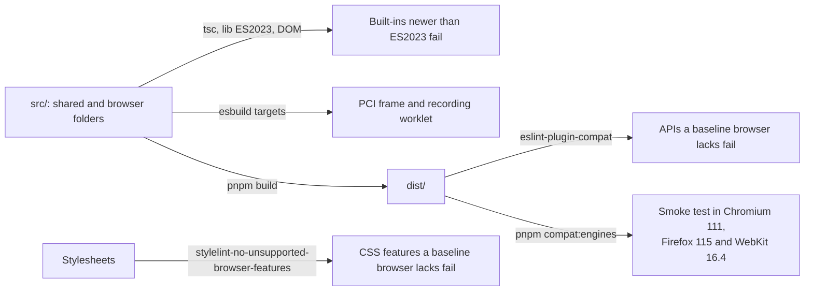

# Browser baseline

The browser code of the player runs in Chromium 111, Firefox 115 and Safari 16.4, and in later versions. The baseline covers
the shared and browser folders (`errors.ts`, `checks.ts`, `messages/`, `protocol/`, `player/` and `client/`) and every
stylesheet. Server folders are outside it.

## What the baseline allows

These features are in all three browsers and the player uses them:

- custom elements and open shadow roots;
- constructed stylesheets and `adoptedStyleSheets`;
- `<dialog>`, `inert`, `:focus-visible`, container queries and `color-mix()`;
- `ResizeObserver`, `MediaRecorder` and `AudioWorklet`;
- WebCrypto;
- the ES2023 array methods.

## What the baseline excludes

A feature is excluded when at least one of the three browsers lacks it, such as the Popover API, CSS nesting, `:has()`,
`Intl.Segmenter`, iterator helpers and the ES2025 `Set` methods. The data of caniuse and `@mdn/browser-compat-data` decide,
through the tools below, and not a list of the repository.

A feature that a baseline browser lacks is not guarded by a check for its support: the guarded code would be dead in some
browsers and untested in the others.

## How the baseline is enforced

The `browserslist` of `packages/player/package.json` names the three browsers for the tools that read it, and the bundles of
`packages/player/scripts/build-static.ts` and `compat/run-engines.ts` have them as esbuild targets.

| Check                                     | Command               | Catches                                                                                                                                                                                                                                                                                      |
| ----------------------------------------- | --------------------- | -------------------------------------------------------------------------------------------------------------------------------------------------------------------------------------------------------------------------------------------------------------------------------------------- |
| `tsconfig.browser.json`                   | `pnpm typecheck`      | Built-ins newer than ES2023, because `lib` is `ES2023`, `DOM` and `DOM.Iterable`                                                                                                                                                                                                             |
| esbuild targets                           | `pnpm build`          | Syntax that a baseline browser cannot parse, in the bundles of the PCI frame and the recording worklet                                                                                                                                                                                       |
| eslint-plugin-compat                      | `pnpm compat`         | Any API of the built JavaScript that a baseline browser lacks, from caniuse and MDN data                                                                                                                                                                                                     |
| stylelint-no-unsupported-browser-features | `pnpm compat`         | Any CSS feature that a baseline browser lacks                                                                                                                                                                                                                                                |
| The pinned browsers                       | `pnpm compat:engines` | The shared modules, `player.css` styling a content root, a portable custom interaction in its frame, the tools of the player, and a choice, an order, a slider and a text entry answered by keyboard with the recording worklet loaded, running in Chromium 111, Firefox 115 and WebKit 16.4 |

The static checks of `pnpm compat` stay because the smoke test runs only the code paths that its cases reach, and the
linters read every line of the built JavaScript and every stylesheet.

`pnpm compat` lints `dist/`, so it needs `pnpm build` first. It checks the shared and browser folders only, and every
stylesheet of the package. The stylelint plugin reports `text-indent` as partial for its `each-line` and `hanging`
keywords, which the stylesheet does not use, so `compat/lint.ts` ignores that one feature.

## The pinned browsers

Playwright ships the browsers of its release, and no release has all three at the baseline. Two old releases together do:

| Release | Chromium      | Firefox | WebKit | Used for            |
| ------- | ------------- | ------- | ------ | ------------------- |
| 1.31.2  | 111.0.5563.19 | 109.0   | 16.4   | Chromium and WebKit |
| 1.36.2  | 115.0.5790.75 | 115.0   | 17.0   | Firefox             |

Each release is pinned exactly in a package of its own under `compat/engines/` and runs in the container image of the
same version, `mcr.microsoft.com/playwright:v1.31.2-jammy` and `v1.36.2-jammy`, because old browser builds need the
system libraries of their time. `pnpm compat:engines` runs the smoke cases of `compat/smoke.ts` in both images, with
Docker; pass a pair name (`chromium-webkit` or `firefox`) to run one. The CI job `engines` runs it too.

The player and the protocol import the runtime by package name, which a browser cannot resolve, so before the containers start
`pnpm compat:engines` bundles `dist/player/index.js` and `dist/protocol/index.js` with their dependencies into
`compat/.smoke/player.js` and `compat/.smoke/protocol.js`, which the smoke server serves in their place. The containers run on the `node_modules` of the machine, so esbuild, a native program, runs outside them. The smoke
server also serves MathJax and its fonts from the `mathjax` package that the tests use.

The cases are: the engine is the baseline; the shared modules
run; `player.css` styles a content root; a portable custom interaction runs in its frame and reaches no network; a speech
request is built from a content root; the supports of a candidate set the look, put a card in place of the content, open a
popup that stays inside the root and is dismissed by Escape, and turn a button of the panel into a request; MathJax typesets MathML in a shadow root, gives braille and leaves elementary
math to the browser; a content root renders nodes with the URLs of the package, sanitizes a hostile stylesheet and opens
modal feedback in the top layer; and the graphic interactions are answered by keyboard and the drawing stores its picture.

Playwright's WebKit is not Safari. A person checks the player in Safari 16.4 before the first release.
