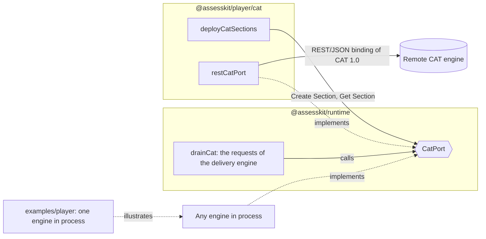
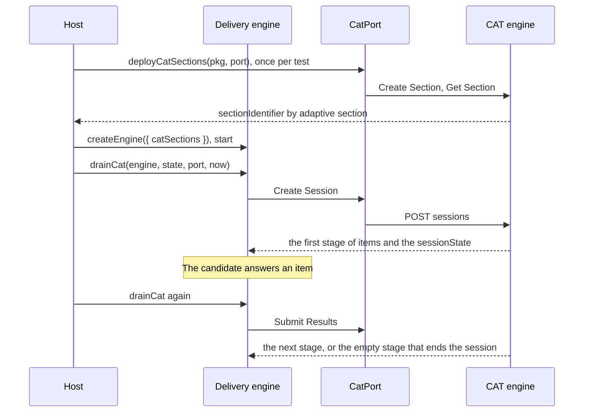

# CAT

The runtime defines `CatPort`, the six requests of a CAT 1.0 engine, and makes no network request and runs no CAT algorithm.
The player implements the port as a client of the REST binding of CAT 1.0 and deploys the adaptive sections of a package. Any
other engine, such as one in process over a psychometrics library, plugs in behind the same port. The code runs on any
server runtime.



| Subpath                 | Export                                            | Purpose                                                                                          |
| ----------------------- | ------------------------------------------------- | ------------------------------------------------------------------------------------------------ |
| `@assesskit/player/cat` | `restCatPort(options)`                            | A client of a remote engine, over the REST/JSON binding of CAT 1.0.                              |
| `@assesskit/player/cat` | `deployCatSections(pkg, port)`                    | Creates the sections of a package's adaptive selections at the engine and checks their pool.     |
| `@assesskit/player/cat` | `CatFetch`, `CatFetchRequest`, `CatFetchResponse` | The part of `fetch` that `restCatPort` uses.                                                     |
| `@assesskit/player/cat` | `OAuthClientCredentials`, `DeployedCatSection`    | The client credentials with which `restCatPort` asks for a token, and what a deployment returns. |

## With the runtime's engine

The delivery engine of the runtime makes the session requests. A deployment creates the sections once, and the delivery engine
takes their identifiers in `catSections`. Any process that holds the port can then answer the requests of any session, because
the engine keeps the session in its state and hands the `sessionState` back with each request.



| Step              | Call                                                                 | When                                                                                  |
| ----------------- | -------------------------------------------------------------------- | ------------------------------------------------------------------------------------- |
| Deploy            | `deployCatSections(pkg, () => port)`                                 | Once, when the test is deployed                                                       |
| Create the engine | `createEngine({ kind: "test", test, base, resolvers, catSections })` | For each session                                                                      |
| Create Session    | `drainCat(engine, state, port, now)` after `engine.start`            | The engine presents the first item once the port has answered                         |
| Submit Results    | `drainCat` again, then let the candidate move on                     | After each submitted item                                                             |
| End Session       | The engine asks for it                                               | Only when the candidate leaves before the port ended the session with the empty stage |

## Any other engine

An engine that runs in process implements `CatPort` and nothing else: the player and the runtime do not know it. The
engine keeps no session of its own, because the runtime stores the `sessionState` that the port returns and hands it back
with the next request. The directory [examples/player](../../examples/player/README.md) has one such engine over a
psychometrics library, with the tests that run it in CI. The [CAT guide of the runtime](../runtime/cat.md) describes the
requests, the stages and the section data that any engine reads.

## restCatPort

`restCatPort(options)` returns a `CatPort` that speaks the REST/JSON binding of CAT 1.0
(<https://www.imsglobal.org/spec/cat/v1p0/bind>) to one remote engine.

| Option        | Default  | Meaning                                                                           |
| ------------- | -------- | --------------------------------------------------------------------------------- |
| `fetch`       | required | `fetch`, or a replacement.                                                        |
| `endpoint`    | required | The `https` URL prefix of the engine, such as `https://cat.example/ims/cat/v1p0`. |
| `credentials` | required | `{ tokenUrl, clientId, clientSecret, scope }`; `tokenUrl` is an `https` URL.      |
| `timeoutMs`   | `10000`  | The milliseconds after which a request, the token request included, is aborted.   |
| `sharePnp`    | `false`  | Whether Create Session sends the personal needs and preferences to the engine.    |

```ts
import { restCatPort } from "@assesskit/player/cat";

const requests = [];
const fetch = async (url, request) => {
  requests.push(`${request.method} ${url}`);
  const body = url.endsWith("/token") ? { access_token: "t0ken", token_type: "Bearer" } : { sectionIdentifier: "s1" };
  return { ok: true, status: 200, text: async () => JSON.stringify(body) };
};
const endpoint = "https://cat.example/ims/cat/v1p0";
const port = restCatPort({
  fetch,
  endpoint,
  credentials: {
    tokenUrl: "https://auth.example/token",
    clientId: "tool",
    clientSecret: "secret",
    scope: "https://purl.imsglobal.org/cat/v1p0/scope/api",
  },
});
const section = await port.createSection(endpoint, { sectionConfiguration: "e30=" });
section; // => { sectionIdentifier: "s1" }
requests; // => ["POST https://auth.example/token", "POST https://cat.example/ims/cat/v1p0/sections"]
```

| Request        | HTTP                                                       | Body                                                       |
| -------------- | ---------------------------------------------------------- | ---------------------------------------------------------- |
| Create Section | `POST {endpoint}/sections`                                 | The section data.                                          |
| Get Section    | `GET {endpoint}/sections/{id}`                             | none                                                       |
| Create Session | `POST {endpoint}/sections/{id}/sessions`                   | `personalNeedsAndPreferences`, `demographics`, `priorData` |
| Submit Results | `POST {endpoint}/sections/{id}/sessions/{session}/results` | `assessmentResult` and `sessionState`                      |
| End Session    | `DELETE {endpoint}/sections/{id}/sessions/{session}`       | none                                                       |
| End Section    | `DELETE {endpoint}/sections/{id}`                          | none                                                       |

- **One engine.** The `prefix` of a request must be the `endpoint`, else `DataError` and nothing is sent. A package names the
  engine in `qti-adaptive-engine-ref`, and the host trusts the engine it configured (CAT section 2.2). Give each engine its own port.
- **Authorization.** The port asks the token endpoint for a bearer token with the client credentials grant: HTTP Basic with
  the form-encoded client identifier and secret, and `grant_type=client_credentials&scope=…` (binding section 4.2, RFC 6749
  section 4.4). The binding recommends the scope `https://purl.imsglobal.org/cat/v1p0/scope/api` for every endpoint, or
  `.../scope/configure` for sections and `.../scope/deliver` for sessions; an engine may define others.
- **Token.** The port keeps the token. It reads no clock, so it learns that the token expired from a `401`: it asks for a new
  token and repeats the request once.
- **Transport.** Every URL is `https` (binding section 4.1). Redirects are errors, because a redirect would send the token to
  another address. The error of `fetch`, such as a timeout, is passed on unchanged.
- **Failure.** A status other than 2xx, and a body that is not JSON, are a `ServiceError` with the `status` and the `body`.
- **Personal data.** Without `sharePnp` the body of Create Session has no `personalNeedsAndPreferences`.

### JSON

The names of the JSON are those of the binding (section 5, Appendix B). The runtime's `cat` module writes and reads the assessment result
and the item stage (the JSON binding section of the runtime's CAT guide), and the port reads and writes the rest of the bodies:

| runtime                                      | Binding                                                |
| -------------------------------------------- | ------------------------------------------------------ |
| `GetSectionResponse.sectionData` and `items` | `section` and `items`                                  |
| `PriorDataEntry` `{ name, value }`           | `{ key, value }`; a value that is not text is its JSON |

An engine may leave out the context of the result it returns (CAT section 4.3.2); the result then has no session identifiers.

### Section metadata

The two normative documents of CAT 1.0 disagree about `qtiMetadata` of the section:

| Source                                                        | Type of `qtiMetadata`                                                                                                  |
| ------------------------------------------------------------- | ---------------------------------------------------------------------------------------------------------------------- |
| CAT Service section 4.1 (and the runtime's `SectionData`)     | The base64 text of the file that `qti-metadata-ref` references: the JSON of Appendix B, with one record for each item. |
| REST/JSON binding, `SectionDType` (section 5.2.1, Appendix B) | An object of `QTIMetadataDType`: one QTI metadata record (`composite`, `interactionType`, `scoringMode`, and so on).   |

The port follows the binding, because it defines the JSON on the wire: CAT section 3 sends the reader to the binding for the full
technical details of the requests and their bodies, and the schema has `additionalProperties: false`, so an engine that
validates the body rejects text where it expects an object. The metadata file of the section data is not a
`QTIMetadataDType` record, so no field of the binding carries it:

- **Create Section** sends `sectionConfiguration` and `qtiUsagedata` only. The metadata file does not reach the engine, though
  CAT section 4.1 says a platform must transmit it. The binding gives the file no place, so an engine cannot read it over REST.
- **Get Section** accepts a `qtiMetadata` object, checks that it is one, and leaves it out of the section data.

`datestamp` is a `date-time` of RFC 3339 in the binding's schema; the port sends the `xs:dateTime` of the result as it is.

The binding's OpenAPI 3 file is named in Appendix B of the binding as
`https://purl.imsglobal.org/cat/v1p0/schema/openapi/imscatv1p0_openapi3_v1p0.json`; that address does not serve the file. The
listing in Appendix B1.2 of <https://www.imsglobal.org/spec/cat/v1p0/bind> is the text the codec of the runtime was written against.

## deployCatSections

`deployCatSections(pkg, port)` deploys the adaptive sections of every test of a package, in document order. For each:

1. It reads the files that the `qti-adaptive-selection` references, against the document that holds the section: the
   settings, and the usage data and the metadata when referenced. A selection without a settings reference sends an empty
   settings file, because the engine may be configured elsewhere (CAT section 2.2).
2. It calls `port(selection)` for the engine, which is the host's choice by `qti-adaptive-engine-ref`.
3. It makes Create Section with `sectionData` of the runtime, then Get Section, and checks the pool against the item references
   with `checkPool` (CAT sections 2.1 and 2.2).

The result maps the identifier of each adaptive section to `{ prefix, sectionIdentifier }`, which is
`DeliveryDefinition.catSections`. Create Section is not idempotent at a remote engine, so deploy once. When a check fails,
the sections made so far stay, and the `DataError` names the section at the engine, so that the host can end it.

## Errors

| Error          | When                                                                                                               |
| -------------- | ------------------------------------------------------------------------------------------------------------------ |
| `DataError`    | An option or an argument has the wrong type, or section data, a `sessionState` or an engine's answer is malformed. |
| `ServiceError` | The engine answers with a status other than 2xx, or with a body that is not JSON, or the token endpoint fails.     |

Errors of the runtime pass through unchanged: `ReadError` and `SecurityError` of the usage data and the package, and the `DataError`
of the runtime for an assessment result or an item stage of an answer that is not the JSON of the binding. The errors of an
engine that the host supplies pass through unchanged too.

## Not included

| Not included                                 | Why                                                                         |
| -------------------------------------------- | --------------------------------------------------------------------------- |
| A CAT algorithm                              | Neither package runs one; an engine is a `CatPort` that the host supplies   |
| The section metadata file over REST          | The binding has no field for it (see [Section metadata](#section-metadata)) |
| Another transport than the REST/JSON binding | Implement `CatPort` over it                                                 |
