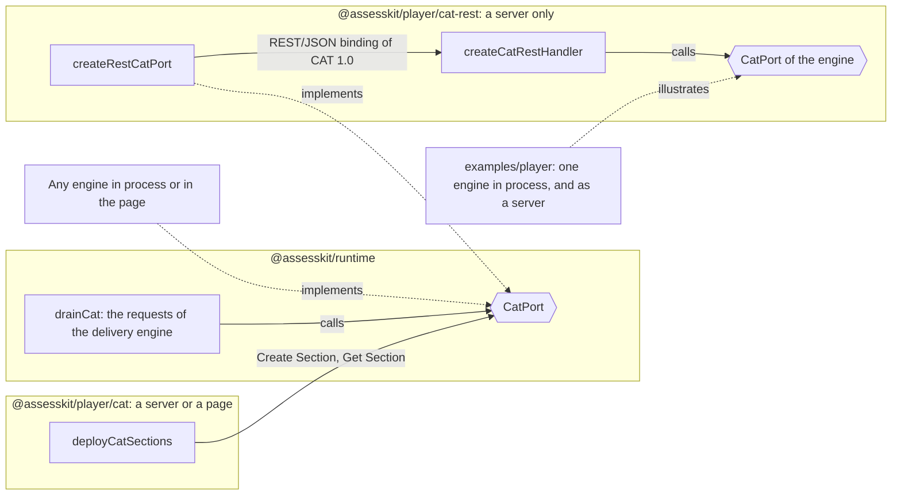
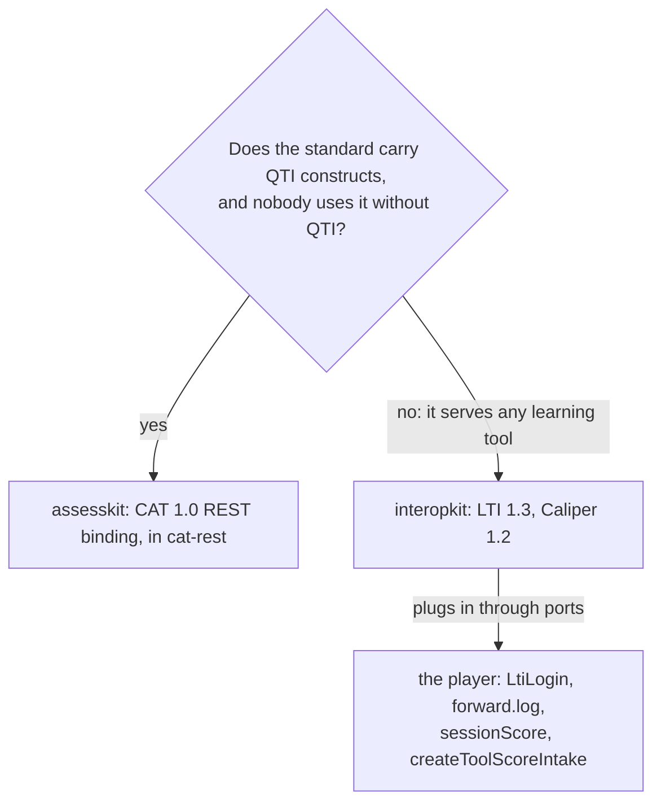
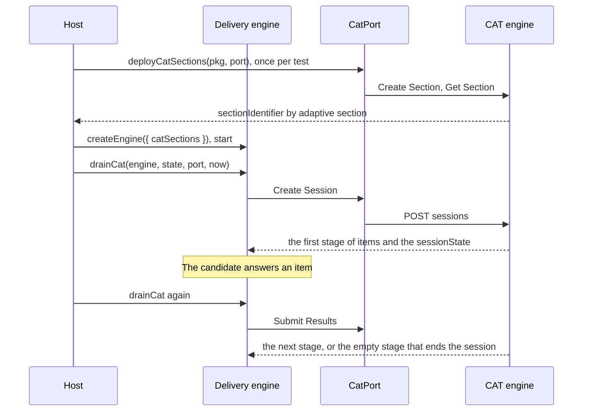
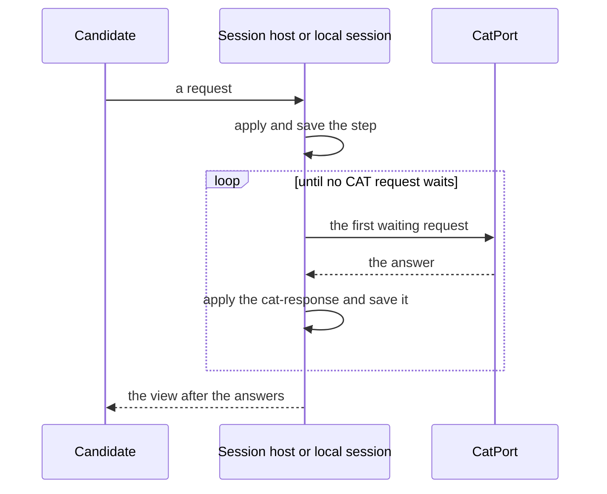
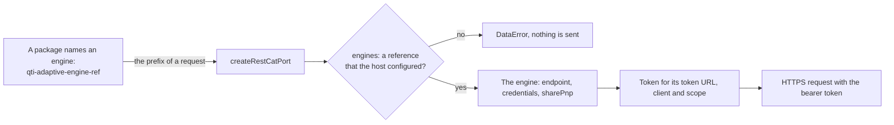
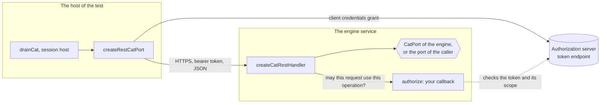

# CAT

The runtime defines `CatPort`, the six requests of a CAT 1.0 engine, and makes no network request and runs no CAT algorithm.
The player has two subpaths for it. `@assesskit/player/cat` deploys the adaptive sections of a package through any port, on a
server or in a page. `@assesskit/player/cat-rest` speaks the REST binding of CAT 1.0 on a server, on both sides of the wire:
`createRestCatPort` is the client of a remote engine, and `createCatRestHandler` is the engine side, which answers the binding's requests
for any `CatPort`. Any other engine, such as one in process over a psychometrics library, plugs in behind the same port.



| Subpath                      | Side   | Export                                              | Purpose                                                                                       |
| ---------------------------- | ------ | --------------------------------------------------- | --------------------------------------------------------------------------------------------- |
| `@assesskit/player/cat`      | shared | `deployCatSections(pkg, port)`                      | Creates the sections of a package's adaptive selections at the engine and checks their pool.  |
| `@assesskit/player/cat`      | shared | `DeployedCatSection`                                | What a deployment returns for an adaptive section.                                            |
| `@assesskit/player/cat-rest` | server | `createRestCatPort(options)`                        | A client of a remote engine, over the REST/JSON binding of CAT 1.0.                           |
| `@assesskit/player/cat-rest` | server | `createCatRestHandler(port, options)`               | The engine side of the binding: a `Request` to a `Response`, over any `CatPort`.              |
| `@assesskit/player/cat-rest` | server | `CatAuthorizer`, `CatAuthorization`, `CatOperation` | The callback that authorizes a request, what it answers, and the names of the six operations. |
| `@assesskit/player/cat-rest` | server | `CAT_SCOPES`, `scopesOf(operation)`                 | The scopes of the binding, and the scopes that enable an operation.                           |
| `@assesskit/player/cat-rest` | server | `CatEngine`, `CatEngines`, `CatEngineResolver`      | The engines that `createRestCatPort` reaches, by the reference that a package names.          |
| `@assesskit/player/cat-rest` | server | `CatFetch`, `CatFetchRequest`, `CatFetchResponse`   | The part of `fetch` that `createRestCatPort` uses.                                            |
| `@assesskit/player/cat-rest` | server | `OAuthClientCredentials`                            | The client credentials with which `createRestCatPort` asks for a token.                       |

## Why the REST subpath stays on servers

`createRestCatPort` holds an OAuth client secret and sends the candidate's results to a remote engine, so it must never reach a
browser bundle. The subpath `cat-rest` is for that reason separate from `cat`, and no shared or browser folder of the package
imports it (lint); the bundle tests check that the bundles of the candidate and of practice hold none of its files.
`createCatRestHandler` holds no secret, but it serves answer keys of the engine and candidate results, so it too belongs on a server.
A page that runs practice with an adaptive section brings its own `CatPort`, such as an engine over a psychometrics library in
the page, and deploys with `deployCatSections(pkg, () => port)` from `@assesskit/player/cat`. Nothing in the library can see a
host's page: a host that imports `@assesskit/player/cat-rest` there puts the secret in the page, and
[SECURITY.md](../../SECURITY.md) says to keep it on the server.

## Why the binding is in assesskit

CAT 1.0 exists to carry the adaptive sections of QTI 3: the package names the engine in `qti-adaptive-engine-ref` and the
files in `qti-adaptive-settings-ref`, and the requests carry QTI assessment results, item identifiers and usage data. Nobody
uses the binding without QTI, so a library that is complete for QTI 3 serves both ends of it. LTI and Caliper are different:
they carry launches, grades and learning events of any learning tool, and nothing in them names a QTI construct, so they
belong to the interoperability family ([interopkit](https://github.com/interopkit/interopkit)), which the player reaches
through ports.



## Why the token request is written here

The token request is the client credentials grant with HTTP Basic (RFC 6749 sections 2.3.1 and 4.4): one `POST`, and a check
that the answer holds a bearer `access_token`. interopkit's OAuth clients make it with `oauth4webapi` 3.8.8, and here that
library would cost more than the request it replaces:

| Measure                                                               | Written here                                       | With `oauth4webapi` 3.8.8                                                                                                        |
| --------------------------------------------------------------------- | -------------------------------------------------- | -------------------------------------------------------------------------------------------------------------------------------- |
| `@assesskit/player/cat-rest` after gzip ([size](size.md))             | 14,475 bytes                                       | 18,804 bytes, above its budget of 18,000                                                                                         |
| What the host's `fetch` returns                                       | `ok`, `status`, `text()`, and `type` if it has one | `headers` too: the library reads `content-type` before it parses an OAuth error (section 5.2), and `WWW-Authenticate` of a `401` |
| The timeout, no redirect, the tokens of JSON counted before the parse | In the request                                     | In a wrapper around the library's `fetch`, as long as the request                                                                |

The port asks the host's `fetch` for the least, so a replacement that returns a status and a body, as in the sample below,
works; the library would need the headers of every answer, or headers that the client makes up. What else it checks, the binding
does not use: the client reads no clock and leaves `expires_in` aside, and any status but 2xx is a failure with its status and body.

## With the runtime's engine

The delivery engine of the runtime makes the session requests. A deployment creates the sections once, and the delivery engine
takes their identifiers in `catSections`. Any process that holds the port can then answer the requests of any session, because
the engine keeps the session in its state and hands the `sessionState` back with each request.



| Step              | Call                                                                 | When                                                                                  |
| ----------------- | -------------------------------------------------------------------- | ------------------------------------------------------------------------------------- |
| Deploy            | `deployCatSections(pkg, () => port)`                                 | Once, when the test is deployed                                                       |
| Create the engine | `createEngine({ kind: "test", test, base, resolvers, catSections })` | For each session                                                                      |
| Create Session    | `drainCat(engine, state, port, now)` after `engine.start`            | The engine presents the first item once the port has answered                         |
| Submit Results    | `drainCat` again, then let the candidate move on                     | After each submitted item                                                             |
| End Session       | The engine asks for it                                               | Only when the candidate leaves before the port ended the session with the empty stage |

## The option cat

A session host and a local session take the port as the option `cat`, and then answer their own CAT requests, so that no host
code drains them. A server passes any `CatPort`, such as `createRestCatPort`; a page passes its own in-browser port, never
`createRestCatPort`. The option is a `CatSessionPort`, the three methods that a session calls (`createSession`, `submitResults` and
`endSession`), so that the client of an engine that someone else deployed needs no `createSection`, `getSection` or `endSection`.



| Call                                                    | What the session does with the CAT requests                                                                               |
| ------------------------------------------------------- | ------------------------------------------------------------------------------------------------------------------------- |
| `start`, `createLocalSession`                           | Creates and saves the session, then answers Create Session                                                                |
| `handle`, `dispatch`                                    | Waits for a running loop first, applies the step, then answers the requests that the step made, and replies with the view |
| `handle` with a repeated sequence number                | Waits for a running loop, then replays the stored answer, which each accepted answer refreshed                            |
| `view`                                                  | Waits for a running loop, then builds the envelope                                                                        |
| `proctor`, `session(id).apply`, `host.apply`, the timer | Applies the step, then starts the loop and waits for it. When a loop runs, the call returns at once                       |
| `pending`, `scorerView`, `results`, `check`             | Read only, and answer nothing                                                                                             |

One loop runs for each session: it reads the pending requests again until none waits, saves each answer before the next
request, and takes no signal. A step that returns because a loop runs marks the loop, and a loop marked since its last read
began reads once more before it ends, so work that arrives while the loop ends is never left unanswered. An abort ends the wait of the caller that passed it, never the loop. A refusal `unknown-request`
means that another call answered first, and the loop reads again. A port never calls the session, and a `log` calls only
`session(id)`, whose `apply` never waits for a running loop.

| Where the loop fails                                                  | Behavior                                                                                                                 |
| --------------------------------------------------------------------- | ------------------------------------------------------------------------------------------------------------------------ |
| Before a step                                                         | It never stops the step                                                                                                  |
| After `proctor`, `session(id).apply` or `host.apply`                  | The step returns with `catFailure` (`request`, `message`) as a value; a time job throws on it for its queue to retry     |
| After `handle`, `dispatch`, `start`, `createLocalSession` or a replay | Rejects with `ServiceError` only when no item is presented and the session is in progress; otherwise it answers as usual |
| In `view`                                                             | It answers with the view as it is                                                                                        |
| In the timer of a local session                                       | The error goes to `reportError`, and the next call retries                                                               |

A port's own `ServiceError` passes through, and any other error is wrapped with status 0. The request stays pending and the
next call tries it again; saved answers stay saved. A process that crashes after the port answered and before the save loses
the answer, and the request goes out again; CAT 1.0 has no idempotency key, so the engine may count it twice. Two server
processes may send one request twice: route each session to one process.

A host without the option reads `pending().cat`, calls `sendCatRequest` and applies the answer with `session(id).apply`, after
every call that can make a request: `start`, `handle`, `proctor` and the time job.

## Any other engine

An engine that runs in process implements `CatPort` and nothing else: the player and the runtime do not know it. The
engine keeps no session of its own, because the runtime stores the `sessionState` that the port returns and hands it back
with the next request. The directory [examples/player](../../examples/player/README.md) has one such engine over a
psychometrics library, with the tests that run it in CI. The [CAT guide of the runtime](../runtime/cat.md) describes the
requests, the stages and the section data that any engine reads.

## createRestCatPort

`createRestCatPort(options)`, from `@assesskit/player/cat-rest`, returns a `CatPort` that speaks the REST/JSON binding of CAT 1.0
(<https://www.imsglobal.org/spec/cat/v1p0/bind>) to the remote engines that the host configured. A package names an engine by
a reference (`qti-adaptive-engine-ref`), which is the `prefix` of every request, and `engines` says which engine the reference
stands for.



| Option      | Default   | Meaning                                                                                                                                                              |
| ----------- | --------- | -------------------------------------------------------------------------------------------------------------------------------------------------------------------- |
| `fetch`     | required  | `fetch`, or a replacement.                                                                                                                                           |
| `engines`   | required  | A `Map` from reference to engine, or a function from a reference to its engine, or to `undefined` for a reference that the host did not configure (it may be async). |
| `timeoutMs` | `10000`   | The milliseconds after which a request, the token request included, is aborted.                                                                                      |
| `maxTokens` | `1000000` | The most tokens of the JSON of an answer, the token endpoint's included, counted before the parse: an answer with more is a `ServiceError`.                          |

| Field of an engine | Default  | Meaning                                                                                                             |
| ------------------ | -------- | ------------------------------------------------------------------------------------------------------------------- |
| `endpoint`         | required | The `https` URL prefix of the engine, such as `https://cat.example/ims/cat/v1p0`. It may differ from the reference. |
| `credentials`      | required | `{ tokenUrl, clientId, clientSecret, scope }`; `tokenUrl` is an `https` URL.                                        |
| `sharePnp`         | `false`  | Whether Create Session sends the candidate's personal needs and preferences to this engine.                         |

```ts
import { createRestCatPort } from "@assesskit/player/cat-rest";

const requests = [];
const fetch = async (url, request) => {
  requests.push(`${request.method} ${url}`);
  const body = url.endsWith("/token") ? { access_token: "t0ken", token_type: "Bearer" } : { sectionIdentifier: "s1" };
  return { ok: true, status: 200, text: async () => JSON.stringify(body) };
};
// The package names the engine by its public address; the platform reaches it through a gateway.
const reference = "https://engine.example/ims/cat/v1p0";
const port = createRestCatPort({
  fetch,
  engines: new Map([
    [
      reference,
      {
        endpoint: "https://gateway.internal/engines/a/ims/cat/v1p0",
        credentials: {
          tokenUrl: "https://auth.example/token",
          clientId: "tool",
          clientSecret: "secret",
          scope: "https://purl.imsglobal.org/cat/v1p0/scope/api",
        },
      },
    ],
  ]),
});
const section = await port.createSection(reference, { sectionConfiguration: "e30=" });
section; // => { sectionIdentifier: "s1" }
requests; // => ["POST https://auth.example/token", "POST https://gateway.internal/engines/a/ims/cat/v1p0/sections"]
```

- **Which engine.** The `prefix` of a request is the reference that the package names, with trailing slashes removed. A
  reference that `engines` does not know is a `DataError`, and nothing is sent: no candidate data and no token leave for an
  engine that the host did not configure (CAT section 2.2). The delivery definition keeps the reference, not the endpoint.
- **A function is an allowlist.** The reference is the package's word. A function maps known references to configured
  engines. It never builds an `endpoint` or a `tokenUrl` from the reference, and never returns shared credentials for any
  reference, because the port sends the client secret and the candidate's data to the engine it returns.
- **One port, many engines.** The port keeps a token for each token URL, client and scope, so engines with their own
  credentials never share a token. A gateway maps its public reference to the upstream endpoint, as the sample does.
- **Identifiers in the path.** A section or session identifier is percent-encoded into the path. One that is `.` or `..` is
  a `DataError` and nothing is sent, since a URL takes it as a step to another path: `sections/..` is the endpoint itself.
- **An expired token.** An engine that answers `401` gets the request once more with a new token. The requests under way
  when a token expires ask for one new token together, so the token endpoint sees one request and not one per candidate.

| Request        | HTTP                                                       | Body                                                       |
| -------------- | ---------------------------------------------------------- | ---------------------------------------------------------- |
| Create Section | `POST {endpoint}/sections`                                 | The section data.                                          |
| Get Section    | `GET {endpoint}/sections/{id}`                             | none                                                       |
| Create Session | `POST {endpoint}/sections/{id}/sessions`                   | `personalNeedsAndPreferences`, `demographics`, `priorData` |
| Submit Results | `POST {endpoint}/sections/{id}/sessions/{session}/results` | `assessmentResult` and `sessionState`                      |
| End Session    | `DELETE {endpoint}/sections/{id}/sessions/{session}`       | none                                                       |
| End Section    | `DELETE {endpoint}/sections/{id}`                          | none                                                       |

- **Authorization.** The port asks the token endpoint for a bearer token with the client credentials grant: HTTP Basic with
  the form-encoded client identifier and secret, and `grant_type=client_credentials&scope=…` (binding section 4.2, RFC 6749
  section 4.4). The binding recommends the scope `https://purl.imsglobal.org/cat/v1p0/scope/api` for every endpoint, or
  `.../scope/configure` for sections and `.../scope/deliver` for sessions; an engine may define others.
- **Token.** The port keeps the token. It reads no clock, so it learns that the token expired from a `401`: it asks for a new
  token with the credentials that `engines` gives for the request, and repeats the request once. A `Map` of `engines` is read
  once, when the port is created, so a secret that rotates needs the function form, which the port calls for every request.
  A `403` is a failure and is not repeated.
- **Transport.** Every URL is `https` (binding section 4.1). Redirects are errors, because a redirect would send the token to
  another address. The error of `fetch`, such as a timeout, is passed on unchanged.
- **Failure.** A status other than 2xx, and a body that is not JSON, are a `ServiceError` with the `status` and the `body`. A
  failed request for a token is one too, with the status of the token endpoint; a gateway answers it as a fault (500) and not
  with that status, because the credentials or the token URL of the host are wrong, not the request of the caller.
- **Personal data.** Without `sharePnp` on the engine the body of Create Session has no `personalNeedsAndPreferences`.

### JSON

The names of the JSON are those of the binding (section 5, Appendix B). The runtime's `cat` module writes and reads the assessment result
and the item stage (the JSON binding section of the runtime's CAT guide), and the port reads and writes the rest of the bodies:

| runtime                                         | Binding                                                             |
| ----------------------------------------------- | ------------------------------------------------------------------- |
| `GetSectionResponse.sectionData` and `items`    | `section` and `items`                                               |
| `PriorDataEntry` `{ name, value, glossaryUri }` | `{ key, value, glossaryURI }`; a value that is not text is its JSON |

An engine may leave out the context of the result it returns (CAT section 4.3.2); the result then has no session identifiers.

### Section metadata

The two normative documents of CAT 1.0 disagree about `qtiMetadata` of the section:

| Source                                                        | Type of `qtiMetadata`                                                                                                  |
| ------------------------------------------------------------- | ---------------------------------------------------------------------------------------------------------------------- |
| CAT Service section 4.1 (and the runtime's `SectionData`)     | The base64 text of the file that `qti-metadata-ref` references: the JSON of Appendix B, with one record for each item. |
| REST/JSON binding, `SectionDType` (section 5.2.1, Appendix B) | An object of `QTIMetadataDType`: one QTI metadata record (`composite`, `interactionType`, `scoringMode`, and so on).   |

The port follows the binding, because it defines the JSON on the wire: CAT section 3 sends the reader to the binding for the full
technical details of the requests and their bodies, and the schema has `additionalProperties: false`, so an engine that
validates the body rejects text where it expects an object. The record has a field of its own in the section data,
`qtiMetadataRecord`, the runtime's `QtiMetadata`, and the metadata file does not reach the wire:

- **Create Section** sends `sectionConfiguration`, `qtiUsagedata` and the record as `qtiMetadata`, with the lists
  `interactionType` and `scoringMode` left out when they are empty. The metadata file does not reach the engine, though CAT
  section 4.1 says a platform must transmit it: the binding gives the file no place, so an engine cannot read it over REST.
- **Get Section** returns the `qtiMetadata` object as `qtiMetadataRecord`, with the lists empty when it leaves them out. It
  leaves out a property of the answer that the binding does not name, at every level, and the handler refuses one in a
  request, so that an engine that adds a field does not break its clients.
- **The handler** passes the record of a Create Section request to the port, and writes the record of the port's Get Section
  answer.

The prior data of Create Session carry a `glossaryURI` for an entry, which is `glossaryUri` in the model.

`datestamp` is a `date-time` of RFC 3339 in the binding's schema; the port sends the `xs:dateTime` of the result as it is.

The binding's OpenAPI 3 file is named in Appendix B of the binding as
`https://purl.imsglobal.org/cat/v1p0/schema/openapi/imscatv1p0_openapi3_v1p0.json`; that address does not serve the file. The
listing in Appendix B1.2 of <https://www.imsglobal.org/spec/cat/v1p0/bind> is the text the codec of the runtime was written against.

## createCatRestHandler

`createCatRestHandler(port, options)`, from `@assesskit/player/cat-rest`, is the engine side of the same binding: a function from a web
`Request` to a `Response` that answers the six requests by calling a `CatPort`. It is the mirror of `createRestCatPort`, built on the
same codec (the JSON of the binding is written once, in `cat-rest`, and read by both), so the two meet without an adapter.



| Option         | Default                              | Meaning                                                                                                                                                                                                                                                                                                    |
| -------------- | ------------------------------------ | ---------------------------------------------------------------------------------------------------------------------------------------------------------------------------------------------------------------------------------------------------------------------------------------------------------- |
| `authorize`    | required                             | `(request, operation) => CatAuthorization`, sync or async: the decision, below. The handler holds no credentials of its own. The request has its body unread, and the step must not read it.                                                                                                               |
| `root`         | `"/ims/cat/v1p0"`                    | The path that the handler receives, with no trailing slash, or `""` where a proxy strips the path. The binding asks the public paths to begin with `/ims/cat/v1p0` (section 2.2).                                                                                                                          |
| `prefix`       | the origin and `root` of the request | The reference that every call of the port gets as its `prefix`: the address of the engine as the `qti-adaptive-engine-ref` of its sections names it, an `https` URL. Set it for a public deployment.                                                                                                       |
| `maxBodyBytes` | `33554432`                           | The most bytes of a request body, counted as the stream is read (32 MiB, the size limit of an XML file in the runtime). It holds a base64 field of about 24 MiB of file. A larger body answers 400.                                                                                                        |
| `maxTokens`    | `1000000`                            | The most tokens of the JSON of a request body, counted before it is parsed: each structural character, string, number and literal counts one. The memory of a parse follows the tokens: 32 MiB of empty objects would take more than a gigabyte. A base64 file is one token. A body with more answers 400. |
| `onError`      | none                                 | `(error, request, operation) => void`: called once for every answer of 500, with the error behind it. Never for a refusal of the caller, for `server_busy`, or after an abort. It is not awaited, and its own failure is ignored.                                                                          |

```ts
import { CAT_SCOPES, createCatRestHandler, scopesOf } from "@assesskit/player/cat-rest";

const engine = {
  createSection: async () => ({ sectionIdentifier: "s1" }),
  getSection: async () => ({ sectionData: { sectionConfiguration: "e30=" }, items: { itemIdentifiers: ["q1"] } }),
  createSession: async () => ({ sessionIdentifier: "x1", nextItems: { itemIdentifiers: ["q1"], stageLength: 1 } }),
  submitResults: async () => ({ nextItems: null }),
  endSession: async () => undefined,
  endSection: async () => undefined,
};
// A token store of your own: the scopes that each token carries.
const tokens = new Map([["t0ken", new Set([CAT_SCOPES.deliver])]]);
const handle = createCatRestHandler(engine, {
  authorize: (request, operation) => {
    const token = request.headers.get("authorization")?.replace(/^Bearer /, "");
    if (token === undefined) return false;
    const scopes = tokens.get(token);
    if (scopes === undefined) return { denied: "invalid-token" };
    return scopesOf(operation).some((scope) => scopes.has(scope)) ? true : { denied: "insufficient-scope" };
  },
});
const create = (token) =>
  handle(
    new Request("https://cat.example/ims/cat/v1p0/sections", {
      method: "POST",
      headers: { authorization: `Bearer ${token}`, "content-type": "application/json" },
      body: JSON.stringify({ sectionConfiguration: "e30=" }),
    }),
  );
(await create("t0ken")).status; // => 403
(await create("other")).status; // => 401
```

`authorize` decides, before any of the body is read, and its result is one of these:

| Result                                      | The handler                                                                                                                      |
| ------------------------------------------- | -------------------------------------------------------------------------------------------------------------------------------- |
| `true`                                      | Serves the request with the `port` that it was created with.                                                                     |
| `false`                                     | Answers 401 with `WWW-Authenticate: Bearer`: the request carries no credentials, or you do not say why.                          |
| `{ port }`                                  | Serves the request with that port: the port of the caller, for several clients on one root.                                      |
| `{ denied: "invalid-token" }`               | Answers 401 with `WWW-Authenticate: Bearer error="invalid_token"`: the token is unknown, expired or malformed.                   |
| `{ denied: "insufficient-scope", scopes? }` | Answers 403 with the code minor `forbidden` and `error="insufficient_scope"`, naming `scopes`, by default `scopesOf(operation)`. |

`scopesOf(operation)` gives the scopes of the binding that enable an operation: `CAT_SCOPES.api`, and `CAT_SCOPES.configure` for the
sections or `CAT_SCOPES.deliver` for the sessions (binding section 4.3). Any other result, or a step that throws, is a fault of the
host: 500, and `onError`.

### Several clients on one root

The port has no idea who calls. A host that serves several clients answers with the port of the caller, which it builds over the
shared engine with a check of the owner of every section and session, and gives the handler a port that refuses everything, so that
a path that returns `true` by mistake reaches no section. An object of another client is an unknown object (a `ServiceError` of status
404), which also hides that it exists. [The example](../../examples/player/cat-with-measurekit/README.md) does exactly this.

```ts
import { ServiceError } from "@assesskit/player";

const owners = new Map(); // section identifier -> client
const unknown = () => new ServiceError("The section is unknown.", 404, "");
const portOf = (engine, client) => ({
  ...engine,
  async createSection(prefix, data) {
    const answer = await engine.createSection(prefix, data);
    owners.set(answer.sectionIdentifier, client);
    return answer;
  },
  async getSection(prefix, section) {
    if (owners.get(section) !== client) throw unknown();
    return engine.getSection(prefix, section);
  },
});
const refusing = {
  createSection: unknown,
  getSection: unknown,
  createSession: unknown,
  submitResults: unknown,
  endSession: unknown,
  endSection: unknown,
};
// authorize: (request, operation) => ({ port: portOf(engine, clientOf(request)) })
// createCatRestHandler(refusing, { authorize })
owners.size; // => 0
```

### A gateway

A gateway answers for an engine at another address. The package names the engine by its public reference, the gateway serves that
reference, and `createRestCatPort` reaches the upstream endpoint:

```ts
import { createCatRestHandler, createRestCatPort } from "@assesskit/player/cat-rest";

const reference = "https://engine.example/ims/cat/v1p0";
const upstream = createRestCatPort({
  fetch,
  engines: new Map([
    [
      reference,
      {
        endpoint: "https://engine.internal/ims/cat/v1p0",
        credentials: {
          tokenUrl: "https://auth.internal/token",
          clientId: "gateway",
          clientSecret: "secret",
          scope: "https://purl.imsglobal.org/cat/v1p0/scope/api",
        },
      },
    ],
  ]),
});
const gateway = createCatRestHandler(upstream, {
  authorize: (request) => request.headers.has("authorization"),
  prefix: reference,
});
typeof gateway; // => "function"
```

Without `prefix` the port gets the internal address of the gateway as the reference, and `createRestCatPort` refuses it: every
request answers 500, and `onError` has the `DataError` that says why.

Every request goes through the same steps, in this order, and a request leaves at the first step that fails:

```mermaid
flowchart TD
  r[Request] --> route{"Path and method select an operation?"}
  route -->|"no endpoint"| e404["404 Unknown Object"]
  route -->|"wrong method"| e405["405 with Allow"]
  route -->|"bad percent-encoding"| e400a["400"]
  route -->|yes| auth{"authorize(request, operation)"}
  auth -->|false| e401["401 with WWW-Authenticate: Bearer"]
  auth -->|"invalid-token"| e401b["401 with error invalid_token"]
  auth -->|"insufficient-scope"| e403["403 forbidden"]
  auth -->|"throws, or not a decision"| e500a["500 and onError"]
  auth -->|"true or a port"| body{"Body within the limit, JSON, and valid?"}
  body -->|"no: a DataError of the readers"| e400b["400 with the first problem"]
  body -->|"no: another error"| e500b["500 and onError"]
  body -->|yes| call["The port is called"]
  call -->|"ServiceError 404, not Create Section"| e404b["404 Unknown Object"]
  call -->|"ServiceError 400"| e400c["400"]
  call -->|"ServiceError 429 or 503"| e503["the same status, server_busy"]
  call -->|"any other error"| e500c["500 and onError"]
  call -->|answer| enc{"A valid answer?"}
  enc -->|no| e500d["500 and onError"]
  enc -->|yes| ok["200, 201 or 204"]
```

| Operation      | Method and path under `root`                     | Success | Body of the answer                               |
| -------------- | ------------------------------------------------ | ------- | ------------------------------------------------ |
| Create Section | `POST /sections`                                 | 201     | `{ sectionIdentifier }`                          |
| Get Section    | `GET /sections/{id}`                             | 200     | `{ section, items }`                             |
| End Section    | `DELETE /sections/{id}`                          | 204     | none                                             |
| Create Session | `POST /sections/{id}/sessions`                   | 201     | `{ sessionIdentifier, nextItems, sessionState }` |
| Submit Results | `POST /sections/{id}/sessions/{session}/results` | 201     | `{ nextItems, assessmentResult, sessionState }`  |
| End Session    | `DELETE /sections/{id}/sessions/{session}`       | 204     | none                                             |

Failures answer the status information of the binding as JSON (table 2.4 and the `default` response of every endpoint), with the code
minor of the table, and `Cache-Control: no-store`. **The status follows the origin of the error, never its class.** A port
signals what the caller did wrong with a `ServiceError`, the error that `createRestCatPort` throws for the answer of an engine, so
that the round trip through both gives the same error back.

| Status   | Code minor              | When                                                                                                                                                                                                                                                                                                                                                                | Description                                                   |
| -------- | ----------------------- | ------------------------------------------------------------------------------------------------------------------------------------------------------------------------------------------------------------------------------------------------------------------------------------------------------------------------------------------------------------------- | ------------------------------------------------------------- |
| 400      | `invaliddata`           | A body is not JSON, empty, not UTF-8, above `maxBodyBytes` or `maxTokens`, of another content type than `application/json`, or does not match the binding; an identifier of the path is not valid percent-encoding.                                                                                                                                                 | What is wrong, with the path of the value                     |
| 400      | `invaliddata`           | The port throws `ServiceError` with the status 400.                                                                                                                                                                                                                                                                                                                 | `The engine refused the request.`                             |
| 401      | `unauthorisedrequest`   | `authorize` answers `false` or `{ denied: "invalid-token" }`. The answer has `WWW-Authenticate: Bearer`, with `error="invalid_token"` for the second.                                                                                                                                                                                                               | `The request is not authorized.` or `The token is not valid.` |
| 403      | `forbidden`             | `authorize` answers `{ denied: "insufficient-scope" }`. The answer has `WWW-Authenticate: Bearer error="insufficient_scope", scope="…"`.                                                                                                                                                                                                                            | `The token does not carry the scope of this operation.`       |
| 404      | `unknownobject`         | The path is no endpoint, or the port throws `ServiceError` with the status 404 for an operation other than Create Section.                                                                                                                                                                                                                                          | `Unknown Object`, with the reason for a path                  |
| 405      | none (`unsupported`)    | The path is an endpoint, and the method is not one of its methods. The answer has `Allow`. The binding's `default` response asks for `failure/error`; the service specification calls `unsupported` the required default for an unsupported operation, and the answer follows that.                                                                                 | `The method is not allowed for this endpoint.`                |
| 429, 503 | `server_busy`           | The port throws `ServiceError` with the status 429 or 503: the engine is busy. The status passes through, so that a client can tell "retry later" from a failure.                                                                                                                                                                                                   | `The engine is busy; try again later.`                        |
| 500      | `internal_server_error` | `authorize` throws or answers something that is not a decision, a body fails to read for another reason than its content, the port throws any other error (a `DataError`, `ReadError` or `SecurityError` of the engine, a `ServiceError` of another status, a 404 of Create Section, a failed request for a token), or its answer cannot be written in the binding. | Fixed text; the message of the error is never shown           |

- **What the caller reads.** A 400 for a body names the path of the caller's own value. Every failure of the port, of `authorize`
  and of the encoding has a fixed text, because the message of a gateway names the address of the upstream engine and the
  message of an engine its own state. The operator reads the error in `onError`.
- **An engine tells the caller's fault with a `ServiceError`.** An engine that finds the data of a request invalid throws
  `ServiceError` with the status 400, and one that does not have an object throws it with 404 (or 429 and 503 when it is busy).
  A `DataError` of the engine is a 500: it does not say whose fault it is.
- **A 403 is not an expired token.** `createRestCatPort` reads a 401 as an expired token, asks for a new one and repeats the call
  once. It reads a 403 as a failure, `ServiceError` with the status 403, and repeats nothing.
- **Authorization.** The authorization server issues the tokens of the OAuth 2.0 client credentials grant, and `authorize`
  checks the bearer token and the scope that `operation` needs. The handler neither reads the `Authorization` header nor keeps a
  token. `authorize` runs once for each request, and requests run at once, so it must be safe to call at once.
- **Abort.** A request whose signal aborts ends the wait: the promise rejects with the reason and nothing is sent. The read of
  the body is cancelled, and the port is not called when the abort came first. A call of the port that has begun runs on, because
  `CatPort` takes no signal. `onError` does not run after an abort.
- **Prefix.** The port gets the `prefix` option, or the origin and `root` of the request.
- **Logging.** The handler logs nothing. `onError` gets the error of every 500, which may hold addresses, tokens or candidate
  data: the host decides where it goes.
- **Session end.** A stage without items is sent as no `nextItems`, which is how the binding ends a session. The item set of
  Get Section has no stage length, and an empty pool leaves `items` out; `createRestCatPort` reads both back.
- **Metadata.** A `qtiMetadata` object of Create Section reaches the port as `qtiMetadataRecord`, and Get Section returns it, for
  the reason in [Section metadata](#section-metadata). The `glossaryURI` of prior data is `glossaryUri`. A value of prior data
  arrives as text.
- **Where it runs.** Any runtime with web `Request` and `Response`:

| Runtime | Mount                                                                                     |
| ------- | ----------------------------------------------------------------------------------------- |
| Deno    | `Deno.serve(handle)`                                                                      |
| Bun     | `Bun.serve({ fetch: handle })`                                                            |
| Workers | `export default { fetch: handle }`                                                        |
| Node.js | `listen(handle, port, host)` of the example, or any adapter from `node:http` to `Request` |

TLS terminates in front of the handler, because the binding requires it. The example
[cat-with-measurekit](../../examples/player/cat-with-measurekit/README.md) is a whole server: the token endpoint, `createCatRestHandler`
over an engine of measurekit, with a port for each client, and the Node adapter.

## deployCatSections

`deployCatSections(pkg, port)`, from `@assesskit/player/cat`, deploys the adaptive sections of every test of a package, in document order. For each:

1. It reads the files that the `qti-adaptive-selection` references, against the document that holds the section: the
   settings, and the usage data and the metadata when referenced. A selection without a settings reference sends an empty
   settings file, because the engine may be configured elsewhere (CAT section 2.2).
2. It calls `port(selection)` for the engine, which is the host's choice by `qti-adaptive-engine-ref`.
3. It makes Create Section with `buildSectionData` of the runtime, then Get Section, and checks the pool against the item references
   with `validatePool` (CAT sections 2.1 and 2.2).

The result maps the identifier of each adaptive section to `{ prefix, sectionIdentifier }`, which is
`DeliveryDefinition.catSections`. Create Section is not idempotent at a remote engine, so deploy once. When a check fails,
the sections made so far stay, and the `DataError` names the section at the engine, so that the host can end it.

## Errors

| Error          | When                                                                                                                                                                                                                                                                                                                                                                                     | What to do                                                                                                                                                     |
| -------------- | ---------------------------------------------------------------------------------------------------------------------------------------------------------------------------------------------------------------------------------------------------------------------------------------------------------------------------------------------------------------------------------------- | -------------------------------------------------------------------------------------------------------------------------------------------------------------- |
| `DataError`    | An option or an argument has the wrong type, or section data, a `sessionState` or an engine's answer is malformed. `createCatRestHandler` throws it for a `port` that lacks a method, an option of the wrong type, or a value that is not a `Request`. `createRestCatPort` throws it for a malformed engine, and for a reference that `engines` does not know, before it sends anything. | Fix the call; the message names the option or the path of the value. For an unknown reference, add the engine to `engines`: the package's word is not trusted. |
| `ServiceError` | The engine answers with a status other than 2xx, or with a body that is not JSON, or the token endpoint fails. A port that `createCatRestHandler` serves throws it to tell the caller's fault: status 400, 404, 429 or 503.                                                                                                                                                              | Read `status` and `body`. A 401 after a new token means that the credentials are wrong; a 403 means that the token lacks the scope of the operation.           |

Errors of the runtime pass through unchanged: `ReadError` and `SecurityError` of the usage data and the package, and the `DataError`
of the runtime for an assessment result or an item stage of an answer that is not the JSON of the binding. The errors of an
engine that the host supplies pass through unchanged too. The handler answers for them with 500 and a fixed text, and `onError`
has the error ([status table](#createcatresthandler)).

## Not included

| Not included                                 | Why                                                                                                                                                           |
| -------------------------------------------- | ------------------------------------------------------------------------------------------------------------------------------------------------------------- |
| A CAT algorithm                              | Neither package runs one; an engine is a `CatPort` that the host supplies                                                                                     |
| The section metadata file over REST          | The binding has no field for it (see [Section metadata](#section-metadata))                                                                                   |
| Another transport than the REST/JSON binding | Implement `CatPort` over it                                                                                                                                   |
| The authorization server                     | The token endpoint is an OAuth 2.0 service, and a library or a hosted service issues the tokens; `authorize` only checks them (the example has a minimal one) |
| TLS and the listener                         | The host terminates TLS and mounts the handler on its runtime                                                                                                 |
