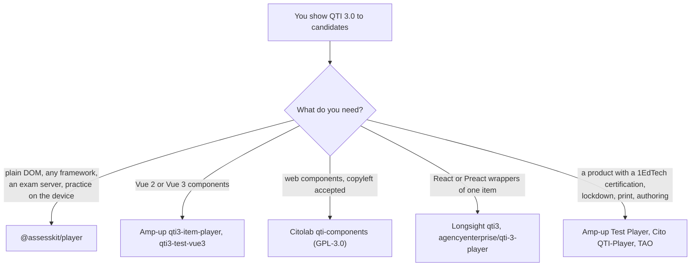

# Choosing the player

When `@assesskit/player` fits a project that shows QTI 3.0 items and tests to candidates, and when another player fits better.
The comparators were read on 2026-11-02, at the versions that the rows give, from their READMEs, source trees, open issues, help
pages and the 1EdTech certification listings; the player's column was checked against this repository on 2026-11-05. No
comparator was run. The help pages of Learnosity and Inspera refuse scripted reads, so archived copies were read (Learnosity of
2025-10-08, 2025-09-16 and 2023-09-30; Inspera of 2023-12-10, 2023-03-23 and 2021-10-22), and they may be out of date.

| You need                                                                                              | Use                                                                 |
| ----------------------------------------------------------------------------------------------------- | ------------------------------------------------------------------- |
| A test with navigation, timers, review, feedback and the supports of a profile, in one call on a page | This package: `mountDelivery` ([delivery](delivery.md))             |
| Many items in one page, each with its own session                                                     | This package: `mountItem` ([delivery](delivery.md#items-in-a-page)) |
| An exam where the answer keys never reach the browser, with a proctor who suspends and resumes        | This package: [server](server.md), [client](client.md)              |
| Practice on the device, with the engine in the browser                                                | This package: `@assesskit/player/client/local`                      |
| Portable custom interactions in a frame with no network, and adaptive tests against a CAT engine      | This package: [pci](pci.md), [cat](cat.md)                          |
| Interface texts in English and Indonesian, or a catalog of your own                                   | This package: [messages](messages.md)                               |
| Vue 2 or Vue 3 components                                                                             | Amp-up                                                              |
| A React or Preact wrapper                                                                             | Longsight `qti3`, or agencyenterprise/qti-3-player                  |
| A player with a 1EdTech certification                                                                 | Amp-up Test Player, Cito QTI-Player                                 |
| Lockdown of the browser, connectivity plugins, paper export, an editor                                | TAO, or the exam application around the player                      |

## What the others have that the player lacks

| Comparator, version                                                                                                                                  | What it has                                                                                                                                                                             | Here                                                                                                                                                                                               |
| ---------------------------------------------------------------------------------------------------------------------------------------------------- | --------------------------------------------------------------------------------------------------------------------------------------------------------------------------------------- | -------------------------------------------------------------------------------------------------------------------------------------------------------------------------------------------------- |
| [Amp-up](https://github.com/amp-up-io/qti3-item-player) `qti3-item-player` 1.1.20 (MIT), [Vue 3](https://github.com/amp-up-io/qti3-item-player-vue3) | Components for Vue 2 and Vue 3                                                                                                                                                          | Not included: `mountDelivery` is plain DOM, and a framework hosts it in an element it owns ([supported](supported.md#not-included))                                                                |
| Amp-up                                                                                                                                               | A 1EdTech certification of its Test Player at Basic and Advanced, listed 2025-11-25                                                                                                     | None: 1EdTech grants certification to products ([supported](supported.md#the-claim))                                                                                                               |
| [Citolab qti-components](https://github.com/Citolab/qti-components) 9.6.2 (GPL-3.0)                                                                  | Word and PDF export of packages for paper; a 1EdTech certification of Cito QTI-Player at Basic, listed 2025-04-25                                                                       | Not included: print and paper export; no certification                                                                                                                                             |
| [Longsight qti3](https://github.com/LongsightGroup/qti3) 0.13.3 (MIT)                                                                                | React and Preact adapters, a command line that scores and inspects an item, a machine-readable support matrix                                                                           | Not included: framework components; [supported](supported.md) is a page, and no matrix is exported                                                                                                 |
| [agencyenterprise/qti-3-player](https://github.com/agencyenterprise/qti-3-player)                                                                    | React, Vue and vanilla wrappers                                                                                                                                                         | Not included: as for Amp-up                                                                                                                                                                        |
| [TAO](https://github.com/oat-sa/tao-test-runner-qti-fe) (Open Assessment Technologies)                                                               | A magnifier lens and a mask for a free area; secure-exam plugins (blur pause, full screen, copy and screenshot prevention, watermark); connectivity plugins; print rendering; authoring | Not included: lens and free-area mask, lockdown, connectivity, print, authoring ([supported](supported.md#not-included)); the player sends a lost request again by its sequence number and resumes |
| TAO                                                                                                                                                  | QTI 3 import and export, experimental and off by default (forum answer of 2026-02-11); a 1EdTech certification for QTI 2.2 at Basic and Advanced, listed 2026-01-30                     | The player reads QTI 3.0 items and tests only                                                                                                                                                      |
| [Learnosity](https://help.learnosity.com/hc/en-us/articles/19176497468573-QTI-Conversion) (archived 2025-10-08)                                      | An idle-timeout dialog, a timed read-only reading mode, redirects after submit and discard, many interface languages                                                                    | Not included: dialogs, reading mode and redirects are the host's; English and Indonesian, and the catalogs of the host ([messages](messages.md))                                                   |
| [Inspera](https://support.inspera.com/hc/en-us/articles/360035249191) (archived 2021 to 2023)                                                        | Safe Exam Browser and alerts for a lost connection; private candidate notes                                                                                                             | Not included: the exam application owns the browser; notes are a slot of the host ([tools](tools.md#tools-of-the-host))                                                                            |
| The dictionary, thesaurus, homophone checker, outliner, visual organizer, peer interaction and spell checker                                         | No open comparator ships any of them; the conformance text lists them as elective                                                                                                       | Slots of the host, and the graphing calculator is one too ([tools](tools.md#tools-of-the-host))                                                                                                    |

Learnosity and Inspera document no QTI 3 support in the copies read. Amp-up's source tree has 15 interactions, without associate,
drawing, graphic associate, graphic order, position object, slider and upload, and Citolab's web components cover every
interaction but drawing; the player draws the 20 standard interactions and hosts portable custom ones ([supported](supported.md)).
Amp-up has 14 standard color themes and the player has the same 14 terms of `color-theme` ([supports](supports.md#the-color-theme)).

## Where the evidence is

[Evidence](evidence.md) gives the counts of tests in Node and in Chromium, Firefox and WebKit, with axe-core at WCAG 2.2 levels A and AA;
[baseline](baseline.md) names the oldest browsers and [size](size.md) the budget of each entry point; [supported](supported.md) says what the
player draws and operates, and what it leaves out.
