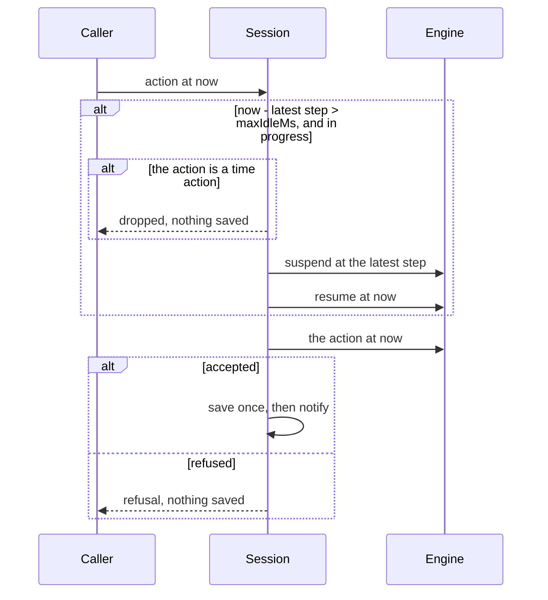
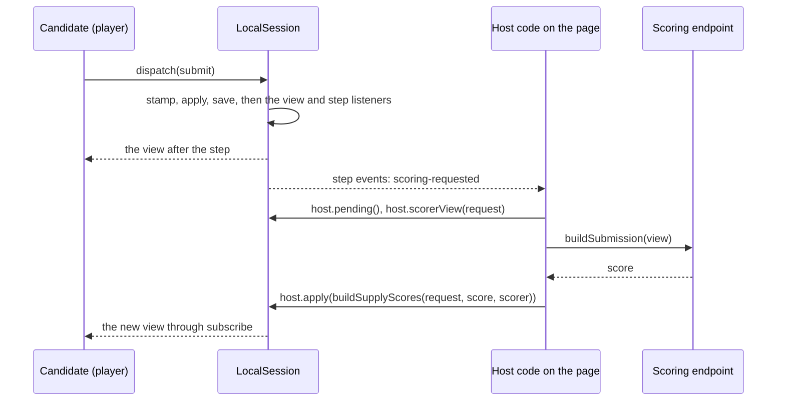

# The session client

The player mounts against one of two session clients, each a subpath of its own, and both implement `SessionClient` of the
[protocol](protocol.md#the-session-client), so the player never knows the mode and a page imports only the client it runs. In
an exam the browser holds no answer key: the remote session imports only the wire functions of
`@assesskit/runtime/delivery/wire`, and a test fails if any file of the engine has code in its first load. Only
`createLocalSession` loads the engine, with `import()` at its first call ([size](size.md#the-first-load-of-a-client)).

| Client                | Subpath                          | Mode     | Where the engine runs | Keys on the device | Host side of the session |
| --------------------- | -------------------------------- | -------- | --------------------- | ------------------ | ------------------------ |
| `createRemoteSession` | `@assesskit/player/client`       | exam     | the server            | no                 | the session host         |
| `createLocalSession`  | `@assesskit/player/client/local` | practice | the device            | yes, by design     | `host`                   |

```mermaid
sequenceDiagram
  participant P as Player
  participant C as Remote session client
  participant H as Session host
  P->>C: dispatch(set-responses)
  Note over C: Held and merged by item,<br/>sent 1 s after the last one
  P->>C: dispatch(submit)
  C->>H: the held responses first, then ActionEnvelope (seq + 1)
  alt no answer arrives
    Note over C: The request stays in doubt and is sent<br/>again, unchanged, before any later one
  end
  H-->>C: ViewEnvelope (same seq)
  C->>C: readView, resolve assets, notify listeners
  C-->>P: DispatchResult {view, refusal?}
  Note over C,H: 10 s before a timer ends, the held<br/>responses go; at 0 an empty set-responses learns the time-out
```

## Quick start

Create a remote session over a transport, send an action and read the view that answers:

```ts
import { readAsi } from "@assesskit/runtime/asi";
import { createEngine } from "@assesskit/runtime/delivery";
import { writeView } from "@assesskit/runtime/delivery/wire";
import { createRemoteSession } from "@assesskit/player/client";

// A page gets the first envelope from the route of `SessionHost.view` and sends the others to the route of `SessionHost.handle`.
// Here an engine on the page makes the envelopes, which only shows the calls.
const document = readAsi(`<qti-assessment-item xmlns="http://www.imsglobal.org/xsd/imsqtiasi_v3p0"
    identifier="q1" title="Question" adaptive="false" time-dependent="false">
  <qti-item-body><p>Hello</p></qti-item-body>
</qti-assessment-item>`);
const engine = createEngine({ kind: "item", item: document.item, base: "items/q1.xml" });
const started = engine.start({ seed: 1, at: 0 });
const view = writeView(engine.view(started.state, 0));

const sent = [];
const transport = async (envelope) => {
  sent.push(envelope.seq);
  return { seq: envelope.seq, view, assets: { "": "https://assets.example/g/token/" } };
};
const client = createRemoteSession(transport, { seq: 0, view, assets: {} });
const answer = await client.dispatch({ type: "end-test" });
sent; // => [1]
answer.view.current?.title; // => "Question"
client.assets("items/q1.xml"); // => "https://assets.example/g/token/items/q1.xml"
client.close();
```

## Remote session

`createRemoteSession(transport, initial, options)` throws `DataError` when an argument is not of its type, a limit of `limits`
among them, so that a misspelled limit fails as the client is made.

| Argument    | Type                       | Meaning                                                                                                                                                                                                          |
| ----------- | -------------------------- | ---------------------------------------------------------------------------------------------------------------------------------------------------------------------------------------------------------------- |
| `transport` | `Transport`                | Sends an `ActionEnvelope` or a `ViewRequest`, and the `signal` of the call, to the host; resolves with its `ViewEnvelope`.                                                                                       |
| `initial`   | `ViewEnvelope`             | What `SessionHost.start` or `SessionHost.view` gave. The first request has its `seq` plus one.                                                                                                                   |
| `clock`     | `Clock`                    | In the options. Times the age of a view. Default: the clock of the browser, `Date.now()`.                                                                                                                        |
| `limits`    | `Partial<ActionLimits>`    | In the options. The limits on the size of an action, as the session host's option `limits` gives them; an action above them is refused before it is held or sent. Default: the runtime's, as the host's.         |
| `onError`   | `(error: unknown) => void` | In the options. Receives the errors that the client can only report: a listener that threw, and a send at an autosave or a deadline that failed, since no call waits for it. Default: `reportError` of the page. |

### What the client does

| Duty         | Behavior                                                                                                                                                                                                                                                                                                                                                                                                                |
| ------------ | ----------------------------------------------------------------------------------------------------------------------------------------------------------------------------------------------------------------------------------------------------------------------------------------------------------------------------------------------------------------------------------------------------------------------- |
| Sequence     | One request at a time, each with the next `seq`. The answer is read with `readView`; an answer to another `seq` is a `DataError`.                                                                                                                                                                                                                                                                                       |
| Lost answers | A request that got no answer, such as a network failure, may have been applied. It is sent again, unchanged, before any later request, and the host answers a repeated `seq` with the answer it stored. A request that the host rejected (`DataError`, `AccessError` or `SecurityError`) is not sent again.                                                                                                             |
| Autosave     | `set-responses` actions are held and merged, by item, and sent 1,000 ms after the last. Every promise of a held action resolves with the answer to the merged request.                                                                                                                                                                                                                                                  |
| Flush        | The held responses go first before any other action, when the page becomes hidden, and 10,000 ms before the nearest timer reaches 0.                                                                                                                                                                                                                                                                                    |
| Deadline     | At 0 the client sends the held responses, or an empty `set-responses` for the item presented, to learn from the host whether the time-out happened. The host's view shows a passed deadline as applied.                                                                                                                                                                                                                 |
| Assets       | `assets(path)` joins the base URL of the longest prefix of the latest envelope that holds the path with the path. A path no prefix holds gets `about:blank`, which loads nothing.                                                                                                                                                                                                                                       |
| Refresh      | `refresh(options?)` sends the held responses, then `{ "type": "view" }`, and resolves with the view the host gives. The host changes nothing, and the client goes on from the `seq` of the answer. A candidate whom a proctor paused has no action to send, so this is how the client learns of the resume ([the proctor](server.md#the-proctor)). A local client builds the view of its state at the time of the call. |
| Age          | `age()` is the milliseconds since the view was received, on the client's clock; the timers count down from it.                                                                                                                                                                                                                                                                                                          |
| Signals      | A `signal` that aborted before the send stops the call, and nothing is sent. In flight, the transport gets the signal and an abort leaves the request in doubt. A held `set-responses` call stops waiting, and its responses are sent all the same.                                                                                                                                                                     |

`close()` stops the timers and removes the listener of the page. Further `dispatch` calls reject with `DataError`.

## Local session

```ts
import { readAsi } from "@assesskit/runtime/asi";
import { createLocalSession } from "@assesskit/player/client/local";

const document = readAsi(`<qti-assessment-item xmlns="http://www.imsglobal.org/xsd/imsqtiasi_v3p0"
    identifier="q1" title="Question" adaptive="false" time-dependent="false">
  <qti-item-body><p>Hello</p></qti-item-body>
</qti-assessment-item>`);
if (document.kind !== "item") throw new Error("The document is not an item.");

const saved = new Map();
const client = await createLocalSession({
  definition: { kind: "item", item: document.item, base: "items/q1.xml" }, // one item alone
  store: {
    load: async (session) => saved.get(session),
    save: async (session, { state }) => void saved.set(session, state),
  },
  session: "preview-1",
  seed: 1,
  assets: (path) => `https://assets.example/package/${path}`,
});
client.view.current?.title; // => "Question"
```

`createLocalSession(options)` is asynchronous because it loads the engine. It returns a `LocalSession`: a `SessionClient` with
`host`, the host side of the session. It throws `DataError` when an option is not of its type, the engine cannot be created from
the definition, or the session cannot start, and it rejects with `signal.reason` when the `signal` aborts before the load or the
first save. A session that was saved stays, and a new call resumes it.

| Option       | Type                                  | Meaning                                                                                                                                                                                                                                                            |
| ------------ | ------------------------------------- | ------------------------------------------------------------------------------------------------------------------------------------------------------------------------------------------------------------------------------------------------------------------ |
| `definition` | `DeliveryDefinition`                  | What to deliver: a test, or an item alone, for practice or for a page of many items.                                                                                                                                                                               |
| `engine`     | `EngineOptions`                       | The options of `createEngine`. Default: none.                                                                                                                                                                                                                      |
| `start`      | `Omit<StartOptions, "seed" \| "at">`  | The PNP, the universal supports and the context of `Engine.start`. Default: none.                                                                                                                                                                                  |
| `store`      | `LocalStore`                          | Where the state is saved and restored from: `load` and `save`, which get the `signal` of the call. `save` takes `{ state, events }` in one write: the state, and the events of the step that made it, so that a store keeps a log with no event without its state. |
| `session`    | `string`                              | The identifier of the session in the store.                                                                                                                                                                                                                        |
| `seed`       | `number`                              | The seed of a session that the store does not have yet, a safe integer.                                                                                                                                                                                            |
| `assets`     | `(path: string) => string`            | Turns the path of a file in the package into the URL to load it from. An item with a portable custom interaction needs the origin of `staticUrl` or of `origins` ([PCI](pci.md)).                                                                                  |
| `lexicons`   | `(item: string) => readonly string[]` | The paths of the pronunciation lexicons that the item whose document is at `item` depends on. Default: none.                                                                                                                                                       |
| `clock`      | `Clock`                               | Stamps actions and times the deadlines; it answers whole milliseconds. Default: the clock of the browser.                                                                                                                                                          |
| `onError`    | `(error: unknown) => void`            | Receives the errors that the client can only report: a listener that threw, and a failure of the timer's step or of the answer loop that no call waits for. Default: `reportError` of the page.                                                                    |
| `maxIdleMs`  | `number`                              | The longest gap between steps, in milliseconds, that counts as time on task: a gap above it counts as suspended ([a learner who is away](#a-learner-who-is-away)). Default: none, so every gap counts.                                                             |
| `cat`        | `CatSessionPort`                      | The port of the CAT engines: the session then answers its own CAT requests, with an in-browser port, never `createRestCatPort` ([CAT](cat.md#the-option-cat)). Default: none.                                                                                      |
| `signal`     | `AbortSignal`                         | Stops the creation before its load and its first save. Default: none.                                                                                                                                                                                              |

It stamps each action with `stamp(state, action, now)`, saves the state of each accepted step before the step takes effect, and
fires a `time` action at each maximum time, and at the `closeAt` of the option `start`, with `setTimeout`, so a time-out happens on the device without a server. A store that
has the session resumes it. The candidate can suspend and resume. Results of practice are never branded: nothing here brands a
report, so `buildSessionScore` refuses them.

An item alone is a session of `{ kind: "item", item, base }`; `documents.item` is `base`. It serves a preview, a practice item and a
lesson page whose items each have a session of their own, which [`mountItem`](delivery.md#items-in-a-page) shows without the chrome.

The session has the engine and the definition but not the package, so a host that wants reading aloud to use the lexicons of
the items names them with `lexicons`. A lexicon is a resource of type `pls` among the dependencies of the item's resource: find
the resource whose path is the item's with `resolveResourcePath` of `@assesskit/runtime/package`, filter the closure that
`listDependencies` gives for `pls`, and return the paths. The server's session host finds them the same way for an exam.

### A learner who is away

A learner who closes the page and comes back three days later has not worked in between, but the clock of every limit and every
duration ran. `maxIdleMs` closes such a gap. The first action after a gap above it suspends the session at the latest step, resumes it
now and then applies the action, so that the durations and the running maximum times leave the gap out exactly as an explicit
`suspend` and `resume` would.



| Rule               | Behavior                                                                                                                                                                    |
| ------------------ | --------------------------------------------------------------------------------------------------------------------------------------------------------------------------- |
| Choosing a value   | Above the longest pause that a learner takes while working: a gap above it counts in full as suspended.                                                                     |
| Limits             | A running maximum time stops with the gap, and resumes with the next action.                                                                                                |
| Saving             | The suspension, the resumption and the action are saved once, so that a crash leaves all of them or none. The step listeners get their events in order.                     |
| A `time` action    | One that finds a gap above `maxIdleMs` is dropped: the timer fires it and the host can send it, but nothing is saved or armed again, so an abandoned session costs nothing. |
| Applies to         | Actions of the candidate and of the host, while the session is in progress. A session that is suspended or ended has no gap to close.                                       |
| A refused action   | Saves nothing, so the next action still closes the gap.                                                                                                                     |
| The view before it | A view that the session gives before the first action after the gap counts the gap, so the timers in it show the time as passed. The action's view is right.                |

### The host side

`host` is a `LocalHostSession`: the `HostSession` of the [protocol](protocol.md#the-host-session) and `subscribeSteps`. A host
that rates practice answers supplies the scores here, with the code it uses on a server.



```ts
import { readAsi } from "@assesskit/runtime/asi";
import { buildSingle } from "@assesskit/runtime/values";
import { createLocalSession } from "@assesskit/player/client/local";

const document = readAsi(`<qti-assessment-item xmlns="http://www.imsglobal.org/xsd/imsqtiasi_v3p0"
    identifier="essay" title="Essay" adaptive="false" time-dependent="false">
  <qti-response-declaration identifier="RESPONSE" cardinality="single" base-type="string"/>
  <qti-outcome-declaration identifier="SCORE" cardinality="single" base-type="float" external-scored="human"/>
  <qti-item-body><qti-extended-text-interaction response-identifier="RESPONSE"/></qti-item-body>
</qti-assessment-item>`);
if (document.kind !== "item") throw new Error("The document is not an item.");

const saved = new Map();
const client = await createLocalSession({
  definition: { kind: "item", item: document.item, base: "items/essay.xml" },
  store: {
    load: async (session) => saved.get(session),
    save: async (session, { state }) => void saved.set(session, state),
  },
  session: "practice-1",
  seed: 1,
  assets: (path) => `https://assets.example/package/${path}`,
});
const types = [];
client.host.subscribeSteps((events) => types.push(...events.map((event) => event.type)));

const item = client.view.current.key;
await client.dispatch({
  type: "set-responses",
  item,
  responses: new Map([["RESPONSE", buildSingle("string", "My essay.")]]),
});
await client.dispatch({ type: "submit", item });
types; // => ["responses-set", "attempt-ended", "response-processed", "outcome-processed", "scoring-requested"]

const [request] = (await client.host.pending()).scoring;
request.id; // => "item:essay:1:SCORE"
const step = await client.host.apply({
  type: "supply-scores",
  request: request.id,
  value: buildSingle("float", 7),
  scorer: "human",
});
step.events.map((event) => event.type); // => ["scores-applied", "outcome-processed"]
(await client.host.results()).itemResults[0].sessionStatus; // => "final"
client.close();
```

| Member                          | Meaning                                                                                                                                                             |
| ------------------------------- | ------------------------------------------------------------------------------------------------------------------------------------------------------------------- |
| `apply(action, options?)`       | Applies a `time`, `supply-scores` or `cat-response` action and resolves with the `HostStep`. A candidate action is a `DataError`: send it with `dispatch`.          |
| `pending(options?)`             | The scoring requests without a value, and the CAT requests.                                                                                                         |
| `scorerView(request, options?)` | What a scorer needs to rate the request. It holds the correct responses, which the device holds already.                                                            |
| `results(options?)`             | The results report. It is never branded.                                                                                                                            |
| `subscribeSteps(listener)`      | Calls the listener with the events of each step saved after this call, the candidate's, the timer's and the host's, in order. Returns the function that removes it. |

`subscribeSteps` calls the listener after the view listeners. A step with no events calls no listener, and a refused action makes
no step. `dispatch` and every method of `host` run one after the other, in the order of the calls; a read sees the state that the
calls before it left. Each call takes the options `{ signal }` of the [protocol](protocol.md#the-host-session): an action or a
read whose signal aborted before its turn rejects with `signal.reason` and is dropped.

| Case                                                          | Behavior                                                                                                                                                                                       |
| ------------------------------------------------------------- | ---------------------------------------------------------------------------------------------------------------------------------------------------------------------------------------------- |
| A session resumed from the store has pending scoring requests | No step announces them. The host checks `pending()` once after `createLocalSession` resolves, for a new and for a resumed session.                                                             |
| The start of a new session makes a scoring request            | Its events come before any listener can subscribe, so the same check covers it.                                                                                                                |
| The store rejects a save                                      | The call rejects with the error of the store. The state, the view, the timer and the listeners stay as they were, because a step takes effect only after its save.                             |
| The save of a `time` action of the timer fails                | The error goes to `onError`. No timer is armed again, because a delay of 0 would loop against a failing store. The next action applies the passed deadlines first, so no expiry slips through. |
| A score arrives after the page closed the client              | `apply` throws. The host opens a new `createLocalSession` from the store and applies the score there.                                                                                          |
| Two sessions on one store key                                 | They overwrite each other, because `LocalStore.save` has no version. One live session per key is the host's duty.                                                                              |
| A listener throws                                             | The error goes to `onError`, and the other listeners still run.                                                                                                                                |
| After `close()`                                               | `dispatch`, `apply` and `subscribeSteps` throw `DataError`. The reads still answer, because the state is in memory and in the store.                                                           |

## Errors

Both clients throw the runtime's `DataError` for what the caller did wrong and pass on the errors of what they call.

| Error                                         | When                                                                                                                                 | What to do                                                                                                                                                    |
| --------------------------------------------- | ------------------------------------------------------------------------------------------------------------------------------------ | ------------------------------------------------------------------------------------------------------------------------------------------------------------- |
| `DataError`                                   | An option, an argument, a listener or a `signal` is of the wrong type, or the clock answers with anything but a non-negative integer | Fix the call; the message names the option                                                                                                                    |
| `DataError`                                   | The client is closed, for `dispatch`, `refresh`, `apply` and `subscribeSteps`                                                        | Create a new client; the host's `view` gives the state to start from                                                                                          |
| `DataError`                                   | `apply` gets what is not an action of the host, or a malformed one; `scorerView` names a request that does not exist                 | Send a candidate action with `dispatch`; read `pending()` for the requests                                                                                    |
| `DataError`                                   | The host answered with a sequence number other than the request's, or with something that is not a view envelope (remote)            | Make the transport return the answer of each request, with no cache or proxy that replays another; check that the endpoint is the session host                |
| `DataError`                                   | The host rejected the request: a malformed action, or one outside its policy (remote)                                                | The request is dropped and the next one goes on; do not send it again                                                                                         |
| `DataError`                                   | `The session cannot start: …`, the engine refused the start (local)                                                                  | Read the refusal in the message; check the definition and the profile                                                                                         |
| `AccessError`                                 | The host's authentication names another principal than the one the session is bound to, or the session exists already (remote)       | Authenticate as the candidate of the session; a session is started once                                                                                       |
| `SecurityError`                               | The action is above `limits`, such as a PCI state longer than `maxPciStateLength` (remote); it is not held, so the held responses go | Give the client the limits of the host; the player says the action was not accepted and reports the error                                                     |
| `ServiceError`, or the error of the transport | The host cannot be reached or cannot save (remote)                                                                                   | Call again: a request that got no answer is sent once more, unchanged, before the next one, and the host answers a repeated request with the answer it stored |
| The error of the store                        | A `load` or a `save` rejected (local)                                                                                                | The state stays as it was; fix the store and call again                                                                                                       |
| `signal.reason`                               | The signal of the call aborted before the call ran, or while it waited                                                               | Nothing was sent when it aborted first; a request in flight is in doubt, except a view request                                                                |

A listener that throws, a send of an autosave or a deadline that failed, and a failure of a local session's timer go to
`onError`, because no call waits for them.

## Not included

| Not included                                       | Why                                                                                                                                        |
| -------------------------------------------------- | ------------------------------------------------------------------------------------------------------------------------------------------ |
| The network call of the remote session             | `Transport` is a function of the host: it chooses the URL, the authentication and the retry policy                                         |
| A queue of requests that survives a reload         | One request that got no answer is kept in memory; after a reload the host's `view` gives the state, whether or not the request was applied |
| Exam mode on a device                              | The engine and the answer keys are on the device in a local session, so it is for practice; an exam runs on the server                     |
| Two live sessions on one store key                 | `LocalStore.save` has no version, so they overwrite each other; the host keeps one live session per key                                    |
| Rating, scoring and CAT in the browser for an exam | The session host does them on the server ([server](server.md)); a local session gives `host` for practice                                  |

## Differences from the references

None. No specification defines the session client: it speaks the envelopes of [protocol](protocol.md), and [Evidence](evidence.md) lists the tests of the clients.
