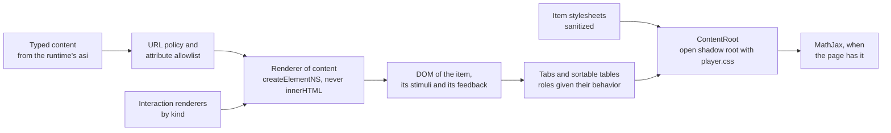

# Content rendering

The content of an item is the typed tree that the runtime's `asi` reads: text, HTML elements, QTI elements, interactions, and
MathML and SSML kept as XML. `createContentRoot` of `@assesskit/player/player` builds the DOM for such nodes and shows an
item with its stimuli in a shadow root of its own. It draws what the runtime's engine resolved (feedback, template content,
printed values and hidden choices, `resolveContent` of the runtime) and decides nothing of QTI. `mountItem` and `mountDelivery`
([delivery](delivery.md)) draw the interactions in it.



## Quick start

Show the body of an item in a content root:

```ts
import { readAsi } from "@assesskit/runtime/asi";
import { selectMessages } from "@assesskit/player";
import { createContentRoot } from "@assesskit/player/player";
import css from "@assesskit/player/player.css?inline"; // any bundler that imports a file as text

const parsed = readAsi(`<qti-assessment-item xmlns="http://www.imsglobal.org/xsd/imsqtiasi_v3p0"
    identifier="map" title="Map" adaptive="false" time-dependent="false">
  <qti-item-body>
    <p lang="en">Look at  and <a href="files/data.pdf" onclick="alert(1)">the data</a>.</p>
  </qti-item-body>
</qti-assessment-item>`);
if (parsed.kind !== "item" || parsed.item.body === undefined) throw new Error("The document is not an item.");

const player = new CSSStyleSheet();
player.replaceSync(css);
const host = document.createElement("div");
document.body.append(host);

const root = createContentRoot(host, {
  messages: selectMessages("en"),
  assets: (path) => `https://assets.example/g/token/${path}`,
  fetch: (url, request) => fetch(url, request),
  stylesheet: player,
});
await root.show({ body: { nodes: parsed.item.body.children, base: "items/map/item.xml" } });

root.root.querySelector(".ak-body")?.innerHTML; // => '<p lang="en">Look at  and <a href="https://assets.example/g/token/items/map/files/data.pdf" target="_blank" rel="noopener noreferrer">the data</a>.</p>'
```

The `onclick` is not in the DOM: the renderer keeps the attributes of [Attributes](#attributes) and no other.

## The content root

`createContentRoot(host, options)` attaches an open shadow root to `host` and returns a `ContentRoot`. An item and its
stimuli share one root, so that `label for`, `aria-describedby` and `data-catalog-idref` resolve between them. The item's
stylesheets neither leak into the page nor take their rules from it. `player.css` gives the host `contain: layout paint` and
`isolation: isolate`, so that the fixed-position CSS of an item cannot cover the page's chrome ([styling](styling.md)).

| Option       | Type                          | Meaning                                                                                                                                                                       |
| ------------ | ----------------------------- | ----------------------------------------------------------------------------------------------------------------------------------------------------------------------------- |
| `messages`   | `Messages`                    | The text of the interface, from `selectMessages`.                                                                                                                             |
| `assets`     | `(path: string) => string`    | Turns the path of a file in the package into the URL to load it from.                                                                                                         |
| `fetch`      | `StylesheetFetch`             | Loads item stylesheets; `fetch` of the page fits. It is called with `credentials: "omit"`, `referrerPolicy: "no-referrer"` and, when a mount drives the root, a `signal`.     |
| `stylesheet` | `CSSStyleSheet`               | The player's stylesheet, built from `player.css`. Every root adopts it first. Keep one root that lives as long as the player ([styling](styling.md)).                         |
| `origins`    | `readonly string[]`           | The origins besides the package's that content may reference, such as `https://media.example`. Default: none.                                                                 |
| `view`       | `View`                        | The view whose rubric blocks are drawn. Default: `candidate`.                                                                                                                 |
| `mediaScale` | `number`                      | The factor for the pixel `width` and `height` of images, video and objects, which the magnification of non-text content sets; `setMediaScale` changes it later. Default: `1`. |
| `fileUrl`    | `(file: FileValue) => string` | The URL of a file value that a printed variable prints, such as an upload under review. Default: none, so that a file prints as its name.                                     |
| `typesetter` | `MathTypesetter`              | From `createMathTypesetter` ([math](math.md)). Default: none, so that the browser renders MathML.                                                                             |

`root.show(content)` replaces what the root showed. The DOM is built before the promise settles; the promise settles when
the item's stylesheets are adopted and the expressions are typeset.

| Field          | Type                          | Meaning                                                                                                                          |
| -------------- | ----------------------------- | -------------------------------------------------------------------------------------------------------------------------------- |
| `body`         | `{ nodes, base? }`            | The body of the item. `base` is the path in the package of its document; relative references resolve against it. Default: none.  |
| `stimuli`      | `readonly { nodes, base? }[]` | The stimuli the item shares, in order. They stand beside the item at 48rem and wider, and above it otherwise. Default: none.     |
| `rubric`       | `{ nodes, base? }`            | The rubric of the test, its part and its sections for the view, before the stimuli. Default: none.                               |
| `testFeedback` | `readonly TestFeedback[]`     | The test feedback that is shown, in a region labelled Feedback after the item. Default: none.                                    |
| `stylesheets`  | `readonly string[]`           | The paths in the package of the stylesheets of the test and of the item, in that order. Default: none.                           |
| `catalogs`     | `readonly Catalog[]`          | The catalogs of the item, for `card`. Default: none.                                                                             |
| `hazards`      | `readonly HazardExposure[]`   | The hazards of the delivered content from the runtime's `deriveHazardExposure`. Default: none.                                   |
| `language`     | `string`                      | The language of the content, such as that of the delivered variant; it becomes `lang` of the content. Default: that of the host. |
| `variables`    | `ContentVariables`            | The variables that printed variables still in the content read. Default: none.                                                   |

When a stylesheet cannot be fetched or MathJax cannot be loaded, the content is on the screen, the stylesheets that loaded
are adopted and the expressions stay MathML; the next `show` fetches a failed stylesheet again ([Errors](#errors)).

| Member                                        | Meaning                                                                                                                              |
| --------------------------------------------- | ------------------------------------------------------------------------------------------------------------------------------------ |
| `root`                                        | The shadow root.                                                                                                                     |
| `stage`                                       | The positioned element in the shadow root that holds the content, and stays when the content is replaced ([The stage](#the-stage)).  |
| `card(idref, support, { language, braille })` | The card that the catalogs of the shown content have for a support ([Catalogs](#catalogs-and-cards)).                                |
| `setMediaScale(scale)`                        | Changes the factor for the pixel sizes of media, in the content shown and in what comes later ([The media scale](#the-media-scale)). |
| `showFeedback(feedback)`                      | Shows modal feedback in a dialog and resolves when the candidate closes it ([Feedback](#feedback)).                                  |
| `destroy()`                                   | Takes the content and the listeners away. The shadow root stays, empty.                                                              |

A link to an `id` of the content (`href="#note"`) moves the focus to that element inside the shadow root. The browser
cannot find the target of the fragment inside it and would only change the address of the page.

### The stage

`root.stage` is the `div.ak-root-stage` that `player.css` positions. The content stands in it, and `show` replaces the
content in it, so that what lies over the item stays: the tools of an item ([tools](tools.md)) mount their layer in it, and
read the text and the choices of the item there. The stylesheets that other parts adopt into the shadow root stay when the
root adopts the stylesheets of the next item.

### The media scale

The magnification of non-text content multiplies the pixel sizes that the author gave to images, video, objects
and other elements with a `width` or `height` in pixels. The renderer keeps the size of the author in `data-ak-width` and
`data-ak-height`, and `root.setMediaScale(scale)` sets the attributes again from it: two changes do not compound, and
`1` gives the author's size back. The content is not drawn again, so the focus, the caret and the responses stay. A card drawn
after the change has the new scale. Sizes that are not pixels, such as `50%`, stay.

## Where it appears

| Part                     | Markup                                                                                                                                               |
| ------------------------ | ---------------------------------------------------------------------------------------------------------------------------------------------------- |
| The content              | `div.ak-content` in the stage, with `lang` when the content states a language.                                                                       |
| The notice of a hazard   | `div.ak-hazards` with `role="note"`, first.                                                                                                          |
| The rubric               | `div.ak-rubric`.                                                                                                                                     |
| The stimuli and the body | `div.ak-main`, with `data-ak-stimuli` when there are stimuli; `div.ak-stimuli` holds one `section.ak-stimulus` for each, and `div.ak-body` the item. |
| The test feedback        | `section.ak-test-feedback`, labelled Feedback, with `h2` for a title.                                                                                |
| The stage                | `div.ak-root-stage`, the parent of the content in the shadow root.                                                                                   |
| The dialog               | `dialog.ak-dialog`, a sibling of the stage in the shadow root.                                                                                       |

## The renderer

The root builds the DOM of the nodes with one renderer, which every other part of the player shares: the prompts and choices of the
interactions, the feedback and the cards of the catalogs draw their content with it, so that they all follow the same rules for
URLs, languages and media. A node that is not an object whose `kind` names an element is a `DataError`. The renderer builds the
element for a node around its children, with the attributes it keeps for the node.

### What a node becomes

| Node                                               | DOM                                                                                                                                                |
| -------------------------------------------------- | -------------------------------------------------------------------------------------------------------------------------------------------------- |
| Text                                               | A text node.                                                                                                                                       |
| An HTML element (the 76 of the ASI schema)         | The element of the same name, with the attributes below. `th` keeps `scope` and `td` keeps `headers`, `colspan` and `rowspan`.                     |
| A QTI element                                      | `qti-` and its kind, with the common attributes. Its content is the nodes below it, in the order the model keeps them.                             |
| An interaction                                     | The element a registered renderer builds, else a placeholder: `qti-` and its kind with `data-ak-placeholder`, around its content.                  |
| `qti-printed-variable`                             | `qti-printed-variable` with the runtime's text; see [Printed variables](#printed-variables).                                                       |
| `qti-rubric-block`                                 | `qti-rubric-block` with `data-use` when the view lists the block; see [Rubric](#rubric).                                                           |
| `audio`, `video`                                   | The element with `controls`; its `source` and `track` children keep their attributes.                                                              |
| `img`                                              | `img`; where a hazard remains, an image that can move becomes its `alt` text.                                                                      |
| `object`                                           | By its `type`; see [Embedded files](#embedded-files).                                                                                              |
| MathML, SSML and CML                               | `createElementNS` with the namespace of the source, so that the typesetter and the speech model find them. `xml:lang` stays.                       |
| Any other XML element, such as `xi:include` or SVG | Not drawn, with what it holds.                                                                                                                     |
| `qti-stylesheet`, `qti-catalog-info`, `param`      | Not drawn: the root loads the stylesheets it is given, the candidate asks for cards, and parameters are for plug-ins that the player does not run. |

The elements of QTI that hold blocks (`qti-rubric-block`, `qti-feedback-block`, `qti-template-block`, `qti-content-body`,
`qti-modal-feedback`, `qti-test-feedback`, `qti-html-content`) are blocks, and `qti-feedback-inline`,
`qti-template-inline` and `qti-printed-variable` stay inline. A `label` inside an interaction is the `qti-label` of an
inline choice, not the HTML element.

### Attributes

The renderer builds the attributes from the typed node, never from markup, and keeps only these.

| Attributes                                                                                                                            | On                                         |
| ------------------------------------------------------------------------------------------------------------------------------------- | ------------------------------------------ |
| `id`, `class`, `dir`, `role`, every `aria-*`, `data-catalog-idref`, `data-qti-suppress-tts`, `data-ssml`                              | Every element                              |
| `lang`, from `xml:lang` or `lang`; `xml:lang` wins where both are given                                                               | Every element                              |
| `data-*` with letters, digits, `_`, `.` and `-`, such as `data-selected_color`                                                        | Every element                              |
| `aria-X` from `data-qti-aria-X`, unless the element has `aria-X`                                                                      | Every element                              |
| `href`, `type`, `src`, `srcset`, `sizes`, `media`, `poster`, `preload`, `loop`, `muted`, `width`, `height`, `alt`, `longdesc`, `cite` | HTML elements that the schema gives them   |
| `controls`, `default`, `open`, read by their presence: `false` leaves them off                                                        | `audio`, `video`, `track`, `details`       |
| `span`, `headers`, `scope`, `abbr`, `axis`, `rowspan`, `colspan`, `align`, `valign`, `summary`, `title`, `srclang`, `kind`, `label`   | `col`, `td`, `th`, `table`, `bdo`, `track` |

Everything else is left out: event handlers, `style`, `autoplay`, `crossorigin`, `mediagroup`, the attributes of other
namespaces, and every attribute that only a QTI element reads (`response-identifier`, `shuffle`, `max-choices` and the
rest). An attribute whose name the DOM would refuse is dropped; it does not throw.

### References

`href`, `src`, `srcset`, `poster`, `longdesc`, `cite` and the `data` of an object go through one policy.

| The reference is                                                     | Result                                                                                                                    |
| -------------------------------------------------------------------- | ------------------------------------------------------------------------------------------------------------------------- |
| A path without scheme or host, such as `images/a.png` or `../b.png`  | Resolved against `base` with the runtime's `resolveReference`, then `assets(path)`.                                       |
| A path that leaves the package, starts with `/`, or is empty         | Refused.                                                                                                                  |
| An `http` or `https` URL, or `//host/path` (taken as `https`)        | Kept when its origin is in `origins`; refused otherwise.                                                                  |
| A `data:` URL of `image/png`, `jpeg`, `gif`, `webp`, `avif` or `bmp` | Kept for a resource that loads (`img`, `source`, `poster`); refused for a link. `image/svg+xml` and the rest are refused. |
| `javascript:`, `vbscript:`, `blob:`, `file:`, `ftp:` and any other   | Refused, whatever the spelling: tabs, entities, case and leading white space do not hide a scheme.                        |
| `#id`                                                                | Kept for a link, which the root follows; refused for a resource.                                                          |

An element with `xml:base` starts the references below it, its own attributes included, at that base resolved against its
parent's (as XML Base resolves it); a base that leaves the package changes nothing. The browser's own URL parser tells the scheme and the
host, so the policy and the page read a reference alike. A refused
reference leaves the attribute off. An `srcset` is parsed as the HTML Standard reads it, a comma in a URL included;
a candidate with a refused URL or a descriptor that is not a width or a density is left out.

### Embedded files

`object` and the files of a card become the element that fits the media type, and run nothing of the file.

| Media type                           | Element                                                                                                                        |
| ------------------------------------ | ------------------------------------------------------------------------------------------------------------------------------ |
| `image/*`                            | `img`. Its `alt` is the `alt` that some authors add beside the schema, else the text of the fallback content.                  |
| `audio/*`, `video/*`                 | `audio` or `video` with `controls`, and the fallback content inside.                                                           |
| `text/html`, `application/xhtml+xml` | `iframe` with an empty `sandbox` (no script, no same origin), `referrerpolicy="no-referrer"` and a `title` of the alternative. |
| Anything else                        | A link that opens in a tab of its own, with the fallback content or the message `toolOpenFile` as its text.                    |

The `id`, `class`, `lang`, ARIA and `data-*` attributes of the object go to the element, and its `width` and `height`,
multiplied by `mediaScale` when they are pixels, go to `img`, `video` and `iframe`. An element with a size in pixels keeps the
size the author gave it in `data-ak-width` and `data-ak-height`, which the coordinates of the graphic interactions are
measured in ([graphics](graphics.md#shapes-and-coordinates)) and `setMediaScale` scales from. A file that the URL policy
refuses leaves the fallback content.

### Links

An `a` keeps `href` when the policy allows it. A link to a file of the package, to an allowed origin or to a printed `uri`
opens in a tab of its own with `rel="noopener noreferrer"`; a link to an `id` does not.

### Printed variables

The runtime's `resolveContent` replaces a `qti-printed-variable` by its text, and that text is what the renderer draws. A printed
variable that is still in the nodes is formatted with the runtime's `formatPrintedVariable` from the `variables` option: an
outcome, else a template variable. A `uri` value is a link, and a `file` value is a link to `fileUrl(file)` when the host
gives one. Without `variables` it prints nothing, as NULL does.

### Rubric

A `qti-rubric-block` is drawn when its `view` lists the view of the renderer (`candidate` by default), with
`data-use` set to its `use` when that is `instructions`, `scoring` or `navigation`. An `ext:` use is ignored, so the block
has no `data-use`. The check repeats the runtime's, so that a view that carried the rubric of a scorer shows it to no candidate.

### Hazards

When `hazards` has an entry with `avoided: true`, the root withholds what plays or can move: `audio`, `video`, an object of
a page, and an image that can animate (`image/gif`, `apng`, `webp`, `avif`, `svg+xml`, or those extensions when no type is
given). Their text alternative stays, and a notice (`div.ak-hazards`) names the hazards. The runtime's engine chooses a
variant without the hazard where it can; the notice is the fallback for a hazard that remains.

## Tabs and sortable tables

QTI holds the roles and attributes of tabs and of a sortable table and gives them no behavior. `ContentRoot.show` gives both
their behavior in the body and in the stimuli, so `mountDelivery` and `mountItem` have it, and no option turns it on. The
markup is what the schema accepts: a tab is a `span`, because `button` is outside the schema.

```xml
<div role="tablist" aria-label="Sources">
  <span role="tab" id="tab-email" aria-controls="panel-email" aria-selected="true">Email</span>
  <span role="tab" id="tab-memo" aria-controls="panel-memo">Memo</span>
</div>
<div role="tabpanel" id="panel-email" aria-labelledby="tab-email"><p>...</p></div>
<div role="tabpanel" id="panel-memo" aria-labelledby="tab-memo"><p>...</p></div>

<table>
  <thead><tr><th aria-sort="none">Region</th><th aria-sort="none">Revenue</th></tr></thead>
  <tbody><tr><td>North</td><td data-ak-sort-value="1200">$1,200</td></tr></tbody>
</table>
```

| Pattern        | Rule                                                                                                                                                                                                                                                                                  |
| -------------- | ------------------------------------------------------------------------------------------------------------------------------------------------------------------------------------------------------------------------------------------------------------------------------------- |
| Tabs           | A `tablist` whose every `tab` names a `tabpanel` of the root with `aria-controls` is managed. The first tab with `aria-selected="true"`, else the first, is shown; the player sets `aria-selected`, `tabindex` (0 for the selected tab alone) and `hidden` on the other panels.       |
| Tab keys       | Left and Right move to the next and the previous tab and select it, wrapping at the ends, and the other way round where the tablist runs from right to left. Home and End go to the first and the last tab. A press selects. A key with Shift, Control, Alt or Meta is the browser's. |
| Keeping a tab  | The root keeps the selection by the `id` of the first tab across `show`, so that a stimulus shared by several items keeps its tab. A reload starts from the default, which no scored response depends on.                                                                             |
| Sortable table | A `th` of the `thead` with `aria-sort` gets a `button` around its content. A press sorts the rows of the `tbody`, stably, ascending first and then descending, sets `aria-sort` on that header and `none` on the others, and leaves the focus on the button.                          |
| Sort key       | The `data-ak-sort-value` of the cell, else its text. When every key of the column is a decimal number (`-5`, `.5`, `1e2`) the column is ordered by value; otherwise by `Intl.Collator` with `numeric` in the language of the content, so that "Zone 9" comes before "Zone 10".        |
| Keeping a sort | None: a sort resets when `show` draws the content again, as a table answers one item.                                                                                                                                                                                                 |

| Case                                                                           | Result                                                                                  |
| ------------------------------------------------------------------------------ | --------------------------------------------------------------------------------------- |
| A tab that names no panel                                                      | The tablist stays as authored: every panel shows, and the player sets nothing on it.    |
| A table with a `rowspan` or more than one `tbody`                              | Stays as authored, with no button.                                                      |
| A table whose rows hold a media, upload, custom or portable custom interaction | Stays as authored: moving a row would stop a recording or load a frame again.           |
| Other interactions in a panel or a row                                         | They hide or move with it and keep their drafts; no response, action or result changes. |
| Reading aloud and the line reader                                              | They read what shows: a hidden panel is left out, as `hidden` content is.               |

The player styles a managed tablist (`ak-tablist`), the sort button (`ak-sort`) and its mark (`ak-sort-mark`, hidden from
assistive technology: `aria-sort` says the state). The selected tab differs by weight and border besides color
([styling](styling.md)).

## Interactions

A content root alone registers no renderer of an interaction, so it draws each as a placeholder
([What a node becomes](#what-a-node-becomes)); `mountItem` and `mountDelivery` register the renderers of twenty-one kinds
([interactions](interactions.md)). A renderer gets the interaction and the renderer of content and returns the element, so an
interaction needs no code of its own for URLs, languages or media.

## Stylesheets

A stylesheet of the test or of the item is fetched through the `fetch` option, parsed into a constructed `CSSStyleSheet`, and
cleaned on the parsed rules, which the browser has normalized: a CSS escape cannot hide a function there. `mountDelivery` gives
the root those of the test first (`view.test.stylesheets`), so that they style the rubric, the feedback and every item, and an
item's own come after them and win where both set a property.

| Removed                                                                                              | Why                                                                                                                                                                                                                                                     |
| ---------------------------------------------------------------------------------------------------- | ------------------------------------------------------------------------------------------------------------------------------------------------------------------------------------------------------------------------------------------------------- |
| `@import`                                                                                            | A constructed sheet ignores it in Chromium, Firefox and WebKit; a test checks that none is left.                                                                                                                                                        |
| Every at-rule besides style, media, supports, keyframes, layer and container rules                   | `@property` can name a resource, `@scope` is outside the baseline, and Firefox does not let a script change `@font-face` and `@page`, so a URL in them could be neither rewritten nor removed. The host declares the fonts of its packages in the page. |
| A rule whose selector names `:host`, `:host()`, `:host-context()` or `::slotted()`                   | It would restyle the host and so escape the containment.                                                                                                                                                                                                |
| A declaration with a `url()` outside the origin of the stylesheet, `origins` and raster `data:` URLs | The page would ask another origin.                                                                                                                                                                                                                      |
| A declaration with `image-set()`, `image()`, `cross-fade()`, `src()`, `element()` or `paint()`       | They load a resource by another name.                                                                                                                                                                                                                   |
| A declaration with a backslash in a value that the browser keeps as written, or a `var()` with one   | `u\72l(` is `url(` in a custom property or a fallback, so the block goes.                                                                                                                                                                               |

A relative `url()` that stays is written as an absolute URL resolved against the stylesheet's URL, since Chromium ignores a
constructed sheet's `baseURL` ([Differences](#differences-from-the-references)).

## Catalogs and cards

A catalog is not drawn with the item. `root.card(idref, support, { language, braille })` renders the card of the catalog whose `id` is
`idref`, for a support, with the runtime's `selectCard`: the card entry whose `xml:lang` is the language, ignoring case; else the
first with the same primary language; else the entry marked `default`. With the settings of the candidate's `braille`, the
entries that state another kind, grade or mathematics of braille are left out first ([runtime](../runtime/content.md#catalogs-and-cards)). The result is a `DocumentFragment` of the card's HTML
content, rendered like any content with its `lang`, and of its files, each embedded like an `object` of the file's media
type. It is `undefined` when no catalog has the id, or its card has no entry that fits. The element that asks keeps
`data-catalog-idref`, which `mountContentSupports` reads to show the cards of the supports that are on ([supports](supports.md#cards)).

## Feedback

`root.showFeedback(feedback)` takes the `ModalFeedback` that the runtime's `selectModalFeedback` gives and opens one modal
`<dialog>` named Feedback, with a heading for each title and the content of each. A modal dialog is in the top layer, so the
containment of the root does not clip it; it makes the rest of the page inert, closes with Escape or the Close button, and
gives the focus back to where it was. The focus starts on the heading, so a screen reader reads the dialog from its name.
The promise resolves when the candidate closes it.

Test feedback is a field of `show`: the entries from the runtime's `selectTestFeedback` are drawn after the item in a region.

## Errors

`createContentRoot` throws the runtime's `DataError` for a call that is wrong. Content that is hostile or broken is not an error: the renderer leaves out what it refuses and the page stays whole.

| Error                                                            | When                                                                                                                           | What to do                                                                                                    |
| ---------------------------------------------------------------- | ------------------------------------------------------------------------------------------------------------------------------ | ------------------------------------------------------------------------------------------------------------- |
| `DataError`                                                      | The host is not an element, or has a shadow root that the player did not attach, or one that an earlier root left with content | Pass an element with no shadow root, or destroy the earlier root first                                        |
| `DataError`                                                      | `stylesheet` is not a `CSSStyleSheet`, or `origins` has an entry that is not an absolute `http` or `https` URL                 | Fix the option; the message names it                                                                          |
| `DataError`                                                      | A node is not an object whose `kind` names an element, or a text node's value is not a string                                  | Pass the nodes that `readAsi` of the runtime returns                                                          |
| `DataError`                                                      | `show` gets content of another type, or `setMediaScale` a scale that is not a positive number                                  | Pass the content of `show`'s fields; a scale above 0                                                          |
| `AssesskitError`, from `show`                                    | A stylesheet cannot be fetched, or MathJax cannot be loaded; the content is shown all the same                                 | Check the stylesheet's URL and origin, or the URL of MathJax; the next `show` tries a failed stylesheet again |
| A notice in the root                                             | An item stylesheet failed to load, or a hazard of the profile remains and the media is withheld                                | Check the stylesheet's URL and that its origin is in `origins`; the notice says what was withheld             |
| An element left out, an attribute dropped, a link without `href` | The attribute is not on the allowlist, the URL is outside `origins`, or a stylesheet rule is on the removal list               | Serve the file from an origin in `origins`; see [Attributes](#attributes) and [Stylesheets](#stylesheets)     |
| The error of `onError`                                           | A stylesheet's fetch failed, with no call to carry the error                                                                   | Log it; the default is `reportError` of the page                                                              |

## Not included

| Not included                                                    | Why                                                                                                                            |
| --------------------------------------------------------------- | ------------------------------------------------------------------------------------------------------------------------------ |
| `innerHTML`, inline `style` and scripts of the content          | A hostile package must run no script and cover no part of the page; a class of the shared vocabulary does what an author needs |
| A decision of QTI: which feedback shows, which choice is hidden | The runtime resolves them; the renderer draws what it is given                                                                 |
| Fetching files by itself                                        | Every file goes through `assets`, `fetch` or `fileUrl`, which the host passes                                                  |
| A viewer for the files of a package                             | A link opens the file in a tab of its own; the tools show the companion materials                                              |
| Typesetting of MathML                                           | [MathJax](math.md) does it, when the page has it                                                                               |
| Authoring and editing of content                                | The player shows content; it has no editor                                                                                     |

## Differences from the references

| Case                                                              | Resolution                                                                                                                 |
| ----------------------------------------------------------------- | -------------------------------------------------------------------------------------------------------------------------- |
| A constructed sheet has a `baseURL` for the `url()`s of its rules | Chromium ignores it for `url()`; the sanitizer writes the URLs as absolute ones.                                           |
| The schema lets any element carry `style`                         | `style` is not kept. A class of the shared vocabulary does what an author needs, and an inline style could cover the page. |
| Test feedback belongs to the chrome of a test                     | The root draws the entries it is given; the chrome decides when.                                                           |
| Package files open "in a viewer"                                  | A link opens the file in a tab of its own. The tools' viewer shows the files of companion materials.                       |
| File and uri values are drawn "as controls"                       | Links, from the `variables` option; the runtime's `resolveContent` leaves only text, which is drawn as it is.              |
| The parameters of an `object`                                     | Not drawn: they are for plug-ins. The runtime has already put the values of `param-variable` in them.                      |

## Evidence

`pnpm test:browser` renders every body and stimulus of the 1EdTech examples in Chromium, Firefox and WebKit and compares the
HTML elements with the XML, runs axe at WCAG 2.2 A and AA on the rendered content, tries hostile markup, nodes no reader
would give and hostile stylesheets, and checks that the browser asks no other origin. It needs `pnpm corpus`.

## Files

Each file of `src/player/content/`, `src/player/roots/`, `src/player/catalogs/`, `src/player/feedback/` holds one concept.

| File                        | Concept                                                                            |
| --------------------------- | ---------------------------------------------------------------------------------- |
| `content/attributes.ts`     | The attributes of an element that the player keeps, and the sizes of media         |
| `content/context.ts`        | The renderer that interaction renderers use, and the context of one rendering      |
| `content/embed.ts`          | Embedding a file by its media type                                                 |
| `content/foreign.ts`        | MathML, SSML and CML kept as XML, drawn with their namespaces                      |
| `content/html-elements.ts`  | The HTML elements of the schema, and the name of an element in the DOM             |
| `content/index.ts`          | The renderer of content, for the folders that draw; the package does not export it |
| `content/internal.ts`       | Helpers that other folders and tests share, which the package does not export      |
| `content/media.ts`          | The `audio`, `video` and `img` elements                                            |
| `content/nodes.ts`          | Rendering the nodes of content                                                     |
| `content/object.ts`         | The `qti-object` element                                                           |
| `content/options.ts`        | The options of the renderer, checked, with their defaults                          |
| `content/printed.ts`        | The printed variable                                                               |
| `content/renderer.ts`       | The renderer of content                                                            |
| `content/sortable-table.ts` | Sorting a table by a column                                                        |
| `content/srcset.ts`         | The candidates of a `srcset`                                                       |
| `content/tabs.ts`           | The tabs of a tablist                                                              |
| `content/urls.ts`           | The URL policy for the references of content                                       |
| `roots/build.ts`            | The DOM of the content of a root, in reading order                                 |
| `roots/content.ts`          | What a root shows, and its check                                                   |
| `roots/hazards.ts`          | The hazards that remain, and their notice                                          |
| `roots/index.ts`            | The public API                                                                     |
| `roots/internal.ts`         | Helpers that other folders and tests share, which the package does not export      |
| `roots/links.ts`            | Links to an `id` inside a shadow root                                              |
| `roots/root.ts`             | `createContentRoot`                                                                |
| `roots/stylesheet.ts`       | Item stylesheets: fetching and sanitizing                                          |
| `catalogs/cards.ts`         | The card of a catalog for a support                                                |
| `catalogs/index.ts`         | The public API                                                                     |
| `feedback/dialog.ts`        | Modal feedback in a dialog                                                         |
| `feedback/index.ts`         | The public API                                                                     |
| `feedback/render.ts`        | Modal and test feedback as elements                                                |

## References

| Specification                                                                                    | Topics                                                                                                                                     |
| ------------------------------------------------------------------------------------------------ | ------------------------------------------------------------------------------------------------------------------------------------------ |
| [RFC 6761](https://www.rfc-editor.org/rfc/rfc6761#section-6.4)                                   | the invalid domain                                                                                                                         |
| [QTI 3.0 ASI Information Model](https://www.imsglobal.org/spec/qti/v3p0/info/)                   | HTML elements, coordinates, feedback, global attributes, inline choice interaction, modal feedback, object, printed variable, rubric block |
| [XML Base](https://www.w3.org/TR/xmlbase/)                                                       | resolving relative references                                                                                                              |
| [WCAG 2.2](https://www.w3.org/TR/WCAG22/#audio-control)                                          | audio control                                                                                                                              |
| [QTI 3.0 Best Practices and Implementation Guide](https://www.imsglobal.org/spec/qti/v3p0/impl/) | catalogs, catalogs and cards, hazards, magnification                                                                                       |
| [QTI 3 Standardized Shared Vocabulary](https://www.imsglobal.org/spec/qti/v3p0/vocab/)           | ARIA attributes                                                                                                                            |
| [WCAG 2.2](https://www.w3.org/TR/WCAG22/#pause-stop-hide)                                        | pause, stop, hide                                                                                                                          |
| [HTML Standard](https://html.spec.whatwg.org/multipage/images.html#srcset-attribute)             | the srcset attribute                                                                                                                       |
| [HTML Standard](https://html.spec.whatwg.org/multipage/images.html#parsing-a-srcset-attribute)   | parsing a srcset attribute                                                                                                                 |
