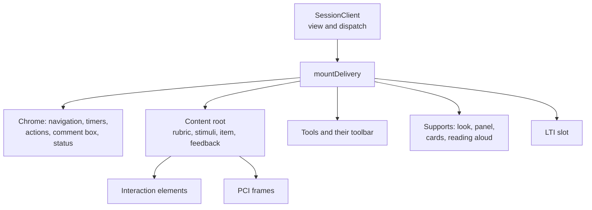
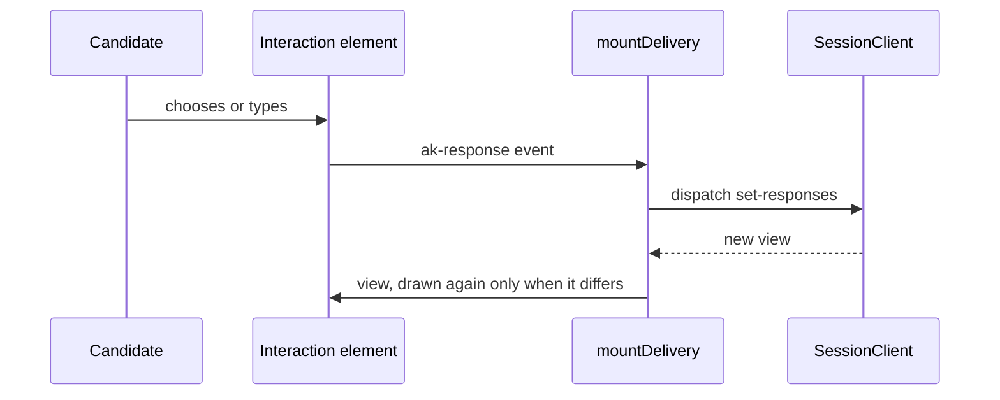
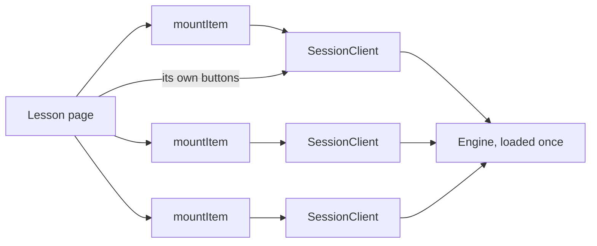

# Mounting a test or an item

`mountDelivery` of `@assesskit/player/player` shows a candidate session: the content of the engine's view and the chrome
around it. It follows a session client ([client](client.md)) and never knows whether the engine runs on a server or on the
device. It decides nothing of QTI: it sends the actions that the view lists and shows what the engine answers.
`mountItem` shows the content alone, for a page that has many items ([items in a page](#items-in-a-page)).



An answer travels from the candidate to the engine and back as a new view:



## Quick start

The sample mounts the player on a preview of one item, which the device runs:

```ts
import { readAsi } from "@assesskit/runtime/asi";
import { createLocalSession } from "@assesskit/player/client/local";
import { mountDelivery } from "@assesskit/player/player";
import css from "@assesskit/player/player.css?inline"; // any bundler that imports a file as text

const parsed = readAsi(`<qti-assessment-item xmlns="http://www.imsglobal.org/xsd/imsqtiasi_v3p0"
    identifier="q1" title="Question" adaptive="false" time-dependent="false">
  <qti-item-body><p>Hello</p></qti-item-body>
</qti-assessment-item>`);
if (parsed.kind !== "item") throw new Error("The document is not an item.");

const saved = new Map();
const client = await createLocalSession({
  definition: { kind: "item", item: parsed.item, base: "items/q1.xml" },
  store: {
    load: async (session) => saved.get(session),
    save: async (session, { state }) => void saved.set(session, state),
  },
  session: "preview-1",
  seed: 1,
  assets: (path) => `https://assets.example/package/${path}`,
});

const stylesheet = new CSSStyleSheet();
stylesheet.replaceSync(css);
const host = document.createElement("div");
document.body.append(host);
const mounted = mountDelivery(host, {
  client,
  files: {
    upload: async (bytes, mimeType) => ({ reference: "f1", mimeType }),
    read: async () => new Uint8Array(),
    url: (file) => `/files/${file.reference}`,
    reserve: async (mimeType) => ({ reference: "f2", mimeType }),
    fill: async (file, bytes) => undefined,
  },
  staticUrl: "https://assets.example/static/",
  stylesheet,
  fetch: (url, init) => fetch(url, init),
  language: "id",
});
await mounted.settled();
host.shadowRoot.querySelector(".ak-heading")?.textContent; // => "Question"
mounted.destroy();
```

## Options

| Option          | Type                                | Meaning                                                                                                                                                                                                                                                                                                                                                                                                                                                                                                                                                                                                                                   |
| --------------- | ----------------------------------- | ----------------------------------------------------------------------------------------------------------------------------------------------------------------------------------------------------------------------------------------------------------------------------------------------------------------------------------------------------------------------------------------------------------------------------------------------------------------------------------------------------------------------------------------------------------------------------------------------------------------------------------------- |
| `client`        | `SessionClient`                     | The session the player shows, sends its actions to, and resolves package paths through.                                                                                                                                                                                                                                                                                                                                                                                                                                                                                                                                                   |
| `files`         | `MountFiles`                        | The host's storage of files: `upload`, `read` and `url`, and `reserve` and `fill` for a recording unless `hooks.record` is `false`. A file value is a reference to it everywhere. `upload`, `read` and `reserve` get `{ signal }` last, which aborts when the player is destroyed; `fill` gets the caller's `signal` only, because the bytes of a recording that the end of the mount stopped still have to arrive. A host that scores waits for `fill` before it reads the file.                                                                                                                                                         |
| `staticUrl`     | `string`                            | The base URL of the player's static files, ending in `/`: `pci-frame/frame.html` and `player.css` are under it.                                                                                                                                                                                                                                                                                                                                                                                                                                                                                                                           |
| `stylesheet`    | `CSSStyleSheet`                     | The stylesheet of the content, built from `player.css` ([styling](styling.md)).                                                                                                                                                                                                                                                                                                                                                                                                                                                                                                                                                           |
| `fetch`         | `StylesheetFetch`                   | Loads item stylesheets and the module resolution files of portable custom interactions from the gate. `fetch` of the page fits: the request carries a `signal` that aborts when the player is destroyed.                                                                                                                                                                                                                                                                                                                                                                                                                                  |
| `language`      | `string`                            | The language of the interface, a BCP 47 tag, which chooses the catalog of [messages](messages.md). Default: `"en"`.                                                                                                                                                                                                                                                                                                                                                                                                                                                                                                                       |
| `catalogs`      | `Record<string, Partial<Messages>>` | The catalogs of the languages the host shows, by language tag, over the English messages ([messages](messages.md)). Default: none, so that the messages are English.                                                                                                                                                                                                                                                                                                                                                                                                                                                                      |
| `origins`       | `readonly string[]`                 | The origins besides the package's that content and portable custom interactions may load from. Default: none.                                                                                                                                                                                                                                                                                                                                                                                                                                                                                                                             |
| `mathjax`       | `string`                            | The URL of MathJax 4's `mml-chtml` component ([math](math.md)). Default: none, so that the browser renders MathML.                                                                                                                                                                                                                                                                                                                                                                                                                                                                                                                        |
| `resumeCheckMs` | `number`                            | How often in milliseconds the player calls `client.refresh()` while the test is paused and the view lists no `resume`: a proctor has to act. `0` for never; the button and the return of the page still check. A remote client sends one request for each check. At most `2147483647`, the longest delay of a timer of the browser. Default: `30000`.                                                                                                                                                                                                                                                                                     |
| `landmark`      | `"main" \| "region"`                | The element that holds the player: `"main"` for a page that is the player, `"region"` (a `section` named by the heading) for a page that has a `main` of its own, since a page has one. Default: `"region"`.                                                                                                                                                                                                                                                                                                                                                                                                                              |
| `headingLevel`  | `1` to `6`                          | The level of the heading of the item: that of the heading under which the page puts the player; `1` for a page that is the player. Default: `2`.                                                                                                                                                                                                                                                                                                                                                                                                                                                                                          |
| `marking`       | `boolean`                           | Whether the chrome offers Mark for review in a nonlinear part: a toggle button for the item presented, and the map names a marked item in words. A host that draws its own sets `false` and sends `mark` itself. Default: `false`.                                                                                                                                                                                                                                                                                                                                                                                                        |
| `chrome`        | `boolean`                           | Whether the player draws the navigation, timers, actions, attempts, comment box, panel of supports and tools. A host that draws its own sets `false`. Default: `true`.                                                                                                                                                                                                                                                                                                                                                                                                                                                                    |
| `hooks`         | `object`                            | The hooks of the host: `customInteraction` mounts `qti-custom-interaction`, `record` says whether an upload of audio offers a recording (Default: `true`), `voice` reads aloud (Default: the voice of the browser, `createWebSpeech()`, [speech](speech.md)), `onError(error)` receives the errors that the player can only report, such as a stylesheet that failed to load, and none after `destroy` (Default: `reportError` of the page), `tools` gives the tools that the host provides, by name ([tools](tools.md#tools-of-the-host)), and `ltiLogin(item)` starts the tool of an LTI item ([LTI items](#lti-items)). Default: none. |

`mountDelivery(host, options)` throws `DataError` when `host` is not an element that can have a shadow root and has none, or has one that an earlier mount of the player left empty, or an
option is not of its type. It attaches an open shadow root to `host` and draws in it, so the page's styles do not reach the
chrome. The chrome uses the system colors and `rem` sizes, so it follows the color scheme, forced colors and the text size.
`destroy` empties the shadow root, so a page that switches sessions, or a React `StrictMode` that mounts, destroys and mounts again, mounts on the same element. A second mount on an element that a mount still draws in throws `DataError`.

It returns a `Mounted`:

| Member         | Meaning                                                                                                                                                                                        |
| -------------- | ---------------------------------------------------------------------------------------------------------------------------------------------------------------------------------------------- |
| `update(view)` | Shows a view in place of the one before. The player follows the client by itself, so a host calls it only to feed its own view.                                                                |
| `settled()`    | Resolves when the interactions of the item shown have handed over what the candidate gave. A host with `chrome: false` waits for it before it sends an action that submits or leaves the item. |
| `destroy()`    | Takes the content, the timers and the listeners away, and closes an open confirmation with nothing confirmed. The session client stays open: it belongs to the host.                           |

## What the player draws

| Part                  | Behavior                                                                                                                                                                                                                                                                                                                                               |
| --------------------- | ------------------------------------------------------------------------------------------------------------------------------------------------------------------------------------------------------------------------------------------------------------------------------------------------------------------------------------------------------ |
| Heading               | The title of the item, or of the test where no item is shown. It takes the focus when the item changes (WCAG 2.4.3).                                                                                                                                                                                                                                   |
| Navigation map        | A landmark of the visible sections and the item instances of the test part, from the engine's map, with each item's state in words, and "Marked for review" for an item the candidate marked. The current item has `aria-current`. An item that is not reachable cannot be chosen; a linear part lists the items presented so far and has no way back. |
| Actions               | One button for each type of action that `view.actions` lists and that a button can send. Nothing is offered that the engine, or the session host's client-action policy, left out: an exam has no pause button.                                                                                                                                        |
| Confirmations         | A modal dialog before `end-part`, `end-test` and a `submit` in a linear part (WCAG 3.3.4). The focus starts on the answer that goes back. Ending a part or the test says how many questions have an attempt open, and that a simultaneous part submits all its answers together.                                                                       |
| Timers                | The time left to each maximum time and the time before the candidate may leave, counted down from the moment the view was made. A limit that passed and still takes answers says so. The candidate can hide the timers (WCAG 2.2.2).                                                                                                                   |
| Timer warnings        | A status message 300 and 60 seconds before a limit, with the time left in words of the interface's language, and one when the time is over (WCAG 2.2.1). A page that loads inside the last minutes announces the time left.                                                                                                                            |
| Review and solution   | Buttons to review a closed item and to show its solution, when the item allows them. The state of the item shows in the map.                                                                                                                                                                                                                           |
| Mark for review       | With `marking`, in a nonlinear part: a toggle button, pressed while the item presented is marked, that sends `mark`. A mark is part of the state, so it survives a reload and a resume on another device, and it never enters the results.                                                                                                             |
| Comment box           | A labelled field and a button where the item allows a comment. A new comment replaces the one before.                                                                                                                                                                                                                                                  |
| Time-dependent notice | A note on an item whose task depends on time.                                                                                                                                                                                                                                                                                                          |
| Suspension            | A note that the test is paused, and no action but the one the view lists. In an exam only the proctor suspends and resumes ([server](server.md#the-proctor)), so a button checks whether the test continues, and the player checks by itself (`resumeCheckMs`).                                                                                        |
| Attempts              | The attempts used and, for an item with a limit, the attempts left.                                                                                                                                                                                                                                                                                    |
| Rubric                | The candidate rubric of the test, its part and its sections, in the content of every item.                                                                                                                                                                                                                                                             |
| Supports              | The panel of the supports, with a button for each option and the state of the others, and what the supports that are on change: the look, the size of media, the cards, the reading aloud and the notice of the variant ([supports](supports.md#in-the-player)).                                                                                       |
| Tools                 | The tools that the item and the profile put in force: a toolbar, the panels of the open tools, and the rule, protractor, line reader, marks and masks over the item ([tools](tools.md#in-the-player)).                                                                                                                                                 |

The map is hidden where the test part has fewer than two items. After the end of a test that the engine lets the candidate review (`reviewAfterEnd` of the [runtime](../runtime/delivery.md#review-after-the-end)), the map lists the items presented in every part, and choosing one sends `review` in place of `move`; the buttons for the review and the solution of the item shown follow `view.actions`.

The map is drawn again with each view, and WebKit lays out a long one in a time that grows faster than its entries: about seven
seconds for 30,000 items on a laptop. A test part of thousands of items in Safari is better served by a host that draws its
own map (`chrome: false`) and shows a part of it.

## LTI items

An item that is a link to a tool (`CandidateItem.lti`) has no content to draw. The player shows the tool in a frame, from the
moment the candidate opens the item to the moment the candidate leaves it or the item closes. It asks the host for the frame
once, through `hooks.ltiLogin(item, { signal })`, where `item` is the `ItemKey` and the `signal` aborts when the candidate leaves the item or the player is destroyed; an answer that arrives late is dropped. The host's authenticated route answers with an `LtiFrame`
(see [LTI items](lti-items.md)): the URL of the tool's login, the URL of the storage page and the
`allow` list of the registration.

| Case                                                                                                                          | What the player does                                                                                                                    |
| ----------------------------------------------------------------------------------------------------------------------------- | --------------------------------------------------------------------------------------------------------------------------------------- |
| The item is open                                                                                                              | Shows the storage page in a hidden frame named `lti-storage`, and the tool in a frame named `lti-tool` once the storage page has loaded |
| A later view of the same item                                                                                                 | Leaves the frames as they are, and does not ask the host again                                                                          |
| The candidate leaves the item                                                                                                 | Removes both frames. Coming back asks the host again and launches the tool again                                                        |
| The item is closed, in review or in solution                                                                                  | Shows the note `ltiClosed` of the catalog in place of the tool                                                                          |
| There is no `ltiLogin`, the hook fails, or its answer is not a frame, or a URL is on the origin of the page or of `staticUrl` | Shows "The tool for this question could not be started." as an alert. A failure is also reported with `reportError`                     |

The frame of the tool has `sandbox="allow-scripts allow-forms allow-same-origin"`, `referrerpolicy="no-referrer"`, the `allow`
list of the answer and no other permission, and the title of the link. `allow-same-origin` keeps the tool's own origin, so the
player refuses a tool that is served from the origin of the page or of `staticUrl`, where it would have the player's own origin.
The player answers the capabilities request of the tool. Both frames are children of the host element, shown through a slot
of the shadow root, because a window finds a frame by name only among the frames of its own document; the storage page needs
that. A page has one player with an LTI item at a time. The player checks only the URLs of the answer; where the tool then
navigates its frame, its login included, the `frame-src` of the page decides, so serve the platform's LTI endpoints apart from
the page's origin, and add to `frame-src` their origin and the tools', not the page's own ([SECURITY.md](../../SECURITY.md)).

## Items in a page

`mountItem` shows the content of one session and nothing around it: a lesson page mounts one for each of its items, each on a
session client of its own, and the host draws the buttons that send the actions. It takes the options of `mountDelivery`
without `chrome`, `hooks.tools` and `hooks.ltiLogin`, and returns the same `Mounted`.



| Part                                                                 | `mountItem`                                                                                   |
| -------------------------------------------------------------------- | --------------------------------------------------------------------------------------------- |
| Content root with rubric, stimuli, item, modal feedback              | Drawn, in a shadow root                                                                       |
| Interactions and portable custom interactions                        | Drawn; they send `set-responses` and `end-attempt` to the session                             |
| Supports that are on, reading aloud, lexicons, variant notice        | Applied; the panel of the options is not drawn                                                |
| Status region                                                        | One `role="status"` region per item: answers saved, and why the engine refused (WCAG 4.1.3)   |
| Heading, map, timers, actions, comment box, attempts, notices, tools | Not drawn. The host sends the actions of the session client and shows what the engine refused |
| A closed item                                                        | Stays drawn, with its interactions disabled, until `destroy`                                  |
| An LTI item                                                          | `DataError`: it needs a login, so use `mountDelivery`                                         |

The host waits for `settled()` before it sends an action that submits or leaves the item, as with `chrome: false`.

```ts
import { readAsi } from "@assesskit/runtime/asi";
import { createLocalSession } from "@assesskit/player/client/local";
import { mountItem } from "@assesskit/player/player";
import css from "@assesskit/player/player.css?inline"; // any bundler that imports a file as text

const parsed = readAsi(`<qti-assessment-item xmlns="http://www.imsglobal.org/xsd/imsqtiasi_v3p0"
    identifier="q1" title="Question" adaptive="false" time-dependent="false">
  <qti-item-body><p>Hello</p></qti-item-body>
</qti-assessment-item>`);
if (parsed.kind !== "item") throw new Error("The document is not an item.");

const saved = new Map();
const client = await createLocalSession({
  definition: { kind: "item", item: parsed.item, base: "items/q1.xml" },
  store: {
    load: async (session) => saved.get(session),
    save: async (session, { state }) => void saved.set(session, state),
  },
  session: "lesson-1-q1",
  seed: 1,
  assets: (path) => `https://assets.example/package/${path}`,
});

const stylesheet = new CSSStyleSheet();
stylesheet.replaceSync(css);
const host = document.createElement("div");
document.body.append(host);
const mounted = mountItem(host, {
  client,
  files: {
    upload: async (bytes, mimeType) => ({ reference: "f1", mimeType }),
    read: async () => new Uint8Array(),
    url: (file) => `/files/${file.reference}`,
    reserve: async (mimeType) => ({ reference: "f2", mimeType }),
    fill: async (file, bytes) => undefined,
  },
  staticUrl: "https://assets.example/static/",
  stylesheet,
  fetch: (url, init) => fetch(url, init),
});
host.shadowRoot.querySelector("[role=status]").textContent; // => ""
host.shadowRoot.querySelector(".ak-actions"); // => null
mounted.destroy();
```

`mountItem(host, options)` throws `DataError` when `host` is not an element that can have a shadow root and has none, or has one that an earlier mount of the player left empty, an option
is not of its type (`chrome`, `marking`, `resumeCheckMs`, `landmark`, `headingLevel`, `hooks.tools` and `hooks.ltiLogin` are not options of it, in its type as at run time), or the view presents an LTI item. The
last also holds for a view that `update` or the client brings later. `destroy()` is the one of `mountDelivery`: a second call
does nothing, and the session client stays open.

### Focus in a page

A lesson has many items, so none of them takes the focus from the page.

| When                                                            | Where the focus goes                                                                                   |
| --------------------------------------------------------------- | ------------------------------------------------------------------------------------------------------ |
| An item mounts, answers, changes its view or closes             | Nowhere: the control of the page that has it keeps it.                                                 |
| Modal feedback opens                                            | The heading of its dialog, as a modal dialog must (WCAG 2.4.3).                                        |
| The candidate closes the dialog with the Close button or Escape | The control that had the focus when the dialog opened, such as the host's button that sent the submit. |

## Refusals and status messages

The engine refuses a well-formed action that the rules do not allow, and leaves the state unchanged. The player
says why, in the language of the interface, in a polite live region with `role="status"` that never takes the focus
(WCAG 4.1.3). The catalog has a message for each `RefusalReason`, and a test fails when the runtime adds a code that has none.

| Case                                             | Message (English)                                                        |
| ------------------------------------------------ | ------------------------------------------------------------------------ |
| The engine refused the action                    | The message of the code, such as "The time for this question is over."   |
| The answers were saved (after a `set-responses`) | Answers saved.                                                           |
| A comment was saved                              | Comment saved.                                                           |
| The host could not be reached or could not save  | Your answers could not be sent. They will be sent again.                 |
| The host rejected the action (`DataError`, 403)  | The test could not accept this action.                                   |
| The action is above the limits (`SecurityError`) | The test could not accept this action; the error goes to `hooks.onError` |

The region keeps the room of one line whether or not it has text, so that a message moves nothing: the player writes "Answers saved."
about 50 ms after an answer, and a button that moves between the press and the release of a pointer gets no click. `mountDelivery`
keeps the same room for the region of the timer warnings from the first view that shows a timer; a test with no timer has none.
A message longer than a line, in a narrow page, takes the lines it needs.

## Focus

| When                                                    | Where the focus goes                                                                            |
| ------------------------------------------------------- | ----------------------------------------------------------------------------------------------- |
| The player starts                                       | Nowhere: it takes nothing from the page.                                                        |
| The item changes, or the test is suspended or ends      | The heading.                                                                                    |
| A new view arrives while a control of the chrome has it | The same control; the heading if the control is gone, such as the Submit button after a submit. |
| A confirmation opens                                    | "No, go back". Escape goes back, and the focus returns to the control that asked.               |

## The content

The content of a view goes to a content root ([content](content.md)): the rubric, the stimuli, the item and the test
feedback, with the documents they come from so that relative references resolve (`ViewEnvelope.documents`). The player draws it
again only when it differs from what is shown: a new item instance, even of the item shown, as a selection with replacement
makes, another state of the item, or answers to review. A new view that
only carries the answers the candidate just gave leaves the interactions as they are, so the caret and the focus stay.
Modal feedback opens in a dialog once for each attempt.

Each interaction is an element of [interactions](interactions.md). The player gives it the descriptor of the runtime, whether the
candidate can respond (only while the item is interacting), and the response; it hears `ak-response` and sends
`set-responses`, and hears `ak-end-attempt` and sends `end-attempt`. It sets the response on an element when the content is
drawn and when the item is not interacting, as in review and in the solution, where the response is the engine's. While the
candidate interacts the element holds the response, so a view that answers an earlier request never takes back what was typed
since. Both actions name the item whose content holds the element, and a portable custom interaction names the item its frame
was mounted for: a view that presents another item arrives before that item is drawn, and what the candidate does in the
content still shown goes to the item it belongs to, which the engine refuses once the candidate has left it.

A request that submits or leaves the item (`submit`, `skip`, `next-attempt`, `end-attempt`, `end-part`, `end-test` and every
`move`) waits first for `settled()` of each interaction element and of each portable custom interaction of an item that is
interacting, after the candidate has confirmed it. An interaction that stores its response in the background, such as a
drawing whose picture is being uploaded, hands it over by then, and so does a portable custom interaction that fires no
`qti-interaction-changed`, whose `getResponse()` the player reads; the `set-responses` that carries it goes before the request. Without this the request would reach the engine first, and the
drawing would be missing from what is submitted or lost with the item.

Each portable custom interaction runs in its frame ([PCI](pci.md)). The player loads its module resolution files from the
gate, mounts the frame with the response, the state `getState` gave before, the template and context values and the status
of the item, and stores each response it gives with its state in `set-responses`, so that the interaction restores on any
device. A `done` event is a response; the candidate decides when to submit.

The frame loads the modules from the package through `client.assets`, and its policy allows scripts from the origin of
`staticUrl` and from `origins` only. So the files of the package that an interaction loads are served from the origin of
`staticUrl`, as in the samples, or from an origin in `origins`. A relative URL from `assets`, such as `/package/q1/main.js`,
is resolved against the base URL of the page, which is the origin of `staticUrl` only when the page itself serves both. A
module on any other origin is refused when the frame is mounted, with an error that names the URL and the origin, and the
item shows "This interactive question could not start" with the error in `reportError`.

## Files

Each file of `src/player/delivery/`, `src/player/lti-frame/` holds one concept.

| File                        | Concept                                                                       |
| --------------------------- | ----------------------------------------------------------------------------- |
| `delivery/action-row.ts`    | The rows of buttons that the actions of a view make                           |
| `delivery/actions.ts`       | The buttons of a view, and the confirmations                                  |
| `delivery/announcer.ts`     | The live region for status messages                                           |
| `delivery/attachments.ts`   | The supports, the lexicons and the tools, mounted together                    |
| `delivery/body.ts`          | The content root, its interactions bound to the view, and the modal feedback  |
| `delivery/chrome.ts`        | The navigation map, the actions, the attempts, the timers and the comment box |
| `delivery/comment.ts`       | The comment box                                                               |
| `delivery/confirm.ts`       | The confirmation dialog                                                       |
| `delivery/content.ts`       | What the content root shows for a view                                        |
| `delivery/duration.ts`      | Times left as a clock and in words                                            |
| `delivery/index.ts`         | The public API                                                                |
| `delivery/internal.ts`      | Helpers that other folders and tests share, which the package does not export |
| `delivery/lexicons.ts`      | Loading the pronunciation lexicons of an item                                 |
| `delivery/mount.ts`         | `mountDelivery`, which puts the parts together                                |
| `delivery/navigation.ts`    | The navigation map                                                            |
| `delivery/notices.ts`       | The notices and the attempts of a view                                        |
| `delivery/options.ts`       | The options of `mountDelivery`, checked                                       |
| `delivery/pci.ts`           | The host of the portable custom interactions of a view                        |
| `delivery/refusals.ts`      | The message of each refusal reason                                            |
| `delivery/sender.ts`        | The actions that the parts send to the session, and what the engine refused   |
| `delivery/settings.ts`      | The options with their defaults applied                                       |
| `delivery/shell.ts`         | The elements of the player, in the order they stand on the page               |
| `delivery/state.ts`         | The view and what is drawn, which the parts share                             |
| `delivery/styles.ts`        | The stylesheet of the chrome                                                  |
| `delivery/supports.ts`      | The supports in the chrome and the content                                    |
| `delivery/timers.ts`        | The timers and their warnings                                                 |
| `delivery/tools.ts`         | The tools in the chrome                                                       |
| `delivery/update.ts`        | Showing a view: the chrome at once, the content one view at a time            |
| `lti-frame/capabilities.ts` | The answer to the capabilities request of a tool                              |
| `lti-frame/frame.ts`        | The frames of a tool and its storage page                                     |
| `lti-frame/index.ts`        | The public API                                                                |
| `lti-frame/internal.ts`     | Helpers that other folders and tests share, which the package does not export |
| `lti-frame/slot.ts`         | The slot of the tool of an LTI item                                           |

## References

| Specification                                                                                    | Topics                            |
| ------------------------------------------------------------------------------------------------ | --------------------------------- |
| [WCAG 2.2](https://www.w3.org/TR/WCAG22/#error-prevention-legal-financial-data)                  | error prevention                  |
| [WCAG 2.2](https://www.w3.org/TR/WCAG22/#focus-order)                                            | focus order                       |
| [WCAG 2.2](https://www.w3.org/TR/WCAG22/#timing-adjustable)                                      | timing adjustable                 |
| [WCAG 2.2](https://www.w3.org/TR/WCAG22/#pause-stop-hide)                                        | pause, stop, hide                 |
| [WCAG 2.2](https://www.w3.org/TR/WCAG22/#status-messages)                                        | status messages                   |
| [WCAG 2.2](https://www.w3.org/TR/WCAG22/#target-size-minimum)                                    | target size                       |
| [QTI 3.0 ASI Information Model](https://www.imsglobal.org/spec/qti/v3p0/info/)                   | candidate comment, modal feedback |
| [QTI 3.0 Best Practices and Implementation Guide](https://www.imsglobal.org/spec/qti/v3p0/impl/) | portable custom interactions      |
| [LTI 1.3](https://www.imsglobal.org/spec/lti/v1p3/)                                              |                                   |
| [LTI Client Side postMessages 0.1](https://www.imsglobal.org/spec/lti-cs-pm/v0p1)                |                                   |

## Errors

`mountDelivery` and `mountItem` throw the runtime's `DataError` for a call that cannot mount, and report the rest through `hooks.onError`. The answers to actions are the [status messages](#refusals-and-status-messages), not errors.

| Error                        | When                                                                                                                                                   | What to do                                                                               |
| ---------------------------- | ------------------------------------------------------------------------------------------------------------------------------------------------------ | ---------------------------------------------------------------------------------------- |
| `DataError`                  | The host is not an element, or has a shadow root that the player did not attach, or one that an earlier mount left with content                        | Pass an element with no shadow root, or the host of an earlier mount after its `destroy` |
| `DataError`                  | `staticUrl` does not end in `/`, `stylesheet` is not a `CSSStyleSheet`, or another option or hook is of the wrong type                                 | Fix the option; the message names it                                                     |
| `DataError`                  | `headingLevel` is above 6, `landmark` is neither `main` nor `region`, `marking` is not a boolean, or `resumeCheckMs` is negative or above `2147483647` | Use a value in range                                                                     |
| `DataError`                  | `mountItem` finds that the current item is a link to an LTI tool                                                                                       | Use `mountDelivery`, which starts the login ([LTI items](#lti-items))                    |
| The error of `hooks.onError` | A stylesheet, a module, a file or a voice failed after the mount, with no call to carry the error                                                      | Log it; the default is `reportError` of the page. None arrives after `destroy`           |
| A status message             | The engine refused an action, or the host could not be reached                                                                                         | Read the message; the player sends held answers again by itself                          |

An error of the session client, such as `ServiceError` for a host that is down, reaches the player through `dispatch`, and the player turns it into the status message "Your answers could not be sent. They will be sent again." ([client errors](client.md#errors)).

## Not included

| Not included                                         | Why                                                                                                       |
| ---------------------------------------------------- | --------------------------------------------------------------------------------------------------------- |
| Deciding what the candidate may do                   | The runtime and the host's client-action policy decide; the player draws the actions the view lists       |
| Authentication, login and the page around the player | The host's page; the player mounts in the element it is given                                             |
| An LTI launch                                        | The host gives `ltiLogin`; [interopkit](https://github.com/interopkit/interopkit) implements the protocol |
| A heading, a map or a timer on a page of many items  | `mountItem` draws the content and the interactions only; a lesson page keeps its own layout               |
| A server-side render                                 | The player needs a DOM; importing it in Node is safe, mounting it is not                                  |
## Differences from the references

None. The player draws the view that the runtime builds and decides nothing of QTI; where the specifications differ or are silent, [spec gaps](../runtime/spec-gaps.md) gives the resolution that the engine applies. The accessibility of the chrome is held by the tests of [Evidence](evidence.md).
