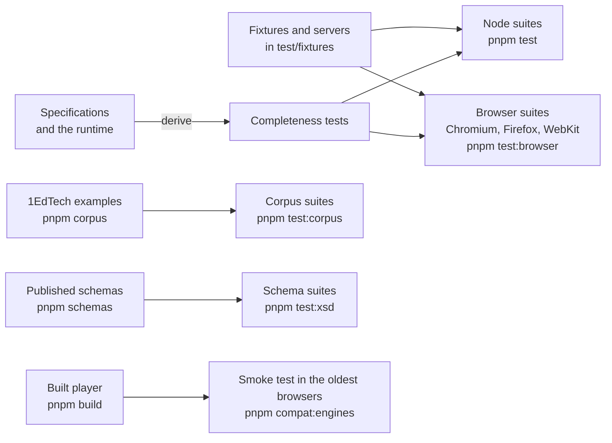

# Evidence for the player

How the player is tested. The claim that these tests support is stated in [Supported](supported.md).



| Suite                      | Runs in                                   | Command               | Covers                                                                                           |
| -------------------------- | ----------------------------------------- | --------------------- | ------------------------------------------------------------------------------------------------ |
| `*.test.ts`                | Node                                      | `pnpm test`           | `protocol`, `scoring`, `cat`, `cat-rest`, `client`, `server` and the shared code                 |
| `*.browser.test.ts`        | Chromium, Firefox and WebKit              | `pnpm test:browser`   | Rendering, the shell, accessibility with axe, the clients, the exam server over HTTP, LTI frames |
| `*.corpus.test.ts`         | Node                                      | `pnpm test:corpus`    | The asset gate over the 1EdTech examples                                                         |
| `*.browser.corpus.test.ts` | Chromium, Firefox and WebKit              | `pnpm test:corpus`    | The 1EdTech examples drawn, answered and checked with axe                                        |
| `*.xsd.test.ts`            | Node                                      | `pnpm test:xsd`       | The HTML elements of the ASI schema                                                              |
| `smoke.ts`                 | Chromium 111, Firefox 115 and WebKit 16.4 | `pnpm compat:engines` | The browser baseline in the oldest engines, in Docker                                            |
| The guides                 | Node and the browsers                     | with the suites above | Every sample of a guide runs and gives the result that it shows                                  |

## Results

The counts are those of the repository at `b543e977`, run on 2026-11-06: every test below passed, and none failed or was skipped. The
tests in Node ran on Node.js 22.23.4, and the tests in a browser in Chromium; Firefox and WebKit run the same files in the job
`browsers` of `.github/workflows/ci.yml`, and their results are not counted here.

| Layer                                 | Count                                               | Where                                                                                                                                   |
| ------------------------------------- | --------------------------------------------------- | --------------------------------------------------------------------------------------------------------------------------------------- |
| Tests in Node, offline                | 893 tests in 22 files                               | `pnpm test`, project `player`                                                                                                           |
| Tests in a browser                    | 1,216 tests in 27 files, in Chromium                | `pnpm test:browser`, project `player-browser`                                                                                           |
| Of these, tests that name axe or WCAG | 88                                                  | the titles of the tests of `*.browser.test.ts`, which say the rule or the success criterion that they hold                              |
| Tests over the 1EdTech examples       | 49 tests in Node and 8 tests in 4 files in Chromium | `pnpm test:corpus`, projects `player-corpus-node` and `player-corpus`; `qti-examples` at commit `0a92fbb` of `scripts/corpus.lock.json` |
| Tests against the published schemas   | 4 tests                                             | `pnpm test:xsd`, project `player-xsd`: the HTML elements of the ASI schema                                                              |
| Fixtures                              | 32 files                                            | `packages/player/test/fixtures/`                                                                                                        |
| The oldest browsers                   | Chromium 111, Firefox 115 and WebKit 16.4           | `compat/engines`, `pnpm compat:engines`; [baseline](baseline.md)                                                                        |
| Entry points held to a budget         | one budget for each                                 | `packages/player/test/size-budgets.ts`; [size](size.md)                                                                                 |

## Completeness

What must be covered is derived from the specifications and from the runtime, not from a list that the repository keeps.

| Source                                                                      | Test                                                                                                                                                                     |
| --------------------------------------------------------------------------- | ------------------------------------------------------------------------------------------------------------------------------------------------------------------------ |
| The HTML elements of the ASI schema                                         | `html-elements.xsd.test.ts` (`pnpm test:xsd`): the elements that the content renderer draws as HTML are those that the schema declares without `qti-`                    |
| The interaction types of the QTI metadata vocabulary                        | `elements.browser.test.ts`: the renderers of the mounts have one for each but the portable custom interaction, which its own host draws                                  |
| The descriptors of the runtime for the interactions of the 1EdTech examples | `elements.browser.corpus.test.ts`: every item of the examples that has an interaction is drawn as its descriptors say, answered, and checked with axe                    |
| The items, stimuli and packages of the 1EdTech examples                     | `content.corpus.browser.test.ts`, `graphic.browser.corpus.test.ts`, `pci.browser.corpus.test.ts` and `server.corpus.test.ts`                                             |
| WCAG 2.2 at levels A and AA                                                 | axe-core with the rules of both levels, scripted keyboard use, and the checks of the success criteria that a rule cannot decide; a test says in its title what it checks |

## Tests in a browser

The global setup `global-setup.ts` builds the files of the frame and starts three servers on free ports: the asset origin, a
second origin that a test may allow, and a stranger that nothing may reach. A test reads the paths a server was asked for at
`/__hits`; the browsers of a run share the servers, so each test names its paths with a token of its own. A server of the
fixtures that fails answers with the reason and never throws, because Vitest cannot print an error that escapes it.

| The asset origin serves                                                                                                                                            | Under                         |
| ------------------------------------------------------------------------------------------------------------------------------------------------------------------ | ----------------------------- |
| The package files of the content renderer, from `test/fixtures/content/`                                                                                           | `/content/<token>/`           |
| The package of a 1EdTech example, as the asset gate would                                                                                                          | `/c/<token>/<example>/`       |
| The whole examples directory, for the images of graphic items                                                                                                      | `/c/<token>/corpus/`          |
| MathJax and its fonts, from the `mathjax` package                                                                                                                  | `/mathjax/`                   |
| The worklet of the WAV recording                                                                                                                                   | `/static/recorder-worklet.js` |
| The issues that the SSML 1.1 schema finds in a posted document, as JSON; this needs `pnpm schemas` and `pnpm corpus`, and answers 500 with the reason without them | `/validate/ssml`              |

The commands of `commands.ts` give a test what a page cannot do: run axe-core inside a frame of an opaque origin, click in it,
read the accessibility tree with its frames, read what applies inside such a frame (`frameTheme`), press and release a pointer
(`pressPointer`, `releasePointer`), and read the XML and CSS files of the examples (`corpusFiles`, which needs `pnpm corpus`).
A suite that checks accessibility runs axe-core with the rules of WCAG 2.2 A and AA, and the suites press real keys and pointer
buttons; Safari leaves form controls and buttons out of the tab order unless the person turns that on, so a keyboard test
focuses a control and presses its keys.

| Area                         | Fixtures                                                                   | What the tests do                                                                                                                                                                                                                                                                                                                                                                                                                                                                                                                                                                                                     |
| ---------------------------- | -------------------------------------------------------------------------- | --------------------------------------------------------------------------------------------------------------------------------------------------------------------------------------------------------------------------------------------------------------------------------------------------------------------------------------------------------------------------------------------------------------------------------------------------------------------------------------------------------------------------------------------------------------------------------------------------------------------- |
| Content renderer             | `renderer-fixture.ts`, `css-fixture.ts`, `content-fixture.ts`              | Read items with the runtime's `readAsi` and render their nodes, SSML and MathML in their namespaces, in a content root. `content.corpus.browser.test.ts` renders every item and stimulus of the examples, adopts their stylesheets, opens every modal feedback and compares the HTML elements with the XML. Hostile cases: markup the reader accepts, nodes only a forged view carries, stylesheets with every way to load a resource; the record of requests shows that the browser asked no other origin                                                                                                            |
| Interactions                 | `interactions-fixture.ts`                                                  | Render items with the interaction renderers and the runtime's `describeInteractions`, and answer with the mouse, real keys and an oscillator in place of the microphone. Media use three recordings and a caption file: a blip of a quarter second played to its end, a tone of two seconds, and twenty seconds of silence that outlast a test. Pause attributes run on fake timers moved by hand; playback is followed by its events, never by a time. `elements.browser.corpus.test.ts` draws, answers and checks every item of the examples that has an interaction                                                |
| Graphic interactions         | `graphic-fixture.ts`                                                       | Wait for the pictures, keep what a drawing uploads in memory, and give the interactions their pictures as `data:` URLs drawn on a canvas. `graphic.browser.corpus.test.ts` renders the graphic items of the examples with their images                                                                                                                                                                                                                                                                                                                                                                                |
| Portable custom interactions | `pci-fixture.ts`                                                           | Mount an interaction as the player does. `*.browser.corpus.test.ts` runs the examples that use the frame, in the three engines with `pnpm test:corpus`                                                                                                                                                                                                                                                                                                                                                                                                                                                                |
| Status lines                 | `layout-fixture.ts`                                                        | `mount-item.browser.test.ts` and `delivery.browser.test.ts` hold the position of a button after the player across "Answers saved." and a refusal, and of the actions across a timer warning, and press a button, write the message while the press lasts and release: the button gets its click                                                                                                                                                                                                                                                                                                                       |
| MathJax                      | `math-failure`, `math-wrong-script`                                        | MathJax is a global of the page and a failure to load it is final, so a page without MathJax, or with a failure, is a test file of its own; each file runs in a page of its own                                                                                                                                                                                                                                                                                                                                                                                                                                       |
| Tools                        | `tools-fixture.ts`                                                         | Build the toolbar in the document and the item in a shadow root, as the player lays them out, with the companion materials of BPIG section 3.7.8 read by `readAsi`; axe also runs `label-content-name-mismatch`, which it leaves off by default                                                                                                                                                                                                                                                                                                                                                                       |
| Supports                     | `supports.browser.test.ts`                                                 | Read the catalogs of an item, mount each part on a content root and drive it with the runtime's engine, so that the `support` action, its refusals and the next view are the runtime's. `pci.browser.test.ts` gives a running frame a new look                                                                                                                                                                                                                                                                                                                                                                        |
| LTI frame                    | `lti-setup.ts`, `lti/storage.html`, `lti/tool.html`, `lti-exam-fixture.ts` | A platform serves a storage page written from LTI postMessage Storage, and two tool origins serve a tool page that runs the scenario the query names, talks to the storage frame and the player as LTI Client Side postMessages describes, and reports each step at `/report/<token>/<step>`. `lti-frame.browser.test.ts` mounts the frames alone and with `mountDelivery` over an essay and a link to a tool. The launch, the grade services and Caliper are tested in [interopkit](https://github.com/interopkit/interopkit), and the exchange between a session host and a platform in [the example](lti-items.md) |

**Audio.** The tests that play a recording to its end, follow its playback with a companion, count its plays and record a
stream need an audio output. A Linux host with no sound card has none: Chromium and WebKit play without one, and Firefox only
through PulseAudio, so `scripts/linux-audio.sh` starts PulseAudio with a sink that plays to nowhere, and all three engines then
play and record. The image of Playwright has no PulseAudio, so the script installs it from the packages that a folder keeps,
which apt fetches into it once and the `browsers` job keeps by the tag of the image. With `REQUIRE_AUDIO=1`, which CI and the container
below set, a test that needs audio fails when the output is missing; without it the test skips. Three tests skip in WebKit on
Linux, whose Playwright build has no `MediaRecorder`: the two of the browser's recorder and the one of a recording in a type
that the interaction accepts run in Chromium and Firefox, and the WAV recording through the worklet runs in all three. WebKit
keeps an audio context suspended without a recent gesture, so the fake microphone presses a button of its own before it makes
its context when the page has no user activation.

The smoke test of the pinned old browsers (`pnpm compat:engines`) also runs a portable custom interaction in its frame and
operates the tools by keyboard ([baseline](baseline.md#the-pinned-browsers)).

In the Firefox of Playwright the mouse of a page can reach another page of the same browser that runs at once, so that pages
take each other's presses, moves and drags. The Firefox instances of `vitest.config.ts` therefore run one test file at a
time; Chromium and WebKit run files at once. A press that overlaps another press of the same page can be lost in Firefox and in
WebKit, as when the fake microphone presses its button while a test presses Record, so a test presses only when no other
press can be under way.

Where the Firefox of Playwright does not start, such as on macOS 27, run the suite in a Linux container from the root of the
repository, in the image of the Playwright that the lock file pins, as CI does: it holds the browsers, and the container needs
network access only for the dependencies and the packages of PulseAudio. The examples in
`examples/player/` have measurekit and interopkit as dev dependencies, linked from `../../../../measurekit/packages/*` and
`../../../../interopkit/packages/*`, so the container mounts the built checkouts of both (`pnpm install && pnpm build` in each)
beside the repository at `/measurekit` and `/interopkit`:

```bash
docker run --rm --ipc=host --volume "$PWD":/src:ro --volume "$PWD/../measurekit":/measurekit:ro --volume "$PWD/../interopkit":/interopkit:ro mcr.microsoft.com/playwright:v1.64.1-noble bash -c '
  mkdir /work && tar -C /src --exclude=node_modules --exclude=.git --exclude=dist --exclude=.cache -cf - . | tar -C /work -xf - &&
  cd /work && npm install --global pnpm@12.8.1 && pnpm install --frozen-lockfile --ignore-scripts &&
  sh scripts/linux-audio.sh .cache/pulseaudio &&
  pnpm schemas && pnpm corpus && REQUIRE_AUDIO=1 pnpm test:browser && pnpm test:corpus'
```

`pnpm schemas` can time out against purl.imsglobal.org from inside a container. It resumes from the files that it holds, so a
second run finishes; a host that has both caches can instead mount its `.cache` read-only and copy it to `/work/.cache`.

## Tests of the shell, the clients and the gate

The tests of `server/` run in Node with an in-memory store, scheduler and file store (`exam-fixture.ts`), a clock that a test
moves and the fixture package of a test of three items with an image, a stylesheet, a portable custom interaction and files
that hide as web content: an item fragment, a response-processing template and a document of QTI data that no resource
declares, under extensions that the gate serves and under `.xml`. Each rule of the gate has a test that fails without it.
The tests of the origin accept `http` on loopback and refuse the names and addresses that only look like it. The gate is also
tested over the 1EdTech examples (`server.corpus.test.ts`, run by `pnpm test:corpus` in the project `player-corpus-node`):
under a token for the whole package, every file of each of the 24 directories and 24 archives is served or refused as an
oracle outside the gate says: the manifest, the main file of every resource of a document type, every file the reader of the runtime
parses as a document of QTI data, the references of adaptive sections and every file that is not a web asset are `404`; the
other files are `200`.

`bundle.test.ts` bundles the player and the remote session with esbuild and reads the metafile of the output: no file of the runtime's
engine has code in it, and a bundle that makes a local session has (so the check can see it). `size.test.ts` bundles every
entry point of both packages alone, minified, and fails when one is above its budget after gzip or holds a module that its budget
does not list ([size](size.md)).

The browser tests of the shell and the clients (`delivery.browser.test.ts`, `client.browser.test.ts`) run a session host in the
page with the wire between them: every envelope goes through JSON. The shell tests with a profile press the panel and read the next view, so that the `support` action goes through the session
host and its policy and the support is applied to the content, the frame of a portable custom interaction and the reading
controls. The tests of a pending drawing hold the upload of the picture until the test lets it go, press Submit, Next, a
question in the map and End the test, and read the order of the actions that reach the session: `set-responses` with the
stored file comes first, and the action that follows is not sent before. `exam.browser.test.ts` is the end-to-end test: the global
setup `exam-setup.ts` starts an HTTP server (`exam-server.ts`) that runs session hosts and the asset gate, and the tests act as
a candidate through `fetch`. The server takes the authentication from the headers `x-session` and `x-principal`, picks the exam
from `x-exam` and moves its clock by `x-offset`, so that a test makes time pass for its own session only. It covers the
caller binding (403 for another candidate's session and for a second start), the policy that refuses `suspend` (400), the
proctor's suspension, conflict retries (a competing write comes first three times and the request still succeeds, and a
fourth gives 409), a time-out that the scheduler's job applies, the gate's refusals and headers, the token of an upload, and a
portable custom interaction with a relative `define` and a stylesheet with a relative `url()` that load under their prefixes.

## Tests of the ports

The tests of `server/` run in Node with no network. The log of a session host is a function that records its calls; the intake
runs against a host and a store that fail on demand, one failure at a time, which is how the failure table of
[server](server.md#forwarding-the-steps) is tested: a retry at an equal time, a `settle` that repeats after it succeeded, a
store, a `scoredBy` and a host that reject, a signal that aborts, and a log that rejects on the step of a `cat-response`. The
oracles are the contracts of those ports and the specification of the score service for the order of timestamps. `buildSessionScore`
is tested in `scoring.test.ts` against reports built from the runtime's result model.

## Tests of scoring

The tests of `scoring/` run in Node against the runtime's engine, and those of the display run in the browsers. Their oracles are not
the code under test.

| Oracle                                                                         | Used for                                                                                                                                                        |
| ------------------------------------------------------------------------------ | --------------------------------------------------------------------------------------------------------------------------------------------------------------- |
| The runtime's engine: `scorerView`, `pending`, `apply` and `results`           | The scorer view that `buildSubmission` reads, and what the engine does with the action of `buildSupplyScores`: the events, the pending requests and the results |
| The runtime's codec, `writeWireValue` and `readWireValue`, and BPIG Appendix C | The form of the values of a submission, which a property test decodes again from JSON text                                                                      |
| INFO section 4.5.10 and the runtime's scoring requests                         | Which outcomes are scored externally, by whom, and when a request is accepted: after the test ended, and again to replace the score                             |

`scoring.test.ts` plays tests and items through the engine: the request of an item outcome and of a test outcome with covers,
an item that was not presented, correct responses and template values, a score supplied before, and `unknown-request` for a
request the state lacks. A property test takes a candidate's text from the engine through a submission, as JSON text, to a
score, a second score that replaces it and the submission read again. The display has `submission.browser.test.ts`: the
content roots and their references, the values by cardinality and base type, the files by media type, the themes, and axe at
WCAG 2.2 A and AA with the contrast of the nested content in every theme.

## The rating form

The oracle of the form is the runtime: the score is `rubricScore`, its highest value `rubricScoreRange`, and a rating that
does not fit the rubric is the runtime's `DataError`. `rating.browser.test.ts` mounts the form in Chromium, Firefox and WebKit
for a rubric of each kind ([rating](rating.md)).

| Check                                                                                           | How                                                                                                                |
| ----------------------------------------------------------------------------------------------- | ------------------------------------------------------------------------------------------------------------------ |
| One group of radio buttons for each criterion, named by its legend, with a label for each level | The accessible names read from the labels; a checklist offers met and not met, in the order of its levels          |
| The score, the ratings and `onChange`                                                           | Pointer presses on the labels and the arrow keys on a focused radio button; the score is compared with the runtime |
| An untouched checklist is incomplete                                                            | `score` is `null`, `ratings` is empty and `reportValidity()` is `false`                                            |
| `reportValidity`                                                                                | The marks, the link of the message, the first unrated button focused, the mark taken off when it is rated          |
| The read-only form                                                                              | No control in the shadow root; `reportValidity()` moves no focus and marks nothing                                 |
| `update`, `destroy` and a refused rubric                                                        | The shadow root as it was after a refusal, no listener after `destroy`, no call of `onChange` for `update`         |
| A rubric in English with the interface in Indonesian                                            | `lang="en"` and `dir="auto"` on each text of the rubric, `lang="id"` on the form, messages and numbers for `id`    |
| Text, not markup                                                                                | A rubric whose texts hold markup shows them as characters                                                          |
| WCAG 2.2 A and AA                                                                               | axe-core for each kind: empty, rated, checked and read-only                                                        |
| Targets of 24 by 24 CSS pixels (2.5.8) and reflow at 320 CSS pixels (1.4.10)                    | The size of each control and label, and the width of the host                                                      |

Options and ratings of another type, as JSON passes them, are refused with a `DataError`, and a host that is refused is left
without a shadow root. `bundle.test.ts` shows that a bundle of `mountDelivery` and `createRemoteSession` holds no file of the
form, and that a bundle of `mountRatingForm` and `buildSupplyScores` holds no file of the engine and no element table of the
runtime.
