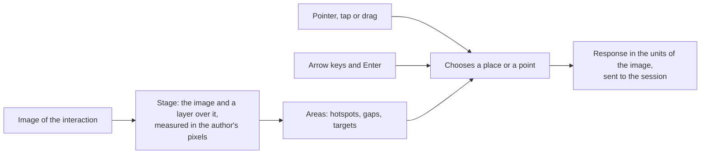

# Graphic interactions

`mountItem` and `mountDelivery` of `@assesskit/player/player` draw the seven interactions that work on an image with the
others: hotspot, select point, graphic order, graphic associate, graphic gap match, position object and drawing. The element,
its properties and events, the hints, the board that carries the choices in places, and the options (`files`, `staticUrl`) are
in [interactions](interactions.md). This guide holds what is particular to an image. The renderers draw what
the runtime describes and decide nothing of QTI: the descriptor of the runtime's `interactions` says which choices stand where, and the runtime's
`validateResponse` says whether a response is valid.

The drawing is the one kind that needs `files`: `files.upload` stores a picture and returns its file
value, and `files.url(file)` returns where the picture of a file value loads from. The other six never call it.



## Quick start

Mount a hotspot interaction, choose the hotspot of Glasgow and read the response that the session holds:

```ts
import { readAsi } from "@assesskit/runtime/asi";
import { createLocalSession } from "@assesskit/player/client/local";
import { mountItem } from "@assesskit/player/player";
import css from "@assesskit/player/player.css?inline"; // any bundler that imports a file as text

const parsed = readAsi(`<qti-assessment-item xmlns="http://www.imsglobal.org/xsd/imsqtiasi_v3p0"
    identifier="map" title="Map" adaptive="false" time-dependent="false">
  <qti-response-declaration identifier="RESPONSE" cardinality="single" base-type="identifier"/>
  <qti-item-body>
    <qti-hotspot-interaction response-identifier="RESPONSE" max-choices="1">
      <qti-prompt>Which one is Glasgow?</qti-prompt>
      <object type="image/png" width="200" height="100" data="images/map.png">A map of Britain</object>
      <qti-hotspot-choice shape="circle" coords="40,50,20" identifier="A" hotspot-label="London"/>
      <qti-hotspot-choice shape="rect" coords="100,20,160,80" identifier="B" hotspot-label="Glasgow"/>
    </qti-hotspot-interaction>
  </qti-item-body>
</qti-assessment-item>`);
if (parsed.kind !== "item") throw new Error("The document is not an item.");

const saved = new Map();
const client = await createLocalSession({
  definition: { kind: "item", item: parsed.item, base: "items/map/item.xml" },
  store: {
    load: async (session) => saved.get(session),
    save: async (session, { state }) => void saved.set(session, state),
  },
  session: "map-1",
  seed: 1,
  assets: (path) => `https://assets.example/g/token/${path}`,
});

const stylesheet = new CSSStyleSheet();
stylesheet.replaceSync(css);
const host = document.createElement("div");
document.body.append(host);
const mounted = mountItem(host, {
  client,
  files: {
    upload: async () => {
      throw new Error("This item has no drawing.");
    },
    read: async () => new Uint8Array(),
    url: () => "",
  },
  staticUrl: "https://assets.example/static/",
  stylesheet,
  fetch: (url, request) => fetch(url, request),
});

const content = host.shadowRoot.querySelector(".ak-content-host").shadowRoot;
while (content.querySelectorAll('input[type="radio"]').length < 2)
  await new Promise((resolve) => setTimeout(resolve, 10));
content.querySelectorAll('input[type="radio"]')[1].click();
const status = host.shadowRoot.querySelector("[role=status]");
while (status.textContent !== "Answers saved.") await new Promise((resolve) => setTimeout(resolve, 10));
client.view.current.responses.get("RESPONSE").value; // => "B"
mounted.destroy();
```

## The interactions

| Kind              | Response                       | Pointer                                                                                                                                                 | Keyboard                                                                                                           |
| ----------------- | ------------------------------ | ------------------------------------------------------------------------------------------------------------------------------------------------------- | ------------------------------------------------------------------------------------------------------------------ |
| Hotspot           | Identifier, single or multiple | Choose a hotspot. With a maximum of one choice, another hotspot replaces it and choosing the selected one again clears it.                              | Tab to a hotspot, Space chooses it.                                                                                |
| Select point      | Point, single or multiple      | Click the image. With a maximum of one point a new click moves it. A marked point is a button that removes it.                                          | Tab to the image, move the crosshair with the arrow keys, Enter or Space marks the point.                          |
| Graphic order     | Ordered identifier             | Choose the hotspots in order. Each shows its number. Choosing one again takes it out.                                                                   | As the hotspot.                                                                                                    |
| Graphic associate | Pair, single or multiple       | Choose a hotspot, then the one to join it with. Choosing the first again lets it go.                                                                    | As the hotspot. Each pair is a line and an entry of a list with a button that removes it.                          |
| Graphic gap match | Directed pair, multiple        | A board: drag a choice onto a gap with a mouse or a pen, or choose the choice and then the gap. A chip in a gap takes it out, and drags to another gap. | The choices come first in the tab order, then the gaps. Enter or Space picks up and places; Escape lets go.        |
| Position object   | Point, single or multiple      | Drag the object from the tray onto the image with a mouse or a pen, or choose it and click or tap the image. Choosing a placed object takes it away.    | Choose the object, which moves the focus to the image; arrow keys and Enter place it. Escape gives it up.          |
| Drawing           | File                           | The pen and the eraser follow the pointer. A line, a rectangle and an ellipse take two clicks, a fill one.                                              | Choose a tool that takes points, then use the crosshair as in select point. The pen and the eraser need a pointer. |

A hotspot with a maximum of one choice is the one exception to [the radio button that cannot be cleared](interactions.md#differences-from-the-references):
the candidate returns to no answer by choosing the hotspot again.

### Limits

The controls do not forbid a move that the question does not allow; the runtime's `validateResponse` says what is wrong and the
interaction says it in words ([hints](interactions.md#hints-and-limits)). Where a rule makes a choice impossible, the
interaction shows it instead:

| Interaction       | What cannot be chosen                                                                                                                                                                                                                                   |
| ----------------- | ------------------------------------------------------------------------------------------------------------------------------------------------------------------------------------------------------------------------------------------------------- |
| Graphic associate | A hotspot that the runtime's rules leave no pair for: one used as often as its `match-max`, one whose pair a `match-group` forbids, and every hotspot at `max-associations`. It is dimmed and has `aria-disabled="true"`, and choosing it does nothing. |
| Graphic gap match | A choice used as often as its `match-max` leaves the pool until one is taken out, and a gap that holds as many as its `match-max` has no button for another.                                                                                            |

## Shapes and coordinates

The coordinates of an area and every point of a response are measured in the units of the image, which are the
pixels of its `width` and `height` as the author declared them, whatever the scale at which the image is drawn. The renderer
keeps the declared size of an image in `data-ak-width` and `data-ak-height`, so that magnification of non-text content,
which scales the `width` of the element, leaves the coordinates alone. An image with no declared size has its natural size.

| Shape     | Coordinates                                     | Box                                            |
| --------- | ----------------------------------------------- | ---------------------------------------------- |
| `rect`    | left-x, top-y, right-x, bottom-y                | The rectangle.                                 |
| `circle`  | center-x, center-y, radius                      | The square around the circle.                  |
| `ellipse` | center-x, center-y, h-radius, v-radius          | The rectangle around the ellipse.              |
| `poly`    | x1, y1, x2, y2 and so on, closed by the browser | The smallest rectangle that holds the corners. |
| `default` | none                                            | The whole image.                               |

A coordinate may be a percentage: of the width for x and the horizontal radius, of the height for y and the vertical radius,
and for the radius of a circle of the smaller side. A rectangle, circle, ellipse or the whole image is the element with a
border, and the border is round for a circle and an ellipse. A polygon draws its outline as SVG in its box, because a
border cannot follow it. The rendering of a node throws `DataError` for coordinates that do not fit the shape.

An area that the candidate selects is a native checkbox or radio button, hidden, with a `label` as its face; an area that
joins is a native button with the same face; a gap is a box that holds the chips and a button to put a choice in. The name of
the control is the `hotspot-label`, else "Choice" and the number of the hotspot.

## Targets and gestures

| Criterion | What the player does                                                                                                                                                                                                     |
| --------- | ------------------------------------------------------------------------------------------------------------------------------------------------------------------------------------------------------------------------ |
| 2.5.1     | No path or multipoint gesture is needed. Every interaction is answered with single clicks. Only the pen and the eraser of the drawing follow a path, and they have the shapes and the fill as their single-pointer form. |
| 2.5.2     | A click acts on the release. A drag can be aborted with Escape or by dropping it off its target, and then nothing changes.                                                                                               |
| 2.5.7     | The position object and the graphic gap match, which a mouse or a pen can drag, can be answered by choosing and then placing, with the pointer or the keyboard. A touch uses that form.                                  |
| 2.5.8     | A hotspot, a placed object or a marker drawn smaller than 24 CSS pixels has the attribute `data-ak-small`, and the stylesheet gives it a target of 24 pixels centered on it. Buttons have at least 24 pixels.            |
| 2.1.1     | Every interaction can be answered with the keyboard. The crosshair moves a twentieth of the smaller side of the image for an arrow key, and one unit of the image with Shift held.                                       |

The player does not move a hotspot: two hotspots that the author drew closer than 24 pixels have targets that overlap where
they are enlarged, and the hidden native controls, which the keyboard and a screen reader use, take the place of the pointer
target there.

The drawing cancels the `touchmove` of a stroke that starts on its image, because the baseline bans CSS `touch-action`;
the position object and the graphic gap match need no drag from a touch.

## Drawing

| Part    | Choices                                                                                                       |
| ------- | ------------------------------------------------------------------------------------------------------------- |
| Tools   | Pen, eraser, straight line, rectangle, ellipse and fill.                                                      |
| Colors  | Black, red, green, blue and yellow. A swatch shows its color and, when chosen, a ring.                        |
| Actions | Undo takes back the last action. Clear takes away everything drawn and brings back the image of the question. |

The canvas has the pixels of the image. A line is `max(2, smaller side / 60)` units wide. A shape is placed by two points and a
fill by one: the fill covers the region that joins the point and stops at a line of the picture, within a tolerance for its
soft edge. The first point of a shape shows as a ring until the second comes.

The response is a file: the image with the drawing on it, in the media type of the image (the `type` of the `object`, else the
one the extension of an `img` names, else `image/png`). The browser encodes PNG and JPEG everywhere and WebP in some engines;
for any other type the picture is a PNG and the file value says so. After the last of a series of actions the picture is
stored with `files.upload`, and the response is the file value it returns. `settled()` of the element resolves when the latest
picture is stored, and the host waits for it before it submits. A drawing that cannot be stored keeps the response it had
and says so; the next action tries again.

A response that the player gives, such as a drawing from an earlier attempt, is shown as the picture to draw on, loaded from
`files.url`. The origin that serves the package and the files must allow the page to read the pictures (CORS, `Access-Control-Allow-Origin`),
because the fill and the stored file are made from the pixels of the picture; without it the drawing still shows, and storing and
filling fail with the message `drawSaveFailed`.

A picture that the browser cannot decode, such as a file that `files.url` points to and that is not an image, leaves nothing to
draw on. The element then shows the hint `drawLoadFailed` as a status that the controls are described by, marks the drawing
area `aria-invalid`, and rejects nothing; Clear brings back the picture of the question, and the hint goes with a picture that
loads.

## Errors

The graphic interactions follow the errors of [interactions](interactions.md#errors). What belongs to an image:

| Error                       | When                                                                                                                                                                                           | What to do                                                                                                             |
| --------------------------- | ---------------------------------------------------------------------------------------------------------------------------------------------------------------------------------------------- | ---------------------------------------------------------------------------------------------------------------------- |
| `DataError`                 | A shape has the wrong number of coordinates for its kind (`circle` needs 3, `rect` and `ellipse` 4, `poly` an even number of 6 or more), or a coordinate is not a length such as `12` or `50%` | Correct the `coords` of the area in the item                                                                           |
| `DataError`                 | `files.upload` or `files.url` is missing for a drawing, or gives something that is not a file value                                                                                            | Pass `files` with both methods ([interactions](interactions.md#upload-and-recording))                                  |
| An image that does not load | The file is outside `origins`, or missing                                                                                                                                                      | Serve the file from an origin the page allows; the URL policy of [content](content.md#references) applies to the image |
| A message under the control | The response breaks a rule of the runtime                                                                                                                                                      | The candidate follows the hint                                                                                         |
| A drawing that is not saved | `files.upload` rejected                                                                                                                                                                        | The host's store failed; no response is given                                                                          |

## Not included

| Not included                                           | Why                                                                                                                                |
| ------------------------------------------------------ | ---------------------------------------------------------------------------------------------------------------------------------- |
| Freehand drawing without a path for the keyboard       | The pen and the eraser follow a path; the shapes and the fill give the keyboard a way to draw (WCAG 2.1.1 exempts the path itself) |
| Editing of an image                                    | The drawing keeps what the candidate drew over the picture; it is no editor                                                        |
| A coordinate unit that the specification does not give | Points are in the pixels of the size the author declared, the one reading the sources allow (see below)                            |

## Differences from the references

| Case                                                                                                      | Resolution                                                                                                                                  |
| --------------------------------------------------------------------------------------------------------- | ------------------------------------------------------------------------------------------------------------------------------------------- |
| The information model gives no unit for the points of a response and none for the size of a stage         | Points are in the pixels of the size the author declared; the natural size of the file where none is declared.                              |
| The graphic gap match wants a placed choice wholly inside its gap; WCAG 2.5.8 wants a target of 24 pixels | A placed text shrinks to fit the gap, but the button around it keeps its 24 pixels, so that a small gap can be overrun.                     |
| The position object interaction says "drag"; WCAG 2.5.7 asks for another way                              | Every drag has the choose-then-place form, and a placed object is removed by choosing it.                                                   |
| The runtime's validity does not forbid the same pair twice                                                | A graphic associate allows it while the `match-max` of both hotspots does.                                                                  |
| The drawing interaction asks for "tools" and 2.5.1 for a way to draw without a path                       | The pen and the eraser follow a path; the shapes and the fill do not. WCAG 2.1.1 exempts a function that depends on the path of a movement. |

## Evidence

`pnpm test:browser` runs the interactions in Chromium, Firefox and WebKit: each shape at its coordinates and at another scale,
every response against the runtime's rules, the keyboard alone, drag and select-then-place, the sizes of the targets, axe at WCAG 2.2
A and AA in each state, and the pictures that the drawing stores, decoded as a person would see them. `pnpm test:corpus`
renders every graphic item of the 1EdTech examples with its images, answers each interaction by clicks, checks the response
with `validateResponse` and runs axe on the item.

## Files

Each file of `src/player/elements/graphic/` holds one concept.

| File                             | Concept                                           |
| -------------------------------- | ------------------------------------------------- |
| `elements/graphic/areas.ts`      | The element of a hotspot or an associable hotspot |
| `elements/graphic/drag.ts`       | Dragging with a mouse or a pen                    |
| `elements/graphic/geometry.ts`   | Shapes, coordinates and points                    |
| `elements/graphic/operations.ts` | The tools of drawing: strokes, shapes and fills   |
| `elements/graphic/picker.ts`     | Picking a point with one pointer or the keyboard  |
| `elements/graphic/stage.ts`      | The image and the layer over it                   |

## References

| Specification                                                                  | Topics                                           |
| ------------------------------------------------------------------------------ | ------------------------------------------------ |
| [WCAG 2.2](https://www.w3.org/TR/WCAG22/#target-size-minimum)                  | target size                                      |
| [QTI 3.0 ASI Information Model](https://www.imsglobal.org/spec/qti/v3p0/info/) | geometry                                         |
| [WCAG 2.2](https://www.w3.org/TR/WCAG22/#keyboard)                             | keyboard, keyboard, which exempts such functions |
| [WCAG 2.2](https://www.w3.org/TR/WCAG22/#dragging-movements)                   | dragging movements                               |
| [WCAG 2.2](https://www.w3.org/TR/WCAG22/#pointer-cancellation)                 | pointer cancellation                             |
| [WCAG 2.2](https://www.w3.org/TR/WCAG22/#non-text-contrast)                    | non-text contrast                                |
| [WCAG 2.2](https://www.w3.org/TR/WCAG22/#pointer-gestures)                     | pointer gestures                                 |
