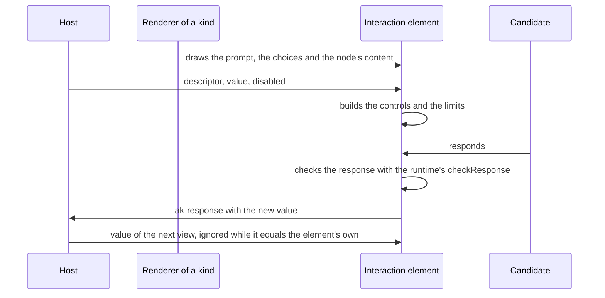
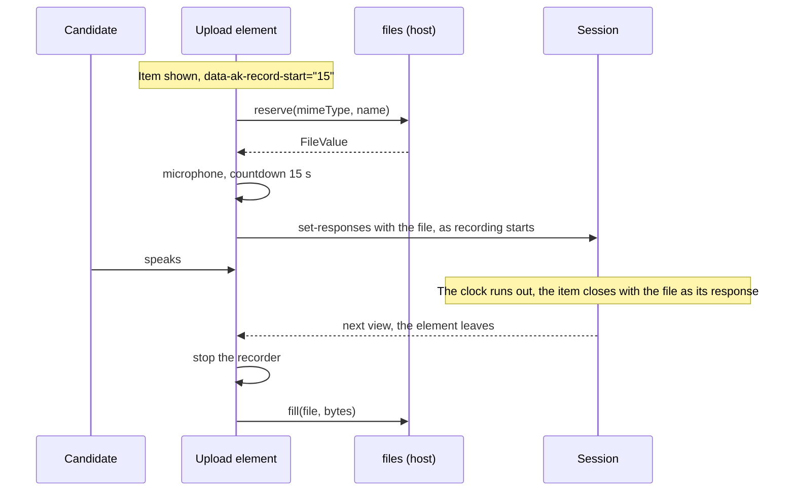

# Interactions

`createInteractionRenderers` of `@assesskit/player/player` draws the interactions of an item: choice, order, associate,
match, gap match, inline choice, text entry, extended text, hot text, slider, end attempt, media, upload and custom, and the
seven that work on an image: hotspot, select point, graphic order, graphic associate, graphic gap match, position object and
drawing ([graphics](graphics.md)). The other kinds are drawn by other renderers that a host adds to the same map
([content](content.md#interactions)). The
renderers draw the content and the controls. They decide nothing of QTI: the runtime's `interactions` gives the descriptors and the
validity of a response, and the host gives each element its descriptor, its value and whether it is disabled.



```ts
import { readAsi } from "@assesskit/runtime/asi";
import { describeInteractions } from "@assesskit/runtime/interactions";
import { selectMessages } from "@assesskit/player";
import { createContentRoot, createInteractionRenderers, InteractionElement } from "@assesskit/player/player";
import css from "@assesskit/player/player.css?inline"; // any bundler that imports a file as text

const parsed = readAsi(`<qti-assessment-item xmlns="http://www.imsglobal.org/xsd/imsqtiasi_v3p0"
    identifier="cities" title="Cities" adaptive="false" time-dependent="false">
  <qti-response-declaration identifier="RESPONSE" cardinality="multiple" base-type="identifier"/>
  <qti-item-body>
    <qti-choice-interaction response-identifier="RESPONSE" max-choices="2">
      <qti-prompt>Which are in France?</qti-prompt>
      <qti-simple-choice identifier="A">Paris</qti-simple-choice>
      <qti-simple-choice identifier="B">Lyon</qti-simple-choice>
      <qti-simple-choice identifier="C">Turin</qti-simple-choice>
    </qti-choice-interaction>
  </qti-item-body>
</qti-assessment-item>`);
if (parsed.kind !== "item" || parsed.item.body === undefined) throw new Error("The document is not an item.");

const messages = selectMessages("en");
const player = new CSSStyleSheet();
player.replaceSync(css);
const host = document.createElement("div");
document.body.append(host);
const root = createContentRoot(host, {
  messages,
  assets: (path) => `https://assets.example/g/token/${path}`,
  fetch: (url, request) => fetch(url, request),
  stylesheet: player,
  interactions: createInteractionRenderers({
    messages,
    files: {
      upload: async () => {
        throw new Error("This item has no upload.");
      },
      url: () => "",
    },
    staticUrl: "https://assets.example/static/",
    record: false,
  }),
});
await root.show({ body: { nodes: parsed.item.body.children, base: "items/cities/item.xml" } });

// The host gives each element the descriptor of its interaction, as it does for each view.
const descriptors = new Map(describeInteractions(parsed.item).map((d) => [d.responseIdentifier, d]));
for (const element of root.root.querySelectorAll("*")) {
  const descriptor = element instanceof InteractionElement ? descriptors.get(element.responseIdentifier) : undefined;
  if (element instanceof InteractionElement && descriptor !== undefined) element.descriptor = descriptor;
}

const responses = [];
root.root.addEventListener("ak-response", (event) => responses.push(event.detail));
root.root.querySelectorAll('input[type="checkbox"]')[1].click();
responses.length; // => 1
responses[0].responseIdentifier; // => "RESPONSE"
responses[0].value.values; // => ["B"]
```

## Options

| Option              | Type                    | Meaning                                                                                                                                                                                                                                                                                                      |
| ------------------- | ----------------------- | ------------------------------------------------------------------------------------------------------------------------------------------------------------------------------------------------------------------------------------------------------------------------------------------------------------ |
| `messages`          | `Messages`              | The text of the interface, from `selectMessages`; the same as the content root's.                                                                                                                                                                                                                            |
| `files`             | `InteractionFiles`      | Where uploads and recordings are kept: `upload(bytes, mimeType, fileName?)` gives the `FileValue` that the response holds, `url(file)` plays it; `reserve(mimeType, fileName?)` names the file of a recording as it starts and `fill(file, bytes)` stores its bytes, both needed unless `record` is `false`. |
| `staticUrl`         | `string`                | The base URL of the static files on the asset origin, ending in `/`. `recorder-worklet.js` is under it.                                                                                                                                                                                                      |
| `record`            | `boolean`               | Whether an upload of audio offers a recording. Default: `true`; then `files` needs `reserve` and `fill`.                                                                                                                                                                                                     |
| `customInteraction` | `CustomInteractionHook` | Draws custom interactions. Default: none, so that a custom interaction says it is not supported.                                                                                                                                                                                                             |
| `onError`           | `(error) => void`       | Receives the errors that a recording can only report: the host could not name the file or store the bytes. Default: `reportError` of the page.                                                                                                                                                               |

`createInteractionRenderers` throws `DataError` for an option of another type, a `staticUrl` that is not an absolute `http`
or `https` URL ending in `/`, and an option that is not in the table. It defines the custom elements first
(`defineElements`, which does nothing the second time and throws `AssesskitError` when another class holds the name of an
interaction).

## The element

Each interaction is one custom element, `qti-` and its kind, that extends `InteractionElement`. The host sets four properties
and listens for one event, so that it never reads the controls.

| Property             | Meaning                                                                                                                                                                              |
| -------------------- | ------------------------------------------------------------------------------------------------------------------------------------------------------------------------------------ |
| `descriptor`         | The `InteractionDescriptor` of the runtime for the interaction. The element shows its content without controls until it is set, and throws `DataError` for another kind or response. |
| `value`              | The response, `null` for NULL. The element shows it. What the candidate gives replaces it, so that the element needs no reply.                                                       |
| `disabled`           | Whether the candidate cannot respond, as in review. Default: `false`.                                                                                                                |
| `messages`           | The text of the interface; the renderer sets it. A new language is set here.                                                                                                         |
| `typed`              | Text entry and extended text only: the text as typed, from the variable of `string-identifier`.                                                                                      |
| `responseIdentifier` | The response variable of the interaction (read only).                                                                                                                                |

Setting a property to what it holds does nothing, so a host may set all of them on every view without moving the focus or
the caret. A value that has the same data as the one the element holds, such as the response that the host sends back, is
the same value.

| Event            | Detail                          | Sent when                                                                                                                                           |
| ---------------- | ------------------------------- | --------------------------------------------------------------------------------------------------------------------------------------------------- |
| `ak-response`    | `{ responseIdentifier, value }` | The candidate changed a response. It bubbles. A text entry with `string-identifier` sends a second event for that variable, with the text as typed. |
| `ak-end-attempt` | `{ responseIdentifier }`        | The candidate pressed the button of an end attempt interaction. It bubbles.                                                                         |

The events are typed for `addEventListener` on elements and shadow roots. The element does not validate the response against
the item's rules; the runtime's `checkResponse` does, and the element says what is wrong ([hints](#hints-and-limits)).

## The kinds

The choices keep the order of the node, which is the order of the view: the runtime shuffles and hides them before the node reaches
the renderer.

| Kind                | What the candidate sees                                                                                                                                                                         | The response                                                                                                  |
| ------------------- | ----------------------------------------------------------------------------------------------------------------------------------------------------------------------------------------------- | ------------------------------------------------------------------------------------------------------------- |
| `choice`            | A radio button for each choice where `max-choices` is 1, else a checkbox. The control comes first and its label is the face of the choice. `orientation` and the stacking classes lay them out. | The identifiers of the selected choices in the order of the choices. The candidate starts with none selected. |
| `hottext`           | The same controls, with the hot text as the face, inside the running text.                                                                                                                      | The same.                                                                                                     |
| `inline-choice`     | A menu inside the sentence. Its first entry is no choice and reads `data-prompt`; the `qti-label` names the menu.                                                                               | One identifier; the first entry gives NULL.                                                                   |
| `order`             | The choices in a pool, and as many numbered places as the candidate may order: all, or `max-choices`.                                                                                           | The identifiers in the order of the places, ordered; places left empty are skipped.                           |
| `associate`         | The choices in a pool and a box of two places for each association, as many as `max-associations`, or as the choices when it is 0.                                                              | A pair for each box whose two places are filled.                                                              |
| `match`             | The first set in the pool and the second as places that take them, as many as each `match-max`; with `qti-match-tabular`, a table with a checkbox where a row and a column meet.                | Directed pairs from the first set to the second.                                                              |
| `gap-match`         | The choices in a pool and the passage with a place in each gap. A gap holds one choice; a choice fills as many gaps as its `match-max`.                                                         | Directed pairs from the choice to the gap.                                                                    |
| `hotspot`           | An image with a hotspot for each choice, as a radio button or a checkbox that the shape is the face of ([graphics](graphics.md)).                                                               | The identifiers of the selected hotspots; the selected one of a radio group can be chosen again to clear it.  |
| `select-point`      | An image to click, or to move a crosshair over with the keys, and a button for each point marked. The areas that score the response are never drawn.                                            | The points, in the units of the image; with `max-choices` 1 a new point moves the old.                        |
| `graphic-order`     | The hotspots as for `hotspot`, each numbered once selected.                                                                                                                                     | The identifiers in the order selected, ordered.                                                               |
| `graphic-associate` | The hotspots as buttons, a line between two joined ones, and a list of the pairs with a button that removes each.                                                                               | A pair for each association.                                                                                  |
| `graphic-gap-match` | The choices in a pool and an image whose hotspots are gaps, on [the board](#choices-in-places).                                                                                                 | Directed pairs from the choice to the gap.                                                                    |
| `position-object`   | An object in a tray, to put on the image of a stage that interactions may share.                                                                                                                | The points where the center of the object lies.                                                               |
| `drawing`           | A toolbar and a canvas over the image ([graphics](graphics.md#drawing)).                                                                                                                        | A file value: the picture with the drawing on it.                                                             |
| `text-entry`        | A line in the sentence, `size` from `expected-length`, `placeholder-text`, and the keyboard of a number for an integer or float.                                                                | See [text](#text).                                                                                            |
| `extended-text`     | A text area, an area that keeps its spaces, or an editor; `max-strings` gives that many.                                                                                                        | See [text](#text).                                                                                            |
| `slider`            | A scale with a thumb, labels at its ends, and at each step when `step-label` is set and there are at most 50. `orientation` and `reverse` apply.                                                | An integer or a float on a step; NULL until the candidate chooses.                                            |
| `end-attempt`       | A button titled as the item says.                                                                                                                                                               | None: the engine sets the variable. The element sends `ak-end-attempt`.                                       |
| `media`             | [The player](#media).                                                                                                                                                                           | The number of plays, an integer.                                                                              |
| `upload`            | [The picker and the recorder](#upload-and-recording).                                                                                                                                           | A file value that the host's storage gave.                                                                    |
| `custom`            | What the host's hook draws, or a notice that the kind is not supported.                                                                                                                         | What the hook gives.                                                                                          |

A single value is given where the variable is declared `single` and one value is chosen; otherwise a container is given
(`multiple`, or `ordered` for an order). No values are NULL.

### Choices in places

Order, associate, match, gap match and graphic gap match share one board. A choice is a button in the pool; once put in a place it is a chip
with a button that takes it out. There are two ways to put a choice in a place, and neither needs a drag (WCAG 2.1.1,
2.5.7):

| Way                 | How                                                                                                                                                                               |
| ------------------- | --------------------------------------------------------------------------------------------------------------------------------------------------------------------------------- |
| Pick up, then place | Press a choice, then the button of the place, with a click, a tap or Enter. A chip can be picked up to move it. Pressing a chip while holding another puts that one in its place. |
| Drag                | A mouse or a pen drags a choice or a chip onto a place, or a chip onto the pool to put it back. A touch scrolls the page and uses the first way.                                  |

Escape lets go of the choice in hand. Pressing a place with nothing in hand says so. A place that is full gives up its first
choice, which goes back to the pool. A choice is hidden from the pool while all its uses are placed, and shown again when one
is taken out. What happens is said in a status region, such as "Alpha placed in Position 2". A half-made association is kept
by the element until it is complete, and the response does not hold it.

A choice that shows no text, such as an image without an alternative, is named "Choice" and its number, so that its controls
have a name (WCAG 4.1.2).

### Text

| Binding of the variable            | The response                                                                                                                                                                    |
| ---------------------------------- | ------------------------------------------------------------------------------------------------------------------------------------------------------------------------------- |
| `string`                           | The text; the empty text is NULL.                                                                                                                                               |
| `integer`, `float`                 | The number that the runtime's `numericRecord` reads in the `base` of the interaction. Text that is not one gives NULL and the hint "Enter a number." or "Enter a whole number." |
| `record`                           | The record of `numericRecord`: `stringValue`, `floatValue` and the rest.                                                                                                        |
| a container (`extended-text` only) | The texts that are not empty, in a container of strings, up to `max-strings`, one field each.                                                                                   |

A text entry or extended text with `string-identifier` also sends the text as typed for that variable, and shows it again
from the property `typed`: "3.50" stays "3.50" although the response is 3.5. A field keeps what the candidate typed while
it still gives the host's response. The fields are native `input` and `textarea`, so that the typing echo and the reading of
the speech guide ([speech](speech.md)) apply. A locked field is read-only, not disabled, so that it keeps the focus.

`format="xhtml"` gives an editor: an editable area and buttons for bold, italic, underline and lists. The response is XHTML
that has only `p`, `br`, `strong`, `em`, `u`, `ul`, `ol`, `li`, `sub` and `sup`, without attributes. Any other element is
replaced by its text and a `script` or `style` is dropped, so that pasted markup carries nothing else; a paste is plain text.
`qti-counter-up` and `qti-counter-down` with `expected-length` show the characters typed, or left, counted as code points;
in XHTML only the text counts. `expected-length` is a hint and never a limit. `data-ak-count="words"` on an extended text shows
the words typed instead, as `Words: 3` (the message `counterWords`), with no counter class and no expected length: a word is a
run of characters that are not white space, and a line or block of an XHTML answer ends a word. `expected-length` stays in
characters, as QTI defines it, and a text in a script with no space between words, such as Chinese or Japanese, uses the
character counter.

The native fields ask the browser for no help in an exam: `spellcheck="false"`, `autocorrect="off"`, `autocapitalize="off"` and
`autocomplete="off"` on the text areas, the editor and the text entry. While the support `spell-checker-on-screen` is on, the
extended texts turn `spellcheck` on, and off again with the support.

### Media

The player draws its own controls, not those of the browser, so that the rules of the item hold: play and pause, and, from
`data-qti-media-player-controls`, going back to the start, captions and audio description. The attribute is read as a list
of words: `default` or none gives all of them, `none` gives only play and pause, because a recording that no one can start
or stop would break WCAG 1.4.2. Captions and audio description appear when the recording has a text track of that kind. The buttons show the mode of the tracks, whoever set it, such as the supports of the candidate ([supports](supports.md#media)).

| Rule           | Behavior                                                                                                                                                                                   |
| -------------- | ------------------------------------------------------------------------------------------------------------------------------------------------------------------------------------------ |
| A play         | Playback that starts from the start, including after the end or going back to the start. Resuming after a pause is not a new play. It is counted when it starts.                           |
| The count      | It is the response that the host restored, never the element's own state, so a reload cannot reset it. A play that a reload interrupts counts, and the next starts from the start.         |
| `max-plays`    | A recording that has been played that often cannot start again; the status says "No plays left." A play that has begun runs to its end. `loop` plays again by itself while plays are left. |
| `autostart`    | Tries to start once, while the count is 0. A browser may refuse without a gesture; the controls stay.                                                                                      |
| Pause delay    | `data-qti-media-player-pause-delay` or `qti-media-player-pause-delay`, in seconds: playback waits after the candidate presses play, at the start and after a pause.                        |
| Pause duration | `…-pause-duration`: a pause ends by itself after that many seconds.                                                                                                                        |
| Pause count    | `…-pause-count`: the most pauses in one play; then pause says so and playback goes on. The count starts again with each play.                                                              |

A value of a pause attribute that is not a number above 0 is ignored. A pause by the keys of the system is not limited, because
the player cannot stop it. `coords` is not read: the player does not place the recording.

### Upload and recording

The picker accepts the item's types (`accept`). A file of another type is not sent: the runtime's `checkResponse` says the type is
not accepted, and the element tells which types are. An accepted file goes through `files.upload`, and the reference it gives
is the response, with its name; a recording plays from `files.url`. A file the browser gives no type for is sent as
`application/octet-stream`. A failure of the host is said and gives no response.

A recording is offered when the item accepts an audio type that the browser can record:

| The item accepts                                             | The recording                                                                                                                                  |
| ------------------------------------------------------------ | ---------------------------------------------------------------------------------------------------------------------------------------------- |
| An audio type that `MediaRecorder.isTypeSupported` gives     | `MediaRecorder` in the first such type, as the browser encodes it. Chromium and Firefox give `audio/webm` and `audio/ogg`, Safari `audio/mp4`. |
| `audio/wav`, `audio/wave` or `audio/x-wav`, and no such type | 16-bit mono PCM, written as WAV, from an audio worklet. `recorder-worklet.js` under `staticUrl` is its program.                                |
| Only other types, such as `audio/mpeg`, or any type          | None: an MP3 encoder would be a dependency.                                                                                                    |

A recording names its file as it starts. `files.reserve(mimeType, fileName?)` gives the file value, which the response holds from then
on, and `files.fill(file, bytes)` stores the bytes when the recording ends, however it ends. So a time limit that closes the item while
the candidate speaks keeps the answer: the item ends with the file as its response, and the bytes follow.



The reservation and the microphone are asked for when the countdown starts, or when the candidate presses Record, so that a
refusal shows at once and the prompt of the browser stays out of the time of the response. A visible indicator and the clock show
while it records. The recording is named `recording.` and an extension. A browser without `MediaRecorder` records WAV or nothing.
The page's content security policy must allow the origin of `staticUrl` in `script-src`, which governs worklets; `pnpm build` writes
the file to `dist/recorder-worklet.js`, and the package exports it as `@assesskit/player/recorder-worklet.js`. `record: false`
turns the recording off, and then `files` needs no `reserve` and `fill`.

An author asks for a timed, limited or single recording with three attributes of the interaction, which QTI has no attribute for, so
that the runtime knows nothing of them and another player ignores them:

```xml
<qti-upload-interaction response-identifier="RESPONSE" type="audio/webm audio/mp4 audio/ogg"
    data-ak-record-start="15" data-ak-record-limit="45" data-ak-record-once="true"/>
```

| Attribute              | Default                 | Meaning                                                                                                                                                                      |
| ---------------------- | ----------------------- | ---------------------------------------------------------------------------------------------------------------------------------------------------------------------------- |
| `data-ak-record-start` | none: Record only       | Seconds after the interaction is shown at which recording starts by itself, with a countdown. `0` starts at once. Record stays, to start earlier.                            |
| `data-ak-record-limit` | `MAX_RECORDING_SECONDS` | The longest recording in seconds, at most `MAX_RECORDING_SECONDS` (600, which bounds memory: the WAV path holds 192 kB for each second). It ends the recording as Stop does. |
| `data-ak-record-once`  | none                    | `true`: no second recording and no Remove once a recording has started, or when a file is there.                                                                             |

A value that is not a whole number of seconds counts as absent. A blueprint's prepare and respond times are one item with
`max-time` of their sum and the prompt on screen throughout; no item needs extra seconds for storing.

| Event                                                         | Happens                                                                                                  |
| ------------------------------------------------------------- | -------------------------------------------------------------------------------------------------------- |
| Item shown with a start and no response                       | Type check, `reserve`, microphone; a countdown; the status says once that the recording starts by itself |
| The countdown ends, or Record is pressed                      | The recording starts, the response names the file, and the clock counts down the limit                   |
| While recording                                               | The part that plays the file and Remove stay hidden: they would show a file with no bytes                |
| Stop, or the limit                                            | The recorder stops, `fill` stores the bytes, and the file shows                                          |
| The interaction locks, or the element leaves the page         | The same: stop and `fill`, and the microphone is let go of. A countdown ends with nothing kept           |
| The candidate goes on or submits                              | `settled()` waits for the recorder to stop and ends a countdown; `fill` goes on behind it                |
| The mount is destroyed during a recording                     | The same; the end of the mount does not abort `fill`                                                     |
| The item is shown with a response, locked, or `record: false` | Nothing starts                                                                                           |

| Failure                                                 | Result                                                                                                                        |
| ------------------------------------------------------- | ----------------------------------------------------------------------------------------------------------------------------- |
| `reserve` rejects                                       | No recording starts; the message that the file could not be uploaded; `onError`; Record stays                                 |
| The microphone is refused at a timed start              | The message that the microphone could not be used; `onError`; no response; Record stays, as a press may grant it              |
| `fill` rejects while the candidate can still act        | The response goes, the message shows, and Record is there unless the recording is once                                        |
| `fill` rejects after the lock, after Next or at destroy | The response names a file with no bytes, and `onError` hears of it while the mount lives; only the host can retry             |
| `fill` hangs                                            | Nothing waits for it: the candidate has moved on, and the host's own timeout ends it                                          |
| Record is pressed in the last second                    | The autosave may miss the clock, and nothing is kept                                                                          |
| The tab closes                                          | The bytes are lost, and the response names a file with none                                                                   |
| The browser holds the audio context suspended           | The element resumes it; give the item a `MediaRecorder` type first, since only a gesture starts the WAV path in some browsers |

A host that scores holds its request until `fill` ends or times out, since the response exists before its bytes do. A new
recording takes a new reservation, and the host expires the old one. Not included: a beep at the start, which is the item's media or
the host's; a start tied to the end of a prompt, since `data-ak-record-start` is a time; and notes during preparation, which are
`note-taking-on-screen`.

### Custom interaction

`qti-custom-interaction` is deprecated in favor of the portable custom interaction. The hook is called when the element is in
the page and has its descriptor:

```ts
import { single } from "@assesskit/runtime/values";

const hook = (interaction, host, set, state) => {
  const button = document.createElement("button");
  button.textContent = state.disabled ? "Closed" : "Say hello";
  button.addEventListener("click", () => set(single("string", "hello")));
  host.append(button);
  return () => button.remove();
};

const host = document.createElement("div");
const given = [];
const stop = hook(undefined, host, (value) => given.push(value), { value: null, disabled: false });
host.querySelector("button").click();
given; // => [{ cardinality: "single", baseType: "string", value: "hello" }]
stop();
host.querySelector("button"); // => null
```

Pass the hook as the `customInteraction` option of `createInteractionRenderers`.

`state` holds the response and `disabled` at that moment; the hook does not hear of later changes of the host. `set` checks the
value, and ignores it while the candidate cannot respond. The function that the hook returns runs when the element
leaves the page.

## Hints and limits

A response that the runtime's `checkResponse` finds `attempted`, that is, given but breaking a rule, gets a hint in text, in a
`role="status"` region that is never focused (WCAG 3.3.1, 4.1.3). The controls get `aria-invalid="true"` and are described by
the hint (`aria-describedby`), and the invalid ones have a thicker border, so that color is not the only cue (WCAG 1.4.1).
NULL gets no hint: the candidate has not begun. The hint says how to fix the response (WCAG 3.3.3): the item's own text where it
has one, else the player's, which names the limit.

| Rule of the runtime                                              | The text                                                                                                                      |
| ---------------------------------------------------------------- | ----------------------------------------------------------------------------------------------------------------------------- |
| `min-choices`, `max-choices`                                     | `data-min-selections-message` or `data-max-selections-message`, else "Select at least 2." or "Place at least 3." for an order |
| `min-associations`, `max-associations`                           | The same two attributes, else "Make at least 2."                                                                              |
| `min-strings`, `max-strings`                                     | "Enter at least 2."                                                                                                           |
| `pattern-mask`                                                   | `data-patternmask-message`, else "The answer does not have the required form."                                                |
| `min-plays`, `max-plays`                                         | "Play at least 2."                                                                                                            |
| `mime-type`                                                      | "This file type is not accepted. Accepted types:" and the types                                                               |
| `required`                                                       | "An answer is required."                                                                                                      |
| `match-min`, `match-max`, `match-group`                          | "Some choices need more matches", "have too many matches", "cannot be matched together."                                      |
| `binding`, `unknown-choice`, `repeated-choice`, `bounds`, `step` | "This answer cannot be accepted. Clear it and try again." No change of the candidate's gives them.                            |

Each message is a key of the catalog ([messages](messages.md)), so Indonesian has them too. The text that tells a number is a
message followed by the number, which both languages can write.

The limits that the candidate cannot guess are told before an error (WCAG 3.3.2), under the controls and tied to them: "Select at
least 2. Select at most 3." A limit of one is the control itself, such as a radio button, and is not told. A pattern mask is
told only when it fails, because it has no readable form; a text bound to a number is not checked against it, because the
text is not in the value (the validity section of the runtime's `interactions` guide).

## Operation

Every control is a native `button`, `input`, `select` or `textarea`, or the `slider` and `textbox` of an ARIA pattern whose keys
are those of the Authoring Practices. Every target is at least 24 by 24 CSS pixels (WCAG 2.5.8). Nothing needs a drag or a
path (WCAG 2.5.1, 2.5.7).

| Interaction                            | Keys                                                                                                                                                                          |
| -------------------------------------- | ----------------------------------------------------------------------------------------------------------------------------------------------------------------------------- |
| Choice, hot text, table                | Tab to a control, Space selects; arrows move within radio buttons.                                                                                                            |
| Inline choice                          | The keys of a menu; the first letters of an entry choose it.                                                                                                                  |
| Text, editor                           | Type; Tab leaves the field.                                                                                                                                                   |
| Slider                                 | Arrows move one step, Page Up and Page Down ten, Home and End go to the bounds. Without a value they move from the lower bound. A click on the scale chooses the value there. |
| Order, associate, match, gap           | Enter or Space picks up and places, Escape lets go.                                                                                                                           |
| Hotspot, graphic order                 | Tab to a hotspot, Space chooses it.                                                                                                                                           |
| Graphic associate                      | Space chooses a hotspot and then the one to join it with; the button of a pair removes it.                                                                                    |
| Select point, position object, drawing | A crosshair moves over the image with the arrow keys and Enter places the point, the object or the shape.                                                                     |
| Media, end attempt, upload             | The buttons, Enter or Space.                                                                                                                                                  |

## Errors

An interaction never throws at the candidate: it says in words what is wrong and why ([Hints and limits](#hints-and-limits)). What a host can meet:

| Error                                     | When                                                                                                                                                                                                               | What to do                                                                                        |
| ----------------------------------------- | ------------------------------------------------------------------------------------------------------------------------------------------------------------------------------------------------------------------ | ------------------------------------------------------------------------------------------------- |
| `DataError`                               | A descriptor is not that of the kind and the response variable of the element, or is malformed                                                                                                                     | Give each element the descriptor that the runtime's `interactions` made for it                    |
| `DataError`                               | `files.upload` or `files.reserve` gives something that is not a file value, `reserve` or `fill` is missing while `record` is not `false`, or `staticUrl` is not an absolute `http` or `https` URL that ends in `/` | Return the `FileValue` of the store; fix `staticUrl`                                              |
| `DataError`                               | A renderer is given a node of another kind, or the option `interactions` is not a `Map` from kind to function                                                                                                      | Register each renderer under the kind it draws                                                    |
| A message under the control               | The response breaks a rule: a limit, a pattern, a type, a missing answer                                                                                                                                           | The candidate follows the hint; the texts are in the table above                                  |
| "This file type is not accepted"          | The file's type is not in `accept`                                                                                                                                                                                 | Offer the types the item lists, or change the item                                                |
| A message that the file could not be sent | `files.upload` rejected                                                                                                                                                                                            | The host's store failed: check it; no response is given, so nothing wrong is saved                |
| A recording that does not start           | The browser has no microphone, no `MediaRecorder` for an accepted type, or the page's content security policy blocks the worklet                                                                                   | Allow the origin of `staticUrl` in `script-src`, or accept an audio type that the browser records |
| A custom interaction that did not start   | The page's policy, a module that did not load, no registration or a factory that threw ([pci](pci.md#events))                                                                                                      | The `failed` event gives the reason; the guide's table says what each one means                   |
| The error of `hooks.onError`              | Something failed after the mount, with no call to carry the error                                                                                                                                                  | Log it; the default is `reportError` of the page                                                  |

## Not included

| Not included                                                                                            | Why                                                                                    |
| ------------------------------------------------------------------------------------------------------- | -------------------------------------------------------------------------------------- |
| The validity and the scoring of a response                                                              | The runtime decides them; the interactions draw the controls and the hints             |
| The interactions that no renderer draws: `qti-custom-interaction` without a hook, and kinds a host adds | A host passes its own renderer in the same map                                         |
| Drag and drop                                                                                           | Nothing needs a drag: every task has a keyboard and a pointer path (WCAG 2.5.1, 2.5.7) |
| An MP3 or other encoder for recordings                                                                  | An encoder would be a dependency; the player records what the browser encodes, or WAV  |
| Storing uploads                                                                                         | `files.upload` is the host's: the player holds the reference, never the bytes          |
| A server render                                                                                         | The elements need a DOM; importing the module in Node is safe, defining them is not    |

## Where the sources differ

| Case                                                                                              | Reading                                                                                                                                                                                                       |
| ------------------------------------------------------------------------------------------------- | ------------------------------------------------------------------------------------------------------------------------------------------------------------------------------------------------------------- |
| The design has the descriptor, the value, `disabled` and the messages as the element's properties | They are. The element builds its controls when the descriptor is set, from the node and the descriptor, so a view that carries the same data again changes nothing.                                           |
| A radio button cannot be cleared                                                                  | A choice with `max-choices` 1 is a radio group, as in any form. A candidate who does not answer leaves it NULL; once chosen, a choice can be changed, not cleared. A hotspot can be chosen again to clear it. |
| A limit is not enforced by the controls                                                           | A response over `max-choices` is given and said to be invalid, as QTI's `attempted` is; the engine refuses to submit it where the item validates responses.                                                   |
| `data-qti-media-player-controls` has no value for the play button                                 | Play and pause are always there. A recording that cannot be started breaks the item, and one that cannot be stopped breaks WCAG 1.4.2.                                                                        |
| The pause count is "during playback"                                                              | It counts the pauses of one play.                                                                                                                                                                             |
| The custom interaction hook has no value in the specification                                     | The hook is given `state` as a fourth argument, so that a reload can restore what the candidate gave.                                                                                                         |
| `qti-gap-match-interaction` gaps and hot texts lose their identifiers in the renderer of content  | The element pairs the drawn elements with the nodes of the model in document order, which the renderer keeps.                                                                                                 |

## Evidence

`pnpm test:browser` renders each kind in Chromium, Firefox and WebKit with the descriptors of the runtime, answers it with a mouse
and with the keyboard alone, checks the responses against the runtime's values, runs axe at WCAG 2.2 A and AA in every state
(interacting, answered, not valid and locked), measures every target, and plays real audio for the media rules; a recording
records a tone through the microphone's place. `pnpm test:corpus` also renders every item of the 1EdTech examples that has an
interaction of these kinds, answers each one, and checks that no response breaks its binding, that axe finds nothing, and
that the page logs no error. The pinned old engines render and answer a choice, an order, a slider and a text entry, and load
the recording worklet (`pnpm compat:engines`).

## Files

Each file of `src/player/elements/`, `src/player/media/`, `src/player/recording/` holds one concept.

| File                             | Concept                                                                       |
| -------------------------------- | ----------------------------------------------------------------------------- |
| `elements/board-element.ts`      | The element of an interaction on a board                                      |
| `elements/define.ts`             | `defineElements`                                                              |
| `elements/editor.ts`             | The XHTML field of an extended text                                           |
| `elements/element.ts`            | `InteractionElement`, the base of every interaction element                   |
| `elements/end-attempt.ts`        | The end attempt element and its event                                         |
| `elements/hints.ts`              | The hints and limits in words                                                 |
| `elements/index.ts`              | The public API                                                                |
| `elements/internal.ts`           | Helpers that other folders and tests share, which the package does not export |
| `elements/notes.ts`              | The limits, hints and announcements of an interaction                         |
| `elements/options.ts`            | The options of the renderers, checked                                         |
| `elements/parts.ts`              | The parts that interactions share: prompt, choices, orientation               |
| `elements/pointer.ts`            | The distance of a drag                                                        |
| `elements/renderers.ts`          | `createInteractionRenderers`                                                  |
| `elements/selection.ts`          | The element of a choice-based interaction                                     |
| `elements/text.ts`               | The text fields of the text interactions                                      |
| `elements/upload.ts`             | The upload element and its recording                                          |
| `elements/values.ts`             | Reading and building responses                                                |
| `media/companion.ts`             | A recording that follows another                                              |
| `media/index.ts`                 | The public API                                                                |
| `media/playback.ts`              | The rules of playing a recording                                              |
| `media/settings.ts`              | What an item asks of the player                                               |
| `media/tracks.ts`                | Text tracks                                                                   |
| `recording/index.ts`             | The public API                                                                |
| `recording/names.ts`             | The name of the recorder processor                                            |
| `recording/recorder.ts`          | Recording the microphone                                                      |
| `recording/wav.ts`               | The WAV encoder                                                               |
| `the other files of `elements/`` | The element of each kind of interaction, with its renderer                    |

## References

| Specification                                                                                                            | Topics                                                                                                                                                                                                                                                                                                                                                                                                                                                                                                                                                                   |
| ------------------------------------------------------------------------------------------------------------------------ | ------------------------------------------------------------------------------------------------------------------------------------------------------------------------------------------------------------------------------------------------------------------------------------------------------------------------------------------------------------------------------------------------------------------------------------------------------------------------------------------------------------------------------------------------------------------------ |
| [QTI 3.0 ASI Information Model](https://www.imsglobal.org/spec/qti/v3p0/info/)                                           | associate interaction, cardinality, choice interaction, custom interaction, drawing interaction, end attempt interaction, extended text interaction, gap match interaction, geometry, graphic associate interaction, graphic gap match interaction, graphic order interaction, hotspot interaction, hottext interaction, inline choice interaction, interactions, match, match interaction, match max, media interaction, order interaction, position object interaction, select point interaction, slider interaction, text, text entry interaction, upload interaction |
| [QTI 3 Standardized Shared Vocabulary](https://www.imsglobal.org/spec/qti/v3p0/vocab/)                                   | choices container width, extended text interaction, match interaction, media interaction, media player, media player controls, orientation                                                                                                                                                                                                                                                                                                                                                                                                                               |
| [WCAG 2.2](https://www.w3.org/TR/WCAG22/#labels-or-instructions)                                                         | labels or instructions                                                                                                                                                                                                                                                                                                                                                                                                                                                                                                                                                   |
| [WCAG 2.2](https://www.w3.org/TR/WCAG22/#non-text-content)                                                               | non-text content                                                                                                                                                                                                                                                                                                                                                                                                                                                                                                                                                         |
| [WCAG 2.2](https://www.w3.org/TR/WCAG22/#name-role-value)                                                                | name, role, value                                                                                                                                                                                                                                                                                                                                                                                                                                                                                                                                                        |
| [WCAG 2.2](https://www.w3.org/TR/WCAG22/#error-identification)                                                           | error identification                                                                                                                                                                                                                                                                                                                                                                                                                                                                                                                                                     |
| [WCAG 2.2](https://www.w3.org/TR/WCAG22/#pointer-gestures)                                                               | pointer gestures                                                                                                                                                                                                                                                                                                                                                                                                                                                                                                                                                         |
| [WCAG 2.2](https://www.w3.org/TR/WCAG22/#keyboard)                                                                       | keyboard, keyboard, which exempts such functions                                                                                                                                                                                                                                                                                                                                                                                                                                                                                                                         |
| [WCAG 2.2](https://www.w3.org/TR/WCAG22/#target-size-minimum)                                                            | target size                                                                                                                                                                                                                                                                                                                                                                                                                                                                                                                                                              |
| [WCAG 2.2](https://www.w3.org/TR/WCAG22/#dragging-movements)                                                             | dragging movements                                                                                                                                                                                                                                                                                                                                                                                                                                                                                                                                                       |
| [WCAG 2.2](https://www.w3.org/TR/WCAG22/#pointer-cancellation)                                                           | pointer cancellation                                                                                                                                                                                                                                                                                                                                                                                                                                                                                                                                                     |
| [WCAG 2.2](https://www.w3.org/TR/WCAG22/#non-text-contrast)                                                              | non-text contrast                                                                                                                                                                                                                                                                                                                                                                                                                                                                                                                                                        |
| [HTML Standard](https://html.spec.whatwg.org/multipage/media.html#attr-track-kind)                                       | the kind of a track                                                                                                                                                                                                                                                                                                                                                                                                                                                                                                                                                      |
| [Multimedia Programming Interface and Data Specifications 1.0](https://www.aelius.com/njh/wavemetatools/doc/riffmci.pdf) | Waveform Audio File Format                                                                                                                                                                                                                                                                                                                                                                                                                                                                                                                                               |
| [RFC 2045](https://www.rfc-editor.org/rfc/rfc2045#section-5.1)                                                           | the Content-Type header field                                                                                                                                                                                                                                                                                                                                                                                                                                                                                                                                            |
