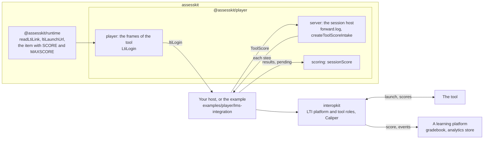
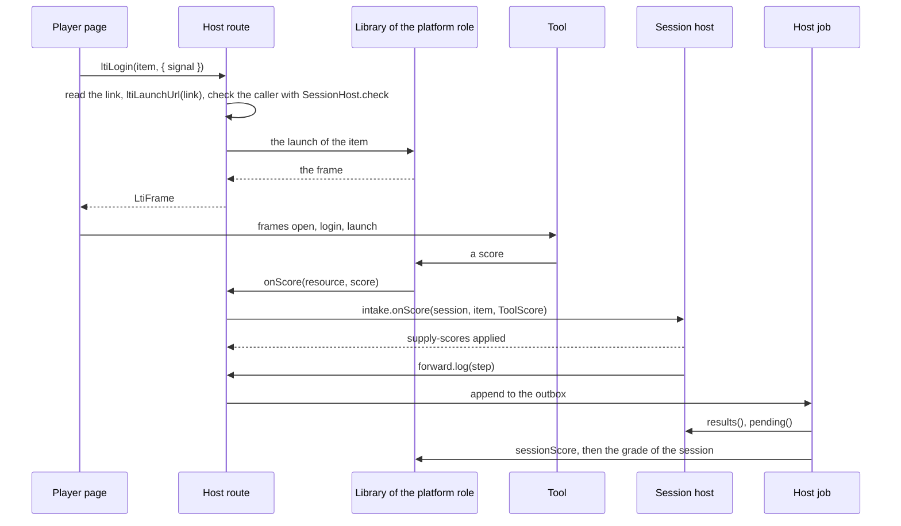

# LTI items

A QTI package can hold an item that is a link to a tool: a resource of the type `imsbasiclti_xmlv1p3` with a
`cartridge_basiclti_link` document. The runtime reads and validates the link and models the item with two outcomes, `SCORE` and
`MAXSCORE`, that the tool scores. The player shows the tool in a frame. Everything between the player and the tool, the
launch, the grade services and the analytics events, belongs to the host and to the library it chooses. The player has four
ports for it and imports no library of another family.

| Port                                      | Direction                                             | Where                                                                      |
| ----------------------------------------- | ----------------------------------------------------- | -------------------------------------------------------------------------- |
| `LtiLogin`, `LtiFrame`                    | The player asks the host to start the tool of an item | `hooks.ltiLogin` of `mountDelivery` ([delivery](delivery.md#lti-items))    |
| `createToolScoreIntake`, `ToolScoreStore` | The score of the tool comes in as `supply-scores`     | `@assesskit/player/server` ([server](server.md#the-scores-of-tool-items))  |
| `forward.log`, `StepSink`                 | The session host gives each saved step to the host    | `@assesskit/player/server` ([server](server.md#forwarding-the-steps))      |
| `sessionScore`                            | The host reads the score of a session as plain data   | `@assesskit/player/scoring` ([scoring](scoring.md#the-score-of-a-session)) |

## The wiring

| Step | The host does                                                                                                                                                                                                                               |
| ---- | ------------------------------------------------------------------------------------------------------------------------------------------------------------------------------------------------------------------------------------------- |
| 1    | Answers `ltiLogin`: it binds the request to the candidate with `SessionHost.check`, reads the `LtiLink` of the item, takes the launch URL with `ltiLaunchUrl` of the runtime, and has its LTI library build the `LtiFrame`.                 |
| 2    | Takes the score of the tool: the handler of the grade service gives each score to `intake.onScore` as a `ToolScore`, and the host's log calls `intake.settle`, so that a score that came early is supplied when the item's session is over. |
| 3    | Publishes the outcome: the log only appends each step to an outbox, and a job outside any step reads `results()` and `pending()`, calls `sessionScore`, and sends the grade and the analytics events with its libraries.                    |

The log never touches the network, so an outage of the platform never delays a candidate and never reads as a CAT failure.
Each grade of a line item needs a later time than the one before, even after a timeout whose outcome is not known; the example
records the time before it sends.

## The example

[`examples/player/lms-integration`](https://github.com/assesskit/assesskit/tree/main/examples/player/lms-integration) wires all three steps with
[interopkit](https://github.com/interopkit/interopkit), the family that implements LTI and Caliper: the platform role for the
launch, the grade services for the score and the grade, and Caliper for the events. It holds the outbox, the two jobs and the
table that maps a delivery event to a Caliper event, and its test runs the whole exchange in Node. A host copies it or writes its
own against the ports; neither family imports the other.

## Not included

| Not included                                        | Why                                                                                      |
| --------------------------------------------------- | ---------------------------------------------------------------------------------------- |
| The launch, the grade services, the roster, Caliper | They are protocols between learning platforms: interopkit implements them                |
| A `forward.scores` or an event sink in `forward`    | The host's `log` and a job do both; a field can be added later without breaking a host   |
| A launch of an item with no `ltiLogin`              | The player shows "The tool for this question could not be started." and the test goes on |
