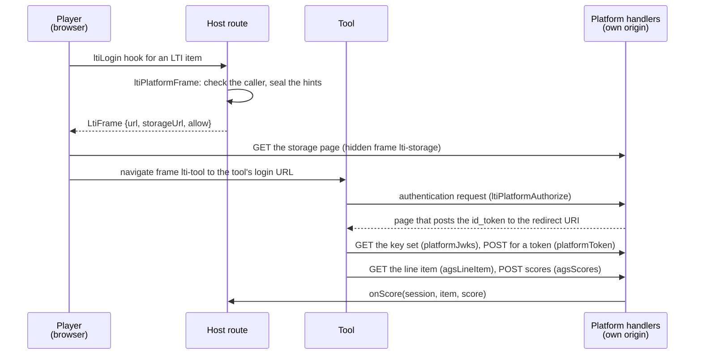

# LTI platform role

`@assesskit/player/lti` also launches tools: an LTI resource in a package (resource type
`imsbasiclti_xmlv1p3`) is an item that a tool delivers, and a conformant tool refuses a launch that skips the OpenID
Connect handshake. The platform role is the other side of the [tool role](lti.md): it uses the same JWT, key set and HTTP
primitives, with [jose](https://github.com/panva/jose).



| Function                                    | Does                                                                                                        |
| ------------------------------------------- | ----------------------------------------------------------------------------------------------------------- |
| `ltiPlatformLogin(caller, item, link, ...)` | Prepares the launch of a tool for an item and returns the URL of the tool's third-party initiated login     |
| `ltiPlatformFrame(caller, item, link, ...)` | Prepares the same launch and returns what the player needs: that URL, the storage page and the `allow` list |
| `ltiPlatformAuthorize(request, options)`    | Answers the tool's authentication request with the page that posts the `id_token`                           |
| `platformJwks(options)`                     | Publishes the key set that verifies the `id_token`s                                                         |
| `platformStorage(options)`                  | Serves the page that keeps the `state` and the `nonce` of a tool's login                                    |
| `platformToken(request, options)`           | Grants access tokens by the client-credentials grant with a JWT assertion                                   |
| `agsLineItem(request, options)`             | Answers a request for the one line item of an item instance                                                 |
| `agsScores(request, options)`               | Receives the scores that the tool posts to the line item                                                    |
| `readAgsScore(body)`                        | Reads the body of a score request                                                                           |
| `platformEndpoints(config)`                 | Gives the URLs of the authorization endpoint, the key set, the token endpoint and the storage page          |

The handlers take an `HttpRequest` and return an `HttpResponse`, as in the tool role. They take callbacks and never the
session host: `check` confirms the caller's session, `once` records single-use identifiers, and `onScore` receives the
scores. The sources are the same as the tool role's, with [LTI AGS 2.0](https://www.imsglobal.org/spec/lti-ags/v2p0) for the
line item and the scores.

## Three origins

The platform's handlers are served from `PlatformConfig.origin`, which differs from the origin of the player page and from
the origin of the assets. The frame of a tool has `allow-same-origin`, so a platform page on the player's origin
would share the origin with the player, and any injection into that page would reach it. Every handler therefore

- refuses a configuration in which two of the three origins coincide, with `DataError`;
- refuses a request whose URL is for another origin than `origin`, with `AccessError` (`wrong-origin`). The `url` of an
  `HttpRequest` is the public URL, so a proxy must pass the original.

`ltiPlatformLogin` also refuses a tool whose launch URL, login URL or redirect URIs are on any of the three origins
(`LtiError`, `origin-refused`): a tool must be cross-origin to the player.

## Configuration

| Property       | Meaning                                                                                                          |
| -------------- | ---------------------------------------------------------------------------------------------------------------- |
| `issuer`       | The `iss` of the platform: an `https` URL without query or fragment                                              |
| `origin`       | The origin of the handlers, such as `https://lti.platform.example`                                               |
| `playerOrigin` | The origin of the player page, which frames the tool and the storage page                                        |
| `assetOrigin`  | The origin that serves the files of packages                                                                     |
| `keys`         | An RSA `CryptoKeyPair` for RS256; the public key must be extractable. The `kid` is its JWK thumbprint (RFC 7638) |
| `hintKey`      | An HMAC key with SHA-256 for `sign` and `verify`                                                                 |

`platformEndpoints(config)` gives the URLs that the tool's administrator registers with the tool. The handlers answer at these
paths of `origin`, and the host routes them:

| Endpoint              | Path                             | Handler                |
| --------------------- | -------------------------------- | ---------------------- |
| Authorization         | `/authorize` (GET or POST)       | `ltiPlatformAuthorize` |
| Key set               | `/jwks` (GET)                    | `platformJwks`         |
| Token                 | `/token` (POST)                  | `platformToken`        |
| Storage page          | `/storage` (GET)                 | `platformStorage`      |
| Line item             | `/ags/{line item}` (GET)         | `agsLineItem`          |
| Scores of a line item | `/ags/{line item}/scores` (POST) | `agsScores`            |

## Registrations

A `ToolRegistration` is the host's record of a tool. The host looks it up in two ways: `registration(link)` at the login,
from the runtime's `LtiLink` (by its launch URL, else its vendor code), and `client(clientId)` at the authorization and the token
endpoint.

| Property       | Meaning                                                                                           |
| -------------- | ------------------------------------------------------------------------------------------------- |
| `clientId`     | The client identifier of the tool                                                                 |
| `deploymentId` | The deployment, at most 255 characters                                                            |
| `loginUrl`     | The tool's login initiation URL                                                                   |
| `redirectUris` | The URLs that the platform may post an `id_token` to; the `redirect_uri` of a request must be one |
| `jwksUrl`      | The tool's key set. Exactly one of this and `keys`                                                |
| `keys`         | The tool's public RSA keys by `kid`, a `Map`. Exactly one of this and `jwksUrl`                   |
| `allow`        | The `allow` attribute of the tool's frame, such as `microphone; camera 'self'`. Default: none     |

Every URL is `https`. A link must have a launch URL: `secureLaunchUrl`, else `launchUrl`. A link that names only a vendor is
refused with `DataError`.

## The launch

1. The player calls its `ltiLogin` hook when the candidate opens an LTI item. The host's authenticated route answers with
   `ltiPlatformFrame(caller, item, link, options)`, which does what `ltiPlatformLogin` does and adds the storage page and the
   `allow` list of the registration to the result. `options.check(caller)` runs first and confirms that the session is the
   caller's (`SessionHost.check`, `AccessError` otherwise). The URL is that of the tool's login: `iss`, `login_hint`,
   `lti_message_hint`, `target_link_uri`, `client_id`, `lti_deployment_id` and `lti_storage_target=lti-storage`. The player
   shows the storage page in a hidden frame named `lti-storage`, and when it has loaded navigates the frame of the tool, named
   `lti-tool`, to the URL ([the storage page](#the-storage-page)).
2. The tool answers with its authentication request (Security Framework section 5.1.1.2) to the authorization endpoint.
   `ltiPlatformAuthorize` checks it and answers with a page that posts the `id_token` and the `state` to the redirect URI.

### The hints

The authorization binds to `lti_message_hint`, and not to a cookie: the request is a navigation, often a cross-site POST in the
cross-site frame of the tool, where Safari and Firefox may withhold the host's session cookie.

| Hint               | Holds                                                                                                                                                                                      | Signed with  |
| ------------------ | ------------------------------------------------------------------------------------------------------------------------------------------------------------------------------------------ | ------------ |
| `lti_message_hint` | The session, the item, the principal, the client, the `target_link_uri`, the custom properties, the title, the highest score, a random `jti` and an expiry of `LTI_HINT_TTL_SECONDS` (300) | HMAC-SHA-256 |
| `login_hint`       | The principal                                                                                                                                                                              | HMAC-SHA-256 |

Both are signed and not encrypted, so the tool can read them: the principal is also the `sub` of the launch, and the session
identifier must be one that the tool may know. Each is a compact JWS (RFC 7515) with `alg: HS256`, and its `typ` header says
what it is for: `hint` or `login`. A token is refused for any other `typ` (RFC 8725 section 3.11), and for any other `alg`. A hint is
valid for one use: `options.once` records its `jti`.

### What `ltiPlatformAuthorize` checks

In this order. An `AccessError` means the request is not bound to a launch that the platform made, and a host maps it to 403.
An `LtiError` means the tool broke the protocol. Neither redirects the browser to the tool (OpenID Connect Core section 3.1.2.6).

| Check                                                                              | Error and reason                                                                                |
| ---------------------------------------------------------------------------------- | ----------------------------------------------------------------------------------------------- |
| The request is for the platform's origin                                           | `AccessError`, `wrong-origin`                                                                   |
| `scope=openid`, `response_type=id_token`, `response_mode=form_post`, `prompt=none` | `LtiError`, `scope-invalid`, `response-type-invalid`, `response-mode-invalid`, `prompt-invalid` |
| `client_id` is a tool of the platform                                              | `LtiError`, `client-unknown`                                                                    |
| `redirect_uri` is one of the tool's redirect URIs, exactly                         | `LtiError`, `redirect-uri-mismatch`                                                             |
| `nonce` and `state` are present                                                    | `LtiError`, `nonce-missing`, `state-missing`                                                    |
| `lti_message_hint` is present and sealed by this platform                          | `AccessError`, `hint-missing`, `hint-invalid`                                                   |
| The hint has not expired                                                           | `AccessError`, `hint-expired`                                                                   |
| The hint is for this tool                                                          | `AccessError`, `client-mismatch`                                                                |
| `login_hint` names the principal of the hint                                       | `AccessError`, `principal-mismatch`                                                             |
| When `options.caller` is given, it names the session and the principal of the hint | `AccessError`, `caller-mismatch`                                                                |
| `options.once` has not seen the hint                                               | `AccessError`, `hint-used`                                                                      |

`options.caller` is the identity that the host's cookie gave, when the cookie arrived. It is an extra check and never a
requirement.

### The page

The page holds a form with the `id_token` and the `state` and one script that submits it. Its policy allows that script by
hash and nothing else: `default-src 'none'; script-src 'sha256-...'; base-uri 'none'; form-action <origin of the redirect
URI>; frame-ancestors <player origin>`. Every value is HTML-encoded. The answer is not cached and sends no referrer. Without
JavaScript the form has a button.

### The storage page

The tool keeps the `state` and the `nonce` of its login in the platform while the browser goes to the platform and back, in
place of a cookie that a frame may not set ([LTI Client Side OIDC 0.1](https://www.imsglobal.org/spec/lti-cs-oidc/v0p1)).
It posts `lti.put_data` and `lti.get_data` to the frame that `lti_storage_target` names, with the origin of the
authentication endpoint as the target, and accepts an answer only from that origin
([LTI postMessage Storage 0.1](https://www.imsglobal.org/spec/lti-pm-s/v0p1)).

The player page is on another origin than the endpoint, so it could not receive these messages. The storage page, served by
`platformStorage` from the platform's origin, answers them instead, in a frame that the player puts beside the frame of the
tool. Both frames are children of the host element of the player, which the player draws through a slot, and not of its shadow
root: a window finds a frame by name only among the frames of its own document tree.

| Message                                                          | Answer                                                                                          |
| ---------------------------------------------------------------- | ----------------------------------------------------------------------------------------------- |
| `lti.put_data` with a `key` and a `value`                        | `lti.put_data.response` with the key and the value; no `value`, or an empty one, clears the key |
| `lti.get_data` with a `key`                                      | `lti.get_data.response` with the value, or the error `key_not_found`                            |
| A request without a `message_id` or a `key`, or a non-text value | The error `bad_request`                                                                         |
| Any other subject                                                | The error `unsupported_subject`                                                                 |
| A write that passes 4096 bytes or 500 keys for the origin        | The error `storage_exhaustion`                                                                  |

The page keeps the values by the origin of the message, so that one tool cannot read another's, and answers only the window of
the frame `lti-tool`: a message from any other window gets no answer. It sends the answer to the window and the origin that sent
the request. Its policy is `default-src 'none'; script-src 'sha256-...'; base-uri 'none'; form-action 'none'; frame-ancestors
<player origin>`, and the answer is not cached and sends no referrer.

The capabilities request (`lti.capabilities`, [LTI Client Side postMessages 0.1](https://www.imsglobal.org/spec/lti-cs-pm/v0p1))
goes to the parent window, so the player answers it, for the frame of the tool only, with the three supported subjects and
`frame: "lti-storage"` for the two storage messages.

### The `id_token`

| Claim                                         | Value                                                                          |
| --------------------------------------------- | ------------------------------------------------------------------------------ |
| `iss`, `aud`                                  | `issuer`; the client identifier                                                |
| `sub`                                         | The principal                                                                  |
| `iat`, `exp`, `nonce`                         | The time; five minutes later; the tool's nonce                                 |
| `.../claim/message_type`, `.../claim/version` | `LtiResourceLinkRequest`, `1.3.0`                                              |
| `.../claim/deployment_id`                     | The deployment of the registration                                             |
| `.../claim/target_link_uri`                   | The launch URL of the link                                                     |
| `.../claim/resource_link`                     | `id`, a hash of the session and the item instance, and the `title` of the link |
| `.../claim/roles`                             | The role of a learner                                                          |
| `.../claim/custom`                            | The custom properties of the link                                              |
| `.../lti-ags/claim/endpoint`                  | The scopes `lineitem.readonly` and `score`, and the `lineitem` URL             |

The header has `alg: RS256` and the `kid` of the key set. The results service and line items that the tool creates are not
offered, because the platform makes the one line item an item needs.

## The token endpoint

`platformToken` grants the client-credentials grant with a JWT assertion (Security Framework section 4.1.1). The access token is
a compact JWS with `alg: HS256` and the `typ` `access`, signed with the hint key; it lasts one hour and holds the requested scopes, which must be among `lineitem.readonly` and `score`.
A request that fails gets status 400 with an `error` and an `error_description` (RFC 6749 section 5.2). The checks, in order:

| Check                                                                                                      | `error`                  |
| ---------------------------------------------------------------------------------------------------------- | ------------------------ |
| The method is POST and the body is a form without a repeated parameter                                     | `invalid_request`        |
| `grant_type=client_credentials`                                                                            | `unsupported_grant_type` |
| `client_assertion_type` is `urn:ietf:params:oauth:client-assertion-type:jwt-bearer`, with an assertion     | `invalid_request`        |
| `scope` names at least one scope, all offered                                                              | `invalid_scope`          |
| The assertion is a JWT, `alg` is `RS256`, `iss` is a tool, and its key (by `kid`) verifies the signature   | `invalid_client`         |
| `sub` equals `iss`                                                                                         | `invalid_client`         |
| `aud` is the token URL                                                                                     | `invalid_client`         |
| `exp` has not passed (60 seconds of leeway), is at most 3,600 seconds away, and `iat` is not in the future | `invalid_client`         |
| `jti` is present and `options.once` has not seen it for this tool                                          | `invalid_client`         |

The key set of a tool comes from `options.jwks`, the cache of the tool role (`createJwksCache`). A `ServiceError` for a key
set that cannot be fetched reaches the host, and the assertion is not used up.

## The line item and the scores

The line item URL is `{origin}/ags/{line item}`. The identifier is a compact JWS with `alg: HS256` and the `typ` `line-item`, signed with the hint key, and names the session, the item
instance, the tool, the user (`sub`), the label and the highest score, so the platform keeps no state. It has no expiry: a
tool may post a score long after the test (LTI AGS 2.0 section 3.1).

`agsLineItem` answers a GET with `application/vnd.ims.lis.v2.lineitem+json`: `id`, `label` (the title of the link),
`scoreMaximum` (`options.scoreMaximum(item)` at the login, above 0, LTI AGS 2.0 section 3.2.8) and `resourceLinkId`, the `id` of
the launch's resource link. `agsScores` receives `POST {line item}/scores` with `application/vnd.ims.lis.v1.score+json` and
answers 204.

| Status | When                                                                                                                                             |
| ------ | ------------------------------------------------------------------------------------------------------------------------------------------------ |
| 401    | No bearer token, or one that this platform did not issue or that has expired (`invalid_token`)                                                   |
| 403    | The token lacks the scope (`insufficient_scope`), the line item is another tool's, or the score is for another user than the `sub` of the launch |
| 404    | The path names no line item of this platform                                                                                                     |
| 405    | A method other than GET (line item) or POST (scores); `Allow` names the method                                                                   |
| 415    | The score has another media type                                                                                                                 |
| 400    | The body is not JSON or not a score                                                                                                              |

`readAgsScore` reads the body of a score. `userId`, `timestamp`, `activityProgress` and `gradingProgress` are required. A
`scoreGiven` is a number from 0, may be higher than `scoreMaximum` (section 3.4.4), and needs a `scoreMaximum` above 0; `null` or
absent means no score. The `timestamp` is ISO 8601 with a time zone designator (`Z`, `+00:00` or `+00`; section 3.4.9); a fraction
of a second is read when it is there. `timestampMs` is the same instant in milliseconds, so that scores of one line item and
user compare across time zones. The platform must not update a result with an older score (section 3.4.9), and `agsScores` does not
keep one: `onScore` receives every score that passed the checks, and the host keeps the one with the greatest `timestampMs`.
`createLtiScoreIntake` of `@assesskit/player/server` does that and supplies the final score to the session
([server](server.md#the-scores-of-lti-items)).

## Example

A host has one tool and an in-memory ledger of the identifiers that were used. The tool's key set is fetched from its URL.

```ts
import { createJwksCache, ltiPlatformFrame, platformEndpoints, platformJwks } from "@assesskit/player/lti";

const keys = await crypto.subtle.generateKey(
  { name: "RSASSA-PKCS1-v1_5", modulusLength: 2048, publicExponent: new Uint8Array([1, 0, 1]), hash: "SHA-256" },
  true,
  ["sign", "verify"],
);
const config = {
  issuer: "https://platform.example",
  origin: "https://lti.platform.example",
  playerOrigin: "https://player.platform.example",
  assetOrigin: "https://assets.platform.example",
  keys,
  hintKey: await crypto.subtle.generateKey({ name: "HMAC", hash: "SHA-256" }, false, ["sign", "verify"]),
};
const tool = {
  clientId: "962fa4d8-bcbf-49a0-94b2-2de05ad274af",
  deploymentId: "07940580-b309-415e-a37c-914d387c1150",
  loginUrl: "https://tool.example.com/lti/login",
  redirectUris: ["https://tool.example.com/lti/launch"],
  jwksUrl: "https://tool.example.com/.well-known/jwks.json",
};

const used = new Map();
const options = {
  config,
  clock: { now: () => Date.now() },
  registration: async (link) => tool,
  client: async (clientId) => (clientId === tool.clientId ? tool : undefined),
  jwks: createJwksCache({ fetch }),
  once: async (id, expiresAt) => {
    if (used.has(id)) return false;
    used.set(id, expiresAt);
    return true;
  },
  scoreMaximum: async (item) => 10,
  onScore: async (session, item, score) => {},
};

// The route behind the `ltiLogin` hook of the player, behind the host's own authentication. Take the item and its link from
// the session, as the host knows them, and not from the request: a candidate must not launch the tool of an item that is not open.
const link = {
  title: "Essay tool",
  secureLaunchUrl: "https://tool.example.com/lti/launch",
  custom: new Map(),
  extensions: [],
};
const caller = { session: "s1", principal: "candidate-7" };
const frame = await ltiPlatformFrame(caller, { ref: "q1", instance: 1 }, link, {
  ...options,
  check: async () => undefined,
});
frame.url.startsWith("https://tool.example.com/lti/login?"); // => true
frame.storageUrl; // => "https://lti.platform.example/storage"

// The routes of the platform's own origin answer at the endpoints that the tool's administrator registers.
platformEndpoints(config).token; // => "https://lti.platform.example/token"
const jwks = await platformJwks(options);
jwks.status; // => 200
```

The host routes `/authorize` to `ltiPlatformAuthorize`, `/jwks` to `platformJwks`, `/storage` to `platformStorage`, `/token` to
`platformToken`, `/ags/{line item}/scores` to `agsScores` and `/ags/{line item}` to `agsLineItem`, each with an `HttpRequest`
that it builds from the request of its web framework.

## Deployment

- Serve the handlers over HTTPS from their own origin, and nothing else from it. The player and the assets have origins of
  their own.
- `options.once` must be atomic, and may delete an identifier after the time it was given. A `jti` and a hint are used once
  across all processes of the host.
- Keep the hint key secret and stable while hints, line items and access tokens are in use: changing it ends them. Line items
  have no expiry.
- Limit the size of a request body.
- Wire `check` to `SessionHost.check`, and call `ltiPlatformFrame` only from a route that authenticated the caller and
  that takes the item from the session.
- Wire `onScore` to `createLtiScoreIntake`: it keeps the latest score by `timestampMs`, and supplies only a `FullyGraded`
  score to the session.
- Route `/storage` to `platformStorage` on the platform's origin, and make sure the player shows it in the frame named
  `lti-storage`, which `mountDelivery` does. One player per page: the frames are found by name.
