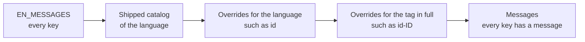

# Messages

The interface text is a catalog of plain strings, one per function of the interface, so that the same function has the
same name everywhere. A message that goes with a count is a label before the number, such as `Words: 1`, so that no noun
has to agree with the count in a language that the host adds. The player ships English and Indonesian, and a host
replaces any message or adds a language.



## Choosing a catalog

`selectMessages(language, overrides)` returns the messages for the language of the interface. Each step of the diagram
replaces the keys that it has; a language without a catalog gets English.

| Parameter   | Type                                | Meaning                                                                                                                            |
| ----------- | ----------------------------------- | ---------------------------------------------------------------------------------------------------------------------------------- |
| `language`  | `string`                            | A BCP 47 tag, such as `id` or `id-ID`. Case is ignored.                                                                            |
| `overrides` | `Record<string, Partial<Messages>>` | Messages that replace the shipped ones, by language tag; a catalog may have only some keys. Without it the shipped messages stand. |

```ts
import { selectMessages } from "@assesskit/player";

selectMessages("id-ID").toolRule; // => "Penggaris"
selectMessages("jv").toolRule; // => "Ruler"
selectMessages("id", { id: { toolRule: "Mistar" } }).toolRule; // => "Mistar"
selectMessages("id-ID", { id: { toolRule: "Rule 1" }, "id-ID": { toolRule: "Rule 2" } }).toolRule; // => "Rule 2"
```

`selectMessages` throws `DataError` when `language` is not a string, `overrides` is not an object of objects, a catalog
has a key that is not a message key, or a message is not a string.

## The catalog

| Key                             | English                                                                                                                                                                                                                                                                              | Indonesian                                                                                                                                                                                                                                                                                          |
| ------------------------------- | ------------------------------------------------------------------------------------------------------------------------------------------------------------------------------------------------------------------------------------------------------------------------------------ | --------------------------------------------------------------------------------------------------------------------------------------------------------------------------------------------------------------------------------------------------------------------------------------------------- |
| `interactiveQuestion`           | Interactive question                                                                                                                                                                                                                                                                 | Soal interaktif                                                                                                                                                                                                                                                                                     |
| `toolRule`                      | Ruler                                                                                                                                                                                                                                                                                | Penggaris                                                                                                                                                                                                                                                                                           |
| `toolProtractor`                | Protractor                                                                                                                                                                                                                                                                           | Busur derajat                                                                                                                                                                                                                                                                                       |
| `toolLineReader`                | Line reader                                                                                                                                                                                                                                                                          | Penyorot baris                                                                                                                                                                                                                                                                                      |
| `toolAnswerMasking`             | Answer masking                                                                                                                                                                                                                                                                       | Penutup pilihan jawaban                                                                                                                                                                                                                                                                             |
| `toolHighlighter`               | Highlighter                                                                                                                                                                                                                                                                          | Penanda teks                                                                                                                                                                                                                                                                                        |
| `toolEliminator`                | Answer eliminator                                                                                                                                                                                                                                                                    | Pencoret pilihan jawaban                                                                                                                                                                                                                                                                            |
| `toolBasicCalculator`           | Basic calculator                                                                                                                                                                                                                                                                     | Kalkulator dasar                                                                                                                                                                                                                                                                                    |
| `toolStandardCalculator`        | Standard calculator                                                                                                                                                                                                                                                                  | Kalkulator standar                                                                                                                                                                                                                                                                                  |
| `toolScientificCalculator`      | Scientific calculator                                                                                                                                                                                                                                                                | Kalkulator ilmiah                                                                                                                                                                                                                                                                                   |
| `toolGraphingCalculator`        | Graphing calculator                                                                                                                                                                                                                                                                  | Kalkulator grafik                                                                                                                                                                                                                                                                                   |
| `toolDictionary`                | Dictionary                                                                                                                                                                                                                                                                           | Kamus                                                                                                                                                                                                                                                                                               |
| `toolThesaurus`                 | Thesaurus                                                                                                                                                                                                                                                                            | Tesaurus                                                                                                                                                                                                                                                                                            |
| `toolHomophoneChecker`          | Homophone checker                                                                                                                                                                                                                                                                    | Pemeriksa homofon                                                                                                                                                                                                                                                                                   |
| `toolNoteTaking`                | Notes                                                                                                                                                                                                                                                                                | Catatan                                                                                                                                                                                                                                                                                             |
| `toolVisualOrganizer`           | Visual organizer                                                                                                                                                                                                                                                                     | Pengatur visual                                                                                                                                                                                                                                                                                     |
| `toolOutliner`                  | Outliner                                                                                                                                                                                                                                                                             | Pembuat kerangka                                                                                                                                                                                                                                                                                    |
| `toolPeerInteraction`           | Peer interaction                                                                                                                                                                                                                                                                     | Interaksi dengan teman                                                                                                                                                                                                                                                                              |
| `toolSpellChecker`              | Spell checker                                                                                                                                                                                                                                                                        | Pemeriksa ejaan                                                                                                                                                                                                                                                                                     |
| `toolsLabel`                    | Tools                                                                                                                                                                                                                                                                                | Alat bantu                                                                                                                                                                                                                                                                                          |
| `toolClose`                     | Close                                                                                                                                                                                                                                                                                | Tutup                                                                                                                                                                                                                                                                                               |
| `toolUnavailable`               | This tool is not available.                                                                                                                                                                                                                                                          | Alat ini tidak tersedia.                                                                                                                                                                                                                                                                            |
| `toolPhysicalMaterials`         | Materials to have ready                                                                                                                                                                                                                                                              | Perlengkapan yang perlu disiapkan                                                                                                                                                                                                                                                                   |
| `toolOpenFile`                  | Open the file                                                                                                                                                                                                                                                                        | Buka berkas                                                                                                                                                                                                                                                                                         |
| `toolMoveUp`                    | Move up                                                                                                                                                                                                                                                                              | Geser ke atas                                                                                                                                                                                                                                                                                       |
| `toolMoveDown`                  | Move down                                                                                                                                                                                                                                                                            | Geser ke bawah                                                                                                                                                                                                                                                                                      |
| `toolMoveLeft`                  | Move left                                                                                                                                                                                                                                                                            | Geser ke kiri                                                                                                                                                                                                                                                                                       |
| `toolMoveRight`                 | Move right                                                                                                                                                                                                                                                                           | Geser ke kanan                                                                                                                                                                                                                                                                                      |
| `toolRotateLeft`                | Rotate counterclockwise                                                                                                                                                                                                                                                              | Putar berlawanan arah jarum jam                                                                                                                                                                                                                                                                     |
| `toolRotateRight`               | Rotate clockwise                                                                                                                                                                                                                                                                     | Putar searah jarum jam                                                                                                                                                                                                                                                                              |
| `toolAngle`                     | Angle in degrees                                                                                                                                                                                                                                                                     | Sudut dalam derajat                                                                                                                                                                                                                                                                                 |
| `toolMoveHint`                  | Arrow keys move the tool. Page Up and Page Down rotate it. Hold Shift for small steps.                                                                                                                                                                                               | Tombol panah menggeser alat. Page Up dan Page Down memutarnya. Tahan Shift untuk langkah kecil.                                                                                                                                                                                                     |
| `toolPreviousLine`              | Previous line                                                                                                                                                                                                                                                                        | Baris sebelumnya                                                                                                                                                                                                                                                                                    |
| `toolNextLine`                  | Next line                                                                                                                                                                                                                                                                            | Baris berikutnya                                                                                                                                                                                                                                                                                    |
| `toolLine`                      | Line                                                                                                                                                                                                                                                                                 | Baris                                                                                                                                                                                                                                                                                               |
| `toolLineOf`                    | of                                                                                                                                                                                                                                                                                   | dari                                                                                                                                                                                                                                                                                                |
| `toolNoText`                    | There is no text to follow.                                                                                                                                                                                                                                                          | Tidak ada teks untuk diikuti.                                                                                                                                                                                                                                                                       |
| `toolHighlighterHint`           | Press a word to mark it or take its mark away, or drag over several words. With the keyboard, the arrow keys move by word and by line, Shift with an arrow extends the choice, and Enter marks it or takes the mark away.                                                            | Tekan sebuah kata untuk menandainya atau menghapus tandanya, atau seret melewati beberapa kata. Dengan papan ketik, tombol panah bergerak per kata dan per baris, Shift dengan tombol panah memperluas pilihan, dan Enter menandai atau menghapus tandanya.                                         |
| `toolMarks`                     | Marks                                                                                                                                                                                                                                                                                | Tanda                                                                                                                                                                                                                                                                                               |
| `toolNoMarks`                   | No words are marked.                                                                                                                                                                                                                                                                 | Belum ada kata yang ditandai.                                                                                                                                                                                                                                                                       |
| `toolRemoveMark`                | Remove mark                                                                                                                                                                                                                                                                          | Hapus tanda                                                                                                                                                                                                                                                                                         |
| `toolClearMarks`                | Clear all marks                                                                                                                                                                                                                                                                      | Hapus semua tanda                                                                                                                                                                                                                                                                                   |
| `toolMarkSet`                   | marked                                                                                                                                                                                                                                                                               | ditandai                                                                                                                                                                                                                                                                                            |
| `toolMarkCleared`               | mark removed                                                                                                                                                                                                                                                                         | tanda dihapus                                                                                                                                                                                                                                                                                       |
| `toolCrossOut`                  | Cross out                                                                                                                                                                                                                                                                            | Coret                                                                                                                                                                                                                                                                                               |
| `answerMaskingNotice`           | The answer choices are hidden.                                                                                                                                                                                                                                                       | Pilihan jawaban disembunyikan.                                                                                                                                                                                                                                                                      |
| `answerMaskingShow`             | Show answer choices                                                                                                                                                                                                                                                                  | Tampilkan pilihan jawaban                                                                                                                                                                                                                                                                           |
| `answerMaskingHide`             | Hide answer choices                                                                                                                                                                                                                                                                  | Sembunyikan pilihan jawaban                                                                                                                                                                                                                                                                         |
| `calculatorDisplay`             | Calculator display                                                                                                                                                                                                                                                                   | Layar kalkulator                                                                                                                                                                                                                                                                                    |
| `calculatorError`               | Error                                                                                                                                                                                                                                                                                | Galat                                                                                                                                                                                                                                                                                               |
| `calculatorMemory`              | Memory in use                                                                                                                                                                                                                                                                        | Memori terisi                                                                                                                                                                                                                                                                                       |
| `calculatorClear`               | C, clear                                                                                                                                                                                                                                                                             | C, hapus                                                                                                                                                                                                                                                                                            |
| `calculatorDivide`              | Divide                                                                                                                                                                                                                                                                               | Bagi                                                                                                                                                                                                                                                                                                |
| `calculatorMultiply`            | Multiply                                                                                                                                                                                                                                                                             | Kali                                                                                                                                                                                                                                                                                                |
| `calculatorSubtract`            | Subtract                                                                                                                                                                                                                                                                             | Kurang                                                                                                                                                                                                                                                                                              |
| `calculatorAdd`                 | Add                                                                                                                                                                                                                                                                                  | Tambah                                                                                                                                                                                                                                                                                              |
| `calculatorEquals`              | Equals                                                                                                                                                                                                                                                                               | Sama dengan                                                                                                                                                                                                                                                                                         |
| `calculatorDecimal`             | Decimal point                                                                                                                                                                                                                                                                        | Titik desimal                                                                                                                                                                                                                                                                                       |
| `calculatorSquareRoot`          | Square root                                                                                                                                                                                                                                                                          | Akar kuadrat                                                                                                                                                                                                                                                                                        |
| `calculatorPercent`             | Percent                                                                                                                                                                                                                                                                              | Persen                                                                                                                                                                                                                                                                                              |
| `calculatorSign`                | Change sign                                                                                                                                                                                                                                                                          | Ubah tanda                                                                                                                                                                                                                                                                                          |
| `calculatorMemoryClear`         | MC, clear memory                                                                                                                                                                                                                                                                     | MC, hapus memori                                                                                                                                                                                                                                                                                    |
| `calculatorMemoryRecall`        | MR, recall memory                                                                                                                                                                                                                                                                    | MR, panggil memori                                                                                                                                                                                                                                                                                  |
| `calculatorMemoryAdd`           | M+, add to memory                                                                                                                                                                                                                                                                    | M+, tambah ke memori                                                                                                                                                                                                                                                                                |
| `calculatorMemorySubtract`      | M−, subtract from memory                                                                                                                                                                                                                                                             | M−, kurangi dari memori                                                                                                                                                                                                                                                                             |
| `calculatorInverse`             | Inv, inverse function                                                                                                                                                                                                                                                                | Inv, fungsi invers                                                                                                                                                                                                                                                                                  |
| `calculatorHyperbolic`          | Hyp, hyperbolic function                                                                                                                                                                                                                                                             | Hyp, fungsi hiperbolik                                                                                                                                                                                                                                                                              |
| `calculatorOpen`                | Open parenthesis                                                                                                                                                                                                                                                                     | Buka kurung                                                                                                                                                                                                                                                                                         |
| `calculatorClose`               | Close parenthesis                                                                                                                                                                                                                                                                    | Tutup kurung                                                                                                                                                                                                                                                                                        |
| `calculatorSine`                | sin, sine                                                                                                                                                                                                                                                                            | sin, sinus                                                                                                                                                                                                                                                                                          |
| `calculatorCosine`              | cos, cosine                                                                                                                                                                                                                                                                          | cos, kosinus                                                                                                                                                                                                                                                                                        |
| `calculatorTangent`             | tan, tangent                                                                                                                                                                                                                                                                         | tan, tangen                                                                                                                                                                                                                                                                                         |
| `calculatorPi`                  | π, pi                                                                                                                                                                                                                                                                                | π, pi                                                                                                                                                                                                                                                                                               |
| `calculatorEuler`               | e, Euler's number                                                                                                                                                                                                                                                                    | e, bilangan Euler                                                                                                                                                                                                                                                                                   |
| `calculatorSquare`              | x², square                                                                                                                                                                                                                                                                           | x², kuadrat                                                                                                                                                                                                                                                                                         |
| `calculatorCube`                | x³, cube                                                                                                                                                                                                                                                                             | x³, pangkat tiga                                                                                                                                                                                                                                                                                    |
| `calculatorPower`               | xʸ, power                                                                                                                                                                                                                                                                            | xʸ, pangkat                                                                                                                                                                                                                                                                                         |
| `calculatorCubeRoot`            | Cube root                                                                                                                                                                                                                                                                            | Akar pangkat tiga                                                                                                                                                                                                                                                                                   |
| `calculatorRoot`                | ʸ√x, root of degree y                                                                                                                                                                                                                                                                | ʸ√x, akar pangkat y                                                                                                                                                                                                                                                                                 |
| `calculatorLog`                 | log, logarithm to base 10                                                                                                                                                                                                                                                            | log, logaritma basis 10                                                                                                                                                                                                                                                                             |
| `calculatorLn`                  | ln, natural logarithm                                                                                                                                                                                                                                                                | ln, logaritma natural                                                                                                                                                                                                                                                                               |
| `calculatorTenPower`            | 10ˣ, ten to the power x                                                                                                                                                                                                                                                              | 10ˣ, sepuluh pangkat x                                                                                                                                                                                                                                                                              |
| `calculatorExp`                 | eˣ, e to the power x                                                                                                                                                                                                                                                                 | eˣ, e pangkat x                                                                                                                                                                                                                                                                                     |
| `calculatorReciprocal`          | 1/x, reciprocal                                                                                                                                                                                                                                                                      | 1/x, kebalikan                                                                                                                                                                                                                                                                                      |
| `calculatorFactorial`           | x!, factorial                                                                                                                                                                                                                                                                        | x!, faktorial                                                                                                                                                                                                                                                                                       |
| `calculatorPermutations`        | nPr, permutations                                                                                                                                                                                                                                                                    | nPr, permutasi                                                                                                                                                                                                                                                                                      |
| `calculatorCombinations`        | nCr, combinations                                                                                                                                                                                                                                                                    | nCr, kombinasi                                                                                                                                                                                                                                                                                      |
| `calculatorAngle`               | Angle unit                                                                                                                                                                                                                                                                           | Satuan sudut                                                                                                                                                                                                                                                                                        |
| `calculatorDegrees`             | Degrees                                                                                                                                                                                                                                                                              | Derajat                                                                                                                                                                                                                                                                                             |
| `calculatorRadians`             | Radians                                                                                                                                                                                                                                                                              | Radian                                                                                                                                                                                                                                                                                              |
| `calculatorGradians`            | Gradians                                                                                                                                                                                                                                                                             | Gradian                                                                                                                                                                                                                                                                                             |
| `speechLink`                    | link                                                                                                                                                                                                                                                                                 | tautan                                                                                                                                                                                                                                                                                              |
| `typingSpace`                   | space                                                                                                                                                                                                                                                                                | spasi                                                                                                                                                                                                                                                                                               |
| `graphicPoint`                  | Point                                                                                                                                                                                                                                                                                | Titik                                                                                                                                                                                                                                                                                               |
| `graphicPointMarked`            | Point marked.                                                                                                                                                                                                                                                                        | Titik ditandai.                                                                                                                                                                                                                                                                                     |
| `graphicRemoved`                | Removed.                                                                                                                                                                                                                                                                             | Dihapus.                                                                                                                                                                                                                                                                                            |
| `graphicPicker`                 | Image with a crosshair                                                                                                                                                                                                                                                               | Gambar dengan garis bidik                                                                                                                                                                                                                                                                           |
| `graphicPickerHint`             | Click the image to mark a point. With the keyboard, go to the image, move the crosshair with the arrow keys, and press Enter or Space to mark a point. Hold Shift for small steps. Choose a marked point to remove it.                                                               | Klik gambar untuk menandai titik. Dengan papan ketik, buka gambar, geser garis bidik dengan tombol panah, lalu tekan Enter atau Spasi untuk menandai titik. Tahan Shift untuk langkah kecil. Pilih titik yang sudah ditandai untuk menghapusnya.                                                    |
| `graphicPlace`                  | Place                                                                                                                                                                                                                                                                                | Letakkan                                                                                                                                                                                                                                                                                            |
| `graphicObject`                 | object                                                                                                                                                                                                                                                                               | objek                                                                                                                                                                                                                                                                                               |
| `graphicPlaced`                 | Placed.                                                                                                                                                                                                                                                                              | Diletakkan.                                                                                                                                                                                                                                                                                         |
| `graphicPlaceHint`              | Choose the object, then click the image to place it, or drag the object onto the image. With the keyboard, choose the object, move the crosshair with the arrow keys, and press Enter or Space to place it. Press Escape to give the object up. Choose a placed object to remove it. | Pilih objek, lalu klik gambar untuk meletakkannya, atau seret objek ke gambar. Dengan papan ketik, pilih objek, geser garis bidik dengan tombol panah, lalu tekan Enter atau Spasi untuk meletakkannya. Tekan Escape untuk melepaskan objek. Pilih objek yang sudah diletakkan untuk menghapusnya.  |
| `graphicChooseSecond`           | Now choose the area to join it with.                                                                                                                                                                                                                                                 | Sekarang pilih area untuk dihubungkan.                                                                                                                                                                                                                                                              |
| `graphicJoined`                 | Joined.                                                                                                                                                                                                                                                                              | Dihubungkan.                                                                                                                                                                                                                                                                                        |
| `graphicAssociateHint`          | Choose an area, then choose another area to join them. Choose the same area again to let it go. Choose Remove to undo a pair.                                                                                                                                                        | Pilih satu area, lalu pilih area lain untuk menghubungkan keduanya. Pilih area yang sama lagi untuk melepaskannya. Pilih Hapus untuk membatalkan sepasang area.                                                                                                                                     |
| `drawTools`                     | Drawing tools                                                                                                                                                                                                                                                                        | Alat gambar                                                                                                                                                                                                                                                                                         |
| `drawToolPen`                   | Pen                                                                                                                                                                                                                                                                                  | Pena                                                                                                                                                                                                                                                                                                |
| `drawToolEraser`                | Eraser                                                                                                                                                                                                                                                                               | Penghapus                                                                                                                                                                                                                                                                                           |
| `drawToolLine`                  | Straight line                                                                                                                                                                                                                                                                        | Garis lurus                                                                                                                                                                                                                                                                                         |
| `drawToolRectangle`             | Rectangle                                                                                                                                                                                                                                                                            | Persegi panjang                                                                                                                                                                                                                                                                                     |
| `drawToolEllipse`               | Ellipse                                                                                                                                                                                                                                                                              | Elips                                                                                                                                                                                                                                                                                               |
| `drawToolFill`                  | Fill                                                                                                                                                                                                                                                                                 | Isi warna                                                                                                                                                                                                                                                                                           |
| `drawColors`                    | Colors                                                                                                                                                                                                                                                                               | Warna                                                                                                                                                                                                                                                                                               |
| `drawColorBlack`                | Black                                                                                                                                                                                                                                                                                | Hitam                                                                                                                                                                                                                                                                                               |
| `drawColorRed`                  | Red                                                                                                                                                                                                                                                                                  | Merah                                                                                                                                                                                                                                                                                               |
| `drawColorGreen`                | Green                                                                                                                                                                                                                                                                                | Hijau                                                                                                                                                                                                                                                                                               |
| `drawColorBlue`                 | Blue                                                                                                                                                                                                                                                                                 | Biru                                                                                                                                                                                                                                                                                                |
| `drawColorYellow`               | Yellow                                                                                                                                                                                                                                                                               | Kuning                                                                                                                                                                                                                                                                                              |
| `drawUndo`                      | Undo                                                                                                                                                                                                                                                                                 | Urungkan                                                                                                                                                                                                                                                                                            |
| `drawClear`                     | Clear                                                                                                                                                                                                                                                                                | Bersihkan                                                                                                                                                                                                                                                                                           |
| `drawStartSet`                  | Start point set. Now choose the end point.                                                                                                                                                                                                                                           | Titik awal ditetapkan. Sekarang pilih titik akhir.                                                                                                                                                                                                                                                  |
| `drawSaveFailed`                | The drawing could not be saved. Draw again to try once more.                                                                                                                                                                                                                         | Gambar tidak dapat disimpan. Gambar lagi untuk mencoba sekali lagi.                                                                                                                                                                                                                                 |
| `drawLoadFailed`                | The picture to draw on could not be loaded.                                                                                                                                                                                                                                          | Gambar untuk digambari tidak dapat dimuat.                                                                                                                                                                                                                                                          |
| `drawHint`                      | The pen and the eraser need a mouse, a finger or a stylus. For the other tools, click or tap the image to choose a point, or go to the image, move the crosshair with the arrow keys and press Enter or Space. A line, a rectangle and an ellipse need two points; a fill needs one. | Pena dan penghapus memerlukan mouse, jari, atau stilus. Untuk alat lain, klik atau ketuk gambar untuk memilih titik, atau buka gambar, geser garis bidik dengan tombol panah, lalu tekan Enter atau Spasi. Garis, persegi panjang, dan elips memerlukan dua titik; isi warna memerlukan satu titik. |
| `feedbackTitle`                 | Feedback                                                                                                                                                                                                                                                                             | Umpan balik                                                                                                                                                                                                                                                                                         |
| `hazardNotice`                  | This question has content that you asked to avoid, and it could not be left out. Its media and animations are not shown. The content is:                                                                                                                                             | Soal ini memuat konten yang Anda minta untuk dihindari, dan konten itu tidak dapat dihilangkan. Media dan animasinya tidak ditampilkan. Kontennya:                                                                                                                                                  |
| `hazardFlashing`                | Flashing                                                                                                                                                                                                                                                                             | Cahaya berkedip                                                                                                                                                                                                                                                                                     |
| `hazardSound`                   | Sound                                                                                                                                                                                                                                                                                | Suara                                                                                                                                                                                                                                                                                               |
| `hazardOlfactory`               | Smell                                                                                                                                                                                                                                                                                | Bau                                                                                                                                                                                                                                                                                                 |
| `hazardMotionSimulation`        | Simulated motion                                                                                                                                                                                                                                                                     | Simulasi gerak                                                                                                                                                                                                                                                                                      |
| `boardChoices`                  | Choices                                                                                                                                                                                                                                                                              | Daftar pilihan                                                                                                                                                                                                                                                                                      |
| `choiceLabel`                   | Choice                                                                                                                                                                                                                                                                               | Pilihan                                                                                                                                                                                                                                                                                             |
| `boardPlaceHere`                | Place here                                                                                                                                                                                                                                                                           | Taruh di sini                                                                                                                                                                                                                                                                                       |
| `boardRemove`                   | Remove                                                                                                                                                                                                                                                                               | Lepaskan                                                                                                                                                                                                                                                                                            |
| `boardPosition`                 | Position                                                                                                                                                                                                                                                                             | Urutan                                                                                                                                                                                                                                                                                              |
| `boardOrder`                    | Your order                                                                                                                                                                                                                                                                           | Urutan Anda                                                                                                                                                                                                                                                                                         |
| `boardPair`                     | Pair                                                                                                                                                                                                                                                                                 | Pasangan                                                                                                                                                                                                                                                                                            |
| `boardFirst`                    | first                                                                                                                                                                                                                                                                                | pertama                                                                                                                                                                                                                                                                                             |
| `boardSecond`                   | second                                                                                                                                                                                                                                                                               | kedua                                                                                                                                                                                                                                                                                               |
| `boardGap`                      | Gap                                                                                                                                                                                                                                                                                  | Rumpang                                                                                                                                                                                                                                                                                             |
| `boardSelected`                 | selected. Choose where to put it.                                                                                                                                                                                                                                                    | dipilih. Pilih tempat untuk menaruhnya.                                                                                                                                                                                                                                                             |
| `boardPlaced`                   | placed in                                                                                                                                                                                                                                                                            | ditaruh di                                                                                                                                                                                                                                                                                          |
| `boardRemoved`                  | put back                                                                                                                                                                                                                                                                             | dikembalikan                                                                                                                                                                                                                                                                                        |
| `boardNothingSelected`          | Select a choice first.                                                                                                                                                                                                                                                               | Pilih salah satu pilihan lebih dahulu.                                                                                                                                                                                                                                                              |
| `hintInvalid`                   | This answer cannot be accepted. Clear it and try again.                                                                                                                                                                                                                              | Jawaban ini tidak dapat diterima. Hapus lalu coba lagi.                                                                                                                                                                                                                                             |
| `hintRequired`                  | An answer is required.                                                                                                                                                                                                                                                               | Jawaban wajib diisi.                                                                                                                                                                                                                                                                                |
| `hintMinChoices`                | Select at least                                                                                                                                                                                                                                                                      | Pilih paling sedikit                                                                                                                                                                                                                                                                                |
| `hintMaxChoices`                | Select at most                                                                                                                                                                                                                                                                       | Pilih paling banyak                                                                                                                                                                                                                                                                                 |
| `hintMinPlaced`                 | Place at least                                                                                                                                                                                                                                                                       | Taruh paling sedikit                                                                                                                                                                                                                                                                                |
| `hintMaxPlaced`                 | Place at most                                                                                                                                                                                                                                                                        | Taruh paling banyak                                                                                                                                                                                                                                                                                 |
| `hintMinAssociations`           | Make at least                                                                                                                                                                                                                                                                        | Buat paling sedikit                                                                                                                                                                                                                                                                                 |
| `hintMaxAssociations`           | Make at most                                                                                                                                                                                                                                                                         | Buat paling banyak                                                                                                                                                                                                                                                                                  |
| `hintMatchMin`                  | Some choices need more matches.                                                                                                                                                                                                                                                      | Beberapa pilihan perlu dicocokkan lagi.                                                                                                                                                                                                                                                             |
| `hintMatchMax`                  | Some choices have too many matches.                                                                                                                                                                                                                                                  | Beberapa pilihan terlalu banyak dicocokkan.                                                                                                                                                                                                                                                         |
| `hintMatchGroup`                | Some choices cannot be matched together.                                                                                                                                                                                                                                             | Beberapa pilihan tidak dapat dicocokkan bersama.                                                                                                                                                                                                                                                    |
| `hintMinStrings`                | Enter at least                                                                                                                                                                                                                                                                       | Isi paling sedikit                                                                                                                                                                                                                                                                                  |
| `hintMaxStrings`                | Enter at most                                                                                                                                                                                                                                                                        | Isi paling banyak                                                                                                                                                                                                                                                                                   |
| `hintPatternMask`               | The answer does not have the required form.                                                                                                                                                                                                                                          | Jawaban tidak berbentuk seperti yang diminta.                                                                                                                                                                                                                                                       |
| `hintMinPlays`                  | Play at least                                                                                                                                                                                                                                                                        | Putar paling sedikit                                                                                                                                                                                                                                                                                |
| `hintMaxPlays`                  | Play at most                                                                                                                                                                                                                                                                         | Putar paling banyak                                                                                                                                                                                                                                                                                 |
| `hintMimeType`                  | This file type is not accepted. Accepted types:                                                                                                                                                                                                                                      | Jenis berkas ini tidak diterima. Jenis yang diterima:                                                                                                                                                                                                                                               |
| `hintNumber`                    | Enter a number.                                                                                                                                                                                                                                                                      | Isi dengan angka.                                                                                                                                                                                                                                                                                   |
| `hintInteger`                   | Enter a whole number.                                                                                                                                                                                                                                                                | Isi dengan bilangan bulat.                                                                                                                                                                                                                                                                          |
| `answerLabel`                   | Answer                                                                                                                                                                                                                                                                               | Jawaban                                                                                                                                                                                                                                                                                             |
| `counterCharacters`             | Characters:                                                                                                                                                                                                                                                                          | Karakter:                                                                                                                                                                                                                                                                                           |
| `counterLeft`                   | Characters left:                                                                                                                                                                                                                                                                     | Karakter tersisa:                                                                                                                                                                                                                                                                                   |
| `counterWords`                  | Words:                                                                                                                                                                                                                                                                               | Kata:                                                                                                                                                                                                                                                                                               |
| `editorToolbar`                 | Formatting                                                                                                                                                                                                                                                                           | Pemformatan                                                                                                                                                                                                                                                                                         |
| `editorBold`                    | Bold                                                                                                                                                                                                                                                                                 | Tebal                                                                                                                                                                                                                                                                                               |
| `editorItalic`                  | Italic                                                                                                                                                                                                                                                                               | Miring                                                                                                                                                                                                                                                                                              |
| `editorUnderline`               | Underline                                                                                                                                                                                                                                                                            | Garis bawah                                                                                                                                                                                                                                                                                         |
| `editorBulletList`              | Bulleted list                                                                                                                                                                                                                                                                        | Daftar berbutir                                                                                                                                                                                                                                                                                     |
| `editorNumberedList`            | Numbered list                                                                                                                                                                                                                                                                        | Daftar bernomor                                                                                                                                                                                                                                                                                     |
| `inlineChoicePrompt`            | Choose an answer                                                                                                                                                                                                                                                                     | Pilih jawaban                                                                                                                                                                                                                                                                                       |
| `sliderNotSet`                  | No value chosen                                                                                                                                                                                                                                                                      | Belum ada nilai dipilih                                                                                                                                                                                                                                                                             |
| `mediaPlayer`                   | Media player                                                                                                                                                                                                                                                                         | Pemutar media                                                                                                                                                                                                                                                                                       |
| `mediaPlay`                     | Play                                                                                                                                                                                                                                                                                 | Putar                                                                                                                                                                                                                                                                                               |
| `mediaPause`                    | Pause                                                                                                                                                                                                                                                                                | Jeda                                                                                                                                                                                                                                                                                                |
| `mediaRewind`                   | Back to start                                                                                                                                                                                                                                                                        | Kembali ke awal                                                                                                                                                                                                                                                                                     |
| `mediaCaptions`                 | Captions                                                                                                                                                                                                                                                                             | Takarir                                                                                                                                                                                                                                                                                             |
| `mediaAudioDescription`         | Audio description                                                                                                                                                                                                                                                                    | Deskripsi audio                                                                                                                                                                                                                                                                                     |
| `mediaPlays`                    | Plays                                                                                                                                                                                                                                                                                | Pemutaran                                                                                                                                                                                                                                                                                           |
| `mediaNoPlaysLeft`              | No plays left.                                                                                                                                                                                                                                                                       | Tidak ada pemutaran tersisa.                                                                                                                                                                                                                                                                        |
| `mediaStartsSoon`               | Playback starts in a moment.                                                                                                                                                                                                                                                         | Pemutaran segera dimulai.                                                                                                                                                                                                                                                                           |
| `mediaNoPauses`                 | You cannot pause again.                                                                                                                                                                                                                                                              | Anda tidak dapat menjeda lagi.                                                                                                                                                                                                                                                                      |
| `mediaResumes`                  | Playback continues by itself.                                                                                                                                                                                                                                                        | Pemutaran berlanjut sendiri.                                                                                                                                                                                                                                                                        |
| `uploadChoose`                  | Choose a file                                                                                                                                                                                                                                                                        | Pilih berkas                                                                                                                                                                                                                                                                                        |
| `uploadRecord`                  | Record                                                                                                                                                                                                                                                                               | Rekam                                                                                                                                                                                                                                                                                               |
| `uploadStopRecording`           | Stop recording                                                                                                                                                                                                                                                                       | Hentikan rekaman                                                                                                                                                                                                                                                                                    |
| `uploadRecording`               | Recording                                                                                                                                                                                                                                                                            | Merekam                                                                                                                                                                                                                                                                                             |
| `uploadUploading`               | Uploading                                                                                                                                                                                                                                                                            | Mengunggah                                                                                                                                                                                                                                                                                          |
| `uploadFailed`                  | The file could not be uploaded. Try again.                                                                                                                                                                                                                                           | Berkas tidak dapat diunggah. Coba lagi.                                                                                                                                                                                                                                                             |
| `uploadNoMicrophone`            | The microphone could not be used.                                                                                                                                                                                                                                                    | Mikrofon tidak dapat digunakan.                                                                                                                                                                                                                                                                     |
| `uploadNotStarted`              | The recording could not start. Check that the sound device works, then press Record.                                                                                                                                                                                                 | Perekaman tidak dapat dimulai. Periksa perangkat suara, lalu tekan Rekam.                                                                                                                                                                                                                           |
| `uploadAutomatic`               | Recording starts by itself when the countdown ends.                                                                                                                                                                                                                                  | Perekaman dimulai sendiri saat hitung mundur berakhir.                                                                                                                                                                                                                                              |
| `uploadStartsIn`                | Starts in                                                                                                                                                                                                                                                                            | Dimulai dalam                                                                                                                                                                                                                                                                                       |
| `uploadTimeLeft`                | Time left                                                                                                                                                                                                                                                                            | Sisa waktu                                                                                                                                                                                                                                                                                          |
| `uploadRemove`                  | Remove the file                                                                                                                                                                                                                                                                      | Hapus berkas                                                                                                                                                                                                                                                                                        |
| `customUnsupported`             | This kind of question is not supported here.                                                                                                                                                                                                                                         | Jenis soal ini tidak didukung di sini.                                                                                                                                                                                                                                                              |
| `navigationLabel`               | Questions                                                                                                                                                                                                                                                                            | Daftar soal                                                                                                                                                                                                                                                                                         |
| `timersLabel`                   | Time limits                                                                                                                                                                                                                                                                          | Batas waktu                                                                                                                                                                                                                                                                                         |
| `actionsLabel`                  | Actions                                                                                                                                                                                                                                                                              | Tindakan                                                                                                                                                                                                                                                                                            |
| `timeDependentNotice`           | This question is timed. Your time counts while you work on it.                                                                                                                                                                                                                       | Soal ini bergantung pada waktu. Waktu Anda terhitung selama Anda mengerjakannya.                                                                                                                                                                                                                    |
| `attemptsUsed`                  | Attempts used                                                                                                                                                                                                                                                                        | Percobaan terpakai                                                                                                                                                                                                                                                                                  |
| `attemptsLeft`                  | Attempts left                                                                                                                                                                                                                                                                        | Sisa percobaan                                                                                                                                                                                                                                                                                      |
| `statusInitial`                 | Not started                                                                                                                                                                                                                                                                          | Belum dikerjakan                                                                                                                                                                                                                                                                                    |
| `statusInteracting`             | In progress                                                                                                                                                                                                                                                                          | Sedang dikerjakan                                                                                                                                                                                                                                                                                   |
| `statusSuspended`               | Paused                                                                                                                                                                                                                                                                               | Dijeda                                                                                                                                                                                                                                                                                              |
| `statusClosed`                  | Submitted                                                                                                                                                                                                                                                                            | Sudah dikirim                                                                                                                                                                                                                                                                                       |
| `statusReview`                  | In review                                                                                                                                                                                                                                                                            | Sedang ditinjau                                                                                                                                                                                                                                                                                     |
| `statusSolution`                | Solution shown                                                                                                                                                                                                                                                                       | Kunci ditampilkan                                                                                                                                                                                                                                                                                   |
| `statusMarked`                  | Marked for review                                                                                                                                                                                                                                                                    | Ditandai untuk ditinjau                                                                                                                                                                                                                                                                             |
| `actionPrevious`                | Previous                                                                                                                                                                                                                                                                             | Sebelumnya                                                                                                                                                                                                                                                                                          |
| `actionNext`                    | Next                                                                                                                                                                                                                                                                                 | Berikutnya                                                                                                                                                                                                                                                                                          |
| `actionSubmit`                  | Submit answer                                                                                                                                                                                                                                                                        | Kirim jawaban                                                                                                                                                                                                                                                                                       |
| `actionSkip`                    | Skip question                                                                                                                                                                                                                                                                        | Lewati soal                                                                                                                                                                                                                                                                                         |
| `actionNextAttempt`             | Try again                                                                                                                                                                                                                                                                            | Coba lagi                                                                                                                                                                                                                                                                                           |
| `actionReview`                  | Review answer                                                                                                                                                                                                                                                                        | Tinjau jawaban                                                                                                                                                                                                                                                                                      |
| `actionSolution`                | Show solution                                                                                                                                                                                                                                                                        | Tampilkan kunci                                                                                                                                                                                                                                                                                     |
| `actionMark`                    | Mark for review                                                                                                                                                                                                                                                                      | Tandai untuk ditinjau                                                                                                                                                                                                                                                                               |
| `actionEndPart`                 | End this part                                                                                                                                                                                                                                                                        | Akhiri bagian ini                                                                                                                                                                                                                                                                                   |
| `actionEndTest`                 | End the test                                                                                                                                                                                                                                                                         | Akhiri tes                                                                                                                                                                                                                                                                                          |
| `actionSuspend`                 | Pause the test                                                                                                                                                                                                                                                                       | Jeda tes                                                                                                                                                                                                                                                                                            |
| `actionResume`                  | Resume the test                                                                                                                                                                                                                                                                      | Lanjutkan tes                                                                                                                                                                                                                                                                                       |
| `commentLabel`                  | Comment on this question                                                                                                                                                                                                                                                             | Komentar untuk soal ini                                                                                                                                                                                                                                                                             |
| `actionComment`                 | Save comment                                                                                                                                                                                                                                                                         | Simpan komentar                                                                                                                                                                                                                                                                                     |
| `confirmTitle`                  | Please confirm                                                                                                                                                                                                                                                                       | Mohon konfirmasi                                                                                                                                                                                                                                                                                    |
| `confirmSubmit`                 | Submit your answer? You cannot change it afterward.                                                                                                                                                                                                                                  | Kirim jawaban? Jawaban tidak dapat diubah setelah dikirim.                                                                                                                                                                                                                                          |
| `confirmEndPart`                | End this part of the test? You cannot return to it.                                                                                                                                                                                                                                  | Akhiri bagian tes ini? Anda tidak dapat kembali ke bagian ini.                                                                                                                                                                                                                                      |
| `confirmEndTest`                | End the test? Your answers are submitted and you cannot change them.                                                                                                                                                                                                                 | Akhiri tes? Jawaban Anda dikirim dan tidak dapat diubah.                                                                                                                                                                                                                                            |
| `confirmSimultaneous`           | The answers to all the questions of this part are submitted together when you end it.                                                                                                                                                                                                | Jawaban semua soal pada bagian ini dikirim bersamaan saat Anda mengakhirinya.                                                                                                                                                                                                                       |
| `confirmUnsubmitted`            | Questions not yet submitted                                                                                                                                                                                                                                                          | Soal yang belum dikirim                                                                                                                                                                                                                                                                             |
| `confirmYes`                    | Yes, continue                                                                                                                                                                                                                                                                        | Ya, lanjutkan                                                                                                                                                                                                                                                                                       |
| `confirmNo`                     | No, go back                                                                                                                                                                                                                                                                          | Tidak, kembali                                                                                                                                                                                                                                                                                      |
| `timerTest`                     | Time left in the test                                                                                                                                                                                                                                                                | Sisa waktu tes                                                                                                                                                                                                                                                                                      |
| `timerPart`                     | Time left in this part                                                                                                                                                                                                                                                               | Sisa waktu bagian ini                                                                                                                                                                                                                                                                               |
| `timerSection`                  | Time left in this section                                                                                                                                                                                                                                                            | Sisa waktu seksi ini                                                                                                                                                                                                                                                                                |
| `timerItem`                     | Time left for this question                                                                                                                                                                                                                                                          | Sisa waktu soal ini                                                                                                                                                                                                                                                                                 |
| `timerMinimum`                  | Time before you may leave                                                                                                                                                                                                                                                            | Waktu sebelum Anda boleh pindah                                                                                                                                                                                                                                                                     |
| `timerLate`                     | Time is up. Answers are still accepted late.                                                                                                                                                                                                                                         | Waktu habis. Jawaban masih diterima terlambat.                                                                                                                                                                                                                                                      |
| `timerHide`                     | Hide the timers                                                                                                                                                                                                                                                                      | Sembunyikan pewaktu                                                                                                                                                                                                                                                                                 |
| `timerShow`                     | Show the timers                                                                                                                                                                                                                                                                      | Tampilkan pewaktu                                                                                                                                                                                                                                                                                   |
| `timerWarning`                  | Time left:                                                                                                                                                                                                                                                                           | Sisa waktu:                                                                                                                                                                                                                                                                                         |
| `timerExpired`                  | Time is up.                                                                                                                                                                                                                                                                          | Waktu habis.                                                                                                                                                                                                                                                                                        |
| `testSuspended`                 | The test is paused and your time is stopped. Wait until it continues.                                                                                                                                                                                                                | Tes dijeda dan waktu Anda berhenti. Tunggu sampai tes dilanjutkan.                                                                                                                                                                                                                                  |
| `checkAgain`                    | Check whether the test continues                                                                                                                                                                                                                                                     | Periksa apakah tes dilanjutkan                                                                                                                                                                                                                                                                      |
| `stillSuspended`                | The test is still paused.                                                                                                                                                                                                                                                            | Tes masih dijeda.                                                                                                                                                                                                                                                                                   |
| `checkFailed`                   | The test could not be checked. Try again.                                                                                                                                                                                                                                            | Tes tidak dapat diperiksa. Coba lagi.                                                                                                                                                                                                                                                               |
| `testEnded`                     | The test has ended.                                                                                                                                                                                                                                                                  | Tes telah selesai.                                                                                                                                                                                                                                                                                  |
| `awaitingItem`                  | The next question is being prepared.                                                                                                                                                                                                                                                 | Soal berikutnya sedang disiapkan.                                                                                                                                                                                                                                                                   |
| `pciFailed`                     | This interactive question could not start.                                                                                                                                                                                                                                           | Soal interaktif ini tidak dapat dimulai.                                                                                                                                                                                                                                                            |
| `answersSaved`                  | Answers saved.                                                                                                                                                                                                                                                                       | Jawaban tersimpan.                                                                                                                                                                                                                                                                                  |
| `commentSaved`                  | Comment saved.                                                                                                                                                                                                                                                                       | Komentar tersimpan.                                                                                                                                                                                                                                                                                 |
| `sendFailed`                    | Your answers could not be sent. They will be sent again.                                                                                                                                                                                                                             | Jawaban Anda tidak dapat dikirim. Jawaban akan dikirim ulang.                                                                                                                                                                                                                                       |
| `sendRejected`                  | The test could not accept this action.                                                                                                                                                                                                                                               | Tes tidak dapat menerima tindakan ini.                                                                                                                                                                                                                                                              |
| `refusalAttemptsExhausted`      | You have used every attempt for this question.                                                                                                                                                                                                                                       | Semua percobaan untuk soal ini sudah terpakai.                                                                                                                                                                                                                                                      |
| `refusalAwaitingCat`            | Wait for the next question to be prepared.                                                                                                                                                                                                                                           | Tunggu sampai soal berikutnya siap.                                                                                                                                                                                                                                                                 |
| `refusalClockRegression`        | The time of this action is earlier than the last one. Try again.                                                                                                                                                                                                                     | Waktu tindakan ini lebih awal daripada yang terakhir. Coba lagi.                                                                                                                                                                                                                                    |
| `refusalCommentNotAllowed`      | Comments are not allowed on this question.                                                                                                                                                                                                                                           | Komentar tidak diizinkan pada soal ini.                                                                                                                                                                                                                                                             |
| `refusalEnded`                  | The test has ended, so this action is not possible.                                                                                                                                                                                                                                  | Tes telah selesai, jadi tindakan ini tidak dapat dilakukan.                                                                                                                                                                                                                                         |
| `refusalInvalidResponse`        | This answer does not fit the question. Check it and try again.                                                                                                                                                                                                                       | Jawaban ini tidak sesuai dengan soal. Periksa dan coba lagi.                                                                                                                                                                                                                                        |
| `refusalItemClosed`             | This question is closed, so its answer can no longer change.                                                                                                                                                                                                                         | Soal ini sudah ditutup, jadi jawabannya tidak dapat diubah lagi.                                                                                                                                                                                                                                    |
| `refusalLinearBackward`         | This part moves forward only. You cannot go back.                                                                                                                                                                                                                                    | Bagian ini hanya bergerak maju. Anda tidak dapat kembali.                                                                                                                                                                                                                                           |
| `refusalMinTimeNotReached`      | You cannot leave yet: the minimum time has not passed.                                                                                                                                                                                                                               | Anda belum boleh pindah: waktu minimum belum terlewati.                                                                                                                                                                                                                                             |
| `refusalNotCurrent`             | That question is not the one on screen.                                                                                                                                                                                                                                              | Soal itu bukan yang sedang ditampilkan.                                                                                                                                                                                                                                                             |
| `refusalReviewNotAllowed`       | This question cannot be reviewed now.                                                                                                                                                                                                                                                | Soal ini tidak dapat ditinjau sekarang.                                                                                                                                                                                                                                                             |
| `refusalScoreTypeMismatch`      | The score does not fit the question.                                                                                                                                                                                                                                                 | Skor tidak sesuai dengan soal.                                                                                                                                                                                                                                                                      |
| `refusalSettingNotAdjustable`   | Your test program sets this setting, so it cannot be changed.                                                                                                                                                                                                                        | Program tes Anda menetapkan pengaturan ini, jadi pengaturan ini tidak dapat diubah.                                                                                                                                                                                                                 |
| `refusalSkippingNotAllowed`     | You must answer this question before you go on.                                                                                                                                                                                                                                      | Anda harus menjawab soal ini sebelum melanjutkan.                                                                                                                                                                                                                                                   |
| `refusalSolutionNotAllowed`     | The solution is not available for this question.                                                                                                                                                                                                                                     | Kunci tidak tersedia untuk soal ini.                                                                                                                                                                                                                                                                |
| `refusalSupportNotAvailable`    | This support is not available for you.                                                                                                                                                                                                                                               | Bantuan ini tidak tersedia untuk Anda.                                                                                                                                                                                                                                                              |
| `refusalSuspended`              | The test is paused, so this action is not possible.                                                                                                                                                                                                                                  | Tes sedang dijeda, jadi tindakan ini tidak dapat dilakukan.                                                                                                                                                                                                                                         |
| `refusalTimeOver`               | The time for this question is over.                                                                                                                                                                                                                                                  | Waktu untuk soal ini sudah habis.                                                                                                                                                                                                                                                                   |
| `refusalUnknownItem`            | That question is not in this test.                                                                                                                                                                                                                                                   | Soal itu tidak ada dalam tes ini.                                                                                                                                                                                                                                                                   |
| `refusalUnknownRequest`         | That request is not known.                                                                                                                                                                                                                                                           | Permintaan itu tidak dikenal.                                                                                                                                                                                                                                                                       |
| `refusalValueOutOfRange`        | That number is too large or too small.                                                                                                                                                                                                                                               | Angka itu terlalu besar atau terlalu kecil.                                                                                                                                                                                                                                                         |
| `refusalWrongSubmissionMode`    | In this part, answers are submitted together when you end it.                                                                                                                                                                                                                        | Pada bagian ini, jawaban dikirim bersamaan saat Anda mengakhirinya.                                                                                                                                                                                                                                 |
| `submissionTitle`               | Submission to score                                                                                                                                                                                                                                                                  | Penilaian yang perlu diberi skor                                                                                                                                                                                                                                                                    |
| `submissionOutcome`             | Outcome to score                                                                                                                                                                                                                                                                     | Hasil yang diberi skor                                                                                                                                                                                                                                                                              |
| `submissionScorer`              | Scored by                                                                                                                                                                                                                                                                            | Diberi skor oleh                                                                                                                                                                                                                                                                                    |
| `submissionHuman`               | A person                                                                                                                                                                                                                                                                             | Seseorang                                                                                                                                                                                                                                                                                           |
| `submissionMachine`             | An external machine                                                                                                                                                                                                                                                                  | Mesin eksternal                                                                                                                                                                                                                                                                                     |
| `submissionType`                | Type of outcome                                                                                                                                                                                                                                                                      | Tipe hasil                                                                                                                                                                                                                                                                                          |
| `submissionMinimum`             | Normal minimum                                                                                                                                                                                                                                                                       | Minimum normal                                                                                                                                                                                                                                                                                      |
| `submissionMaximum`             | Normal maximum                                                                                                                                                                                                                                                                       | Maksimum normal                                                                                                                                                                                                                                                                                     |
| `submissionMastery`             | Mastery value                                                                                                                                                                                                                                                                        | Nilai penguasaan                                                                                                                                                                                                                                                                                    |
| `submissionMeaning`             | Meaning of the outcome                                                                                                                                                                                                                                                               | Arti hasil                                                                                                                                                                                                                                                                                          |
| `submissionDetails`             | Description of the outcome                                                                                                                                                                                                                                                           | Uraian hasil                                                                                                                                                                                                                                                                                        |
| `submissionVariable`            | Variable reference                                                                                                                                                                                                                                                                   | Rujukan variabel                                                                                                                                                                                                                                                                                    |
| `submissionLinkedTool`          | This item links to a tool.                                                                                                                                                                                                                                                           | Soal ini menaut ke alat.                                                                                                                                                                                                                                                                            |
| `submissionRequested`           | Requested at                                                                                                                                                                                                                                                                         | Diminta pada                                                                                                                                                                                                                                                                                        |
| `submissionEarlier`             | Earlier score                                                                                                                                                                                                                                                                        | Skor sebelumnya                                                                                                                                                                                                                                                                                     |
| `submissionEarlierBy`           | Earlier score given by                                                                                                                                                                                                                                                               | Skor sebelumnya diberikan oleh                                                                                                                                                                                                                                                                      |
| `submissionEarlierAt`           | Earlier score given at                                                                                                                                                                                                                                                               | Skor sebelumnya diberikan pada                                                                                                                                                                                                                                                                      |
| `submissionRubric`              | Rubric for the scorer                                                                                                                                                                                                                                                                | Rubrik untuk penilai                                                                                                                                                                                                                                                                                |
| `submissionNotPresented`        | The candidate was not shown this item.                                                                                                                                                                                                                                               | Peserta tidak diperlihatkan soal ini.                                                                                                                                                                                                                                                               |
| `submissionResponseId`          | Response variable                                                                                                                                                                                                                                                                    | Variabel jawaban                                                                                                                                                                                                                                                                                    |
| `submissionInteraction`         | Kind of interaction                                                                                                                                                                                                                                                                  | Jenis interaksi                                                                                                                                                                                                                                                                                     |
| `submissionResponse`            | Response of the candidate                                                                                                                                                                                                                                                            | Jawaban peserta                                                                                                                                                                                                                                                                                     |
| `submissionNoResponse`          | No response                                                                                                                                                                                                                                                                          | Tidak ada jawaban                                                                                                                                                                                                                                                                                   |
| `submissionCorrect`             | Correct responses                                                                                                                                                                                                                                                                    | Jawaban yang benar                                                                                                                                                                                                                                                                                  |
| `submissionTemplates`           | Template values                                                                                                                                                                                                                                                                      | Nilai templat                                                                                                                                                                                                                                                                                       |
| `submissionNoValue`             | No value                                                                                                                                                                                                                                                                             | Tidak ada nilai                                                                                                                                                                                                                                                                                     |
| `submissionFile`                | Submitted file                                                                                                                                                                                                                                                                       | Berkas yang diserahkan                                                                                                                                                                                                                                                                              |
| `ratingForm`                    | Rating                                                                                                                                                                                                                                                                               | Penilaian                                                                                                                                                                                                                                                                                           |
| `ratingScore`                   | Score                                                                                                                                                                                                                                                                                | Skor                                                                                                                                                                                                                                                                                                |
| `ratingOutOf`                   | out of                                                                                                                                                                                                                                                                               | dari maksimum                                                                                                                                                                                                                                                                                       |
| `ratingPoints`                  | Points                                                                                                                                                                                                                                                                               | Poin                                                                                                                                                                                                                                                                                                |
| `ratingWeight`                  | Weight                                                                                                                                                                                                                                                                               | Bobot                                                                                                                                                                                                                                                                                               |
| `ratingNotRated`                | not rated                                                                                                                                                                                                                                                                            | belum dinilai                                                                                                                                                                                                                                                                                       |
| `ratingChooseLevel`             | Choose a level for this criterion.                                                                                                                                                                                                                                                   | Pilih satu tingkat untuk kriteria ini.                                                                                                                                                                                                                                                              |
| `ratingMet`                     | Met                                                                                                                                                                                                                                                                                  | Terpenuhi                                                                                                                                                                                                                                                                                           |
| `ratingNotMet`                  | Not met                                                                                                                                                                                                                                                                              | Belum terpenuhi                                                                                                                                                                                                                                                                                     |
| `supportsLabel`                 | Supports                                                                                                                                                                                                                                                                             | Dukungan                                                                                                                                                                                                                                                                                            |
| `supportOn`                     | on                                                                                                                                                                                                                                                                                   | aktif                                                                                                                                                                                                                                                                                               |
| `supportOff`                    | off                                                                                                                                                                                                                                                                                  | nonaktif                                                                                                                                                                                                                                                                                            |
| `supportHazardAvoidance`        | Hazard avoidance                                                                                                                                                                                                                                                                     | Penghindaran bahaya                                                                                                                                                                                                                                                                                 |
| `supportInputRequirements`      | Input requirements                                                                                                                                                                                                                                                                   | Kebutuhan masukan                                                                                                                                                                                                                                                                                   |
| `supportLanguageOfInterface`    | Interface language                                                                                                                                                                                                                                                                   | Bahasa antarmuka                                                                                                                                                                                                                                                                                    |
| `supportLinguisticGuidance`     | Linguistic guidance                                                                                                                                                                                                                                                                  | Panduan kebahasaan                                                                                                                                                                                                                                                                                  |
| `supportKeywordEmphasis`        | Keyword emphasis                                                                                                                                                                                                                                                                     | Penekanan kata kunci                                                                                                                                                                                                                                                                                |
| `supportKeywordTranslation`     | Keyword translation                                                                                                                                                                                                                                                                  | Terjemahan kata kunci                                                                                                                                                                                                                                                                               |
| `supportSimplifiedLanguage`     | Simplified language                                                                                                                                                                                                                                                                  | Bahasa yang disederhanakan                                                                                                                                                                                                                                                                          |
| `supportSimplifiedGraphics`     | Simplified graphics                                                                                                                                                                                                                                                                  | Gambar yang disederhanakan                                                                                                                                                                                                                                                                          |
| `supportItemTranslation`        | Question translation                                                                                                                                                                                                                                                                 | Terjemahan soal                                                                                                                                                                                                                                                                                     |
| `supportSignLanguage`           | Sign language                                                                                                                                                                                                                                                                        | Bahasa isyarat                                                                                                                                                                                                                                                                                      |
| `supportEncouragement`          | Encouragement                                                                                                                                                                                                                                                                        | Dorongan semangat                                                                                                                                                                                                                                                                                   |
| `supportAdditionalTestingTime`  | Additional testing time                                                                                                                                                                                                                                                              | Waktu tes tambahan                                                                                                                                                                                                                                                                                  |
| `supportInvertDisplayPolarity`  | Inverted display                                                                                                                                                                                                                                                                     | Tampilan terbalik                                                                                                                                                                                                                                                                                   |
| `supportMagnification`          | Magnification                                                                                                                                                                                                                                                                        | Pembesaran                                                                                                                                                                                                                                                                                          |
| `supportSpoken`                 | Spoken                                                                                                                                                                                                                                                                               | Lisan                                                                                                                                                                                                                                                                                               |
| `supportTactile`                | Tactile                                                                                                                                                                                                                                                                              | Taktil                                                                                                                                                                                                                                                                                              |
| `supportBraille`                | Braille                                                                                                                                                                                                                                                                              | Braille                                                                                                                                                                                                                                                                                             |
| `supportKeyboardDirections`     | Keyboard directions                                                                                                                                                                                                                                                                  | Petunjuk papan ketik                                                                                                                                                                                                                                                                                |
| `supportAdditionalDirections`   | Additional directions                                                                                                                                                                                                                                                                | Petunjuk tambahan                                                                                                                                                                                                                                                                                   |
| `supportLongDescription`        | Long description                                                                                                                                                                                                                                                                     | Deskripsi panjang                                                                                                                                                                                                                                                                                   |
| `supportEnvironment`            | Environment                                                                                                                                                                                                                                                                          | Lingkungan                                                                                                                                                                                                                                                                                          |
| `supportTranscript`             | Transcript                                                                                                                                                                                                                                                                           | Transkrip                                                                                                                                                                                                                                                                                           |
| `supportAlternativeText`        | Alternative text                                                                                                                                                                                                                                                                     | Teks alternatif                                                                                                                                                                                                                                                                                     |
| `supportHighContrast`           | High contrast                                                                                                                                                                                                                                                                        | Kontras tinggi                                                                                                                                                                                                                                                                                      |
| `supportLayoutSingleColumn`     | Single column                                                                                                                                                                                                                                                                        | Satu kolom                                                                                                                                                                                                                                                                                          |
| `supportTextAppearance`         | Text appearance                                                                                                                                                                                                                                                                      | Tampilan teks                                                                                                                                                                                                                                                                                       |
| `supportGlossaryOnScreen`       | Glossary                                                                                                                                                                                                                                                                             | Glosarium                                                                                                                                                                                                                                                                                           |
| `colorTheme`                    | Color theme                                                                                                                                                                                                                                                                          | Tema warna                                                                                                                                                                                                                                                                                          |
| `colorThemeDefault`             | Default colors                                                                                                                                                                                                                                                                       | Warna bawaan                                                                                                                                                                                                                                                                                        |
| `colorThemeDefaultReverse`      | Default colors, reversed                                                                                                                                                                                                                                                             | Warna bawaan, dibalik                                                                                                                                                                                                                                                                               |
| `colorThemeHighContrast`        | High contrast colors                                                                                                                                                                                                                                                                 | Warna kontras tinggi                                                                                                                                                                                                                                                                                |
| `colorThemeHighContrastReverse` | High contrast colors, reversed                                                                                                                                                                                                                                                       | Warna kontras tinggi, dibalik                                                                                                                                                                                                                                                                       |
| `colorThemeYellowBlue`          | Yellow on blue                                                                                                                                                                                                                                                                       | Kuning di atas biru                                                                                                                                                                                                                                                                                 |
| `colorThemeBlueYellow`          | Blue on yellow                                                                                                                                                                                                                                                                       | Biru di atas kuning                                                                                                                                                                                                                                                                                 |
| `colorThemeBlackRose`           | Black on rose                                                                                                                                                                                                                                                                        | Hitam di atas merah muda                                                                                                                                                                                                                                                                            |
| `colorThemeRoseBlack`           | Rose on black                                                                                                                                                                                                                                                                        | Merah muda di atas hitam                                                                                                                                                                                                                                                                            |
| `colorThemeBlackCyan`           | Black on light blue                                                                                                                                                                                                                                                                  | Hitam di atas biru muda                                                                                                                                                                                                                                                                             |
| `colorThemeCyanBlack`           | Light blue on black                                                                                                                                                                                                                                                                  | Biru muda di atas hitam                                                                                                                                                                                                                                                                             |
| `colorThemeBlackCream`          | Black on cream                                                                                                                                                                                                                                                                       | Hitam di atas krem                                                                                                                                                                                                                                                                                  |
| `colorThemeCreamBlack`          | Cream on black                                                                                                                                                                                                                                                                       | Krem di atas hitam                                                                                                                                                                                                                                                                                  |
| `colorThemeMedgrayDarkgray`     | Medium gray on dark gray                                                                                                                                                                                                                                                             | Abu-abu sedang di atas abu-abu tua                                                                                                                                                                                                                                                                  |
| `colorThemeDarkgrayMedgray`     | Dark gray on medium gray                                                                                                                                                                                                                                                             | Abu-abu tua di atas abu-abu sedang                                                                                                                                                                                                                                                                  |
| `settingFontSize`               | Text size, points                                                                                                                                                                                                                                                                    | Ukuran teks, poin                                                                                                                                                                                                                                                                                   |
| `settingZoom`                   | Zoom                                                                                                                                                                                                                                                                                 | Tingkat pembesaran                                                                                                                                                                                                                                                                                  |
| `settingZoomText`               | Zoom of text                                                                                                                                                                                                                                                                         | Pembesaran teks                                                                                                                                                                                                                                                                                     |
| `settingZoomNonText`            | Zoom of images                                                                                                                                                                                                                                                                       | Pembesaran gambar                                                                                                                                                                                                                                                                                   |
| `settingSpeechRate`             | Speech rate, words per minute                                                                                                                                                                                                                                                        | Kecepatan bicara, kata per menit                                                                                                                                                                                                                                                                    |
| `settingPitch`                  | Pitch of the voice                                                                                                                                                                                                                                                                   | Tinggi suara                                                                                                                                                                                                                                                                                        |
| `settingVolume`                 | Volume of the voice                                                                                                                                                                                                                                                                  | Volume suara                                                                                                                                                                                                                                                                                        |
| `settingLinkIndication`         | How links are read                                                                                                                                                                                                                                                                   | Cara tautan dibacakan                                                                                                                                                                                                                                                                               |
| `linkIndicationSpeakLink`       | Say that it is a link                                                                                                                                                                                                                                                                | Sebutkan bahwa itu tautan                                                                                                                                                                                                                                                                           |
| `linkIndicationDifferentVoice`  | In a different voice                                                                                                                                                                                                                                                                 | Dengan suara lain                                                                                                                                                                                                                                                                                   |
| `linkIndicationSoundEffect`     | With a sound                                                                                                                                                                                                                                                                         | Dengan bunyi                                                                                                                                                                                                                                                                                        |
| `linkIndicationNone`            | Like any other text                                                                                                                                                                                                                                                                  | Seperti teks lainnya                                                                                                                                                                                                                                                                                |
| `settingTypingEcho`             | Repeat what I type                                                                                                                                                                                                                                                                   | Ulangi yang saya ketik                                                                                                                                                                                                                                                                              |
| `typingEchoCharacters`          | Each character                                                                                                                                                                                                                                                                       | Setiap karakter                                                                                                                                                                                                                                                                                     |
| `typingEchoWords`               | Each word                                                                                                                                                                                                                                                                            | Setiap kata                                                                                                                                                                                                                                                                                         |
| `typingEchoCharactersAndWords`  | Each character and word                                                                                                                                                                                                                                                              | Setiap karakter dan kata                                                                                                                                                                                                                                                                            |
| `typingEchoNone`                | Nothing                                                                                                                                                                                                                                                                              | Tidak ada yang diulang                                                                                                                                                                                                                                                                              |
| `settingBrailleDelivery`        | Braille delivery                                                                                                                                                                                                                                                                     | Penyajian braille                                                                                                                                                                                                                                                                                   |
| `brailleRefreshable`            | Refreshable braille display                                                                                                                                                                                                                                                          | Layar braille                                                                                                                                                                                                                                                                                       |
| `brailleEmbossed`               | Embossed on paper                                                                                                                                                                                                                                                                    | Dicetak timbul di kertas                                                                                                                                                                                                                                                                            |
| `settingBrailleGrade`           | Braille grade                                                                                                                                                                                                                                                                        | Tingkat braille                                                                                                                                                                                                                                                                                     |
| `settingBrailleType`            | Kind of braille                                                                                                                                                                                                                                                                      | Jenis braille                                                                                                                                                                                                                                                                                       |
| `brailleTypeUeb`                | Unified English Braille (UEB)                                                                                                                                                                                                                                                        | Unified English Braille (UEB)                                                                                                                                                                                                                                                                       |
| `brailleTypeEbae`               | English Braille, American Edition (EBAE)                                                                                                                                                                                                                                             | English Braille, American Edition (EBAE)                                                                                                                                                                                                                                                            |
| `settingBrailleMath`            | Braille of mathematics                                                                                                                                                                                                                                                               | Braille matematika                                                                                                                                                                                                                                                                                  |
| `brailleMathNemeth`             | Nemeth Code                                                                                                                                                                                                                                                                          | Kode Nemeth                                                                                                                                                                                                                                                                                         |
| `brailleMathUeb`                | Unified English Braille for mathematics                                                                                                                                                                                                                                              | Unified English Braille untuk matematika                                                                                                                                                                                                                                                            |
| `readAloud`                     | Read aloud                                                                                                                                                                                                                                                                           | Bacakan                                                                                                                                                                                                                                                                                             |
| `readAloudStop`                 | Stop reading                                                                                                                                                                                                                                                                         | Hentikan pembacaan                                                                                                                                                                                                                                                                                  |
| `readAloudPreviousWord`         | Previous word                                                                                                                                                                                                                                                                        | Kata sebelumnya                                                                                                                                                                                                                                                                                     |
| `readAloudNextWord`             | Next word                                                                                                                                                                                                                                                                            | Kata berikutnya                                                                                                                                                                                                                                                                                     |
| `readAloudWord`                 | Word read                                                                                                                                                                                                                                                                            | Kata yang dibaca                                                                                                                                                                                                                                                                                    |
| `readAloudNothing`              | There is nothing to read.                                                                                                                                                                                                                                                            | Tidak ada yang dapat dibaca.                                                                                                                                                                                                                                                                        |
| `readAloudFailed`               | The voice could not read this.                                                                                                                                                                                                                                                       | Suara tidak dapat membacakan ini.                                                                                                                                                                                                                                                                   |
| `variantLanguage`               | Language of this version                                                                                                                                                                                                                                                             | Bahasa versi ini                                                                                                                                                                                                                                                                                    |
| `variantAdapted`                | An adapted version of this question is shown.                                                                                                                                                                                                                                        | Versi soal yang disesuaikan ditampilkan.                                                                                                                                                                                                                                                            |
| `ltiUnavailable`                | The tool for this question could not be started.                                                                                                                                                                                                                                     | Alat untuk soal ini tidak dapat dijalankan.                                                                                                                                                                                                                                                         |
| `ltiClosed`                     | The tool for this question is no longer open.                                                                                                                                                                                                                                        | Alat untuk soal ini sudah tidak terbuka.                                                                                                                                                                                                                                                            |
| `ltiStorageFrame`               | Storage for the tool                                                                                                                                                                                                                                                                 | Penyimpanan untuk alat                                                                                                                                                                                                                                                                              |

`Messages` is the type of a catalog, `EN_MESSAGES` and `ID_MESSAGES` are the shipped ones, and a catalog for another
language has the same keys.

## Adding a message

A message is a property of `Messages` with a TSDoc comment, and a string in both `en.ts` and `id.ts`; the type checker
refuses a catalog that lacks one. Its text names a function of the interface, never a shape, color or position alone
(WCAG 1.3.3), and no two keys of a catalog have the same text.

## Files

Each file of `src/messages/` holds one concept.

| File          | Concept                                                                       |
| ------------- | ----------------------------------------------------------------------------- |
| `messages.ts` | The `Messages` type, a property for each message of the interface             |
| `en.ts`       | The English catalog                                                           |
| `id.ts`       | The Indonesian catalog                                                        |
| `select.ts`   | `selectMessages`                                                              |
| `check.ts`    | The check of a catalog that a host passes                                     |
| `internal.ts` | Helpers that other folders and tests share, which the package does not export |
| `index.ts`    | The public API                                                                |

## References

| Specification                                                       | Topics                         |
| ------------------------------------------------------------------- | ------------------------------ |
| [RFC 5646](https://www.rfc-editor.org/rfc/rfc5646)                  | Tags for identifying languages |
| [WCAG 2.2](https://www.w3.org/TR/WCAG22/#consistent-identification) | Consistent identification      |
