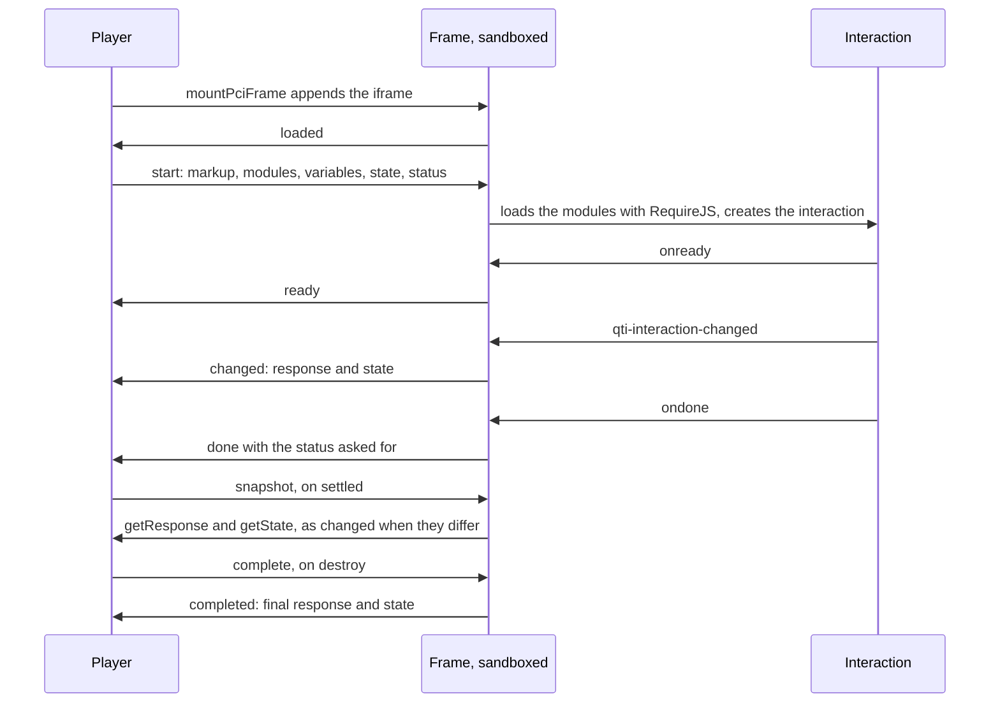

# Portable custom interactions

A portable custom interaction (PCI) is code that an item brings with it: an AMD module that builds its own interface. The code is the package author's, so it runs where it can do no harm. `mountPciFrame` puts each
interaction in a frame of its own, loads its modules with RequireJS, and passes what it does to the player as events.
The interaction, the module resolution and the JSON of its variables are the runtime's (`@assesskit/runtime/pci`); the frame is
the player's.



```ts
import { readAsi } from "@assesskit/runtime/asi";
import { resolveModuleConfigurationPaths, readModuleResolution } from "@assesskit/runtime/pci";
import { buildSingle } from "@assesskit/runtime/values";
import { EN_MESSAGES } from "@assesskit/player";
import { mountPciFrame } from "@assesskit/player/player";

const gate = "https://assets.example/g/dGFwLXRva2Vu.c2ln/";
const item = readAsi(`<qti-assessment-item xmlns="http://www.imsglobal.org/xsd/imsqtiasi_v3p0"
    identifier="pci" title="PCI" time-dependent="false">
  <qti-item-body>
    <qti-portable-custom-interaction response-identifier="RESPONSE" module="tap"
        custom-interaction-type-identifier="urn:fdc:hmhco.com:pci:tapToReveal" data-toggle="true">
      <qti-interaction-markup/>
    </qti-portable-custom-interaction>
  </qti-item-body>
</qti-assessment-item>`);
const [interaction] = item.kind === "item" ? (item.item.body?.children ?? []) : [];
if (interaction?.kind !== "portable-custom-interaction") throw new Error("The item has no interaction.");

// The host reads the file at resolveModuleConfigurationPaths(interaction).primary from the package.
const primary = readModuleResolution('{"waitSeconds": 60, "paths": {"tap": "modules/tap"}}');

const events = [];
const host = document.createElement("div");
document.body.append(host);

const frame = mountPciFrame(host, {
  staticUrl: "https://assets.example/static/",
  messages: EN_MESSAGES,
  language: "en",
  interaction,
  configuration: { primary },
  assets: (path) => `${gate}${path}`,
  prompt: "Tap each picture to reveal it.",
  markup: `<qti-interaction-markup></qti-interaction-markup>`,
  stylesheets: [`${gate}styles/item.css`],
  status: "interacting",
  response: { value: buildSingle("integer", 0), declaration: { cardinality: "single", baseType: "integer" } },
  files: {
    read: async () => new Uint8Array(),
    upload: async (_bytes, mimeType) => ({ reference: "file-1", mimeType }),
  },
  onEvent: (event) => events.push(event.type),
});

frame.element.getAttribute("sandbox"); // => "allow-scripts"
frame.element.title; // => "Tap each picture to reveal it."
await frame.destroy();
frame.element.isConnected; // => false
```

## Serving the frame

The frame is three static files, which `pnpm build` writes to `dist/pci-frame/` and the package exports as
`@assesskit/player/pci-frame/*`:

| File         | Contents                                                                                      |
| ------------ | --------------------------------------------------------------------------------------------- |
| `frame.html` | The document of the frame: it loads the two scripts below                                     |
| `require.js` | RequireJS 2.3.8 (MIT), unchanged                                                              |
| `bridge.js`  | The program of the frame: its policy, its document, the communication bridge and the messages |

The host serves them from the asset origin, outside the asset gate, next to `player.css`, under `staticUrl`: `frame.html`
at `<staticUrl>pci-frame/frame.html` and the stylesheet at `<staticUrl>player.css`. They hold no package data. The scripts
are classic scripts, so the files need no CORS headers, and the frame sets its own content security policy, so they need
no CSP header. A header can only restrict the frame further.

The page that mounts the player needs the origin of `staticUrl` in the `frame-src` of its content security policy. That
also keeps a module from navigating its own frame to another site.

## Options

`mountPciFrame(parent, options)` appends the `iframe` to `parent` and returns a `PciFrame`. It throws `DataError` when
`parent` is not an element, an option is not valid, the interaction names no module to load, a module has no location, or a
module in the package is on an origin that the frame loads no scripts from.

| Option              | Type                              | Meaning                                                                                                                                    |
| ------------------- | --------------------------------- | ------------------------------------------------------------------------------------------------------------------------------------------ |
| `staticUrl`         | `string`                          | Base URL of the static files, ending in `/`                                                                                                |
| `origins`           | `string[]`                        | Origins besides the asset origin that scripts, styles, images, media and fonts may come from, such as `https://cdn.example`. Default: `[]` |
| `messages`          | `{ interactiveQuestion: string }` | The interface text; `Messages` fits                                                                                                        |
| `language`          | `string`                          | The language of the item, a BCP 47 tag, for the document of the frame                                                                      |
| `interaction`       | `PortableCustomInteraction`       | The `qti-portable-custom-interaction` as the runtime reads it                                                                              |
| `configuration`     | `PciModuleConfiguration`          | The module resolution files of the interaction, parsed; a file that the package lacks is left out                                          |
| `assets`            | `(path: string) => string`        | The URL, under the asset prefix of the package, of a path in the package; a relative URL is resolved against the base URL of the page      |
| `prompt`            | `string \| null`                  | The text of the interaction's prompt, which names the frame                                                                                |
| `markup`            | `string`                          | The HTML of `qti-interaction-markup`, with the URLs in it resolved                                                                         |
| `stylesheets`       | `string[]`                        | URLs of the item's stylesheets, loaded after `player.css`                                                                                  |
| `status`            | `PciStatus`                       | `interacting`, `suspended`, `closed`, `solution` or `review`; the interaction is not to accept input in the last three                     |
| `state`             | `string \| null`                  | The state that `getState` gave before, to restore. Default: `null`                                                                         |
| `presentation`      | `Presentation`                    | The look that the candidate's supports ask for, from `resolvePresentation` ([supports](supports.md)). Default: none                        |
| `response`          | `PciVariable`                     | The response variable the interaction is bound to, with its value                                                                          |
| `templateVariables` | `Map<string, PciVariable>`        | The template variables bound to the interaction, by identifier. Default: empty                                                             |
| `contextVariables`  | `Map<string, PciVariable>`        | The context variables bound to it, by identifier. Default: empty                                                                           |
| `files`             | `PciFiles`                        | The host's storage of files, below                                                                                                         |
| `onEvent`           | `(event: PciEvent) => void`       | Receives what the interaction does, in order                                                                                               |

The type identifier, the response identifier, the `class` and the properties come from the interaction: the
identifiers as written, the `class` as the `class` of the element that holds the markup in the frame, so that the item's
stylesheets select its markup as they do in the item, and the properties from `derivePciProperties` of the runtime, the `data-*`
attributes named as `dataset` names them. Maps keep names such as `__proto__` as data. A stylesheet URL is an absolute
`http` or `https` URL, and an origin is only a scheme, a host and a port.

`PciVariable` is `{ value, declaration }`: a `Value` of the runtime or `null` for NULL, and the cardinality and base type of the
variable. The value is checked against the declaration when the frame is mounted.

## Variables and files

The variables travel as the plain JSON of the portable custom interaction binding, which `encodePciValue` and `decodePciValue` of the runtime
write and read: `{ "base":... }`, `{ "list":... }` and `{ "record":... }`, with `null` inside for NULL. A file is
`{ "data", "mime", "name" }` with the bytes in `data` as base64. A file value only refers to its bytes, and the callbacks
of the runtime's codec are synchronous, so the host's storage, which is not, is used in two steps:

- **To the interaction.** Before the frame starts, the player reads the bytes of every file value among the variables
  with `files.read(file)` and writes them inline. If `read` rejects, the interaction does not start: the event `failed`
  with the reason `files`, and the error goes to `reportError`.
- **From the interaction.** The player reads the JSON of a response to find the inline files, stores each with
  `files.upload(bytes, mimeType, fileName?)`, and reads it again so that each file value holds the reference that `upload`
  resolved with. A file that an earlier response held, byte for byte, is not stored again, since an interaction that draws
  gives the same image with every change.

`PciFiles` is `{ read(file: FileValue): Promise<Uint8Array>; upload(bytes: Blob, mimeType: string, fileName?: string):
Promise<FileValue> }`.

A response is untrusted until `decodePciValue` has read it. JSON that is not a value of the declaration of the response
variable, or a file whose data is not canonical base64, is dropped: the player delivers no event for it, and stores nothing. The
events keep the order in which the frame sent them, although storing files takes time.

## Loading

The modules come from `resolvePciModules` of the runtime. The player requires the module of the
`module` attribute or, when there is none, those of `qti-interaction-modules`. It gives RequireJS a location for each
module that the interaction or the configuration files name, the primary location first and the fallback after it:

| Location                                   | The player gives RequireJS                                             |
| ------------------------------------------ | ---------------------------------------------------------------------- |
| A path in the package, such as `modules/x` | `assets(path)`, absolute, under the asset prefix                       |
| A location with a protocol                 | the location as it is, which the policy of the frame allows or refuses |
| Any location ending in `.js`               | the location without `.js`, which RequireJS adds again                 |

`waitSeconds` is that of the primary configuration, 7 when there is none, and 0 waits for ever. A location that answers
with an error, or does not answer within `waitSeconds`, makes RequireJS try the next one of the module. A dependency such
as `define(["./renderer"],...)` has the name `renderer` in the module's directory, which RequireJS resolves against
`baseUrl`. `baseUrl` is the directory of the first package location of the first module to load, under its asset prefix,
or the directory of the primary configuration file when every location has a protocol. So dependencies, and the `url()` of
stylesheets that they add, stay under the prefix that the asset gate signed for the interaction.

The frame loads scripts from its own origin and from `origins` only. A location on another origin fails, and so does the
module that needs it, with the failure `modules`. A path in the package is a location the host chooses, so `mountPciFrame`
refuses one whose URL, a relative one resolved against the base URL of the page, is on any other origin than that of
`staticUrl` and `origins`: serve the files of the package from the asset origin, or list their origin in `origins`.

The frame calls the factory that the modules registered under the interaction's type identifier. When no factory has it
and the modules registered exactly one, that one serves the interaction: the `pci-simple` example of 1EdTech names
`urn-fdc-hmhco.com-pci-tapToReveal` for a module that registers `urn:fdc:hmhco.com:pci:tapToReveal`. With several factories
and none matching, the failure is `register`.

The communication bridge `qtiCustomInteractionContext` is the AMD module of that name and the property of `window`. A module calls its `register`; once the modules have loaded and the stylesheets have loaded or
failed, the frame calls the registered factory with `getInstance(dom, configuration, state)`:

| Argument or property                                  | Value                                                                                             |
| ----------------------------------------------------- | ------------------------------------------------------------------------------------------------- |
| `dom`                                                 | A `qti-portable-custom-interaction` element with the `class` of the interaction, holding `markup` |
| `configuration.properties`                            | An object of the `data-*` attributes                                                              |
| `configuration.templateVariables`, `contextVariables` | Objects of the variables, as JSON                                                                 |
| `configuration.boundTo`                               | The response variable, as JSON                                                                    |
| `configuration.responseIdentifier`, `status`          | The `response-identifier` of the interaction, and the `status` option                             |
| `configuration.onready`, `ondone`                     | Callbacks that become the events `ready` and `done`                                               |
| `state`                                               | `state`, or `undefined`                                                                           |

## Events

| `type`      | Fields                        | When                                                                                                                                                                                 |
| ----------- | ----------------------------- | ------------------------------------------------------------------------------------------------------------------------------------------------------------------------------------ |
| `ready`     | `state`                       | The interaction called `onready`                                                                                                                                                     |
| `changed`   | `response`, `state`, `valid`  | The interaction fired `qti-interaction-changed`, or `settled` found a response or a state that differs from what it told last; the frame reads `getResponse()` and `getState()` then |
| `done`      | `response`, `state`, `status` | The interaction called `ondone`; `status` is the one it asks for (`interacting` when it gives none), which the player may refuse                                                     |
| `completed` | `response`, `state`           | `destroy` collected the final response and state of an interaction that exists                                                                                                       |
| `failed`    | `reason`                      | The interaction did not start                                                                                                                                                        |

`response` is a `Value` of the runtime, or `null` for NULL: the interaction gave no response (`getResponse()` gave `undefined`),
or gave the NULL of App. C. It is read against the declaration of the response variable, and its files are stored.
`valid` is what the interaction says in the event, or `undefined`.

The player turns `changed` and `completed` into the response of the item session: the value goes to the response variable
under the response identifier, and `state` is kept with the session, so that the interaction restores on any device. The
item session is the delivery engine's, which the player's shell wires to the events; `done` is a request that the shell
may honor. A `failed` reason is one of:

| Reason     | Meaning                                                                         |
| ---------- | ------------------------------------------------------------------------------- |
| `csp`      | The browser did not apply the frame's policy, so nothing was loaded             |
| `modules`  | A module did not load from any of its locations in time                         |
| `register` | The modules loaded, but none registered the interaction                         |
| `instance` | The factory threw                                                               |
| `files`    | The host's storage could not give the bytes of a file that the interaction gets |

## The `PciFrame`

| Member                    | Meaning                                                                                       |
| ------------------------- | --------------------------------------------------------------------------------------------- |
| `element`                 | The `iframe`                                                                                  |
| `checkValidity()`         | Resolves with the verdict of the interaction's `checkValidity`, or `undefined` for none       |
| `reportValidity()`        | The same with `reportValidity`                                                                |
| `setCustomValidity(text)` | Sets the custom validity message; `""` clears it                                              |
| `getCustomValidity()`     | Resolves with the message, or `undefined`                                                     |
| `setPresentation(look)`   | Sets the look on the `html` of the frame, in place of the earlier one ([The look](#the-look)) |
| `settled()`               | Has the interaction hand over its response and state, and resolves once they are delivered    |
| `destroy()`               | Sends the event `completed`, lets the interaction call `oncompleted`, and removes the frame   |

A validity method resolves with `undefined` when the interaction is not running, lacks the method, throws, or does not
answer within two seconds. `destroy` waits at most two seconds for a frozen module and returns the same promise when
called again.

An interaction need not fire `qti-interaction-changed`: the examples of 1EdTech do not, and leave the response to
`getResponse()`. `settled` has the frame call `getResponse()` and `getState()` and delivers them as a `changed` event when they
differ from the response the frame was started with, or the last one it told; it resolves once every event of the frame has
been delivered, the files of the response stored. Call it before an action that submits or leaves the item, as the player
does. It waits at most two seconds for a frozen module, and resolves at once when the interaction is not running.

Before it removes the frame, `destroy` has the frame call `getResponse()` and `getState()`, send them, and then call
`oncompleted()`, so a listener flushes the final response before the module cleans up. It resolves
when every event, the `completed` one included, has been delivered. An interaction
that is to see new markup or a new status is mounted again with the saved state.

## The frame and its limits

The `iframe` has `sandbox="allow-scripts"` and no `allow-same-origin`, so its origin is opaque, and
`referrerpolicy="no-referrer"`, so its `document.referrer` is empty. The module has no cookie, `localStorage`,
`sessionStorage` or IndexedDB, cannot read the player's document or location, cannot navigate the top window, open a window
or submit a form.

When the player starts it, the frame restricts itself with this policy, in a `meta` element, before it loads anything:

| Directive                                                            | Sources                                                               |
| -------------------------------------------------------------------- | --------------------------------------------------------------------- |
| `default-src`, `connect-src`, `frame-src`, `form-action`, `base-uri` | `'none'`                                                              |
| `script-src`                                                         | the origin of the frame and `origins`; no inline script, no `eval`    |
| `style-src`                                                          | the same, and `'unsafe-inline'`, because most interactions set styles |
| `img-src`, `media-src`, `font-src`                                   | the same, and `data:`                                                 |

So a module reaches no network by `fetch`, `XMLHttpRequest`, `WebSocket`, `EventSource`, `sendBeacon`, a worker, a
dynamic `import()`, an image, a script, a stylesheet or a frame. A module that builds code with `eval` or `new Function`,
as some template libraries do, fails. The frame then checks that the policy is in force with a script from a `data:` URL,
which the policy refuses. Where that script loads, the browser applies no policy: the frame reports `csp` and loads
nothing.

Everything a module sends is untrusted. The player reads a message only from the frame's window, only with the shape of
the table above, and a response only as a value of its declaration. It sets the height of the frame to the content height the frame
reports, between 48 and 4096 CSS pixels (`MIN_PCI_HEIGHT` and `MAX_PCI_HEIGHT`); taller content scrolls in the frame.

A module is code of the package and its source is visible to the candidate, so it must not hold an answer key.

What the policy and the player leave to the host:

| Risk                                                                                    | What the host does                                                                                                  |
| --------------------------------------------------------------------------------------- | ------------------------------------------------------------------------------------------------------------------- |
| WebRTC and a DNS prefetch reach the network, which no policy stops                      | Binds no personal data to the variables of an interaction whose package it does not trust                           |
| A module posts messages at any rate and size, and each new file of a response is stored | Limits the requests and the stored files of a session, and gives the remote client the `limits` of the session host |
| A frame from another version of the package does not answer `settled`                   | Serves `pci-frame/*` from the version that the page runs; otherwise each leave waits two seconds                    |
| A module navigates its own frame                                                        | Lists the origin of `staticUrl` in the `frame-src` of the page ([Serving the frame](#serving-the-frame))            |

## The look

The frame loads `player.css`, which reads the attributes and custom properties of its `html` element
([styling](styling.md#themes)). The `presentation` option is set there before anything is drawn, and
`frame.setPresentation(presentation)` replaces it while the interaction runs, so that a candidate who turns high contrast
on, or whose zoom changes, sees it in the frame too. A presentation set before the frame starts is the one it starts with.
Only the names of `resolvePresentation` are touched. The interaction is told nothing; it sees the CSS change. `setPresentation`
throws `DataError` for a value that is not a presentation, and does nothing once the frame is gone.

## The name and the focus

The frame is named by `title`: the prompt of the interaction with its white space collapsed, or the message
`interactiveQuestion` when there is no prompt (WCAG 4.1.2). Tab moves the focus into the frame and out of it, forward and
back, as it does for any frame (WCAG 2.1.2); a module that traps the key traps the candidate, which the player cannot
prevent.

## Errors

`mountPciFrame` throws `DataError` for an option of the wrong type, a variable that does not have its declared type, a URL
that is not absolute `http` or `https`, a base URL that does not end in `/`, an origin that is more than a scheme, a host
and a port, an interaction that names no module to load, a module without a location, and a module in the package on an
origin that the frame loads no scripts from. The runtime's `DataError` passes
through unchanged. A message from the frame that fails its check, and a response that is not a value of its declaration,
are dropped, not thrown. An error of the host's storage goes to `reportError`.

## Files

Each file of `src/player/pci/` holds one concept.

| File                | Concept                                                                       |
| ------------------- | ----------------------------------------------------------------------------- |
| `check-options.ts`  | The check of the options of a frame                                           |
| `csp.ts`            | The content security policy of a frame                                        |
| `describe-frame.ts` | The title of a frame and the message that starts it                           |
| `files.ts`          | Variables and files: encoding and decoding                                    |
| `host.ts`           | `mountPciFrame`                                                               |
| `index.ts`          | The public API                                                                |
| `internal.ts`       | Helpers that other folders and tests share, which the package does not export |
| `modules.ts`        | Locating the modules of an interaction                                        |
| `options.ts`        | The events and the options of a frame                                         |
| `protocol.ts`       | The messages between the player and the frame                                 |
| `read-message.ts`   | Reading a message of the frame                                                |

## References

| Specification                                                                                    | Topics                                                                                     |
| ------------------------------------------------------------------------------------------------ | ------------------------------------------------------------------------------------------ |
| [QTI 3.0 Best Practices and Implementation Guide](https://www.imsglobal.org/spec/qti/v3p0/impl/) | module resolution, portable custom interactions, validity of a portable custom interaction |
| [Content Security Policy Level 3](https://www.w3.org/TR/CSP3/)                                   |                                                                                            |
