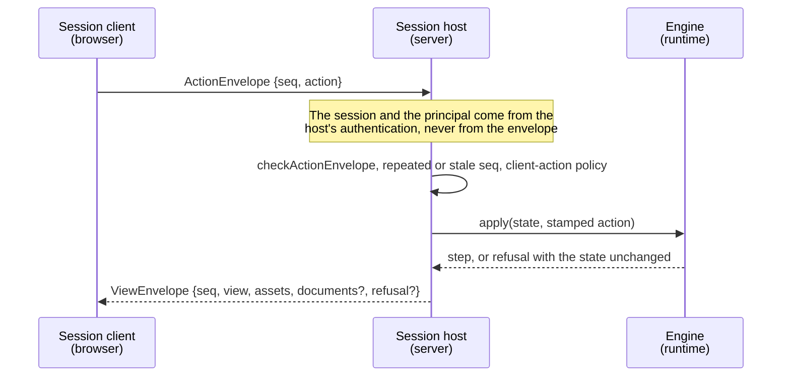

# Protocol

`@assesskit/player/protocol` holds what a browser and a session host send each other: JSON envelopes around the runtime's JSON
forms of actions and views, the caller that the host's authentication gives to a request, the session client that the player
mounts against, the official results report, and the submission that a rater reads. It uses no DOM, Node.js, timer or network API.



The runtime writes and reads the JSON inside an envelope: `actionToJson` and `parseCandidateAction` for actions, `viewToJson`
and `viewFromJson` for views. The checks of this module look at the envelope only. The one form that the player defines is the
submission, because the server writes it and the browser shows it.

| Export                                             | Purpose                                                                                                |
| -------------------------------------------------- | ------------------------------------------------------------------------------------------------------ |
| `Caller`, `checkCaller`                            | The identity that authentication gives to a request.                                                   |
| `ActionEnvelope`, `checkActionEnvelope`            | What a client sends: a sequence number and one action.                                                 |
| `ViewEnvelope`, `checkViewEnvelope`                | What a host answers: the view, the asset prefixes and, when they apply, the documents and the refusal. |
| `REFUSAL_CODES`, `checkRefusal`                    | The refusal codes of the engine, and a check of a refusal that arrived as JSON.                        |
| `ViewDocuments`, `DocumentSource`, `viewDocuments` | Where the content of a view comes from, so that references in it resolve.                              |
| `LtiFrame`, `checkLtiFrame`, `checkAllowList`      | What the player needs to show a tool, and the checks of it.                                            |
| `LTI_TOOL_FRAME`, `LTI_STORAGE_FRAME`              | The names of the two frames of an LTI item.                                                            |
| `SessionClient`, `DispatchResult`                  | The one interface the player mounts against.                                                           |
| `OfficialResult`, `isOfficialResult`               | A results report that the session host marked official.                                                |
| `Submission` and its parts, `checkSubmission`      | What a rater needs to rate an externally scored outcome.                                               |

```ts
import { checkActionEnvelope, checkCaller, isOfficialResult } from "@assesskit/player/protocol";

const envelope = JSON.parse('{"seq":3,"action":{"type":"move"}}');
checkActionEnvelope(envelope);
envelope.seq; // => 3
checkCaller({ session: "s1", principal: "candidate-7", role: "candidate" });
isOfficialResult({}); // => false
```

## Caller

`Caller` is the identity that the host's authentication gives to a request. It never comes from the client.

| Property    | Type     | Meaning                                                                                     |
| ----------- | -------- | ------------------------------------------------------------------------------------------- |
| `session`   | `string` | The identifier of the session the request is about                                          |
| `principal` | `string` | The identifier of the authenticated principal; a session belongs to the one that started it |

`checkCaller` ignores other properties, because a host may pass a richer object.

## Envelopes

An envelope has no session identifier. The host takes the session from the authenticated request, so a candidate cannot name
another candidate's session. `seq` makes a request idempotent: a repeated number returns the answer already given, and a stale
one is refused.

| Envelope         | Property    | Type                 | Meaning                                                                             |
| ---------------- | ----------- | -------------------- | ----------------------------------------------------------------------------------- |
| `ActionEnvelope` | `seq`       | non-negative integer | The sequence number of the request                                                  |
| `ActionEnvelope` | `action`    | any JSON             | The runtime's JSON of a candidate action; `parseCandidateAction` reads it           |
| `ViewEnvelope`   | `seq`       | non-negative integer | The number of the request it answers                                                |
| `ViewEnvelope`   | `view`      | any JSON             | The runtime's JSON of a candidate view; `viewFromJson` reads it                     |
| `ViewEnvelope`   | `assets`    | object of strings    | Each asset prefix mapped to its base URL                                            |
| `ViewEnvelope`   | `documents` | `ViewDocuments`      | Where the content comes from. Default: none, so that references resolve at the root |
| `ViewEnvelope`   | `refusal`   | refusal              | Why the action was not applied. Default: none, the action was applied               |

## Refusal

When the engine refuses a well-formed action, the host answers with the view of the state as it was, and the refusal in the
envelope. A refusal has the properties `code` and `message` of the runtime's `Refusal`. `REFUSAL_CODES` lists the codes, and
the player has a message for each ([delivery](delivery.md#refusals-and-status-messages)).

## Documents

A reference in content is written against the document that holds it, and the view does not say which document that is. The
host does, with `documents`.

| Property   | Meaning                                                                                                                                                        |
| ---------- | -------------------------------------------------------------------------------------------------------------------------------------------------------------- |
| `test`     | The path of the test document. `""` is the root of the package.                                                                                                |
| `item`     | The path of the document of the item presented; `""` for a variant, whose path the runtime does not know, and for a link to a tool, which has no QTI document. |
| `stimuli`  | The paths of the documents of its stimuli, in the order of the view.                                                                                           |
| `lexicons` | The paths of the pronunciation lexicons (PLS) that the item depends on, which reading aloud uses ([speech](speech.md#lexicons)).                               |

A path is a path in the package. Without `documents`, every reference resolves against the root. `viewDocuments(view, source)`
builds them from the `DocumentSource` that a host or a local session has of its test.

## The frame of an LTI item

`LtiFrame` is what the host's route answers the player's `ltiLogin` hook with; `ltiPlatformFrame` builds it.

| Property     | Meaning                                                                                                     |
| ------------ | ----------------------------------------------------------------------------------------------------------- |
| `url`        | The tool's third-party initiated login, an absolute `http` or `https` URL                                   |
| `storageUrl` | The platform's storage page, an absolute `http` or `https` URL                                              |
| `allow`      | The `allow` list of the tool's frame. Default: none, so that the tool may use no feature needing permission |

An allow list holds letters, digits, spaces and the characters `; * : / . ' -` (`checkAllowList`). A `javascript:` or `data:`
URL is never a frame URL. `LTI_TOOL_FRAME` (`lti-tool`) and `LTI_STORAGE_FRAME` (`lti-storage`) are the names of the two frames,
by which the storage page and the tool look each other up.

## The session client

`SessionClient` is the one interface the player mounts against, whether the engine runs on a server or on the device
([client](client.md)).

| Member                | Meaning                                                                                                                           |
| --------------------- | --------------------------------------------------------------------------------------------------------------------------------- |
| `view`                | The latest view.                                                                                                                  |
| `documents`           | The documents the content of the latest view comes from.                                                                          |
| `age()`               | The milliseconds since the view was built or received, on the client's clock.                                                     |
| `assets(path)`        | The URL of a path of the package: the base URL of the longest asset prefix of the latest view that holds the path, plus the path. |
| `dispatch(action)`    | Sends an action and resolves with `{ view, refusal? }`: the view after it, or the view as it was with the refusal of the engine.  |
| `subscribe(listener)` | Calls the listener with every new view, and returns the function that removes it.                                                 |
| `close()`             | Stops the timers and the listeners of the client.                                                                                 |

## Official results

`SessionHost.results` returns a report of type `OfficialResult`. The host records the object it returns in a private `WeakSet`,
and `isOfficialResult` tells whether a value is one: a copy of the report, a report parsed from JSON and the report of a practice
session are not. The marking function is not exported; only `server` and `lti` may reach it, through the `internal.ts` of the
module (lint). A service that reports a score takes only an `OfficialResult` and refuses any other object.

## Submission

A `Submission` is what a rater or a scorer service needs to rate one externally scored outcome. `toSubmission` of
[scoring](scoring.md) writes it from the runtime's scorer view, and `mountSubmission` of `@assesskit/player/player` shows it. It
holds the correct responses of the items, so it goes only to raters.

## Errors

Every check throws `DataError` with a sentence that names the path of the first problem.

| A check refuses                            | When                                                                                                                                                                                                                 |
| ------------------------------------------ | -------------------------------------------------------------------------------------------------------------------------------------------------------------------------------------------------------------------- |
| `checkCaller`                              | `value` is not an object with a non-empty `session` and `principal`                                                                                                                                                  |
| `checkActionEnvelope`, `checkViewEnvelope` | `value` is not an object, has a property outside the table, or has a `seq` that is not a non-negative safe integer                                                                                                   |
| `checkActionEnvelope`                      | `action` is missing                                                                                                                                                                                                  |
| `checkViewEnvelope`                        | `view` is missing, `assets` is not an object of strings, `documents` or `refusal` is malformed                                                                                                                       |
| `checkRefusal`                             | `value` is not an object with a `code` of `REFUSAL_CODES` and a string `message`                                                                                                                                     |
| `checkLtiFrame`                            | `value` is not an object of `url`, `storageUrl` and `allow` only, or a URL is not absolute `http` or `https`                                                                                                         |
| `checkAllowList`                           | the value is empty or has a character outside an allow list                                                                                                                                                          |
| `checkSubmission`                          | a property outside the form, a field of another type, a time outside the years 1 to 9999, content that is not a list of nodes with a string `kind`, a part that names an item the submission lacks, or an item twice |
