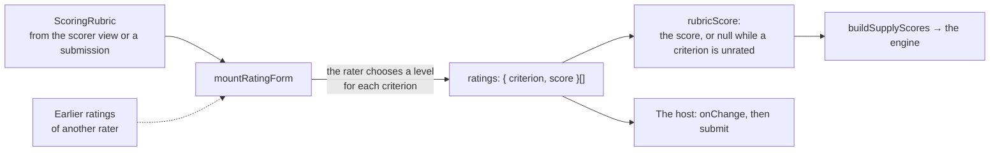

# Rating form

`mountRatingForm` shows a rater a scoring rubric as an accessible form: one choice of level for each criterion, and the score
of the choices. The rubric is the [scoring rubric](../runtime/conventions.md#scoring-rubrics) of the runtime; the score is the
runtime's `rubricScore`, so the form and a machine rater compute the same number.



The form is the player's part of rating, and the workflow is the host's: assignment, double rating, adjudication and queues
stay outside it. A host that shows a submission to a rater puts the form beside `mountSubmission` ([scoring](scoring.md)); a
host with a machine rater uses the same rubric and `rubricScore` without a page.

```ts
import { mountRatingForm } from "@assesskit/player/player";
import css from "@assesskit/player/player.css?inline"; // any bundler that imports a file as text

const stylesheet = new CSSStyleSheet();
stylesheet.replaceSync(css);

const rubric = {
  outcomeIdentifier: "SCORE",
  kind: "analytic",
  language: "en",
  criteria: [
    {
      identifier: "content",
      weight: 2,
      description: "Content: the response addresses the task.",
      levels: [
        { score: 0, quality: "Absent", description: "No idea relates to the task." },
        { score: 2, quality: "Full", description: "Every idea addresses the task." },
      ],
    },
    {
      identifier: "language",
      weight: 1,
      description: "Language: grammar and vocabulary.",
      levels: [
        { score: 0, quality: "Weak", description: "Errors block meaning." },
        { score: 1, quality: "Adequate", description: "Errors do not block meaning." },
      ],
    },
  ],
};

const host = document.createElement("div");
document.body.append(host);
const form = mountRatingForm(host, rubric, { stylesheet, ratings: [{ criterion: "content", score: 2 }] });
form.score; // => null
form.reportValidity(); // => false
form.update(rubric, [
  { criterion: "content", score: 2 },
  { criterion: "language", score: 1 },
]);
form.score; // => 5
form.ratings; // => [{ criterion: "content", score: 2 }, { criterion: "language", score: 1 }]
host.shadowRoot.querySelector("output").textContent; // => "Score 5 out of 5"
form.destroy();
```

## What the form shows

`mountRatingForm(host, rubric, options)` attaches an open shadow root to `host`, which must have none, and returns the handle
below. In the shadow root:

| Part               | Markup                                                                                                                                                                                   |
| ------------------ | ---------------------------------------------------------------------------------------------------------------------------------------------------------------------------------------- |
| The form           | `form.ak-rating`, named by the message `ratingForm`, with `lang` set to the language of the interface                                                                                    |
| A criterion        | `fieldset.ak-rating-criterion` with `role="radiogroup"`; its `legend` holds the description of the criterion (its identifier when it has none) and, when the weight is not 1, the weight |
| A level            | A native radio button in a `label` that holds the quality, the points and the description of the level                                                                                   |
| A checklist level  | The message `ratingNotMet` for the level that scores 0 and `ratingMet` for the other, then the points and the description                                                                |
| The score          | `output.ak-rating-score` with `role="status"`: "Score 7 out of 12", or "Score not rated" while a criterion is unrated                                                                    |
| A missing rating   | After `reportValidity()`: `p.ak-rating-error` inside the group, which the group names in `aria-describedby`, and `aria-invalid="true"` on the group                                      |
| The read-only form | `section.ak-rating` with a `dl` of each criterion and the level chosen, or "not rated", then the score; it has no control                                                                |

A level is chosen by a radio button of its own, which the rater reaches with the pointer or the keyboard. The score is the
sum of weight times the score of the chosen level, over the criteria ([conventions](../runtime/conventions.md#kinds-and-the-score)),
and its highest value is `rubricScoreRange(rubric).maximum`.

A checklist offers met and not met for each criterion as two radio buttons, and starts with neither chosen. A single button for
each criterion would make an untouched form a form of zeros: with two, "not rated" differs from "not met", the score stays `null`,
and `reportValidity()` is `false` until the rater has decided every criterion.

| Option       | Type                                | Meaning                                                                                                                |
| ------------ | ----------------------------------- | ---------------------------------------------------------------------------------------------------------------------- |
| `stylesheet` | `CSSStyleSheet`                     | The player's stylesheet, built from `player.css` ([styling](styling.md)). Required                                     |
| `language`   | `string`                            | The language of the interface, a BCP 47 tag. Default: `"en"`                                                           |
| `messages`   | `Record<string, Partial<Messages>>` | The catalogs of the languages the host shows, by language tag ([messages](messages.md)). Default: none, English        |
| `ratings`    | `readonly RubricRating[]`           | The ratings to show at first, such as those of an earlier rater. Default: `[]`                                         |
| `readOnly`   | `boolean`                           | Whether the form only shows the ratings as text, for a second rater or an adjudicator. Default: `false`                |
| `onChange`   | `(ratings, score) => void`          | Called with the ratings and their score after each change by the rater, never for `ratings` or `update`. Default: none |

`stylesheet`, `language` and `messages` are the options of the same names of `mountDelivery` ([delivery](delivery.md)) and
`mountSubmission`, so a host passes the same values to all of them.

| Member                     | Meaning                                                                                                                                                                        |
| -------------------------- | ------------------------------------------------------------------------------------------------------------------------------------------------------------------------------ |
| `ratings`                  | The ratings the form holds, in the order of the criteria; a criterion without a rating is left out. A new array on each read                                                   |
| `score`                    | Their score, or `null` while a criterion has no rating                                                                                                                         |
| `update(rubric, ratings?)` | Shows another rubric in the same place, with its ratings (default `[]`), for a rater who moves through a queue. The old ratings go. When it throws, the form is as it was      |
| `reportValidity()`         | Marks each criterion without a rating, moves the focus to the first one, and returns whether every criterion is rated. In a read-only form it marks nothing and moves no focus |
| `destroy()`                | Removes the form and its listeners; the shadow root stays, empty, as it does for `mountSubmission`, so a queue uses `update`                                                   |

## Accessibility

The form meets WCAG 2.2 level AA ([evidence](evidence.md#the-rating-form) lists the tests).

| Concern              | Design                                                                                                                                                                                           |
| -------------------- | ------------------------------------------------------------------------------------------------------------------------------------------------------------------------------------------------ |
| Structure            | A `fieldset` for each criterion with the description as its `legend`, and a native radio button for each level, each with a `label`                                                              |
| Keyboard and pointer | Native controls only: Tab moves between groups, the arrow keys within a group, and the whole label takes a press. The form adds no key handling                                                  |
| Target size          | Each radio button and each label is at least 24 by 24 CSS pixels (2.5.8)                                                                                                                         |
| The score            | An `output` with `role="status"` announces the new score, or that a criterion is not rated, after each change                                                                                    |
| Errors               | `reportValidity()` writes the message under each unrated group, names it in `aria-describedby`, sets `aria-invalid` and does not rely on color: the border is thicker too (1.4.1, 3.3.1)         |
| Read-only            | Text, not disabled controls, in the reading order; a rater using a screen reader reads the chosen level for each criterion                                                                       |
| Language             | The form takes `lang` from `language`. Each text of the rubric takes `lang` from `rubric.language` and `dir="auto"`, because a rubric in English may be rated in an Indonesian interface (3.1.2) |
| Text                 | Texts are set as text, never as markup, and numbers are written for the language of the interface                                                                                                |
| Styles               | The player's stylesheet and a sheet of its own: visible focus, reflow at 320 CSS pixels, sizes in `rem` that follow the text size and the text spacing a person sets                             |

## Messages

| Key                 | Used for                                                 |
| ------------------- | -------------------------------------------------------- |
| `ratingForm`        | The name of the form                                     |
| `ratingScore`       | "Score", the start of the text of the score              |
| `ratingOutOf`       | "out of", between the score and the highest score        |
| `ratingPoints`      | "Points", before the points of a level                   |
| `ratingWeight`      | "Weight", before the weight of a criterion that is not 1 |
| `ratingNotRated`    | What stands for a criterion or a score without a rating  |
| `ratingChooseLevel` | The message under an unrated criterion                   |
| `ratingMet`         | The level of a checklist criterion that is met           |
| `ratingNotMet`      | The level of a checklist criterion that is not met       |

[Messages](messages.md) lists the English and Indonesian text of each.

## Errors

| Thrown by                   | `DataError` when                                                                                              | What to do                                                              |
| --------------------------- | ------------------------------------------------------------------------------------------------------------- | ----------------------------------------------------------------------- |
| `mountRatingForm`           | `host` is not an element, or has a shadow root                                                                | Pass an element in the page that has none                               |
| `mountRatingForm`           | The rubric fails `checkScoringRubric` (the message names the path of the rule)                                | Pass the rubric of the scorer view or of a submission                   |
| `mountRatingForm`           | An option is not of its type, or an unknown option is given                                                   | Pass the options above                                                  |
| `mountRatingForm`, `update` | A rating names an unknown criterion or a criterion twice, or gives a score that no level of its criterion has | Pass the ratings that the form gave, or those of a rater of this rubric |

A host stays without a shadow root when the form is refused. A form that `update` refuses stays as it was.

## Not included

| Not included                            | Reason                                                                             |
| --------------------------------------- | ---------------------------------------------------------------------------------- |
| Comments of the rater                   | Part of the host's rating workflow, not of the score                               |
| Submitting the ratings                  | The host decides what to send and where: `onChange` and `ratings` give it the data |
| Assignment, double rating, adjudication | The host's workflow, which differs by program                                      |
| Showing the response being rated        | `mountSubmission` shows the submission; the form shows only what it rates          |
