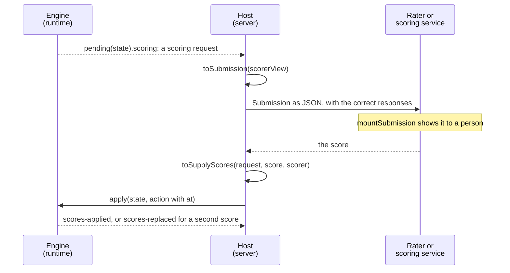

# Scoring

An outcome with `external-scored` is one that a person or a machine sets, not processing. The runtime's engine asks the host
for each one with a scoring request and waits (see Scoring requests in the runtime's delivery guide).
`@assesskit/player/scoring` hands a request to a scorer and the score back to the engine; the player shows the request to a
rater.



| Step                                  | Where                                | Function                                 |
| ------------------------------------- | ------------------------------------ | ---------------------------------------- |
| Turn a request into a JSON submission | server, `@assesskit/player/scoring`  | `toSubmission`                           |
| Check a submission that arrived       | shared, `@assesskit/player/protocol` | `checkSubmission`                        |
| Show a submission to a rater          | browser, `@assesskit/player/player`  | `mountSubmission`                        |
| Turn the rater's score into an action | server, `@assesskit/player/scoring`  | `toSupplyScores`                         |
| Give the action to the engine         | server, the runtime                  | `engine.apply(state, { ...action, at })` |

The rating form and the rating workflow, such as assignment and double scoring, are the host's. A submission holds the correct
responses of the items, so the host gives it only to authorized raters.

```ts
import { readAsi } from "@assesskit/runtime/asi";
import { createEngine } from "@assesskit/runtime/delivery";
import { single } from "@assesskit/runtime/values";
import { toSubmission, toSupplyScores } from "@assesskit/player/scoring";

const document = readAsi(`<qti-assessment-item xmlns="http://www.imsglobal.org/xsd/imsqtiasi_v3p0" identifier="essay"
    title="Essay" time-dependent="false">
  <qti-response-declaration identifier="RESPONSE" cardinality="single" base-type="string"/>
  <qti-outcome-declaration identifier="SCORE" cardinality="single" base-type="float" external-scored="human"
      normal-minimum="0" normal-maximum="10"/>
  <qti-item-body>
    <p>Write about your town.</p>
    <qti-extended-text-interaction response-identifier="RESPONSE"/>
    <qti-rubric-block view="scorer" use="scoring"><qti-content-body><p>Give 0 to 10 points.</p></qti-content-body></qti-rubric-block>
  </qti-item-body>
</qti-assessment-item>`);
if (document.kind !== "item") throw new Error("Expected an item.");

const engine = createEngine({ kind: "item", item: document.item, base: "essay.xml" });
const started = engine.start({ seed: 1, at: 0 });
if (!started.ok) throw new Error(started.refusal.message);
const item = { ref: "essay", instance: 1 };
const written = engine.apply(started.state, {
  type: "set-responses",
  item,
  responses: new Map([["RESPONSE", single("string", "Dear Sir")]]),
  at: 1_000,
});
if (!written.ok) throw new Error(written.refusal.message);
const submitted = engine.apply(written.state, { type: "submit", item, at: 2_000 });
if (!submitted.ok) throw new Error(submitted.refusal.message);

// The host sends the submission to the rater as JSON.
const [request] = engine.pending(submitted.state).scoring;
if (request === undefined) throw new Error("No request waits.");
const submission = toSubmission(engine.scorerView(submitted.state, request.id));
submission.request; // => "item:essay:1:SCORE"
submission.declaration; // => { cardinality: "single", baseType: "float", normalMinimum: 0, normalMaximum: 10 }
submission.parts[0]?.value; // => { cardinality: "single", baseType: "string", value: { base: { string: "Dear Sir" } } }

// The rater scores it; the host gives the score to the engine.
const action = toSupplyScores(request, 7.5, "human");
action; // => { type: "supply-scores", request: "item:essay:1:SCORE", value: { cardinality: "single", baseType: "float", value: 7.5 }, scorer: "human" }
const scored = engine.apply(submitted.state, { ...action, at: 3_000 });
if (!scored.ok) throw new Error(scored.refusal.message);
scored.events.map(({ type }) => type); // => ["scores-applied", "outcome-processed"]
engine.pending(scored.state).scoring.length; // => 0

// The rater changes the score: the second supply replaces the first.
const again = engine.apply(scored.state, { ...toSupplyScores(request, 8, "human"), at: 4_000 });
if (!again.ok) throw new Error(again.refusal.message);
again.events.map(({ type }) => type); // => ["scores-replaced", "outcome-processed"]
```

## The submission

`toSubmission(view)` takes what `Engine.scorerView(state, request.id)` returns. One submission is one scoring request, so it
rates one outcome. It is JSON text as it is: `JSON.parse(JSON.stringify(submission))` equals it.

| Property                | Type                               | Meaning                                                                                                              |
| ----------------------- | ---------------------------------- | -------------------------------------------------------------------------------------------------------------------- |
| `request`               | `string`                           | The identifier of the request, `item:<ref>:<instance>:<outcome>` or `test:<outcome>`, which `toSupplyScores` answers |
| `outcome`               | `string`                           | The identifier of the outcome                                                                                        |
| `mode`                  | `"human"` or `"externalMachine"`   | Who is to score it                                                                                                   |
| `variableIdentifierRef` | `string`                           | The `variable-identifier-ref` of the declaration; absent when it has none                                            |
| `lti`                   | `true`                             | The item is a link to a tool; absent otherwise                                                                       |
| `declaration`           | The runtime's `ScoringDeclaration` | Cardinality, base type, normal minimum and maximum, mastery value, interpretation and long interpretation            |
| `requestedAt`           | `number`                           | When the request was made, in epoch milliseconds                                                                     |
| `supplied`              | `{ value, at, scorer }`            | The score supplied before; absent while the request is pending                                                       |
| `rubric`                | `BodyNode[]`                       | The rubric of the scorer view: that of the test, and for an item outcome that of its part and sections               |
| `parts`                 | `SubmissionPart[]`                 | The responses the outcome rates, in the order of the covers                                                          |
| `items`                 | `SubmissionItem[]`                 | The item instances the outcome covers, each once, in the order of the covers                                         |

| `SubmissionPart`     | Type                | Meaning                                                                                  |
| -------------------- | ------------------- | ---------------------------------------------------------------------------------------- |
| `item`               | `{ ref, instance }` | The item instance; it names one of `items`                                               |
| `responseIdentifier` | `string`            | The response variable                                                                    |
| `label`              | `string`            | The label of the cover in the test; absent when it has none                              |
| `presented`          | `boolean`           | Whether the candidate was presented the item; if not, `value` is `null`                  |
| `interaction`        | `string`            | The kind of the interaction that binds the response, such as `extended-text-interaction` |
| `value`              | `SubmissionValue`   | The last submitted response, exact                                                       |

| `SubmissionItem`   | Type                   | Meaning                                                                                                           |
| ------------------ | ---------------------- | ----------------------------------------------------------------------------------------------------------------- |
| `key`              | `{ ref, instance }`    | The item instance                                                                                                 |
| `title`            | `string`               | The title of the item                                                                                             |
| `presented`        | `boolean`              | Whether the candidate was presented the item; if not, the body and the lists are empty                            |
| `body`             | `BodyNode[]`           | The body as the candidate saw it after template processing, then the item's rubric blocks that only a scorer sees |
| `templateValues`   | `SubmissionVariable[]` | The template variables of the instance                                                                            |
| `correctResponses` | `SubmissionVariable[]` | The correct response of each response variable of the item                                                        |

- A value is the runtime's `WireValue`: `{ cardinality, baseType, value }` whose `value` is the JSON of the QTI 3.0 Best Practices guide, Appendix C. It decodes
  with `fromWireValue` of `@assesskit/runtime/values` without a declaration. NULL is `null`.
- A file stays a reference, `{ reference, mime, name }`. The host resolves it to a URL with its own files service.
- A variable is `{ identifier, value }` in a list, so that an identifier such as `__proto__` stays data.
- The content is the runtime's typed nodes, as JSON.

`checkSubmission(value)` of `@assesskit/player/protocol` checks a submission that arrived as JSON: every property of its
form and no other, the type of every field, the content as nodes, and that each part names an item the submission has once.
It reads no value; `fromWireValue` does when the value is shown.

## The score

`toSupplyScores(request, score, scorer)` builds the `supply-scores` action for one request and one value.

| Argument  | Type                                           | Meaning                                                                                                                                 |
| --------- | ---------------------------------------------- | --------------------------------------------------------------------------------------------------------------------------------------- |
| `request` | The runtime's `ScoringRequest`                 | A request of `Engine.pending(state).scoring`                                                                                            |
| `score`   | `Value`, `number`, `string`, `boolean`, `null` | A value of the runtime, or a plain value for a single outcome, which becomes a single value of the outcome's base type; `null` for NULL |
| `scorer`  | `"human"` or `"externalMachine"`               | Who scored it                                                                                                                           |

The value is checked against the declaration of the request, as the engine does (`score-type-mismatch`): the cardinality
and the base type must be the outcome's. An integer fits a float or duration outcome and is promoted. NULL fits, and so does
the empty string, which is NULL. A plain value for an outcome that is not single is a `DataError`. The result is the action
without `at`: the host stamps it.


The engine accepts the action while the request exists, also after the test ended or while the session is suspended. It
keeps the request after its value is supplied, so a second action for it replaces the value and reports `scores-replaced`;
that is how a score is corrected or scored again. An action for a request the state lacks is refused with `unknown-request`.
Until a request is supplied the results report is provisional: the item result has the status `pendingExternalScoring`.

## The display

`mountSubmission(host, submission, options)` shows a submission read-only to a rater and returns `{ update, destroy }`. It
attaches an open shadow root to `host`, which must have none. In it:

| Part                           | Markup                                                                                                                                                                                                                                    |
| ------------------------------ | ----------------------------------------------------------------------------------------------------------------------------------------------------------------------------------------------------------------------------------------- |
| The display                    | `article.ak-submission`, labelled by its `h2`, with `lang` set to the language of the interface                                                                                                                                           |
| The facts of the request       | `dl.ak-submission-facts`: the outcome, who scores it, its type, range, mastery value, meaning, variable reference, when it was requested and the earlier score                                                                            |
| The notice of a link to a tool | `p.ak-submission-note`                                                                                                                                                                                                                    |
| The rubric                     | `section` with an `h3`, and a content root in `div.ak-submission-content`                                                                                                                                                                 |
| An item                        | `section` with an `h3` of its title: the notice that the candidate was not shown it, its body in a content root, its scorer rubric in a second content root, `ol.ak-submission-parts`, then the correct responses and the template values |
| A response the outcome rates   | `li.ak-submission-part` with an `h4` of its label (else its response variable) and `dl.ak-submission-facts`                                                                                                                               |

A body is drawn by a content root of the player ([content](content.md)), so it is sanitized as a candidate's is. Rubric blocks
that the candidate saw are drawn for the `candidate` view and those that only the scorer sees for the `scorer` view. Interactions
are placeholders until the host gives renderers in `interactions`; the response of the candidate is shown in its part whatever
the interaction is.

A value shows by its cardinality: a single value as text in its lexical form (a point as `10 20`, a duration in seconds), a container as a list (`ol` for `ordered`), a record as names and
values, NULL as a message. A string keeps its line breaks and takes the direction of its text (`dir="auto"`). A file shows by
its media type: an image as `img`, audio and video with controls, anything else as a link that opens in a tab of its own with
`rel="noopener noreferrer"`. A file is never framed, because the candidate chose its bytes and its type. The URL comes from
`files.url`, which must give an `http` or `https` URL.

| Option         | Type                                | Meaning                                                                                                                                                                                                                 |
| -------------- | ----------------------------------- | ----------------------------------------------------------------------------------------------------------------------------------------------------------------------------------------------------------------------- |
| `assets`       | `(path: string) => string`          | Turns the path of a file in the package into the URL to load it from. Required                                                                                                                                          |
| `stylesheet`   | `CSSStyleSheet`                     | The player's stylesheet, built from `player.css` ([styling](styling.md)). Required                                                                                                                                      |
| `language`     | `string`                            | The language of the interface, a BCP 47 tag. Default: `"en"`                                                                                                                                                            |
| `messages`     | `Record<string, Partial<Messages>>` | Messages that replace the shipped ones, by language tag ([messages](messages.md)). Default: none                                                                                                                        |
| `files`        | `{ url(file: FileValue): string }`  | The URL that plays or opens a file value that a candidate submitted. Default: none, so that a file shows as its name                                                                                                    |
| `origins`      | `readonly string[]`                 | The origins besides the package's that content may reference. Default: none                                                                                                                                             |
| `mathjax`      | `string`                            | The URL of MathJax 4's `mml-chtml.js` ([math](math.md)). Default: none, so that the browser renders MathML                                                                                                              |
| `interactions` | `InteractionRenderers`              | The renderers of interactions by kind. Default: none, so that each interaction is a placeholder                                                                                                                         |
| `itemPath`     | `(item: ItemKey) => string`         | The path in the package of the document of an item instance, such as `items/q1/item.xml`, against which the relative references of its content resolve. The scorer view does not carry it. Default: `""` for every item |

`stylesheet`, `language`, `messages`, `origins`, `mathjax` and `files.url` are the options of the same names of `mountDelivery` ([delivery](delivery.md)),
so a host passes the same values to both.

| Member               | Meaning                                                                                                                           |
| -------------------- | --------------------------------------------------------------------------------------------------------------------------------- |
| `update(submission)` | Shows another submission in place of the one on show, for a rater who moves to the next. When it throws, the display is as it was |
| `destroy()`          | Takes the display and its content roots down; the shadow root stays, empty                                                        |

`mountSubmission` and `update` throw `DataError` when an option or the submission is not valid, and `mountSubmission` when
the host has a shadow root. A host stays without a shadow root when the submission is wrong. A value that is not a wire
value throws the runtime's `DataError`. A MathJax that cannot load leaves the expressions as MathML and is not an error of the
display.

The themes and the PNP presentation of [styling](styling.md) apply when the host sets their attributes and properties on
`host`; the content roots in the display take the colors from it.

Raters have their own tools. The display adds no controls: the rating form belongs beside it, in the host's page.

## Errors

| Call                           | Throws `DataError` when                                                                                                                                                                                                                        |
| ------------------------------ | ---------------------------------------------------------------------------------------------------------------------------------------------------------------------------------------------------------------------------------------------- |
| `toSubmission(view)`           | `view` is not a scorer view, a part of it has the wrong type, or what it holds is not a submission                                                                                                                                             |
| `toSupplyScores(request, ...)` | `request` is not a scoring request, `scorer` is not `human` or `externalMachine`, or the score does not fit the declaration, such as a single string for a single float outcome: `The outcome SCORE is a single float, found a single string.` |
| `checkSubmission(value)`       | `value` is not a submission: see [protocol](protocol.md#errors)                                                                                                                                                                                |
| `mountSubmission`, `update`    | an option or the submission is not valid, or the host has a shadow root                                                                                                                                                                        |

## Not included

| Not included                                 | Why                                                                                      |
| -------------------------------------------- | ---------------------------------------------------------------------------------------- |
| A rating form, assignment and double scoring | They are the workflow of the host, which differs for each                                |
| A machine scorer                             | A scoring service reads the submission and answers with a score through `toSupplyScores` |
