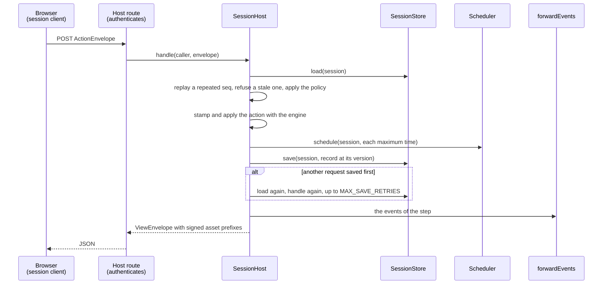
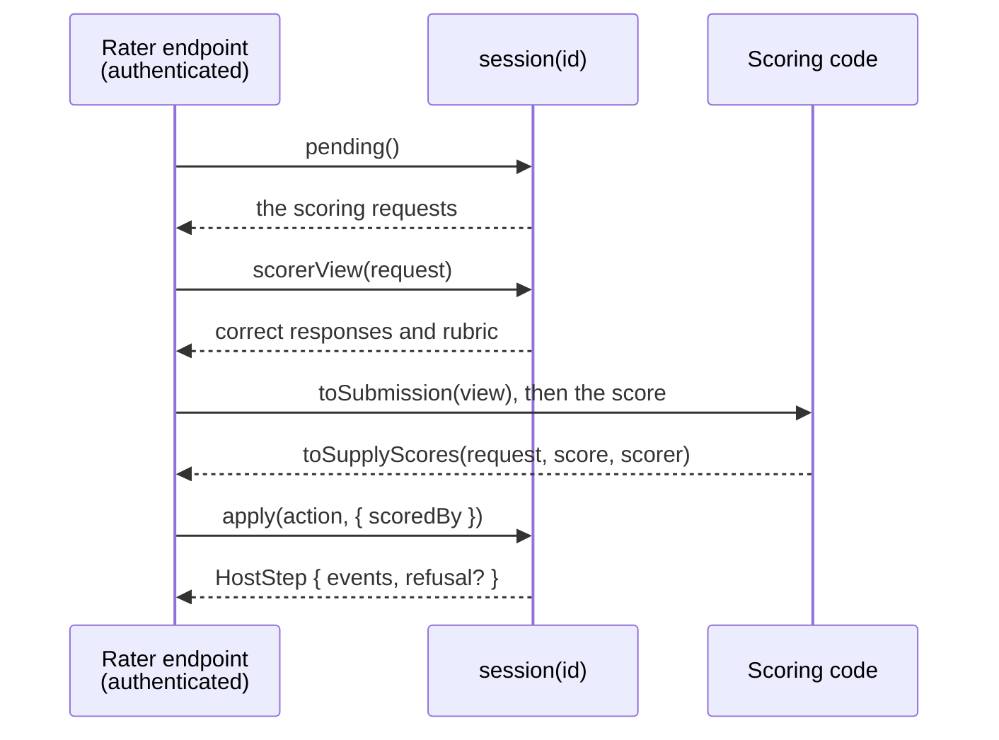

# Server

`@assesskit/player/server` runs a candidate session for a candidate who is not trusted with its keys: the session host of
exam mode, the [asset gate](asset-gate.md), the stores a host provides, and the forwarding of each step's events
([Caliper](caliper.md#forwarding-the-events-of-a-step)). Keys and seeds stay on the server.



| Export                                                                 | Purpose                                                                     |
| ---------------------------------------------------------------------- | --------------------------------------------------------------------------- |
| `createSessionHost`, `SessionHost`, `SessionHostOptions`               | The session host of exam mode                                               |
| `MAX_SAVE_RETRIES`                                                     | How many times a request is handled again after a version conflict          |
| `CANDIDATE_ACTION_TYPES`, `EXAM_CLIENT_ACTIONS`, `CandidateActionType` | The client-action policy                                                    |
| `SessionStore`, `StoredSession`, `SessionSave`                         | The storage of sessions                                                     |
| `Scheduler`, `FileStore`, `AgsScoreStore`                              | The scheduler of time-outs, the storage of files, the storage of LTI scores |
| `createAssetGate`, `collectAssetPrefixes` and the gate's types         | The [asset gate](asset-gate.md)                                             |
| `forwardEvents`, `StepEvents`, `SuppliedGrade`, `ForwardOptions`       | What the host does with the events of each step                             |
| `createLtiScoreIntake`, `LtiScoreIntake`                               | The scores of LTI items                                                     |
| `SYSTEM_CLOCK`                                                         | The clock of the machine                                                    |

```ts
import { createEngine } from "@assesskit/runtime/delivery";
import { openPackage, packageResolvers } from "@assesskit/runtime/package";
import { createAssetGate, createSessionHost, SYSTEM_CLOCK } from "@assesskit/player/server";

const ASI = "http://www.imsglobal.org/xsd/imsqtiasi_v3p0";
const files = new Map(
  Object.entries({
    "imsmanifest.xml": `<manifest xmlns="http://www.imsglobal.org/xsd/qti/qtiv3p0/imscp_v1p1" identifier="package">
      <metadata><schema>QTI Package</schema><schemaversion>3.0.0</schemaversion></metadata>
      <organizations/>
      <resources>
        <resource identifier="exam" type="imsqti_test_xmlv3p0" href="tests/exam.xml"><file href="tests/exam.xml"/></resource>
        <resource identifier="q1" type="imsqti_item_xmlv3p0" href="items/q1.xml"><file href="items/q1.xml"/></resource>
      </resources>
    </manifest>`,
    "tests/exam.xml": `<qti-assessment-test xmlns="${ASI}" identifier="exam" title="Exam">
      <qti-test-part identifier="part" navigation-mode="nonlinear" submission-mode="individual">
        <qti-assessment-section identifier="section" title="Section" visible="true">
          <qti-assessment-item-ref identifier="q1" href="../items/q1.xml"/>
        </qti-assessment-section>
      </qti-test-part>
    </qti-assessment-test>`,
    "items/q1.xml": `<qti-assessment-item xmlns="${ASI}" identifier="q1" title="Question" adaptive="false" time-dependent="false">
      <qti-item-body><p>Hello</p></qti-item-body>
    </qti-assessment-item>`,
  }).map(([path, text]) => [path, new TextEncoder().encode(text)]),
);
const pkg = openPackage({ paths: [...files.keys()].sort(), read: (path) => files.get(path) });
const test = pkg.document("tests/exam.xml");
if (test.kind !== "test") throw new Error("The document is not a test.");
const engine = createEngine({
  kind: "test",
  test: test.test,
  base: "tests/exam.xml",
  resolvers: packageResolvers(pkg),
});

// The stores of a host are its database and its job queue; these keep one session in memory.
const records = new Map();
const store = {
  create: async (session, record) => !records.has(session) && !!records.set(session, { ...record, version: 0, seq: 0 }),
  load: async (session) => records.get(session),
  save: async (session, { action, ...record }) => {
    if (records.get(session)?.version !== record.version) return false;
    records.set(session, { ...record, version: record.version + 1 });
    return true;
  },
};
const jobs = [];
const scheduler = { schedule: async (session, at) => void jobs.push([session, at]) };
const fileStore = { put: async () => ({ reference: "none", mimeType: "text/plain" }), read: async () => undefined };
const key = await crypto.subtle.generateKey({ name: "HMAC", hash: "SHA-256" }, false, ["sign", "verify"]);
const packages = async () => pkg;
const gate = createAssetGate({ key, origin: "https://assets.example", packages, files: fileStore });

const host = createSessionHost({ engine, store, scheduler, clock: SYSTEM_CLOCK, gate, packages });

// In the handler of POST /exam/start, for the caller that the host authenticated:
const caller = { session: "s1", principal: "candidate-7" };
const first = await host.start(caller, { seed: 12345 });
first.seq; // => 0
first.view.current.title; // => "Question"
const again = await host.handle(caller, { seq: 1, action: { type: "move", to: "next" } });
again.seq; // => 1
records.get("s1").version; // => 1
```

## Session host

`createSessionHost(options)` throws `DataError` when an option is not of its type.

| Option          | Type                                         | Meaning                                                                                                          |
| --------------- | -------------------------------------------- | ---------------------------------------------------------------------------------------------------------------- |
| `engine`        | `Engine`                                     | The delivery engine of the test. One engine serves every session.                                                |
| `store`         | `SessionStore`                               | The storage of sessions.                                                                                         |
| `scheduler`     | `Scheduler`                                  | The scheduler of time-outs, such as a job queue.                                                                 |
| `clock`         | `Clock`                                      | The time of the server. `SYSTEM_CLOCK` is the machine's.                                                         |
| `gate`          | `AssetGate`                                  | Signs the prefixes of each envelope.                                                                             |
| `packages`      | `(session, options?) => Promise<QtiPackage>` | The package that a session delivers; the gate takes the same function. It may ignore the options.                |
| `clientActions` | `CandidateActionType[]`                      | The types of action a client may send. Default: every type but `suspend` and `resume` (`EXAM_CLIENT_ACTIONS`).   |
| `limits`        | `Partial<ActionLimits>`                      | The limits on the size of an action, as the runtime's `parseCandidateAction` takes them. Default: the runtime's. |
| `forward`       | `ForwardOptions`                             | Where the events of each step go: the host's log and Caliper. Default: nowhere.                                  |

| Method                               | What it does                                                                                                                                                                                                                                                                                  |
| ------------------------------------ | --------------------------------------------------------------------------------------------------------------------------------------------------------------------------------------------------------------------------------------------------------------------------------------------- |
| `start(caller, options)`             | Starts the session at the time of the clock, binds it to `caller.principal`, stores the record, schedules the deadlines, forwards the events and answers with the first envelope, `seq` 0. `options` are those of `Engine.start` but the time, and `signal`, which does not reach the engine. |
| `check(caller, options?)`            | Throws `AccessError` (`not-bound`) unless the session is bound to the caller's principal. A session that does not exist is the same error, so that the answer does not tell which sessions exist.                                                                                             |
| `view(caller, options?)`             | The current view as an envelope, with fresh tokens and the `seq` of the latest request answered. A page that reloads, or that the proctor acted on, mounts from it.                                                                                                                           |
| `handle(caller, envelope, options?)` | Answers a request of the client, as below.                                                                                                                                                                                                                                                    |
| `proctor(session, action, options?)` | Applies `suspend`, `resume`, `end-part` or `end-test` on the host's authority and answers with a `HostStep`.                                                                                                                                                                                  |
| `session(session)`                   | The host side of the session, a `HostSession` ([protocol](protocol.md#the-host-session)): `apply`, `pending`, `scorerView` and `results`, as below.                                                                                                                                           |

`options` of a call is `{ signal? }`: an `AbortSignal` that stops the call before its next load, as [signals](#signals) says.

### The host side

`session(session)` returns the `HostSession` of one session. Each of its methods loads the session when it is called, and
rejects with `DataError` when the session does not exist. It gives the correct responses and the powers of the host for a bare
session identifier, so call it only from the host's rater and service endpoints, such as the job of the scheduler and the
rater's route, and never with an identifier that a candidate supplies.



| Method                          | What it does                                                                                                                                                                                                                                                                                                                                                                                                                                                                                                                                                                                                                                                                                                                                                                     |
| ------------------------------- | -------------------------------------------------------------------------------------------------------------------------------------------------------------------------------------------------------------------------------------------------------------------------------------------------------------------------------------------------------------------------------------------------------------------------------------------------------------------------------------------------------------------------------------------------------------------------------------------------------------------------------------------------------------------------------------------------------------------------------------------------------------------------------- |
| `apply(action, options?)`       | Applies `time`, `supply-scores` or `cat-response`. A refusal of the engine, such as `unknown-request`, is `HostStep.refusal` and changes nothing. A `time` that finds nothing to apply is accepted with no events; it is saved, and nothing is forwarded. When Caliper is configured, a `supply-scores` action also forwards a GradeEvent for the score it applied or replaced, scored by `options.scoredBy`: the IRI of the rater or of the scoring service, which the host takes from its authentication of the rater endpoint. A `supply-scores` without an absolute IRI as `scoredBy` is a `DataError` and changes nothing. If forwarding throws, the step stays saved and the call rejects, so a retried `supply-scores` reports `scores-replaced` and a second GradeEvent. |
| `pending(options?)`             | What the engine waits on the host for.                                                                                                                                                                                                                                                                                                                                                                                                                                                                                                                                                                                                                                                                                                                                           |
| `scorerView(request, options?)` | What a rater needs, correct responses included. Call it only from a rater's endpoint.                                                                                                                                                                                                                                                                                                                                                                                                                                                                                                                                                                                                                                                                                            |
| `results(options?)`             | The results report, marked official: the one object that `publishScore` accepts. A copy of it is not official.                                                                                                                                                                                                                                                                                                                                                                                                                                                                                                                                                                                                                                                                   |

The step feed of a session host is `forward.log`, which every process calls after the save of each step with events; a
local session has `subscribeSteps` instead ([protocol](protocol.md#the-host-session)).

### Caller binding

An envelope has no session identifier. The host's authentication gives `caller = { session, principal }`, and the record's
principal must match, else `AccessError` (`not-bound`), which the host maps to 403. `start` creates the record with
`SessionStore.create`, which fails when the session exists, and then throws `AccessError` (`session-exists`): a session is
never started twice or bound to another principal.

### Handling a request

1. The caller is checked against the record. A repeated `seq` returns the stored envelope with fresh tokens and changes
   nothing; a stale one is a `DataError`.
2. The action is read with the runtime's `parseCandidateAction` and its size limits. The actions of the host are refused there.
3. The client-action policy applies: an action outside `clientActions` is a `DataError`.
4. The action is stamped with `stamp(state, action, clock.now())`, which never goes back, so a clock that steps back refuses
   nothing, and applied.
5. The deadlines of the new state are scheduled, then the state is saved by version, then the events are forwarded.
6. The answer is the view, with the actions the policy allows, the signed asset prefixes and the documents of the
   content, among them the pronunciation lexicons of the item. A refusal of the engine is in the envelope and the state stays as it was; the `seq` is still stored, so a repeat
   of the refused request gets the same refusal.

When another request saved first, the host loads the record again and handles the request again, up to `MAX_SAVE_RETRIES`
(3) times, and then throws `ServiceError` with status 409. Repeats are safe because `seq` makes the request idempotent.

If the scheduler fails, nothing is saved and the request can be sent again, so no time-out is lost. If forwarding fails, the
step stays saved and the error reaches the caller; `forwardEvents` gives the same identifiers for the same step, so a host
that needs every event reports the step again. A step is numbered by the version of the record it saved, `"start"` for the
first.

### Client-action policy

The exam default lists every action of the candidate but `suspend` and `resume`, because the runtime counts suspended time nowhere
a candidate who could suspend would stop the clock. The host filters `view.actions` through the policy, so the chrome
never offers such an action. Practice allows every action, and so does a host that passes `CANDIDATE_ACTION_TYPES`.

### The proctor

A break, a pause and the end of a part are the proctor's, through `proctor(session, action)`. It applies the
action as the host and saves it; a refusal of the engine, such as `suspend` on an ended test, is `HostStep.refusal` and
saves nothing. The candidate learns of it with the next request: the engine refuses the action as `suspended`, the
envelope carries the suspended view, and `view(caller)` gives it after a reload.

### Time

The scheduler is the host's, such as a job queue, so a restart loses no time-out. After each step the host calls
`schedule(session, at)` for every maximum time of the new state, rounded up to a millisecond; the call is idempotent for a
pair. The job calls `session(id).apply({ type: "time" })` when `at` arrives. The runtime applies a passed deadline on the next
action and its view shows a time-out as applied, so a late job delays only a proactive time-out, never correctness. A `time` that
finds nothing to apply is accepted with no events: it is saved, and nothing is forwarded. Proctor time extensions are out of scope: the runtime has no action
for them.

## Stores

| Interface       | Methods                                                                                                                                                                                                                                                                                                      |
| --------------- | ------------------------------------------------------------------------------------------------------------------------------------------------------------------------------------------------------------------------------------------------------------------------------------------------------------ |
| `SessionStore`  | `create(session, { state, principal, envelope }, options?)` returns `false` when the session exists. `load(session, options?)` gives `{ state, principal, version, seq, envelope }`. `save(session, record, options?)` stores `version + 1` if the stored version is `record.version`, else returns `false`. |
| `Scheduler`     | `schedule(session, at, options?)`: idempotent per pair.                                                                                                                                                                                                                                                      |
| `FileStore`     | `put(bytes, mimeType, fileName?)` returns the `FileValue` that refers to the bytes; `read(file)` returns them or `undefined`.                                                                                                                                                                                |
| `AgsScoreStore` | `keep(session, item, score)` keeps the score if it is later than the kept one and returns `false` otherwise. `latest(session, item)` returns the kept score or `undefined`.                                                                                                                                  |

`create` and `save` of `SessionStore`, and `keep` of `AgsScoreStore`, must be atomic across the host's processes. `state` is the runtime's `serializeState`, `envelope` the JSON of the
latest `ViewEnvelope`, and `action` of a save the JSON `{ at, action }` of the step that made it: the log of the session.

### Signals

Every call of the session host takes `{ signal }`, and the signal reaches the stores, the scheduler and `packages`, which may
ignore it. `FileStore`, `AgsScoreStore`, the gate and forwarding take none.

| Point                                      | Effect of an aborted signal                                                                         |
| ------------------------------------------ | --------------------------------------------------------------------------------------------------- |
| Before each load, and between save retries | The call rejects with `signal.reason`; nothing was applied                                          |
| In `load`, `schedule`, `packages`          | The service may reject, and then the call rejects; nothing was applied                              |
| In `save`, `create`                        | Passed to the store, which rejects only when nothing was saved: a store that cannot tell ignores it |
| After the save                             | Ignored by the call: forwarding completes                                                           |

`start` takes the signal beside the options of `Engine.start`, and does not pass it on.

## The scores of LTI items

An item that is a link to a tool is delivered by the tool, which posts its score to the line item that the
[platform role](lti-platform.md) offers. `createLtiScoreIntake({ host, scores, scoredBy? })` turns those scores into the scores
of the session. Its `onScore` is the `onScore` of `agsScores`, and its `settle` takes the steps of the host's forwarding.

| Option     | Meaning                                                                                                                                        |
| ---------- | ---------------------------------------------------------------------------------------------------------------------------------------------- |
| `host`     | The session host, of which the intake uses `session(id).apply`.                                                                                |
| `scores`   | The `AgsScoreStore` that keeps the latest score of each line item.                                                                             |
| `scoredBy` | `(session, item) => iri`: the IRI of the tool, for the GradeEvent of Caliper. Needed when the session host forwards to Caliper. Default: none. |

- The line item keeps the score with the latest `timestamp`. A score that is not later is ignored, as the score service of the
  grade services requires ([LTI AGS 2.0](https://www.imsglobal.org/spec/lti-ags/v2p0#timestamp)).
- A score that is `FullyGraded` is supplied with `supply-scores`, scored by an external machine: its `scoreGiven` answers the
  `SCORE` request of the item and its `scoreMaximum` the `MAXSCORE` request. A later final score replaces the values. A value that
  the score lacks is NULL. `Pending`, `PendingManual` and the other progress is kept and not supplied.
- The runtime makes the requests of an item when its session is over, not when the tool is done. A final score that arrives earlier is
  kept, and `settle` supplies it when a step makes the requests. Call it from the `log` of the host's forwarding:

```ts
import { createLtiScoreIntake } from "@assesskit/player/server";

const supplied = [];
const kept = new Map();
const intake = createLtiScoreIntake({
  host: {
    session: (session) => ({
      apply: async (action) => {
        supplied.push(`${session} ${action.request} ${action.value?.value}`);
        return { events: [] };
      },
    }),
  },
  scores: {
    keep: async (session, item, score) => {
      const key = `${session} ${item.ref} ${item.instance}`;
      if (kept.has(key) && kept.get(key).timestampMs >= score.timestampMs) return false;
      kept.set(key, score);
      return true;
    },
    latest: async (session, item) => kept.get(`${session} ${item.ref} ${item.instance}`),
  },
});

const item = { ref: "q1", instance: 1 };
const score = {
  userId: "candidate-7",
  scoreGiven: 7,
  scoreMaximum: 10,
  activityProgress: "Completed",
  gradingProgress: "FullyGraded",
  timestamp: "2026-10-31T10:00:00.000Z",
  timestampMs: Date.UTC(2026, 9, 31, 10),
};
await intake.onScore("s1", item, score);
supplied; // => ["s1 item:q1:1:SCORE 7", "s1 item:q1:1:MAXSCORE 10"]
await intake.onScore("s1", item, { ...score, scoreGiven: 1 });
supplied.length; // => 2
```

The intake and the host need each other: the host logs through the intake's `settle`, and the intake supplies through the host.
Create the intake with `host: { session: (id) => host.session(id) }`, then the host with
`forward: { log: (step) => intake.settle(step) }`, and mount the handler of the score service with
`agsScores({ ...platformOptions, onScore: intake.onScore })`.

A host that logs in other ways calls `settle` after its own log. The intake does not publish the results: that is
[`publishScore`](lti.md#publishing-a-score) when the session is over, and again when a person or a tool supplies the rest.
