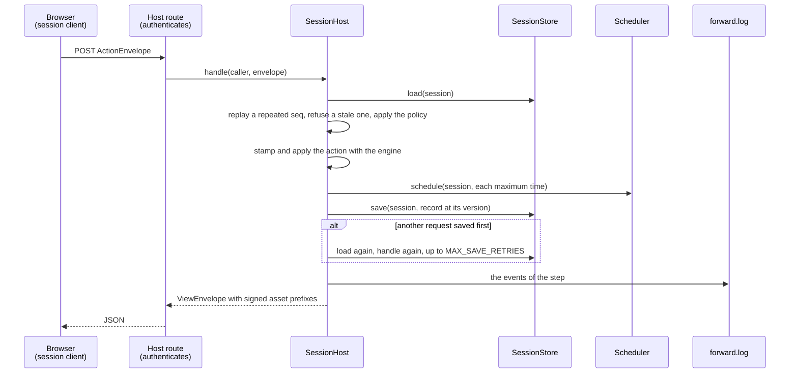
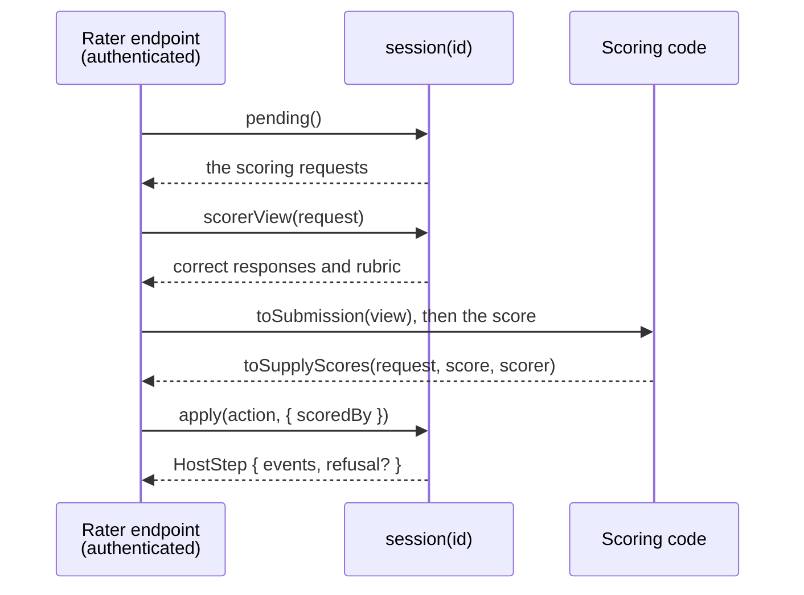
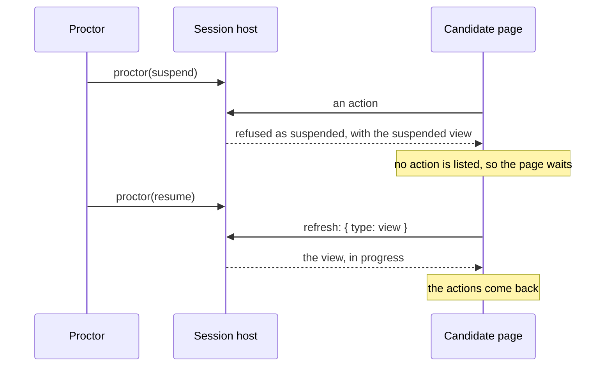
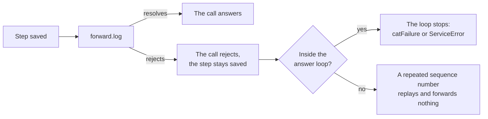

# Server

`@assesskit/player/server` runs a candidate session for a candidate who is not trusted with its keys: the session host of
exam mode, the [asset gate](asset-gate.md), the stores a host provides, and the log that receives each step's events
(see [forwarding](#forwarding-the-steps)). Keys and seeds stay on the server.



| Export                                                                 | Purpose                                                                              |
| ---------------------------------------------------------------------- | ------------------------------------------------------------------------------------ |
| `createSessionHost`, `SessionHost`, `SessionHostOptions`               | The session host of exam mode                                                        |
| `MAX_SAVE_RETRIES`                                                     | How many times a request is handled again after a version conflict                   |
| `CANDIDATE_ACTION_TYPES`, `EXAM_CLIENT_ACTIONS`, `CandidateActionType` | The client-action policy                                                             |
| `SessionStore`, `StoredSession`, `SessionSave`                         | The storage of sessions                                                              |
| `Scheduler`, `FileStore`, `ToolScoreStore`, `ToolScore`                | The scheduler of time-outs, the storage of files, the storage of the scores of tools |
| `createAssetGate`, `collectAssetPrefixes` and the gate's types         | The [asset gate](asset-gate.md)                                                      |
| `StepEvents`, `StepSink`, `SuppliedGrade`, `ForwardOptions`            | What the host does with the events of each step                                      |
| `createToolScoreIntake`, `ToolScoreIntake`, `ToolScoreIntakeOptions`   | The scores of tool items                                                             |
| `SYSTEM_CLOCK`                                                         | The clock of the machine                                                             |

```ts
import { createEngine } from "@assesskit/runtime/delivery";
import { openPackage, packageResolvers } from "@assesskit/runtime/package";
import { createAssetGate, createSessionHost, SYSTEM_CLOCK } from "@assesskit/player/server";

const ASI = "http://www.imsglobal.org/xsd/imsqtiasi_v3p0";
const files = new Map(
  Object.entries({
    "imsmanifest.xml": `<manifest xmlns="http://www.imsglobal.org/xsd/qti/qtiv3p0/imscp_v1p1" identifier="package">
      <metadata><schema>QTI Package</schema><schemaversion>3.0.0</schemaversion></metadata>
      <organizations/>
      <resources>
        <resource identifier="exam" type="imsqti_test_xmlv3p0" href="tests/exam.xml"><file href="tests/exam.xml"/></resource>
        <resource identifier="q1" type="imsqti_item_xmlv3p0" href="items/q1.xml"><file href="items/q1.xml"/></resource>
      </resources>
    </manifest>`,
    "tests/exam.xml": `<qti-assessment-test xmlns="${ASI}" identifier="exam" title="Exam">
      <qti-test-part identifier="part" navigation-mode="nonlinear" submission-mode="individual">
        <qti-assessment-section identifier="section" title="Section" visible="true">
          <qti-assessment-item-ref identifier="q1" href="../items/q1.xml"/>
        </qti-assessment-section>
      </qti-test-part>
    </qti-assessment-test>`,
    "items/q1.xml": `<qti-assessment-item xmlns="${ASI}" identifier="q1" title="Question" adaptive="false" time-dependent="false">
      <qti-item-body><p>Hello</p></qti-item-body>
    </qti-assessment-item>`,
  }).map(([path, text]) => [path, new TextEncoder().encode(text)]),
);
const pkg = openPackage({ paths: [...files.keys()].sort(), read: (path) => files.get(path) });
const test = pkg.document("tests/exam.xml");
if (test.kind !== "test") throw new Error("The document is not a test.");
const engine = createEngine({
  kind: "test",
  test: test.test,
  base: "tests/exam.xml",
  resolvers: packageResolvers(pkg),
});

// The stores of a host are its database and its job queue; these keep one session in memory.
const records = new Map();
const store = {
  create: async (session, record) => !records.has(session) && !!records.set(session, { ...record, version: 0, seq: 0 }),
  load: async (session) => records.get(session),
  save: async (session, { action, ...record }) => {
    if (records.get(session)?.version !== record.version) return false;
    records.set(session, { ...record, version: record.version + 1 });
    return true;
  },
};
const jobs = [];
const scheduler = { schedule: async (session, at) => void jobs.push([session, at]) };
const fileStore = { put: async () => ({ reference: "none", mimeType: "text/plain" }), read: async () => undefined };
const key = await crypto.subtle.generateKey({ name: "HMAC", hash: "SHA-256" }, false, ["sign", "verify"]);
const packages = async () => pkg;
const gate = createAssetGate({ key, origin: "https://assets.example", packages, files: fileStore });

const host = createSessionHost({ engine, store, scheduler, clock: SYSTEM_CLOCK, gate, packages });

// In the handler of POST /exam/start, for the caller that the host authenticated:
const caller = { session: "s1", principal: "candidate-7" };
const first = await host.start(caller, { seed: 12345 });
first.seq; // => 0
first.view.current.title; // => "Question"
const again = await host.handle(caller, { seq: 1, action: { type: "move", to: "next" } });
again.seq; // => 1
records.get("s1").version; // => 1
```

## Session host

`createSessionHost(options)` throws `DataError` when an option is not of its type.

| Option          | Type                                         | Meaning                                                                                                                                                                        |
| --------------- | -------------------------------------------- | ------------------------------------------------------------------------------------------------------------------------------------------------------------------------------ |
| `engine`        | `Engine`                                     | The delivery engine of the test. One engine serves every session.                                                                                                              |
| `store`         | `SessionStore`                               | The storage of sessions.                                                                                                                                                       |
| `scheduler`     | `Scheduler`                                  | The scheduler of time-outs, such as a job queue.                                                                                                                               |
| `clock`         | `Clock`                                      | The time of the server. `SYSTEM_CLOCK` is the machine's.                                                                                                                       |
| `gate`          | `AssetGate`                                  | Signs the prefixes of each envelope.                                                                                                                                           |
| `packages`      | `(session, options?) => Promise<QtiPackage>` | The package that a session delivers; the gate takes the same function. It may ignore the options.                                                                              |
| `clientActions` | `CandidateActionType[]`                      | The types of action a client may send. Default: every type but `suspend` and `resume` (`EXAM_CLIENT_ACTIONS`).                                                                 |
| `maxIdle`       | `number`                                     | The longest gap between steps, in milliseconds, that counts as time on task, as on `createLocalSession`. Needs `suspend` in `clientActions`; never for an exam. Default: none. |
| `limits`        | `Partial<ActionLimits>`                      | The limits on the size of an action, as the runtime's `parseCandidateAction` takes them. Default: the runtime's.                                                               |
| `forward`       | `ForwardOptions`                             | Where the events of each step go: the host's `log`. Default: nowhere.                                                                                                          |
| `cat`           | `CatPort`                                    | The port of the CAT engines: the host then answers its own CAT requests ([CAT](cat.md#the-option-cat)). Default: none.                                                         |

| Method                               | What it does                                                                                                                                                                                                                                                                                          |
| ------------------------------------ | ----------------------------------------------------------------------------------------------------------------------------------------------------------------------------------------------------------------------------------------------------------------------------------------------------- |
| `start(caller, options)`             | Starts the session at the time of the clock, binds it to `caller.principal`, stores the record, schedules the deadlines, gives the events to the log and answers with the first envelope, `seq` 0. `options` are those of `Engine.start` but the time, and `signal`, which does not reach the engine. |
| `check(caller, options?)`            | Throws `AccessError` (`not-bound`) unless the session is bound to the caller's principal. A session that does not exist is the same error, so that the answer does not tell which sessions exist.                                                                                                     |
| `view(caller, options?)`             | The current view as an envelope, with fresh tokens and the `seq` of the latest request answered. A page that reloads, or that the proctor acted on, mounts from it.                                                                                                                                   |
| `handle(caller, envelope, options?)` | Answers a request of the client, as below. A view request, `{ "type": "view" }`, is answered as `view` answers, and applies and saves nothing.                                                                                                                                                        |
| `proctor(session, action, options?)` | Applies `suspend`, `resume`, `end-part` or `end-test` on the host's authority and answers with a `HostStep`.                                                                                                                                                                                          |
| `session(session)`                   | The host side of the session, a `HostSession` ([protocol](protocol.md#the-host-session)): `apply`, `pending`, `scorerView` and `results`, as below.                                                                                                                                                   |

`options` of a call is `{ signal? }`: an `AbortSignal` that stops the call before its next load, as [signals](#signals) says.

### The host side

`session(session)` returns the `HostSession` of one session. Each of its methods loads the session when it is called, and
rejects with `DataError` when the session does not exist. It gives the correct responses and the powers of the host for a bare
session identifier, so call it only from the host's rater and service endpoints, such as the job of the scheduler and the
rater's route, and never with an identifier that a candidate supplies.



| Method                          | What it does                                                                                                                                                                                                                                                                                                                                                                                                                                                                                                                                                                                                                                                                                    |
| ------------------------------- | ----------------------------------------------------------------------------------------------------------------------------------------------------------------------------------------------------------------------------------------------------------------------------------------------------------------------------------------------------------------------------------------------------------------------------------------------------------------------------------------------------------------------------------------------------------------------------------------------------------------------------------------------------------------------------------------------- |
| `apply(action, options?)`       | Applies `time`, `supply-scores` or `cat-response`. A refusal of the engine, such as `unknown-request`, is `HostStep.refusal` and changes nothing. A `time` that finds nothing to apply is accepted with no events; it is saved, and the log is not called. The step of a `supply-scores` action reaches the log with `supplied`: the value, the scorer and, when the host gave `options.scoredBy`, who scored: a non-empty string, such as the rater or the scoring service that the host's authentication of the rater endpoint names. If the log throws, the step stays saved and the call rejects, so a retried `supply-scores` reports `scores-replaced` and reaches the log a second time. |
| `pending(options?)`             | What the engine waits on the host for.                                                                                                                                                                                                                                                                                                                                                                                                                                                                                                                                                                                                                                                          |
| `scorerView(request, options?)` | What a rater needs, correct responses included. Call it only from a rater's endpoint.                                                                                                                                                                                                                                                                                                                                                                                                                                                                                                                                                                                                           |
| `results(options?)`             | The results report, marked official: the one object that `sessionScore` accepts. A copy of it is not official.                                                                                                                                                                                                                                                                                                                                                                                                                                                                                                                                                                                  |

The step feed of a session host is `forward.log`, which every process calls after the save of each step with events; a
local session has `subscribeSteps` instead ([protocol](protocol.md#the-host-session)). The host reads the score of a session
with `results()` and `pending()` and gives them to `sessionScore` ([scoring](scoring.md#the-score-of-a-session)).

### Caller binding

An envelope has no session identifier. The host's authentication gives `caller = { session, principal }`, and the record's
principal must match, else `AccessError` (`not-bound`), which the host maps to 403. `start` creates the record with
`SessionStore.create`, which fails when the session exists, and then throws `AccessError` (`session-exists`): a session is
never started twice or bound to another principal.

### Handling a request

1. The caller is checked against the record. A repeated `seq` returns the stored envelope with fresh tokens and changes
   nothing; a stale one is a `DataError`.
2. The action is read with the runtime's `parseCandidateAction` and its size limits. The actions of the host are refused there.
3. The client-action policy applies: an action outside `clientActions` is a `DataError`.
4. The action is stamped with `stamp(state, action, clock.now())`, which never goes back, so a clock that steps back refuses
   nothing, and applied.
5. The deadlines of the new state are scheduled, then the state is saved by version, then the events are forwarded.
6. The answer is the view, with the actions the policy allows, the signed asset prefixes and the documents of the
   content, among them the pronunciation lexicons of the item. A refusal of the engine is in the envelope and the state stays as it was; the `seq` is still stored, so a repeat
   of the refused request gets the same refusal.

When another request saved first, the host loads the record again and handles the request again, up to `MAX_SAVE_RETRIES`
(3) times, and then throws `ServiceError` with status 409. Repeats are safe because `seq` makes the request idempotent.

If the scheduler fails, nothing is saved and the request can be sent again, so no time-out is lost. If the log fails, the
step stays saved and the error reaches the caller. A step is numbered by the version of the record it saved, `"start"` for the
first.

### Client-action policy

The exam default lists every action of the candidate but `suspend` and `resume`, because the runtime counts suspended time nowhere
a candidate who could suspend would stop the clock. The host filters `view.actions` through the policy, so the chrome
never offers such an action. Practice allows every action, and so does a host that passes `CANDIDATE_ACTION_TYPES`.

### The proctor

A break, a pause and the end of a part are the proctor's, through `proctor(session, action)`. It applies the
action as the host and saves it; a refusal of the engine, such as `suspend` on an ended test, is `HostStep.refusal` and
saves nothing. The candidate learns of it with the next request: the engine refuses the action as `suspended`, the
envelope carries the suspended view, and `view(caller)` gives it after a reload.

A paused candidate has no action to send, so the page learns of the resume only by asking. `SessionClient.refresh` sends a
view request through the route that carries the actions, so that route needs nothing besides `handle`. The player asks while
the view is suspended and lists no `resume`: on a button, when the page becomes visible, and every `resumeCheckMs`
([delivery](delivery.md#options)).



### Time

The scheduler is the host's, such as a job queue, so a restart loses no time-out. After each step the host calls
`schedule(session, at)` for every maximum time of the new state, rounded up to a millisecond; the call is idempotent for a
pair. The job calls `session(id).apply({ type: "time" })` when `at` arrives. The runtime applies a passed deadline on the next
action and its view shows a time-out as applied, so a late job delays only a proactive time-out, never correctness. A `time` that
finds nothing to apply is accepted with no events: it is saved, and the log is not called. The player offers no proctor time extension and no read of the status, the item or the time left of a session: see
[Not included](supported.md#not-included).

With `maxIdle` the host closes a gap above it as [a local session does](client.md#a-learner-who-is-away): the first request of the
candidate or action of the host after it applies `suspend` at the latest step, `resume` now and the action, saves the three as one
step with one version, and gives the log the events of all three in order. The `time` of the job that finds such a gap is dropped:
nothing is saved and no deadline is scheduled again, so an abandoned session stops costing anything, and the next action
schedules the deadlines that the gap moved. A host that wants old sessions closed sweeps them itself. `maxIdle` suspends on the
candidate's behalf, which the policy of an exam does not allow, so `createSessionHost` throws `DataError` when `clientActions`
has no `suspend`; an exam leaves `maxIdle` out.

## Stores

| Interface        | Methods                                                                                                                                                                                                                                                                                                      |
| ---------------- | ------------------------------------------------------------------------------------------------------------------------------------------------------------------------------------------------------------------------------------------------------------------------------------------------------------ |
| `SessionStore`   | `create(session, { state, principal, envelope }, options?)` returns `false` when the session exists. `load(session, options?)` gives `{ state, principal, version, seq, envelope }`. `save(session, record, options?)` stores `version + 1` if the stored version is `record.version`, else returns `false`. |
| `Scheduler`      | `schedule(session, at, options?)`: idempotent per pair.                                                                                                                                                                                                                                                      |
| `FileStore`      | `put(bytes, mimeType, fileName?)` returns the `FileValue` that refers to the bytes; `read(file)` returns them or `undefined`.                                                                                                                                                                                |
| `ToolScoreStore` | `keep(session, item, score, options?)` keeps the score unless the kept one is later, and returns whether it did; an equal time keeps it again and returns `true`. `latest(session, item, options?)` returns the kept score or `undefined`.                                                                   |

`create` and `save` of `SessionStore`, and `keep` of `ToolScoreStore`, must be atomic across the host's processes. `state` is the runtime's `serializeState`, `envelope` the JSON of the
latest `ViewEnvelope`, and `action` of a save the JSON `{ at, action }` of the step that made it: the log of the session.

### CAT requests

With the option `cat` the session host answers the CAT requests of its sessions itself: after `start`, `handle`, `proctor` and the
time job, as [CAT](cat.md#the-option-cat) shows. An accepted `cat-response` also replaces the stored answer of the latest
request with the view after it, keeping its sequence number and its refusal, so that a request sent again gets the current
view. The time job throws when `apply` returns `catFailure`, so that its queue retries. A `log` calls only `session(id)`, and a host
with several processes routes each session to one of them.

### Signals

Every call of the session host takes `{ signal }`, and the signal reaches the stores, the scheduler and `packages`, which may
ignore it. `FileStore` and the gate take none, and neither does the `log`: forwarding completes after the save.

| Point                                      | Effect of an aborted signal                                                                         |
| ------------------------------------------ | --------------------------------------------------------------------------------------------------- |
| Before each load, and between save retries | The call rejects with `signal.reason`; nothing was applied                                          |
| In `load`, `schedule`, `packages`          | The service may reject, and then the call rejects; nothing was applied                              |
| In `save`, `create`                        | Passed to the store, which rejects only when nothing was saved: a store that cannot tell ignores it |
| After the save                             | Ignored by the call: forwarding completes                                                           |

`start` takes the signal beside the options of `Engine.start`, and does not pass it on.

## Forwarding the steps

`forward.log` receives each saved step that has events, as a `StepEvents`: the session, the step, the events as the runtime gave
them, and `supplied` on every step of a `supply-scores` action. It is the one place where the host sees what happened, so a host
composes its event sink and its score sink in it. Both are jobs of the host: the log only appends to an outbox, and a job outside
any step reads `results()` and `pending()` from `session(id)`, calls `sessionScore`, and publishes. [LTI items](lti-items.md)
shows the wiring.

The events carry no score unless the host builds its engine with `eventOutcomes`: `response-processed` then holds the outcomes
of the item after each attempt, with `attempt` and `duration`, which are always present ([events](../runtime/delivery.md#events)).
A host that feeds a learner model reads them in the `log` and so never calls `results()` after a step. The log, its outbox and its
sinks then hold scores, so they need the protection of the results ([SECURITY.md](../../SECURITY.md)). The events never reach a
candidate: a candidate's answer is a view.



A `log` bounds its own time and calls only `session(id)`: `handle`, `view` and `start` join the answer loop that waits for the
`log`, so they would never return. These rows hold for every port the host passes in:

| Port                                | When it fails                                                                                                                                                                               | When it hangs                                                                          | When it is called again                                                                                                      |
| ----------------------------------- | ------------------------------------------------------------------------------------------------------------------------------------------------------------------------------------------- | -------------------------------------------------------------------------------------- | ---------------------------------------------------------------------------------------------------------------------------- |
| `forward.log`                       | The step stays saved and the call rejects. In the answer loop the `cat-response` stays saved and the loop stops, so the failure reads as `catFailure`. Nothing repeats the step             | It holds the call, and the answer loop when the step is its own                        | Never by the player. A candidate's retry replays the stored answer and forwards nothing                                      |
| `ToolScoreIntake.onScore`           | `keep` rejects: nothing is stored, and the tool retries. `apply` rejects after `keep`: the score is stored and the call rejects; a retry at the same or a later time supplies both outcomes | `apply` waits for the answer loop. The `signal` ends the caller's wait before the save | Same time: `scores-replaced`. Earlier time: dropped by `keep`. `SCORE` applied and `MAXSCORE` failed: a retry completes both |
| `ToolScoreIntake.settle`            | `pending` or `apply` rejects, as `log` when it runs inside `log`; the score stays kept                                                                                                      | As `log`, or the timeout of the job that runs it                                       | Safe: it supplies only the requests that are open, so a repeat makes no step                                                 |
| The option `scoredBy` of the intake | Rejects after `keep` and before any `apply`: the score stays kept, and a retry supplies it                                                                                                  | The `signal` of `onScore` reaches it. `settle` has none, so it bounds itself           | Before each supply; pure                                                                                                     |
| `ToolScoreStore`                    | Rejects the caller; `keep` stores nothing when it rejects                                                                                                                                   | The `signal` reaches it; it bounds itself                                              | `keep` is atomic across processes, and keeps a score unless a later one is kept                                              |
| `sessionScore`                      | Throws `DataError` on a report that gives no score, in the host's job and never in a step                                                                                                   | No I/O                                                                                 | Same input, same result                                                                                                      |

## The scores of tool items

An item that is a link to a tool is delivered by the tool, which gives its score to the host by a protocol such as the grade
services of LTI. `createToolScoreIntake({ host, scores, scoredBy? })` turns those scores into the scores of the session. A
platform adapter, such as [the example](lti-items.md), turns the score that the tool posted into a `ToolScore` and calls
`onScore`; `settle` takes the steps of the host's log.

| Option     | Meaning                                                                                                                                                                                                   |
| ---------- | --------------------------------------------------------------------------------------------------------------------------------------------------------------------------------------------------------- |
| `host`     | The session host, of which the intake uses `session(id).apply` and `session(id).pending`.                                                                                                                 |
| `scores`   | The `ToolScoreStore` that keeps the latest score of each item instance.                                                                                                                                   |
| `scoredBy` | `(session, item, options?) => string`: who scored, for the `scoredBy` of the steps that the score makes. It runs after the score is kept and before any action. Default: none, the steps carry no scorer. |

- The store keeps the score with the latest `timestampMs`. A score that is earlier is ignored; one at the same time is kept again,
  so that a retry finishes a supply that failed halfway.
- A score that is `final` is supplied with `supply-scores`, scored by an external machine: its `scoreGiven` answers the `SCORE`
  request of the item and its `scoreMaximum` the `MAXSCORE` request. A later final score replaces the values. A value that the
  score lacks is NULL. A score that is not final is kept and not supplied.
- The runtime makes the requests of an item when its session is over, not when the tool is done. A final score that arrives
  earlier is kept, and `settle` supplies it when a step makes the requests, for the requests that are still open. Call it from the
  `log` of the host's forwarding, or from a job:

```ts
import { createToolScoreIntake } from "@assesskit/player/server";

const supplied = [];
const answered = new Set();
const kept = new Map();
const intake = createToolScoreIntake({
  host: {
    session: (session) => ({
      apply: async (action) => {
        supplied.push(`${session} ${action.request} ${action.value?.value}`);
        answered.add(action.request);
        return { events: [] };
      },
      pending: async () => ({
        scoring: ["item:q1:1:SCORE", "item:q1:1:MAXSCORE"].filter((id) => !answered.has(id)).map((id) => ({ id })),
        cat: [],
      }),
    }),
  },
  scores: {
    keep: async (session, item, score) => {
      const key = `${session} ${item.ref} ${item.instance}`;
      if (kept.has(key) && kept.get(key).timestampMs > score.timestampMs) return false;
      kept.set(key, score);
      return true;
    },
    latest: async (session, item) => kept.get(`${session} ${item.ref} ${item.instance}`),
  },
});

const item = { ref: "q1", instance: 1 };
const score = { scoreGiven: 7, scoreMaximum: 10, final: true, timestampMs: Date.UTC(2026, 9, 31, 10) };
await intake.onScore("s1", item, score);
supplied; // => ["s1 item:q1:1:SCORE 7", "s1 item:q1:1:MAXSCORE 10"]
await intake.onScore("s1", item, { ...score, scoreGiven: 1, timestampMs: score.timestampMs - 1 });
supplied.length; // => 2
await intake.settle({ session: "s1", step: 4, events: [{ type: "scoring-requested", at: 1, item }] });
supplied.length; // => 2
```

The intake and the host need each other: the host logs through the intake's `settle`, and the intake supplies through the host.
Create the intake with `host: { session: (id) => host.session(id) }`, then the host with
`forward: { log: (step) => intake.settle(step) }`.

A host that logs in other ways calls `settle` after its own log, or from a job. The intake does not publish the results: that is
the job of the host, which calls `sessionScore` when the session is over, and again when a person or a tool supplies the rest.
