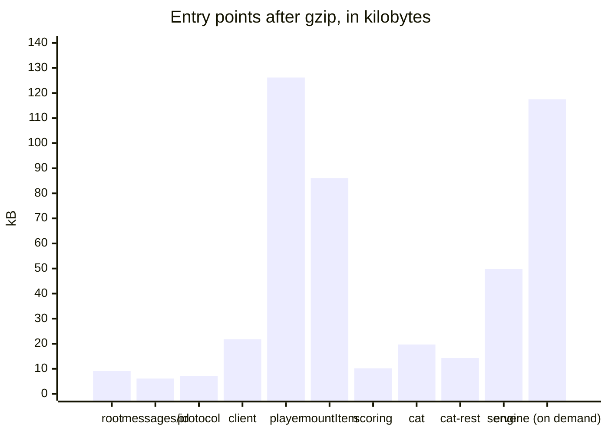

# Size

What a browser loads from the player, and the budgets that keep it from growing. `packages/player/test/size.test.ts` bundles
every entry point of both packages alone, as a host's bundler does: esbuild, minified, for the browsers of the
[baseline](baseline.md), with what the entry point loads by `import()` left out. It fails when an entry point is above its
budget after gzip, or when it holds a module that its budget in `size-budgets.ts` does not list, so that an import which pulls
one module into another shows in the change that makes it. The runtime's entry points are in
[performance](../runtime/performance.md#entry-points).

| File                            | Bytes   | Gzip    | Budget  | What it holds                                                                                                                                                                                                     |
| ------------------------------- | ------- | ------- | ------- | ----------------------------------------------------------------------------------------------------------------------------------------------------------------------------------------------------------------- |
| `@assesskit/player`             | 25,963  | 9,066   | 10,000  | The errors, the checks of the player and the interface messages in English                                                                                                                                        |
| `@assesskit/player/messages/id` | 16,977  | 6,147   | 8,000   | The interface messages in Indonesian, which a host that shows Indonesian loads beside the player, and nothing else                                                                                                |
| `@assesskit/player/protocol`    | 22,149  | 7,083   | 7,500   | The envelopes and their schemas, and the check of a scoring rubric (`asi`, `values`); valibot is 10.5 kB of it                                                                                                    |
| `@assesskit/player/client`      | 67,723  | 21,794  | 25,000  | The remote and the local session, and the decoders of a view and of an action (`delivery`, `interactions`, `package`, `pnp`, `values`, `xml`), without the engine                                                 |
| `@assesskit/player/player`      | 396,660 | 126,170 | 134,500 | The custom elements, the tools, the delivery, the supports, speech, the rating form, the host of portable custom interactions (`asi`, `content`, `interactions`, `package`, `pci`, `pnp`, `values`, `xml`, saxes) |
| `mountItem`                     | 269,704 | 86,134  | 101,000 | The content, the interactions, the supports, speech and the host of portable custom interactions; no chrome, no tools and no XML parser                                                                           |
| `@assesskit/player/scoring`     | 33,485  | 10,226  | 13,000  | The actions that score and supply scores, with the protocol (`asi`, `processing`, `values`)                                                                                                                       |
| `@assesskit/player/cat`         | 65,085  | 19,712  | 24,500  | The deployment of adaptive sections, which reads their files (`cat`, `delivery`, `metadata`, `package`, `values`, `xml`, saxes)                                                                                   |
| `@assesskit/player/cat-rest`    | 45,868  | 14,330  | 18,000  | The client and the handler of the REST binding of a CAT engine (`cat`, `metadata`, `results`, `values`)                                                                                                           |
| `@assesskit/player/server`      | 158,794 | 49,750  | 62,000  | The session host, the asset gate and the stores, with the protocol, jose and the readers and JSON of the runtime; not the engine, which the host passes in                                                        |
| `@assesskit/runtime/delivery`   | 502,161 | 117,546 | 140,500 | The engine, which `createLocalSession` loads with `import()` for practice on a device                                                                                                                             |
| `pci-frame/bridge.js`           | 9,915   | 3,685   | 5,000   | The script of the frame of a portable custom interaction                                                                                                                                                          |
| `pci-frame/require.js`          | 17,781  | 6,852   | 9,000   | RequireJS, which the frame loads                                                                                                                                                                                  |
| `recorder-worklet.js`           | 322     | 250     | 500     | The script of the audio worklet of a WAV recording                                                                                                                                                                |
| `player.css`                    | 64,840  | 13,610  | 16,000  | The stylesheet of a content root                                                                                                                                                                                  |

The sizes are bytes of the minified file. The names in brackets are the modules of the runtime that an entry point holds;
every entry point but the Indonesian catalog also holds the runtime's `checks` and `errors` and valibot, and
`size-budgets.ts` lists every module of each. The first load of a client holds none of the engine: the engine is a chunk that
the client loads on demand, and the test fails when the first load holds a file of the runtime's processing. The root, the
protocol and the client hold no `jose` or XML parser, and the player holds no `jose`.

`mountItem` is `mountDelivery` without the chrome, the tools, the panel of the supports and the frame of an LTI item, so it
loads the content and the interactions that every mount shares. `bundle.test.ts` fails when a file of the chrome is in a bundle
that imports only `mountItem`, and `size.test.ts` fails when it is not smaller than a bundle of `mountDelivery`. The XML parser
that reads a pronunciation lexicon (`saxes` and the runtime's `xml`, 40 kB of the player) is a chunk that loads with the
first lexicon, so neither `mountItem` nor `mountDelivery` holds it in the first load; the `player` entry point holds it, because it
exports `parseLexicon`.

## Languages

English is in the root, in `player` and in `mountItem`: every catalog is checked against it, and a language without a catalog
gets it. The Indonesian catalog is the module `@assesskit/player/messages/id`, which a host passes to the player
([messages](messages.md)). `size.test.ts` fails when the root, the protocol, the client, the player or the first load of an
item holds it. A host that shows English loads nothing more; a host that shows Indonesian loads 6.1 kB more after gzip,
beside the player, and each language after it is a module of the same kind.

## What is in the player

Bytes of the minified `@assesskit/player/player`, before gzip:

| Part                                             | Bytes   | Why                                                                                                     |
| ------------------------------------------------ | ------- | ------------------------------------------------------------------------------------------------------- |
| The elements of the player                       | 254,344 | The folders of `player/`, of which `elements` is 78 kB, `tools` 45 kB and `supports` 24 kB              |
| `values` of the runtime                          | 40,752  | The values of responses, and the automaton and the Unicode tables for the patterns of text entry        |
| The messages                                     | 16,642  | The English catalog, which `selectMessages` completes a language from; Indonesian is a module of 16,977 |
| `saxes`, and `xml` and `xmlchars` of the runtime | 41,406  | The reader of a pronunciation lexicon in `speech/`                                                      |
| valibot                                          | 11,379  | The schemas of the JSON that crosses the wire                                                           |

The controls that close the gaps of [conformance](../runtime/conformance.md) are in the entry points that draw them. The
largest, the scientific calculator, is 9.9 kB of the tools; the lists of the panel of the supports are chrome, so `mountItem`
holds only their messages and what the content root shares with them, such as the choice of braille files.

## Running it

`pnpm test` runs the size test with the other tests of the player, and needs no build. A new entry point fails the test until
`size-budgets.ts` has its budget. A new budget is 1.25 times the size measured, rounded up to the next 500 bytes, and a budget
changes only with the reason in the commit that changes it; a change that takes bytes out of an entry point lowers its
budget by as much, rounded up to the next 500 bytes, so that the room for growth stays what it was. The static files
are built by `scripts/build-static.ts`, which the test calls, so it measures what `pnpm build` writes.

## Mount time

`pnpm bench` also times the mounts in Chromium with the CPU slowed 4 times through the DevTools protocol, as a mid-range
phone is, and fails when the fastest of 5 samples is above its budget. The files are `mount-time.browser.bench.ts` and
`mount-budgets.ts` in `packages/player/test/`; the browser pane of the run is the Chromium of Playwright.

| Mount                                                      | On the CI runner | On a laptop | Budget |
| ---------------------------------------------------------- | ---------------- | ----------- | ------ |
| `mountDelivery` over a test, until the first item is shown | 30 ms            | 5 ms        | 200 ms |
| 10 calls of `mountItem` on one page, until all are shown   | 73 ms            | 16 ms       | 400 ms |
| Turning on the highlighter over a passage of 2,000 words   | 48 ms            | 14 ms       | 300 ms |

A budget is five times the fastest sample, the median over three runs, rounded up to one significant digit: the rule of the
other benchmarks of the repository ([performance](../runtime/performance.md#budgets)), whose sample is the one that the CI
runner took, because the gate runs there. The runner takes 4 to 6 times as long as a laptop, and one run of it takes up to 1.4
times as long as another on the same code (`mountDelivery` 23.9, 30.1 and 33.2 ms), so a budget of five times the sample of a
laptop fails on the runner with no change in the code. A mount must become several times slower on the runner before it fails
its budget; the sizes above guard the load.

### Against the Amp-up player

The lesson page also comes from the documents of its ten items, in the player and in the Amp-up player (`qti3-item-player`,
Vue 2), the player that holds the certifications of 1EdTech for QTI 3 delivery, with the CPU slowed 4 times. The player
reads each item, starts a local session and mounts it with `mountItem`; the Amp-up player mounts a player for each item and
loads its document with `loadItemFromXml`. Both are timed until the text of every item is in the page, checked at each task
rather than at each frame, in turns over 5 samples; the gate compares the fastest of each.

| Row                                             | The player | Amp-up  | Ratio | Budget (ratio) |
| ----------------------------------------------- | ---------- | ------- | ----- | -------------- |
| A lesson page of ten items from their documents | 26.5 ms    | 13.8 ms | 1.92  | 3              |

The times are those of the laptop, from the run whose ratio is the median of six; the ratios of the six runs were 1.4 to 2.1,
and the budget is the median with the headroom of the [rows against Longsight](../runtime/performance.md#against-the-references).
The player draws each item in shadow roots of its own, with the stylesheet of a content root, a status region and the controls
of the supports, where the Amp-up player draws plain elements; with the sessions made, the player takes 21 ms for the same page
(the lesson row above), so the drawing is most of its time, and the runtime's reading, gate and start of the ten items the
rest. A local session loads the engine with `import()` once for a page, not once for each session.

The times do not include loading and parsing the bundle, which `size.test.ts` bounds by bytes: with the CPU slowed 4 times
the bundle of `mountDelivery` loaded, parsed and evaluated in 47 ms, and that of `mountItem` in 46 ms.
