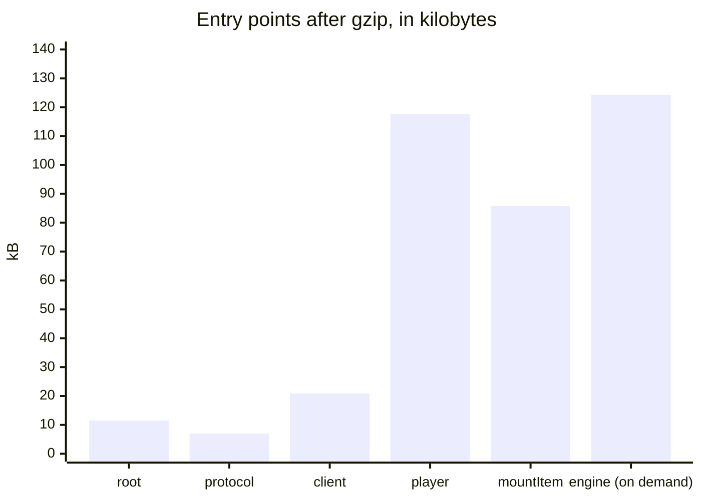

# Size

What a browser loads from the player, and the budgets that keep it from growing. `packages/player/test/size.test.ts` bundles
each entry point as a host's bundler does (esbuild, minified, for the browsers of the [baseline](baseline.md)), and fails when a
file is above its budget after gzip.

| File                          | Bytes   | Gzip    | Budget  | What it holds                                                                                                                 |
| ----------------------------- | ------- | ------- | ------- | ----------------------------------------------------------------------------------------------------------------------------- |
| `@assesskit/player`           | 35,514  | 11,521  | 14,500  | The errors, the checks of the player, valibot, and the interface messages in English and Indonesian                           |
| `@assesskit/player/protocol`  | 21,958  | 7,016   | 7,500   | The envelopes and their schemas, and the check of a scoring rubric; valibot is 10.9 kB of it                                  |
| `@assesskit/player/client`    | 64,928  | 20,883  | 25,000  | The remote and the local session, and the decoders of a view and of an action that they take from the runtime                 |
| `@assesskit/player/player`    | 368,331 | 117,575 | 140,500 | The custom elements, the tools, the delivery, the supports, speech, the rating form, the host of portable custom interactions |
| `mountItem`                   | 265,709 | 85,814  | 107,500 | The content, the interactions, the supports, speech and the host of portable custom interactions; no chrome and no tools      |
| `@assesskit/runtime/delivery` | 526,637 | 124,304 | 152,000 | The engine, which `createLocalSession` loads with `import()` for practice on a device                                         |
| `pci-frame/bridge.js`         | 10,026  | 3,735   | 5,000   | The script of the frame of a portable custom interaction                                                                      |
| `pci-frame/require.js`        | 17,781  | 6,863   | 9,000   | RequireJS, which the frame loads                                                                                              |
| `recorder-worklet.js`         | 322     | 270     | 500     | The script of the audio worklet of a WAV recording                                                                            |
| `player.css`                  | 60,623  | 12,747  | 16,000  | The stylesheet of a content root                                                                                              |

The sizes are bytes of the minified file. The first load of a client holds none of the engine: the engine is a chunk that
the client loads on demand, and the test fails when the first load holds a file of the runtime's processing. The entry points of
the shared folders `scoring` and `cat` and of the server side (`cat-rest`, `server`) have no budget, as none
of the entry points above loads them; the root, the protocol and the client hold no `jose` or XML parser, and the
player holds no `jose`.

`mountItem` is `mountDelivery` without the chrome, the tools, the panel of the supports and the frame of an LTI item, so it
loads the content and the interactions that every mount shares. `bundle.test.ts` fails when a file of the chrome is in a bundle
that imports only `mountItem`, and `size.test.ts` fails when it is not smaller than a bundle of `mountDelivery`. The XML parser
that reads a pronunciation lexicon (`saxes` and the runtime's `xml`, 40 kB of the player) is a chunk that loads with the
first lexicon, so neither `mountItem` nor `mountDelivery` holds it in the first load; the `player` entry point holds it, because it
exports `parseLexicon`.

## What is in the player

| Part                                             | Bytes   | Why                                                                                              |
| ------------------------------------------------ | ------- | ------------------------------------------------------------------------------------------------ |
| The elements of the player                       | 209,234 | The folders of `player/`, of which `elements` is 74 kB and `tools` 29 kB                         |
| `values` of the runtime                          | 40,761  | The values of responses, and the automaton and the Unicode tables for the patterns of text entry |
| The messages                                     | 25,599  | Both catalogs; `selectMessages` chooses one at run time                                          |
| `saxes`, and `xml` and `xmlchars` of the runtime | 40,317  | The reader of a pronunciation lexicon in `speech/`                                               |
| valibot                                          | 11,350  | The schemas of the JSON that crosses the wire                                                    |

## Running it

`pnpm test` runs the size test with the other tests of the player, and needs no build. A budget is 1.25 times the size
measured, rounded up to the next 500 bytes, and changes only with the reason in the commit that changes it. The static files
are built by `scripts/build-static.ts`, which the test calls, so it measures what `pnpm build` writes.
