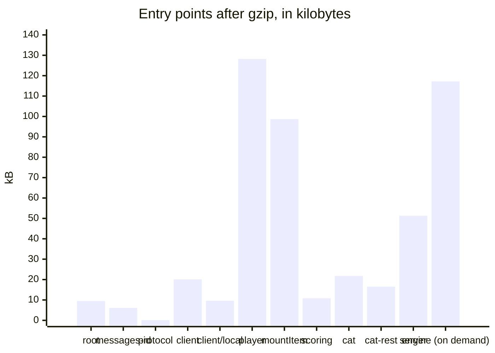

# Size of the player

What a browser loads from the player, and the budgets that keep it from growing. `packages/player/test/size.test.ts` bundles
every entry point of both packages alone, as a host's bundler does: esbuild with code splitting, minified, for the browsers of
the [baseline](baseline.md). The size of an entry point is its first load: the entry chunk and the chunks that it imports
statically, which hold the code that it shares with a chunk that `import()` loads, and not that chunk. The test fails when an
entry point is above its budget after gzip, or when its first load holds a module that its budget in `size-budgets.ts` does
not list, so that an import which pulls one module into another shows in the change that makes it. The runtime's entry points
are in [performance](../runtime/performance.md#entry-points).

| File                             | Bytes   | Gzip    | Budget  | What it holds                                                                                                                                                                                                                |
| -------------------------------- | ------- | ------- | ------- | ---------------------------------------------------------------------------------------------------------------------------------------------------------------------------------------------------------------------------- |
| `@assesskit/player`              | 27,054  | 9,455   | 10,000  | The errors, the checks of the player and the interface messages in English                                                                                                                                                   |
| `@assesskit/player/messages-id`  | 16,977  | 6,121   | 8,000   | The interface messages in Indonesian, which a host that shows Indonesian loads beside the player, and nothing else                                                                                                           |
| `@assesskit/player/protocol`     | 85      | 90      | 500     | The wire types, which compile to nothing, and the names of the two frames of an LTI item                                                                                                                                     |
| `@assesskit/player/client`       | 62,482  | 20,062  | 25,000  | The remote session of an exam page, and the decoders of a view and of an action (`delivery/wire` with `interactions`, `pnp`, `values`, `xml`); no engine, and nothing loads on demand                                        |
| `@assesskit/player/client/local` | 29,196  | 9,602   | 11,000  | The local session of practice (`package` for the paths of the package); the engine loads with `import()` at its first call                                                                                                   |
| `@assesskit/player/player`       | 395,422 | 128,235 | 134,500 | The custom elements, the tools, the delivery, the supports, speech, the rating form, the host of portable custom interactions (`asi`, `content`, `interactions`, `package`, `pci`, `pnp`, `results`, `values`, `xml`, saxes) |
| `mountItem`                      | 306,118 | 98,730  | 101,000 | The content, the interactions, the supports, speech with the reader of a pronunciation lexicon, and the host of portable custom interactions; no chrome and no tools                                                         |
| `@assesskit/player/scoring`      | 35,051  | 10,770  | 13,000  | The actions that score and supply scores, with the protocol (`asi`, `processing`, `results`, `values`)                                                                                                                       |
| `@assesskit/player/cat`          | 71,661  | 21,754  | 24,500  | The deployment of adaptive sections, which reads their files (`cat`, `delivery`, `metadata`, `package`, `values`, `xml`, saxes)                                                                                              |
| `@assesskit/player/cat-rest`     | 52,145  | 16,514  | 18,000  | The client and the handler of the REST binding of a CAT engine (`cat`, `metadata`, `results`, `values`)                                                                                                                      |
| `@assesskit/player/server`       | 161,181 | 51,261  | 62,000  | The session host, the asset gate and the stores, with the protocol, jose and the readers and JSON of the runtime; not the engine, which the host passes in                                                                   |
| `@assesskit/runtime/delivery`    | 499,012 | 117,198 | 140,500 | The engine, which `createLocalSession` loads with `import()` for practice on a device                                                                                                                                        |
| `pci-frame/bridge.js`            | 11,151  | 4,117   | 5,000   | The script of the frame of a portable custom interaction                                                                                                                                                                     |
| `pci-frame/require.js`           | 17,781  | 6,866   | 9,000   | RequireJS, which the frame loads                                                                                                                                                                                             |
| `recorder-worklet.js`            | 322     | 250     | 500     | The script of the audio worklet of a WAV recording                                                                                                                                                                           |
| `player.css`                     | 65,416  | 13,757  | 16,000  | The stylesheet of a content root                                                                                                                                                                                             |

The sizes are bytes of the minified files of the first load. The names in brackets are the modules of the runtime that an
entry point holds; every entry point but the Indonesian catalog also holds the runtime's `checks` and `errors` and valibot,
and `size-budgets.ts` lists every module of each. The root, the protocol and the clients hold no `jose` or XML parser, and the
player holds no `jose`.

`mountItem` is `mountDelivery` without the chrome, the tools, the panel of the supports and the frame of an LTI item, so it
loads the content and the interactions that every mount shares. `bundle.test.ts` fails when a file of the chrome is in a bundle
that imports only `mountItem`, and `size.test.ts` fails when it is not smaller than a bundle of `mountDelivery`. Both hold the
reader of a pronunciation lexicon with its XML parser (`saxes` and the runtime's `xml`, 42 kB before gzip): reading aloud is
part of every mount, and each bundler below puts the parser in the first load of `mountItem`, which without it would be
88,939 bytes after gzip in place of 98,730 (measured on 2026-11-05). Loading the reader with `import()` does not take it out
in esbuild, which splits by file: the entry point exports `readLexicon`, and the speech of the mounts writes SSML with the
runtime's `xml`, whose index reaches the parser.

## The first load of a client

The client of an exam page holds no engine and no answer key. Each session is a subpath of its own, so that a page imports
only the one it runs: an exam page `@assesskit/player/client`, whose remote session reads views and writes actions with the
wire forms of `@assesskit/runtime/delivery/wire`, and a practice page `@assesskit/player/client/local`, whose local session
loads `@assesskit/runtime/delivery` with `import()` at its first call. `size.test.ts` fails when the first load of either
client holds a file of the runtime's processing, when the client of an exam page loads anything on demand, or when the local
session does not load the engine on demand; `bundle.test.ts` fails when the first load of an exam page holds a file of the
engine.

The built packages, bundled in a project of their own, minified, with code splitting, after gzip:

| What the page imports                 | esbuild 0.28.2 | Rollup 4.67.4 | Rolldown 1.2.15 (Vite 8) | Bun 1.4.4 |
| ------------------------------------- | -------------- | ------------- | ------------------------ | --------- |
| `createRemoteSession`, an exam page   | 19,923         | 18,992        | 19,179                   | 19,985    |
| `createLocalSession`, a practice page | 9,426          | 8,347         | 8,889                    | 9,636     |
| Both sessions                         | 39,363         | 23,760        | 24,881                   | 25,330    |
| `mountItem`                           | 98,571         | 95,236        | 95,236                   | 98,678    |

No first load holds the runtime's processing, and each bundler puts the engine in a chunk that the local session loads on
demand. A page with both sessions loads most with esbuild, which splits by file: a file that the first load reaches through
any import goes in a chunk of the first load with all of its code that any chunk uses, so what the wire forms share with the
engine (the values, the interactions, the personal needs and preferences) comes whole; Rollup and Rolldown split by statement.
A client that imports a value from `@assesskit/runtime/delivery`, which no longer exports the wire forms, loads the whole engine first, because the index
of `delivery` reaches every file of the engine and the `import()` of the local session keeps them in the bundle. Measured with
both sessions in `@assesskit/player/client` and that import, an exam page loads 119,998 bytes with esbuild, and a page with
both sessions 122,361 with esbuild, 119,022 with Rolldown and 125,931 with Bun. The lint of the browser folders refuses that
import.

## Languages

English is in the root, in `player` and in `mountItem`: every catalog is checked against it, and a language without a catalog
gets it. The Indonesian catalog is the module `@assesskit/player/messages-id`, which a host passes to the player
([messages](messages.md)). `size.test.ts` fails when the root, the protocol, the client, the player or the first load of an
item holds it. A host that shows English loads nothing more; a host that shows Indonesian loads 6.1 kB more after gzip,
beside the player, and each language after it is a module of the same kind.

## What is in the player

Bytes of the minified `@assesskit/player/player`, before gzip:

| Part                                             | Bytes   | Why                                                                                                     |
| ------------------------------------------------ | ------- | ------------------------------------------------------------------------------------------------------- |
| The elements of the player                       | 248,544 | The folders of `player/`, of which `elements` is 78 kB, `tools` 44 kB and `supports` 23 kB              |
| `values` of the runtime                          | 39,587  | The values of responses, and the automaton and the Unicode tables for the patterns of text entry        |
| The messages                                     | 16,740  | The English catalog, which `selectMessages` completes a language from; Indonesian is a module of 16,977 |
| `saxes`, and `xml` and `xmlchars` of the runtime | 41,585  | The reader of a pronunciation lexicon in `speech/`                                                      |
| valibot                                          | 11,734  | The schemas of the JSON that crosses the wire                                                           |

The controls that close the gaps of [conformance](../runtime/conformance.md) are in the entry points that draw them. The
largest, the scientific calculator, is 9.9 kB of the tools; the lists of the panel of the supports are chrome, so `mountItem`
holds only their messages and what the content root shares with them, such as the choice of braille files.

## Running it

`pnpm test` runs the size test with the other tests of the player, and needs no build. A new entry point fails the test until
`size-budgets.ts` has its budget. A new budget is 1.25 times the size measured, rounded up to the next 500 bytes, and a budget
changes only with the reason in the commit that changes it; a change that takes bytes out of an entry point lowers its
budget by as much, rounded up to the next 500 bytes, so that the room for growth stays what it was. The static files
are built by `scripts/build-static.ts`, which the test calls, so it measures what `pnpm build` writes.

## Mount time

`pnpm bench` also times the mounts in Chromium with the CPU slowed 4 times through the DevTools protocol, as a mid-range
phone is, and fails when the fastest of 5 samples is above its budget. The files are `mount-time.browser.bench.ts` and
`mount-budgets.ts` in `packages/player/test/`; the browser pane of the run is the Chromium of Playwright.

| Mount                                                      | On the CI runner | On a laptop | Budget |
| ---------------------------------------------------------- | ---------------- | ----------- | ------ |
| `mountDelivery` over a test, until the first item is shown | 30 ms            | 8 ms        | 200 ms |
| 10 calls of `mountItem` on one page, until all are shown   | 73 ms            | 8 ms        | 400 ms |
| Turning on the highlighter over a passage of 2,000 words   | 48 ms            | 14 ms       | 300 ms |

A budget is five times the fastest sample, the median over three runs, rounded up to one significant digit: the rule of the
other benchmarks of the repository ([performance](../runtime/performance.md#budgets)), whose sample is the one that the CI
runner took, because the gate runs there. The runner takes 4 to 6 times as long as a laptop, and one run of it takes up to 1.4
times as long as another on the same code (`mountDelivery` 23.9, 30.1 and 33.2 ms), so a budget of five times the sample of a
laptop fails on the runner with no change in the code. A mount must become several times slower on the runner before it fails
its budget; the sizes above guard the load. The times of the laptop are those of 2026-11-05, after the messages of a mount
are checked once for all its parts and elements (the catalog has hundreds of keys, and the check of each part took 88% of the
time of a lesson page); the times of the runner are of the run before.

### Against the Amp-up player

The lesson page also comes from the documents of its ten items, in the player and in the Amp-up player (`qti3-item-player`,
Vue 2), the player that holds the certifications of 1EdTech for QTI 3 delivery, with the CPU slowed 4 times. The player
reads each item, starts a local session and mounts it with `mountItem`; the Amp-up player mounts a player for each item and
loads its document with `loadItemFromXml`. Both are timed until the text of every item is in the page, checked at each task
rather than at each frame, in turns over 5 samples; the gate compares the fastest of each.

| Row                                             | The player | Amp-up  | Ratio | Budget (ratio) |
| ----------------------------------------------- | ---------- | ------- | ----- | -------------- |
| A lesson page of ten items from their documents | 10.1 ms    | 14.6 ms | 0.69  | 3              |

The times are those of the laptop, from the run whose ratio is the median of three on 2026-11-05; the ratios of the three runs
were 0.42 to 0.73, and the budget is the median of the six runs before the check of the messages was made once, 1.4 to 2.1,
with the headroom of the [rows against Longsight](../runtime/performance.md#against-the-references). The player draws each
item in shadow roots of its own, with the stylesheet of a content root, a status region and the controls of the supports, where
the Amp-up player draws plain elements; with the sessions made, the player takes 8 ms for the same page (the lesson row
above), and the runtime's reading, gate and start of the ten items the rest. A local session loads the engine with `import()` once for a page, not once for each session.

The times do not include loading and parsing the bundle, which `size.test.ts` bounds by bytes: with the CPU slowed 4 times
the bundle of `mountDelivery` loaded, parsed and evaluated in 47 ms, and that of `mountItem` in 46 ms.
