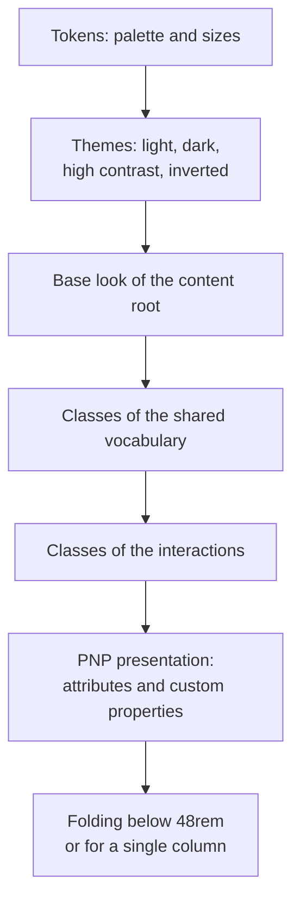

# Styling

`@assesskit/player/player.css` is the stylesheet of a content root: the base look, the QTI 3 shared vocabulary and its CSS
classes, the interaction classes of the best practices guide, and the presentation that a candidate's PNP asks for. It is
one file, without `@import`, so that a constructed stylesheet can hold it.



| Context                     | How the stylesheet is used                                      |
| --------------------------- | --------------------------------------------------------------- |
| A content root (an item)    | The shadow root of the item adopts it. `:host` is the root.     |
| The document of a PCI frame | The frame links it. `:root` is the root.                        |
| The host page               | Never. Its rules for `:root` and `body` would restyle the page. |

```ts
import css from "@assesskit/player/player.css?inline"; // any bundler that imports a file as text

const host = document.createElement("div");
const root = host.attachShadow({ mode: "open" });
const sheet = new CSSStyleSheet();
sheet.replaceSync(css);
root.adoptedStyleSheets = [sheet];
root.adoptedStyleSheets.length; // => 1
sheet.cssRules.length > 100; // => true
```

A content root has `contain: layout paint` and `isolation: isolate`, so fixed-position item CSS cannot cover the chrome.
Paint containment clips at the border box, so the root has padding of the width of a focus ring.

WebKit applies a change of the viewport to the media queries of an adopted sheet only for the roots that hold it at that
time. A root that appears after a resize can lay out for the old width. Keep the sheet adopted by one root that lives as
long as the player does.

## Themes

A theme is a palette. The other colors derive from it with `color-mix()`, so a color that the player sets stays in step.
Set the attributes on the host of the root, or on `<html>` of a frame.

| Attribute                     | Text on background     | Accent    | Borders and focus ring            |
| ----------------------------- | ---------------------- | --------- | --------------------------------- |
| none                          | `#1a1a1a` on white     | `#0b57d0` | the text, 62% over the background |
| `data-ak-polarity="inverted"` | `#f2f2f2` on `#121212` | `#8ab4f8` | as above                          |
| `data-ak-contrast="high"`     | black on white         | `#0000b3` | the text, 2px borders, 4px ring   |
| both                          | white on black         | `#ffff00` | as above                          |

In every theme the text has at least 7:1 against the background, the accent and the muted text at least 4.5:1, and the
borders, the focus ring and the selection lines at least 3:1 (WCAG 1.4.3, 1.4.11). The tests check each pair.

## What the player sets

The player sets these on the host of the root, as inline custom properties on the same element as the attributes. A
property that is not set has its default. `presentationOf` builds them from a candidate's supports and `applyPresentation`
sets them ([supports](supports.md)); a frame of a portable custom interaction gets them on its `html` element
([PCI](pci.md)).

| PNP support                            | Property or attribute                    | Value, default                                               |
| -------------------------------------- | ---------------------------------------- | ------------------------------------------------------------ |
| `invert-display-polarity`              | `data-ak-polarity`; `--ak-fg`, `--ak-bg` | `inverted`; the colors of the profile. Default: off          |
| `high-contrast`                        | `data-ak-contrast`                       | `high`. Default: off                                         |
| `text-appearance` colors               | `--ak-fg`, `--ak-bg`                     | Colors. Default: the theme's                                 |
| `text-appearance` font size            | `--ak-font-scale`                        | A number that multiplies the size. Default: `1`              |
| `text-appearance` font face            | `--ak-font-family`                       | A font family list. Default: `system-ui, sans-serif`         |
| `text-appearance` line height          | `--ak-line-height`                       | A number that multiplies the base of 1.5. Default: `1`       |
| `text-appearance` line spacing         | `--ak-line-spacing`                      | Ems added to the line height. Default: `0`                   |
| `text-appearance` letter spacing       | `--ak-letter-spacing`                    | A length. Default: `normal`                                  |
| `text-appearance` word spacing         | `--ak-word-spacing`                      | A length. Default: `normal`                                  |
| `text-appearance` uniform sizing       | `data-ak-uniform-font`                   | Present: every size is the body size. Default: absent        |
| `text-appearance` wrapping             | `data-ak-wrapping`                       | Present: text wraps, whatever the item says. Default: absent |
| `magnification` of text or all content | `--ak-text-zoom`                         | A number that multiplies the size. Default: `1`              |
| `layout-single-column`                 | `data-ak-single-column`                  | Present: one column. Default: absent                         |
| `keyword-emphasis`                     | `data-ak-keyword-emphasis`               | Present: `.qti-keyword-emphasis` shows. Default: absent      |

The base size is `1rem`, so a root inside a root does not multiply a zoom twice. Magnification of non-text content has no
form in CSS inside the baseline, because `zoom` needs Firefox 126: the renderer multiplies the pixel sizes it gives media by the
media scale of the root, which `setMediaScale` changes without drawing the content again ([content](content.md#the-media-scale)).

These values are not PNP and complete the markup:

| Name                                    | Set by the player to                                                                               | Default |
| --------------------------------------- | -------------------------------------------------------------------------------------------------- | ------- |
| `--ak-rows`                             | The rows of a vertical choice stack: `ceil(choices / columns)`. CSS cannot count children          | `1`     |
| `--ak-choices-width`                    | `data-choices-container-width` as a length, such as `188px`. Typed `attr()` is not in the baseline | `auto`  |
| `--ak-sticky-top`, `--ak-sticky-bottom` | The heights of the sticky chrome, so that a focused element scrolls clear of it (WCAG 2.4.11)      | `0px`   |
| `data-ak-placing`                       | On a graphic gap match or a position object while the candidate holds a choice or the object       | absent  |

## Parts

The vocabulary classes sit on QTI elements, such as `qti-choice-interaction`. The stylesheet needs these parts of an
interaction, which are classes of the player and not of the item:

| Class        | What it is                                                                                             |
| ------------ | ------------------------------------------------------------------------------------------------------ |
| `ak-control` | The native control of a choice, hot text or hotspot. It comes first, and its face follows it.          |
| `ak-face`    | What the candidate sees of it: the text of a choice, a hot text, or the outline of a hotspot.          |
| `ak-choices` | The container of the choices of an order, gap match or graphic gap match, and the first set of a match |
| `ak-targets` | The container of the targets, and the second set of a match                                            |
| `ak-target`  | One target of an order                                                                                 |

The content root ([content](content.md)) builds these parts around the content, which the stylesheet lays out:

| Class or attribute               | What it is                                                                                                                          |
| -------------------------------- | ----------------------------------------------------------------------------------------------------------------------------------- |
| `ak-content`                     | The container of everything the root shows; it carries `lang`.                                                                      |
| `ak-hazards`                     | The notice of a hazard that remains: a border and text, so that it does not rely on color.                                          |
| `ak-rubric`                      | The rubric of the test, above the stimuli.                                                                                          |
| `ak-main`                        | Holds the stimuli and the item. With `data-ak-stimuli` it is two columns from 48rem, and one with a single column.                  |
| `ak-stimuli`, `ak-stimulus`      | The column of the stimuli, and one stimulus.                                                                                        |
| `ak-body`                        | The item.                                                                                                                           |
| `ak-test-feedback`               | The region of the test feedback, after the item.                                                                                    |
| `ak-tablist`                     | A tablist that the player manages; its panels that are not selected have `hidden` ([content](content.md#tabs-and-sortable-tables)). |
| `ak-sort`, `ak-sort-mark`        | The button in the header of a sortable column, and its mark; `aria-sort` of the header says the state.                              |
| `ak-dialog`                      | The dialog of modal feedback, with a backdrop of its own.                                                                           |
| `ak-card`                        | A card of a support beside the content, in a group named after the support ([supports](supports.md)).                               |
| `ak-card-anchor`                 | Holds the button of a card and its popup. The popup is `ak-popup`, with `ak-card-close` and `ak-popup-body`.                        |
| `ak-card-trigger`                | The button that opens the popup of a card.                                                                                          |
| `ak-alternative-text`            | The `alt` of an image shown as text.                                                                                                |
| `data-ak-placeholder`            | An interaction that no renderer has drawn.                                                                                          |
| `data-use` on `qti-rubric-block` | `instructions`, `scoring` or `navigation`.                                                                                          |

```html
<qti-choice-interaction class="qti-labels-upper-alpha qti-labels-suffix-period qti-input-control-hidden">
  <qti-prompt>Which?</qti-prompt>
  <qti-simple-choice>
    <input class="ak-control" type="radio" name="r" aria-label="First">
    <div class="ak-face">First</div>
  </qti-simple-choice>
</qti-choice-interaction>
```

The interactions of [interactions](interactions.md) add these parts. Their elements are the custom elements named for the kind,
and the stylesheet reads the state from attributes:

| Class or attribute                                         | What it is                                                                                                                                          |
| ---------------------------------------------------------- | --------------------------------------------------------------------------------------------------------------------------------------------------- |
| `ak-notes`                                                 | The limits, the hint and the announcements of an interaction, after its content; in a grid it takes the row after the last.                         |
| `ak-instruction`, `ak-hint`                                | The limits that the candidate is told, and the hint for a response that is not valid, which has a mark in front of it.                              |
| `ak-token`, `ak-chip`, `ak-chip-button`, `ak-remove`       | A choice in the pool, a choice in a place, its button, and the button that takes it out. `aria-pressed` marks the one in hand.                      |
| `ak-drop`, `ak-pair`, `ak-target-content`                  | The button that puts the choice in hand in a place; the box of two places of an association; the content of a match target.                         |
| `data-ak-over`, `ak-dragging`                              | The place under a drag, and the choice that is dragged.                                                                                             |
| `ak-slider`, `-track`, `-thumb`, `-end`, `-ticks`, `-tick` | The slider. `data-orientation`, `data-ak-unset` (no value yet), `data-ak-disabled` and `ak-slider-stepped` (steps are labelled) are on `ak-slider`. |
| `ak-fields`, `ak-editor`, `ak-editable`, `ak-counter`      | The fields of an extended text, the editor of XHTML, its editable area, and the counter of characters.                                              |
| `ak-preformatted`                                          | A text area that keeps its spaces.                                                                                                                  |

The graphic interactions ([graphics](graphics.md)) put an image in a stage, with a layer over it that has the drawn size of the
image. The stylesheet needs these parts and attributes:

| Class or attribute                                               | What it is                                                                                                                        |
| ---------------------------------------------------------------- | --------------------------------------------------------------------------------------------------------------------------------- |
| `ak-stage`, `ak-layer`                                           | The image with its container, and the layer over it. A position object interaction uses `qti-position-object-stage` as the stage. |
| `data-shape` on a hotspot                                        | `rect`, `circle`, `ellipse`, `poly` or `default`. A circle and an ellipse have round faces; a polygon draws its outline as SVG.   |
| `data-ak-small` on a hotspot or object                           | Present while it is drawn smaller than a target; the stylesheet gives it a target of 24 pixels.                                   |
| `ak-outline`, `ak-halo`                                          | The SVG of a polygon, and its halo under the line.                                                                                |
| `ak-badge`                                                       | The number of a hotspot in an order.                                                                                              |
| `ak-surface`, `ak-crosshair`                                     | The part of the image that takes a click and the focus of the keyboard, and the crosshair that the arrow keys move.               |
| `ak-marker`, `ak-object`, `ak-start`                             | A marked point, a placed object, and the first point of a shape.                                                                  |
| `ak-tray`, `ak-pick`, `ak-pick-label`                            | The tray under the stage of a position object, and the button that holds the object.                                              |
| `ak-links`, `ak-associations`                                    | The lines of a graphic associate, and the list of its pairs, with a `ak-remove` button each.                                      |
| `ak-toolbar`, `ak-tools`, `ak-colors`, `ak-actions`, `ak-canvas` | The parts of a drawing.                                                                                                           |
| `ak-draggable`, `ak-dragging`                                    | A source of a drag that is not on a board, and the source while it is carried.                                                    |
| `ak-usage`                                                       | How to operate the interaction, in text beside it.                                                                                |
| `aria-disabled="true"` on a `ak-control`                         | A hotspot of a graphic associate that the runtime's rules leave no pair for.                                                      |

The player sets these custom properties as inline styles: `--ak-image-width` and `--ak-image-height` on a layer, the
size of the image in the units of its coordinates; `--ak-scale` on a layer, the drawn pixels for one unit; `--ak-x`,
`--ak-y`, `--ak-w` and `--ak-h` on a hotspot, object, marker or crosshair, its box or position in those units; and
`--ak-swatch` on a color of the drawing.
| `ak-media-bar`, `-status`, `-time`, `-notice` | The controls of a media interaction, the plays, the time, and what the candidate waits for. |
| `ak-upload`, `-upload-status`, `ak-stored`, `ak-recording` | The picker and the buttons of an upload, what it says, the file that the response holds, and the indicator of a recording. |
| `ak-custom` | Where a host's hook draws a custom interaction. |

A hidden control is visually hidden, stays in the tab order, and shows its focus and its state on its face. The choices
come first in the markup, for a screen reader, and `qti-choices-bottom` and `qti-choices-right` move them only for the
eye. A hot text, a hotspot and a choice use the state of the control: `:checked` and `:focus-visible`.

## The vocabulary

| Group                                               | Classes                                                                                                                             |
| --------------------------------------------------- | ----------------------------------------------------------------------------------------------------------------------------------- |
| Accessibility                                       | `qti-hidden`, `qti-visually-hidden`, `qti-keyword-emphasis`                                                                         |
| Text, boxes, alignment                              | `qti-underline`, `qti-italic`, `qti-bordered`, `qti-well`, `qti-align-*`, `qti-valign-*`                                            |
| Layout                                              | `qti-layout-row`, `qti-layout-col1` to `12`, `qti-layout-offset1` to `11`                                                           |
| Display, flex, spacing, size, indent                | `qti-display-*`, `qti-flex-*`, `qti-margin-*`, `qti-padding-*`, `qti-height-*`, `qti-width-*`, `qti-fullwidth`, `qti-text-indent-*` |
| Lists                                               | `qti-list-style-type-*`                                                                                                             |
| Vertical writing                                    | `qti-writing-mode-*`, `qti-float-*`, `qti-text-orientation-upright`, `qti-text-combine-upright-all`                                 |
| Choice                                              | `qti-labels-*`, `qti-labels-suffix-*`, `qti-orientation-*`, `qti-choices-stacking-1` to `5`, `qti-input-control-hidden`             |
| Text entry, inline choice, gap                      | `qti-input-width-1` to `72`                                                                                                         |
| Extended text                                       | `qti-height-lines-3`, `-6`, `-15`                                                                                                   |
| Vertical choice, text, extended text, inline choice | `qti-writing-orientation-vertical-rl`, `-lr`, `qti-labels-cjk-ideographic`                                                          |
| Match, gap match, graphic gap match, order          | `qti-choices-top`, `-bottom`, `-left`, `-right`; `qti-match-tabular`, `qti-header-hidden`                                           |
| Order targets                                       | `qti-labels-*` and `qti-labels-suffix-*` on `qti-order-interaction`                                                                 |
| Hotspot, graphic gap match, hot text                | `qti-selections-light`, `-dark`, `qti-unselected-hidden`, `qti-input-control-hidden`                                                |

The messages (`data-max-selections-message`, `data-patternmask-message`, `data-prompt`, `data-first-column-header`), the
counters (`qti-counter-up` and `-down`) and the media attributes are behavior of the elements, so the stylesheet does not
read them.

## Where the sources differ

| Case                                                                                                                                                                                           | Reading                                                                            |
| ---------------------------------------------------------------------------------------------------------------------------------------------------------------------------------------------- | ---------------------------------------------------------------------------------- |
| The list of classes names `qti-writing-mode-vertical-tb`, the sample `qti-writing-mode-horizontal-tb`                                                                                          | Both set `horizontal-tb`                                                           |
| The list of classes has `kannada`, `katakana` and `katakana-iroha`, which the sample lacks; the sample has `ethiopic-halehame*`, `hangul`, `hangul-consonant` and `urdu`, which the list lacks | Every name of both is a class                                                      |
| `qti-input-width-40` is in the summary tables and the inline choice, not in the text entry                                                                                                     | A class of every interaction                                                       |
| `qti-gap-placement` is in the summary tables, with no definition                                                                                                                               | Not styled                                                                         |
| The sample has pixel widths, `.container` and `.container-fluid` (Bootstrap 2)                                                                                                                 | A twelve-column grid of fractions with a gutter; the containers are not vocabulary |
| The margin and padding classes define `s` and `e` as left and right for left-to-right text                                                                                                     | Logical: the start and the end of the line                                         |
| `qti-header-hidden` does not display the header row                                                                                                                                            | The row is visually hidden and stays for a screen reader                           |
| `qti-unselected-hidden` on a hot text shows "no buttons"                                                                                                                                       | It hides the controls too                                                          |
| Hidden selections show on focus; a graphic gap match also while placing                                                                                                                        | `:focus-visible`, `:checked` and `data-ak-placing`                                 |
| `qti-labels-*` without a class                                                                                                                                                                 | No label: the best practices guide leaves the default to the platform              |

Below 48rem, about the 767px of the sample's mobile breakpoint, and for a candidate who wants a single column, rows, stacks and containers become
one column. A horizontal stack folds the same way, for the best practices guide advises vertical choices where a row would leave the
viewport.

## Evidence

`pnpm test:browser` renders fixtures of every class in Chromium, Firefox and WebKit, runs axe on them, and checks WCAG 2.2
1.4.1, 1.4.3, 1.4.4, 1.4.10, 1.4.11, 1.4.12, 2.4.7, 2.4.11 (the sticky chrome) and 2.5.8 in every theme. Run
`pnpm exec playwright install` first. `pnpm compat:engines` loads the stylesheet in Chromium 111, Firefox 115 and WebKit
16.4.

## Files

| File                              | Concept                                                                                                                            |
| --------------------------------- | ---------------------------------------------------------------------------------------------------------------------------------- |
| `packages/player/player.css`      | The stylesheet of a content root: tokens, themes, the shared vocabulary, the interaction classes, the presentation and the folding |
| `src/player/delivery/styles.ts`   | The stylesheet of the chrome, which uses the system colors                                                                         |
| `src/player/tools/styles.ts`      | The stylesheets of the toolbar, the panels and what lies over the item                                                             |
| `src/player/supports/styles.ts`   | The stylesheet of the panel of supports, reading aloud and the notice of the variant                                               |
| `src/player/submission/styles.ts` | The stylesheet of the display of a submission                                                                                      |

## References

| Specification                                                                                          | Topics                                                        |
| ------------------------------------------------------------------------------------------------------ | ------------------------------------------------------------- |
| [QTI 3 Standardized Shared Vocabulary and CSS Classes](https://www.imsglobal.org/spec/qti/v3p0/vocab/) | The classes of the vocabulary and the interaction classes     |
| [QTI 3.0 Best Practices and Implementation Guide](https://www.imsglobal.org/spec/qti/v3p0/impl/)       | Display supports, magnification and the layout of choices     |
| [WCAG 2.2](https://www.w3.org/TR/WCAG22/)                                                              | Contrast, text spacing, reflow, focus appearance, target size |
