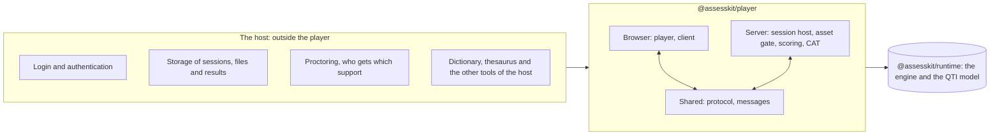

# Supported

What `@assesskit/player` draws and operates. A cell says Yes, Partly (the note says what is left out) or No (see Not
included).

| Part                                                                                                            | Supported | Notes                                                                                                                                                              |
| --------------------------------------------------------------------------------------------------------------- | --------- | ------------------------------------------------------------------------------------------------------------------------------------------------------------------ |
| Item and stimulus bodies, shared stimuli, HTML, MathML, SSML, stylesheets, shared CSS classes                   | Yes       | Content is sanitized: no script, event handler, inline style or reference outside the package                                                                      |
| Images, audio, video, text tracks, `object`, links                                                              | Yes       | Package files only, or an origin that the host allows                                                                                                              |
| Tabs (`tablist`, `tab`, `tabpanel`) and tables sorted by a column (`aria-sort`)                                 | Yes       | ARIA roles that QTI keeps without behavior, given it by the content root ([content](content.md#tabs-and-sortable-tables))                                          |
| Feedback, template content, rubric blocks, catalogs and cards                                                   | Yes       | As the view of the runtime resolves them                                                                                                                           |
| The 20 interactions of QTI 3.0 besides the two custom ones                                                      | Yes       | Each with keyboard operation, and without a drag where the interaction takes a drag                                                                                |
| Portable custom interactions                                                                                    | Yes       | In a sandboxed frame; modules load from the package                                                                                                                |
| Custom interaction (deprecated)                                                                                 | Partly    | A hook of the host draws it; without the hook the player shows a notice                                                                                            |
| Navigation, submission, confirmations, timers, review, solution, comments, suspension                           | Yes       | The controls come from the actions that the view lists and that the policy of the host allows                                                                      |
| Exam mode: session host, asset gate, scheduler, stores, caller binding, proctor                                 | Yes       | The answer keys stay on the server                                                                                                                                 |
| Practice mode: the engine on the device                                                                         | Yes       | The same client interface as exam mode                                                                                                                             |
| Personal needs and preferences: look, color themes, cards, captions, reading aloud, magnification, masks, tools | Yes       | See [Supports](supports.md) and [Tools](tools.md)                                                                                                                  |
| Companion materials: rule, protractor, calculators, line reader, digital and physical materials                 | Yes       |                                                                                                                                                                    |
| Interface languages                                                                                             | Yes       | English in the player and Indonesian in `@assesskit/player/messages/id`; the language of the host chooses the catalog of those it passes ([messages](messages.md)) |
| Adaptive testing                                                                                                | Yes       | Through the runtime's `CatPort`: a client for the REST binding of CAT 1.0, or any engine                                                                           |
| LTI items: read, shown and scored; the launch goes through the port `LtiLogin`                                  | Yes       | [LTI items](lti-items.md); the launch and the grade services are in interopkit                                                                                     |
| Scoring: submissions for raters, supplying a score, provisional results                                         | Yes       | [Scoring](scoring.md)                                                                                                                                              |

| Engine   | Oldest version | How it is tested                                                        |
| -------- | -------------- | ----------------------------------------------------------------------- |
| Chromium | 111            | The suites in the current engine, and a smoke test in the oldest one    |
| Firefox  | 115            | The same                                                                |
| Safari   | 16.4           | The suites in the current WebKit, and a smoke test in the oldest WebKit |

The server folders (`server`, `cat-rest`) run on Node.js 22 or later. [Baseline](baseline.md) lists
the features that the browser code does not use.

## WCAG 2.2, levels A and AA

| How the criteria are checked | Criteria                                                                                                                                                                                                                            |
| ---------------------------- | ----------------------------------------------------------------------------------------------------------------------------------------------------------------------------------------------------------------------------------- |
| A test of their own          | 1.1.1, 1.2.1, 1.2.2, 1.2.3, 1.2.5, 1.3.1, 1.4.1, 1.4.2, 1.4.3, 1.4.4, 1.4.10, 1.4.11, 1.4.12, 1.4.13, 2.1.1, 2.1.2, 2.1.4, 2.2.1, 2.4.3, 2.4.7, 2.4.11, 2.5.1, 2.5.7, 2.5.8, 3.1.2, 3.2.4, 3.3.1, 3.3.2, 3.3.3, 3.3.4, 4.1.2, 4.1.3 |
| axe-core only                | 1.3.2, 1.3.4, 2.2.2, 2.3.1, 2.4.1, 2.4.4, 2.4.6, 2.5.2, 2.5.3, 3.1.1, 3.2.1, 3.2.2: axe-core runs with the rules of both levels on the rendered player and decides what it can                                                      |
| By a person                  | 1.3.3, 1.4.5, 3.2.3, 3.2.6: the message catalog, the chrome for images of text, the order of the chrome and the slot for help                                                                                                       |
| Not applicable               | 1.2.4, 1.3.5, 2.4.2, 2.4.5, 2.5.4, 3.3.7, 3.3.8                                                                                                                                                                                     |

| Criterion                       | Why it does not apply                                                       |
| ------------------------------- | --------------------------------------------------------------------------- |
| 1.2.4 Captions (Live)           | The player has no live media.                                               |
| 1.3.5 Identify Input Purpose    | The player collects no personal data; login is the host's.                  |
| 2.4.2 Page Titled               | The page is the host's. The view gives the titles of the test and the item. |
| 2.4.5 Multiple Ways             | A test is a process, which the criterion excepts.                           |
| 2.5.4 Motion Actuation          | No input comes from motion.                                                 |
| 3.3.7 Redundant Entry           | Nothing is entered twice.                                                   |
| 3.3.8 Accessible Authentication | Authentication is the host's. An LTI launch needs no cognitive test.        |

The suites cannot show that a whole product is accessible: the host's page, its login and its content are the host's.

## Not included

| Not included                                                                                                                                                                                                                   | Why                                                                                                                                                                                                                                                                                                             |
| ------------------------------------------------------------------------------------------------------------------------------------------------------------------------------------------------------------------------------ | --------------------------------------------------------------------------------------------------------------------------------------------------------------------------------------------------------------------------------------------------------------------------------------------------------------- |
| LTI launches, the grade services, Caliper events and any other protocol of a learning platform                                                                                                                                 | [interopkit](https://github.com/interopkit/interopkit) implements them; the player has the ports they plug into.                                                                                                                                                                                                |
| Deciding who gets which support, encouragement and environment supports, proctoring                                                                                                                                            | The host decides and runs them. The player applies the profile it is given.                                                                                                                                                                                                                                     |
| Authoring                                                                                                                                                                                                                      | The player shows content; it has no editor.                                                                                                                                                                                                                                                                     |
| Lockdown, connectivity and session-flow extras: pausing on a blur of the window, full screen, blocking copy and screenshots, watermarks, a safe exam browser, alerts for a lost connection, idle dialogs, redirects on discard | None is QTI, and the exam application owns the page and the browser. The player gives the ports they plug into, and the proctor's `suspend` and `resume` ([the proctor](server.md#the-proctor)).                                                                                                                |
| UI languages beyond English and Indonesian                                                                                                                                                                                     | `language-of-interface` is elective in QTI. A host adds a language, or changes a text, with the catalogs it passes to `selectMessages` or to the option `messages` of a mount ([messages](messages.md)); the player ships English and Indonesian as modules of their own.                                       |
| Components for React, Vue and other frameworks, and a service that validates over HTTP                                                                                                                                         | `mountDelivery` is plain DOM, which a framework hosts in an element it owns; a wrapper is the host's, or an example when a product needs one. Longsight ships components for React and Preact, and Amp-up for Vue 2 and Vue 3. A service calls `validate` of the runtime, which is pure and runs in any server. |
| Print and paper export of items                                                                                                                                                                                                | The player shows an item on a screen, and `player.css` has no print layout. Paper needs page sizes, answer sheets and a document format, which an application or an authoring tool owns; Citolab and TAO export to Word and PDF in extensions.                                                                  |
| A magnifier lens and a mask for a free area of the screen                                                                                                                                                                      | QTI defines magnification as an amount, which the player applies to the content ([magnification](supports.md#magnification)). A lens and a mask are tools of some products, TAO among them, and not terms of the profile.                                                                                       |
| Storage of sessions, files and results                                                                                                                                                                                         | The host gives the player stores and a file store.                                                                                                                                                                                                                                                              |
| The dictionary, thesaurus, homophone checker, note taking, visual organizer, outliner, peer interaction and spell checker supports                                                                                             | The conformance text lists them as elective, so the tools are the host's. The player has a slot for each ([tools](tools.md#tools-of-the-host)).                                                                                                                                                                 |
| A time extension for a candidate during a session                                                                                                                                                                              | Not included in the runtime either ([why](../runtime/supported.md#not-included)): QTI gives extra time through the PNP at `start`, and a proctor covers a disruption with `suspend` and `resume` ([the proctor](server.md#the-proctor)).                                                                        |
| A read of the status, the current item and the time left of a session for a proctor's dashboard                                                                                                                                | `HostSession` is the host's side of the actions and of the pending work. A dashboard reads the stored session through the store it gave and the engine's `view`, and the player adds no second read of it.                                                                                                      |
| Fetching from a network on its own                                                                                                                                                                                             | The CAT adapter takes a `fetch` that the host passes; the player never fetches by itself.                                                                                                                                                                                                                       |
| Live captions and media that the content does not provide                                                                                                                                                                      | The player shows the media and tracks of the content.                                                                                                                                                                                                                                                           |
| Certification by 1EdTech                                                                                                                                                                                                       | Certification is for products, with member-only test sets. [Conformance](../runtime/conformance.md) says what is implemented, feature by feature.                                                                                                                                                               |

## The claim

| Part                     | Evidence                                                                                                                                                                                                                                |
| ------------------------ | --------------------------------------------------------------------------------------------------------------------------------------------------------------------------------------------------------------------------------------- |
| What the runtime decides | Items are differentially tested and test sessions are specification-tested: [the runtime's claim](../runtime/supported.md#the-claim) holds for the player, which draws and operates what the runtime describes.                         |
| What the player adds     | Tested in Chromium, Firefox and WebKit on the 1EdTech examples and on fixtures, with axe-core at WCAG 2.2 levels A and AA, with scripted keyboard use, and over HTTP for the exam server and the integrations: [Evidence](evidence.md). |
| Certification            | None: 1EdTech grants it to products. [Conformance](../runtime/conformance.md) maps each feature ID of its Appendix A to a guide and a test.                                                                                             |
