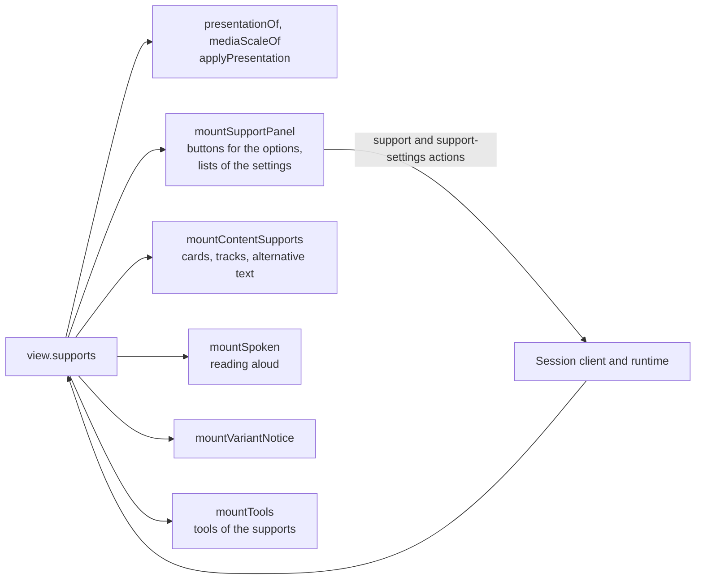
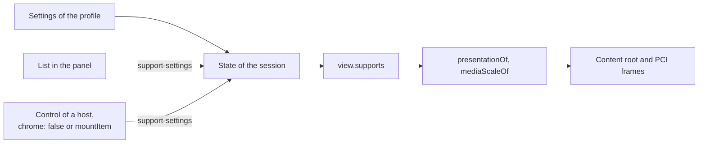

# Supports

A candidate's personal needs and preferences (PNP) arrive in the runtime's view as `SupportView`s: a `name`, a `state`, whether
the support is `active`, and its `settings`: those of the profile, as the candidate changed them. The player applies each support that is on. It does not
decide which candidate has which support, and it does not choose the variant: the runtime does both, and the player shows the result.



| Part                                  | What it does                                                                                               |
| ------------------------------------- | ---------------------------------------------------------------------------------------------------------- |
| `presentationOf`, `applyPresentation` | The look: themes, color themes, colors, text size and face, spacing, zoom, single column, keyword emphasis |
| `mountSupportPanel`                   | The buttons that turn the supports that are options on and off, and the lists of their settings            |
| `mountContentSupports`                | Cards of the catalog, text tracks of media and the alternative text of images                              |
| `mountSpoken`                         | Reading aloud: the controls, the word-by-word cursor, the typing echo and the reading type                 |
| `mountVariantNotice`                  | The variant that the runtime delivered, and its language                                                   |
| `PciFrame.setPresentation`            | The look inside the frame of a portable custom interaction ([PCI](pci.md))                                 |
| `mountTools`                          | The tools that supports put on the screen ([tools](tools.md))                                              |

The parts do not navigate and do not build the chrome. The chrome mounts them, calls `update` with `view.supports` for every
view, and sends the `support` and `support-settings` actions when a part asks for one ([in the player](#in-the-player)).

```ts
import { selectMessages } from "@assesskit/player";
import { applyPresentation, mountSupportPanel, presentationOf } from "@assesskit/player/player";

const supports = [
  { name: "high-contrast", state: "option", active: true },
  { name: "magnification", state: "active", active: true },
];

const chrome = document.createElement("div");
document.body.append(chrome);
const requests = [];
const panel = mountSupportPanel(chrome, {
  messages: selectMessages("en"),
  onSupport: (name, active) => requests.push([name, active]),
});
panel.update(supports);
chrome.querySelector("button")?.getAttribute("aria-pressed"); // => "true"
chrome.querySelector("button")?.click();
requests; // => [["high-contrast", false]]

const host = document.createElement("div");
const look = presentationOf(supports);
look.attributes; // => new Map([["data-ak-contrast", "high"]])
look.properties; // => new Map([["--ak-text-zoom", "2"]])
applyPresentation(host, look);
host.getAttribute("data-ak-contrast"); // => "high"
```

## In the player

`mountDelivery` ([delivery](delivery.md)) is a chrome that mounts the parts and feeds them `view.supports` of every view. A
host that draws its own chrome (`chrome: false`) keeps the parts that act on the content and mounts the panel and the tools
itself. `mountItem` ([items in a page](delivery.md#items-in-a-page)) mounts the same parts, without the panel and the tools.

| Part                   | Where it is                                      | When it is updated                                                                                      |
| ---------------------- | ------------------------------------------------ | ------------------------------------------------------------------------------------------------------- |
| `applyPresentation`    | The host of the content root, and the PCI frames | When the supports of the view differ from the last view's                                               |
| `setMediaScale`        | The content root                                 | Together with `applyPresentation`; the content is not drawn again                                       |
| `mountSupportPanel`    | Above the content, in a region named Supports    | With every view. Not drawn with `chrome: false` or in `mountItem`                                       |
| `mountVariantNotice`   | Above the content                                | With every view                                                                                         |
| `mountContentSupports` | The content root                                 | When the content was drawn again or the supports of the view differ from the last view's                |
| `mountSpoken`          | Above the content, and the content root          | Together with `mountContentSupports`                                                                    |
| `mountTools`           | Above the content, and over the item             | When the item or the supports of the view differ from the last view's ([tools](tools.md#in-the-player)) |

- **Options** are the supports whose state is `option`. A button sends `{ type: "support", name, active }` through the session
  client, so in an exam the host receives it like any other action (the default client-action policy allows it). The button
  follows the next view, and a refusal such as `support-not-available` is said in the status region.
- **Other supports** have no control. The panel lists a support that is `active` or `assigned` with its state, such as
  "Additional testing time: on", so that the candidate sees what is in force; the supports also show by what they change. A
  prohibited support is not listed and changes nothing.
- **Answers do not undo the supports.** A view that carries only an answer has the supports of the view before, so the cards,
  text tracks and reading controls stay as they are, and a popup that the candidate opened stays open.
- **The voice** of reading aloud is `hooks.voice`, by default the voice of the browser ([speech](speech.md)). It reads with
  the pronunciation lexicons of the item shown: the shell loads the files that `documents.lexicons` names, through the gate,
  and leaves out one that is missing or is not a PLS document ([speech](speech.md#lexicons)).
- **Settings** that the candidate may change have a list in the panel while their support is on: the color theme, the amount
  of magnification, and the preferences of reading aloud and of braille. A choice sends `{ type: "support-settings", settings }`, the state keeps it, and the next view applies it, so
  it holds for later items and after a reload ([the settings](#the-settings)).
- **The magnification** of non-text content reaches media sized in pixels at once: the shell sets the media scale of the
  content root from `mediaScaleOf` with every change of the supports, and the item is not drawn again, so what the candidate
  typed and chose stays.

## The support action

The runtime turns a support on or off for the `support` action `{ type: "support", name, active }`, and only when the support's
state is `option`. It refuses the action for a prohibited support, one that is on from the start and one that
is assigned with `support-not-available`, and records the supports that were on for the item in the results.

- The panel and the tools ask; they never decide. A button shows the `active` flag of the last input, and it calls
  `onSupport(name, !active)` when pressed. The host sends the action, and the next view says whether it took effect.
- A prohibited support has no control and is not listed. A support that is `active` or `assigned` has no control either,
  because the runtime would refuse it; the panel lists it with its state.
- `{ type: "support-settings", settings }` changes the settings of a support that is on, whatever its state. The runtime takes
  the settings whole and refuses one that changes what only the profile sets with `setting-not-adjustable`
  ([delivery](../runtime/delivery.md#suspension-supports-and-variants)).
- The panel does not list the supports that the toolbar of the tools turns on and off (`line-reader`, `answer-masking`,
  `calculator-on-screen`, the on-screen tools but the glossary, and the custom supports `ext:highlighter` and `ext:eliminator`), so that no support has two controls.

## The look

`presentationOf(supports)` builds a `Presentation`: the attributes and custom properties that [player.css](styling.md)
reads. `applyPresentation(target, presentation)` sets them on the host of a content root, or on the `html` element of a
frame, and takes off those that an earlier presentation set. Other attributes and properties of the element stay.

| Support                   | Attribute or property                                                                            |
| ------------------------- | ------------------------------------------------------------------------------------------------ |
| `high-contrast`           | `data-ak-contrast="high"`                                                                        |
| `invert-display-polarity` | `data-ak-polarity="inverted"`; `--ak-fg` and `--ak-bg` from `foreground` and `background`        |
| `text-appearance`         | `data-ak-theme` and the attributes above ([color theme](#the-color-theme))                       |
|                           | `--ak-fg` (`fontColor`), `--ak-bg` (`backgroundColor`), `--ak-font-scale` (`fontSize` over 12)   |
|                           | `--ak-font-family` (`fontFace`), `--ak-line-height`, `--ak-line-spacing`                         |
|                           | `--ak-letter-spacing` and `--ak-word-spacing` in ems; `data-ak-uniform-font`, `data-ak-wrapping` |
| `magnification`           | `--ak-text-zoom` from `allContent`, or from `text`                                               |
| `layout-single-column`    | `data-ak-single-column`                                                                          |
| `keyword-emphasis`        | `data-ak-keyword-emphasis`                                                                       |

`mediaScaleOf(supports)` gives the factor for the pixel sizes of media, from `allContent` or `nonText`; it is the `mediaScale`
option of the content root and the argument of `setMediaScale` ([content](content.md#the-media-scale)), and it is 1 without
a magnification.

| Case                                                                  | Reading                                                                                                             |
| --------------------------------------------------------------------- | ------------------------------------------------------------------------------------------------------------------- |
| A support that is off, or prohibited                                  | Sets nothing                                                                                                        |
| `text-appearance` and `invert-display-polarity` both give a color     | The color of `text-appearance` wins                                                                                 |
| A color theme with high contrast, polarity or the colors of a profile | The theme decides the colors, and the others set nothing of them, so that `default` is the default colors           |
| A magnification without a positive `zoomAmount`                       | 200 percent, the enlargement that WCAG 1.4.4 asks the text to survive                                               |
| `fontSize`                                                            | Points, with 12 as 1: the PNP schema gives 12 as the default size and no unit; a size of 0 or less asks for nothing |
| `letterSpacing` and `wordSpacing`                                     | Ems: the schema gives a float and no unit                                                                           |
| `lineHeight` and `lineSpacing`                                        | A multiple of the base height of 1.5, and ems added to it                                                           |
| A font name                                                           | Quoted as a CSS string, with the backslash and the quote escaped and control characters turned into spaces          |

## The settings

The profile sets the preferences of a support when the session starts, and the candidate changes them during the session, as
CERT asks of braille (`A-10b`), magnification (`A-30a`, `A-30b`) and reading aloud (`A-40d`, `A-40e`), and the best practices
guide of the color theme. The kind, grade and mathematics of braille choose among the files of a braille or tactile card that
state them ([cards](#cards)); the rest of the preferences of braille are the screen reader's, which reads the page. The panel has a list for each
setting that the player follows, while its support is on. A choice reports the settings whole, those of the view with the value
chosen; the host sends them as `support-settings`, the runtime keeps them in the state, and the next view applies them to the
content root and the frames at once, without drawing the item again.



| Support           | List                          | Values                                                                                                                                      |
| ----------------- | ----------------------------- | ------------------------------------------------------------------------------------------------------------------------------------------- |
| `text-appearance` | Color theme                   | The 14 terms of `color-theme`, and a theme of a program that the profile names                                                              |
| `magnification`   | Zoom                          | 100 to 400 percent: 100, 125, 150, 175, 200, 250, 300, 350, 400; an amount of the profile too                                               |
|                   | Zoom of text                  | The same, in place of Zoom when the profile magnifies text apart                                                                            |
|                   | Zoom of images                | The same, in place of Zoom when the profile magnifies non-text content apart                                                                |
| `spoken`          | Speech rate, words per minute | 100, 120, 150, 180, 210, 240, 300; a rate of the profile too; for `computer-read-aloud` only, as a screen reader has preferences of its own |
|                   | Pitch of the voice            | 0 to 100 percent by 25, as the PNP gives the pitch from 0 to 1                                                                              |
|                   | Volume of the voice           | 25 to 100 percent by 25                                                                                                                     |
|                   | How links are read            | The 4 terms of `link-indication`                                                                                                            |
|                   | Repeat what I type            | The 4 terms of `typing-echo`                                                                                                                |
| `braille`         | Braille delivery              | Refreshable display, or embossed on paper, which shows the text of a braille card                                                           |
|                   | Braille grade                 | 1, 2 and 3                                                                                                                                  |
|                   | Kind of braille               | UEB and EBAE, and a kind of a program that the profile names                                                                                |
|                   | Braille of mathematics        | Nemeth and UEB, and a kind of a program that the profile names                                                                              |

- **Each list** is a `select` with a label, so the pointer, the keyboard and a screen reader operate it as any list of the page:
  the first characters choose an entry, and the arrow keys move in it. It keeps the focus while views arrive, and it shows what
  the next view says, not the request, so a refusal leaves it as it was.
- **A list without a value** selects nothing: a profile that names no color theme leaves the colors to the other supports.
  A magnification that names no amount shows 200 percent, the zoom that the player applies then.
- **A setting of the program**, such as the restrictions of reading aloud, has no list: the runtime refuses a change of it.
- **A host without chrome**, or with `mountItem`, draws its own control and sends the same action through the session client.
- **A program that offers a setting to everyone** gives every candidate the support, such as `text-appearance` or
  `magnification`, as a universal support; the candidate turns it on and then changes its settings.

### The color theme

The best practices guide says that a candidate whose profile has the color theme must be able to change it at any time and to go
back to the default colors, and CERT asks the same of `text-appearance` as a whole (`A-42a`). So the list shows while
`text-appearance` is on, with or without `colorTheme` in the profile. A theme decides the colors: high contrast, polarity and the
colors of `text-appearance` set none of theirs while it is in force, so that `default` is the default colors whatever the profile
asks for. The chrome stays in the system colors, as it does for high contrast and inverted polarity.

| Term                                                                                                                                                       | Look                                                          |
| ---------------------------------------------------------------------------------------------------------------------------------------------------------- | ------------------------------------------------------------- |
| `default`                                                                                                                                                  | The default colors                                            |
| `default-reverse`                                                                                                                                          | `data-ak-polarity="inverted"`                                 |
| `high-contrast`                                                                                                                                            | `data-ak-contrast="high"`                                     |
| `high-contrast-reverse`                                                                                                                                    | Both                                                          |
| `yellow-blue`, `blue-yellow`, `black-rose`, `rose-black`, `black-cyan`, `cyan-black`, `black-cream`, `cream-black`, `medgray-darkgray`, `darkgray-medgray` | `data-ak-theme`, a palette of [player.css](styling.md#themes) |
| `ext:` and a name                                                                                                                                          | `data-ak-theme`; the stylesheet of the host gives the palette |

### Magnification

The guide asks that the candidate can change the amount of magnification at any time, at least up to 400 percent, starting at
the `zoom-amount` of the profile. The list of the zoom sets `zoomAmount` of `allContent`, or of `text` and `nonText` when the
profile magnifies them apart.

| Type         | What grows                                                                                                          |
| ------------ | ------------------------------------------------------------------------------------------------------------------- |
| `allContent` | The text of the content root (`--ak-text-zoom`) and media sized in pixels (`mediaScaleOf`); also with no type named |
| `text`       | The text of the content root, which reflows in its containers                                                       |
| `nonText`    | Media sized in pixels; an image never grows past the width of its container                                         |

The content root is the main content of the guide: the item with its interactions, the stimuli, the rubric and the feedback.
At 400 percent in a page 1280 pixels wide, which WCAG 1.4.10 takes as 320 pixels, the text reflows with no scrolling in two
directions and loses no content. The chrome (navigation, timers, toolbar and panel) keeps the size of the page and follows the
zoom of the browser, as the guide lets the delivery system choose how far the interface around the content grows.

## The panel

`mountSupportPanel(host, options)` puts a region named Supports into `host`, with a toggle button (`aria-pressed`) for each
support whose state is `option`, and a line of text with the state of each support that is `active` or `assigned`, such as
"Additional testing time: on" or "Additional testing time: off". The line has no control. It adopts its stylesheet into the
document or shadow root of `host`.

| Option       | Type                                           | Meaning                                                                                                       |
| ------------ | ---------------------------------------------- | ------------------------------------------------------------------------------------------------------------- |
| `messages`   | `Messages`                                     | The text of the interface; the supports are named in its language.                                            |
| `onSupport`  | `(name: SupportName, active: boolean) => void` | Called when the candidate asks to turn a support on or off.                                                   |
| `onSettings` | `(settings: SupportSetting) => void`           | Called with the settings whole when the candidate changes one. With it the panel has the lists. Default: none |
| `language`   | `string`                                       | The language of the interface, in which the lists write numbers. Default: `"en"`                              |

`update(supports)` shows the buttons and the lines for the supports of the view, in their order, then the lists of the settings,
and keeps the focus on the control that has it. A prohibited support is not shown. A custom support is named by the local name of its element. `destroy()` takes the panel away.

## Cards

A catalog gives the content of a support for an element that names it with `data-catalog-idref`. A `qti-card`
names one of 15 supports or an extension (the `support` of the schema). `mountContentSupports(root, options)` shows the
cards of the supports that are on, with `ContentRoot.card`; the card is chosen by the language of the support.

| Option     | Type       | Meaning                    |
| ---------- | ---------- | -------------------------- |
| `messages` | `Messages` | The text of the interface. |

`update(supports)` replaces what an earlier call applied. Call it after `show` of the root settles, and again when the
supports change. `destroy()` gives the content back as the root drew it.

| Support                                                               | The card shows                                                                                         |     |
| --------------------------------------------------------------------- | ------------------------------------------------------------------------------------------------------ | --- |
| `glossary-on-screen`                                                  | in a popup, on request                                                                                 |     |
| `keyword-translation`                                                 | in a popup, on request, in the language of the support                                                 |     |
| `linguistic-guidance`, `additional-directions`, `keyboard-directions` | in a popup, on request                                                                                 |     |
| A custom support (`ext:`)                                             | in a popup, on request                                                                                 |     |
| `high-contrast`                                                       | in place of the content                                                                                |     |
| `simplified-graphics`, `simplified-language-portions`                 | in place of the content                                                                                |     |
| `sign-language`                                                       | beside the content, the entry of the language of the support                                           |     |
| `audio-description`, `transcript`                                     | beside the content                                                                                     |     |
| `long-description`                                                    | beside the content; visually hidden unless `hideVisually` is `false`                                   |     |
| `braille`                                                             | beside the content; the text is visually hidden unless the delivery is `embossed`, the files are links |     |
| `tactile`                                                             | beside the content; its files are links                                                                |     |
| `spoken`                                                              | not shown: a card for the voice of a host                                                              |     |

The language of a card is that of `keyword-translation` or `sign-language` for their own cards, else that of the
`item-translation` support when it is on, else none, which gives the default entry of the card (the runtime's `selectCard`).
While `braille` is on, its kind, grade and mathematics choose among the entries of a card that state them, as the braille and
tactile cards of the guide do.

Beside the content means inside the element at its end, or after it when the element cannot hold content (`img`, `video`,
`audio`, `object`, `iframe`, `canvas`, `svg`, `math`, `input`, `select`, `textarea`, `br`, `hr`). The card is a `div` of the
class `ak-card` with `role="group"`, named after the support and with `data-ak-card`.

In place of the content means the children of the element are replaced, and come back when the support goes. The face of a
choice (`.ak-face`) is replaced and its control stays. A picture or media is hidden and the card stands after it. An
element that holds a control and has no face keeps its content, and its card comes beside it.

Two supports without a card also change the content:

| Support             | Effect                                                                                                          |
| ------------------- | --------------------------------------------------------------------------------------------------------------- |
| `captions`          | The `captions` and `subtitles` text tracks of `audio` and `video` are `showing`; they get their mode back later |
| `audio-description` | The `descriptions` text tracks are `showing`; the browser decides how it presents their cues                    |
| `alternative-text`  | The `alt` of each image stands after it as text; an empty `alt`, which marks decoration, gets nothing           |

### Media

The player of a media interaction ([interactions](interactions.md)) and the supports share the text tracks and the
recording, so that a support does not play beside the player.

- The captions and the audio description buttons of the player show the mode of the tracks, whoever set it: with the
  support `captions` on, the button of the captions is pressed, and the candidate can still turn the captions off with it.
- The media of a `sign-language` or an `audio-description` card is the recording of the element in another form, so it
  follows the recording of the element when the element has one: it plays, pauses, seeks and changes speed with it. It has
  no controls and no sound of its own while it follows, so that the candidate cannot play it beyond `max-plays` or through a
  pause the item forbids. Without a recording to follow it keeps its controls.
- The transcript card stands inside the media interaction, after the player.

### Popups

A popup meets WCAG 1.4.13 (content on hover or focus). The button that opens it is inside the element, named after the
support. The popup is a group with a Close button.

| Rule        | Behavior                                                                                                                                     |
| ----------- | -------------------------------------------------------------------------------------------------------------------------------------------- |
| Shows       | While the pointer is over the button or the popup, while the focus is in either, and after the button is pressed                             |
| Dismissible | Escape, whatever has the focus or the pointer, and the Close button, hide it without moving either. It shows again after both have left      |
| Hoverable   | The popup touches the button, so the pointer goes onto it without leaving both; the pointer may rest on it                                   |
| Persistent  | A press keeps it until a second press, Escape or Close, or until the focus leaves it; otherwise it stays while the pointer or focus is there |
| Place       | Script puts it inside the host of the root, which clips at its border box: below the button, above when there is more room there, shifted in |
| Focus       | Dismissing with the focus in the popup gives the focus to the button                                                                         |

## Reading aloud

`mountSpoken(host, root, options)` applies the spoken support to a content root and puts the controls into `host`.

| Option     | Type                 | Meaning                                                                     |
| ---------- | -------------------- | --------------------------------------------------------------------------- |
| `messages` | `Messages`           | The text of the interface.                                                  |
| `language` | `string`             | The language of content that states none, a BCP 47 tag.                     |
| `voice`    | `SpeechHook`         | The voice: a host's text-to-speech, or `webSpeech()` ([speech](speech.md)). |
| `lexicons` | `readonly Lexicon[]` | The pronunciation lexicons of the item. Default: none.                      |

`update(supports)` reads the `spoken` support that is on. Call it after `show` of the root settles, and again when the
supports change. It throws `DataError` for settings that reading aloud cannot use, such as a pitch above 1.
`setLexicons(lexicons)` replaces the lexicons for the next reading, such as when the item changes; it throws `DataError`
unless `lexicons` is a list of what `parseLexicon` makes.

| Reading type                           | What it does                                                                                                                               |
| -------------------------------------- | ------------------------------------------------------------------------------------------------------------------------------------------ |
| `screen-reader`, or none (the default) | No controls. `applyReadingType` keeps what `data-qti-suppress-tts` marks out of the accessibility tree                                     |
| `computer-read-aloud`                  | A group Spoken with Read aloud and Stop reading. Read aloud reads the content with the settings of the support; the voice gets the request |
| No spoken support                      | No controls; the voice is stopped                                                                                                          |

With the restriction type `word-by-word` the group also has Previous word and Next word, which read the word before and
after the one read last, and Read aloud reads that word again. The candidate chooses the word with them because a
selection inside a shadow root cannot be read in every browser. A word that the speech model leaves out is skipped. The
text of the word shows in an output, which also says when there is nothing to read or the voice failed.

With a `typingEcho` other than `none`, `echoTyping` repeats what the candidate types in the text areas and text inputs of
the root, and stops when the support goes.

## The variant

`mountVariantNotice(host, options)` shows which version of a question the runtime delivered (`CandidateItem.variant`). The runtime
chooses it at the first presentation, from the hazards the candidate avoids and the language of the `item-translation`
support, and fixes it for the session. The player shows the choice and decides nothing.

| Option     | Type       | Meaning                                                                       |
| ---------- | ---------- | ----------------------------------------------------------------------------- |
| `messages` | `Messages` | The text of the interface.                                                    |
| `language` | `string`   | The language of the interface, in which the language of the variant is named. |

`update(variant)` takes `CandidateItem.variant`. For a variant with a language it says, in a note, "Language of this
version: Indonesian", with the name in the language of the interface and marked with the language it names (WCAG 3.1.2). A
variant without a language says that an adapted version is shown. `undefined`, the question itself, shows nothing. The
`language` of a variant also belongs in the `language` of `RootContent`, so that the content has the right `lang`
([content](content.md)). The hazards that remain after the choice are the notice of the content root.

## Input requirements

`input-requirements` asks for full keyboard control or full mouse control. Every control of these parts works
with the keyboard alone and with the pointer alone, so the support changes nothing: buttons are buttons, the popup opens on
hover and on focus, and Escape has the Close button as its pointer equivalent.

## Errors

A support that is wrong for the candidate is not an error of the player: the runtime refuses the action and the status region says why. What a host can meet:

| Error                                                   | When                                                                                                                                                                                                                    | What to do                                                                                            |
| ------------------------------------------------------- | ----------------------------------------------------------------------------------------------------------------------------------------------------------------------------------------------------------------------- | ----------------------------------------------------------------------------------------------------- |
| `DataError`                                             | The host of a part is not an element in the document, or the root of the content root is not a shadow root                                                                                                              | Mount the part after the host is in the page, and pass the content root that `createContentRoot` made |
| `DataError`                                             | The list of supports is not an array of `SupportView`: a support of the wrong type, with an unknown property, with a name that is not a support, or with settings that are not those of its support or are out of range | Pass `view.supports` as the runtime gave it                                                           |
| `DataError`                                             | An option, such as `onSupport`, `messages` or `hooks`, is of the wrong type                                                                                                                                             | Fix the option; the message names it                                                                  |
| A refusal `support-not-available` in the status region  | The panel asked for a support that is prohibited, on from the start or assigned, or for the settings of one that is off                                                                                                 | The runtime decides; the panel has no button for these, so a host's own button should not offer them  |
| A refusal `setting-not-adjustable` in the status region | A host's control changed a setting that only the profile sets                                                                                                                                                           | Change only the settings of `ADJUSTABLE_SETTINGS`                                                     |
| A support with no visible effect                        | It is `prohibited`, or the content has nothing for it: a card the catalog lacks, a track the media lacks                                                                                                                | Nothing: see [the cards](#cards) for what an absent card leaves                                       |
| No voice for reading aloud                              | The browser has none for the language, or `hooks.voice` fails                                                                                                                                                           | The error goes to `hooks.onError` ([speech](speech.md#errors))                                        |

## Not included

| Not included                                                                                                          | Why                                                                                     |
| --------------------------------------------------------------------------------------------------------------------- | --------------------------------------------------------------------------------------- |
| Deciding which candidate has which support                                                                            | The system that administers the test decides; the runtime reads the profile             |
| Choosing the variant of an item                                                                                       | The runtime chooses it; the player shows the notice                                     |
| Dictionary, thesaurus, homophone checker, note taking, visual organizer, outliner, peer interaction and spell checker | Tools of the host: the player has a slot for each ([tools](tools.md#tools-of-the-host)) |
| A control for a support that is on from the start or assigned                                                         | The runtime would refuse it; the panel lists the support with its state                 |
| Live captions and media that the content does not provide                                                             | The player shows the media and tracks of the content                                    |

## Where the sources differ

| Case                                                                                             | Reading                                                                                     |
| ------------------------------------------------------------------------------------------------ | ------------------------------------------------------------------------------------------- |
| The design lists `captions` and `alternative-text` with the cards                                | The schema gives a `qti-card` no such `support`; they act on text tracks and on `alt`       |
| The best practices guide leaves the presentation of a card to the platform                       | The table above                                                                             |
| `item-translation` has a language but no card                                                    | Its language chooses the entry of the cards of supports that have none of their own         |
| The PNP schema gives no unit for sizes and spacing                                               | Points over 12 for the font size, ems for the spacing                                       |
| The guide has `color-theme`, and the PNP schema does not                                         | The runtime reads it ([spec gaps](../runtime/spec-gaps.md), G49), and the player acts on it |
| The two gray themes are below the contrast of the other themes                                   | The guide asks for 3:1 to 4:1, as a choice of the candidate (G51)                           |
| The guide marks braille and tactile files with `data-` attributes and says nothing of the choice | The runtime's `selectCard` chooses by the braille settings (G52)                            |

## Evidence

`pnpm test:browser` mounts every part in Chromium, Firefox and WebKit, runs axe at WCAG 2.2 A and AA on each of them
(popups open, in the themes), presses real keys and pointer buttons, and drives them with the runtime's engine: a click on the
panel sends the `support` action, a list sends `support-settings`, and the next view applies them. The popup tests cover the three conditions of
1.4.13. A running frame of a portable custom interaction takes a new look (`pci` in `pci.browser.test.ts`).

## Files

Each file of `src/player/supports/`, `src/player/presentation/` holds one concept.

| File                           | Concept                                                                       |
| ------------------------------ | ----------------------------------------------------------------------------- |
| `supports/appearance.ts`       | The look and the media scale of the supports                                  |
| `supports/cards.ts`            | Showing the cards of the supports                                             |
| `supports/check.ts`            | The check of the supports of a view                                           |
| `supports/content.ts`          | `mountContentSupports`                                                        |
| `supports/index.ts`            | The public API                                                                |
| `supports/internal.ts`         | Helpers that other folders and tests share, which the package does not export |
| `supports/media.ts`            | Text tracks and alternative text                                              |
| `supports/names.ts`            | The name of a support                                                         |
| `supports/panel.ts`            | `mountSupportPanel`                                                           |
| `supports/popup.ts`            | The popup of a card                                                           |
| `supports/settings.ts`         | The lists of the settings that the candidate changes                          |
| `supports/spoken.ts`           | `mountSpoken`                                                                 |
| `supports/styles.ts`           | The stylesheet of the parts in the chrome                                     |
| `supports/variant.ts`          | `mountVariantNotice`                                                          |
| `presentation/index.ts`        | The public API                                                                |
| `presentation/internal.ts`     | Helpers that other folders and tests share, which the package does not export |
| `presentation/presentation.ts` | The presentation of the supports, its check and its application               |

## References

| Specification                                                                                    | Topics                                                                                                                                             |
| ------------------------------------------------------------------------------------------------ | -------------------------------------------------------------------------------------------------------------------------------------------------- |
| [WCAG 2.2](https://www.w3.org/TR/WCAG22/#resize-text)                                            | resize text                                                                                                                                        |
| [QTI 3.0 Best Practices and Implementation Guide](https://www.imsglobal.org/spec/qti/v3p0/impl/) | catalogs and cards, custom supports, display supports, magnification, personal needs and preferences, reading type, support states, text to speech |
| [WCAG 2.2](https://www.w3.org/TR/WCAG22/#language-of-parts)                                      | language of parts                                                                                                                                  |
| [ECMA-402](https://tc39.es/ecma402/#intl-displaynames-objects)                                   | Intl.DisplayNames                                                                                                                                  |
| [WCAG 2.2](https://www.w3.org/TR/WCAG22/#target-size-minimum)                                    | target size                                                                                                                                        |
| [WCAG 2.2](https://www.w3.org/TR/WCAG22/#content-on-hover-or-focus)                              | content on hover or focus                                                                                                                          |
| [QTI 3.0 ASI Information Model](https://www.imsglobal.org/spec/qti/v3p0/info/)                   | card                                                                                                                                               |
| [QTI 3 Standardized Shared Vocabulary](https://www.imsglobal.org/spec/qti/v3p0/vocab/)           | visually hidden                                                                                                                                    |
| [HTML Standard](https://html.spec.whatwg.org/multipage/media.html#attr-track-kind)               | the kind of a track                                                                                                                                |
| [WCAG 2.2](https://www.w3.org/TR/WCAG22/#captions-prerecorded)                                   | captions                                                                                                                                           |
| [WCAG 2.2](https://www.w3.org/TR/WCAG22/#audio-description-prerecorded)                          | audio description                                                                                                                                  |
