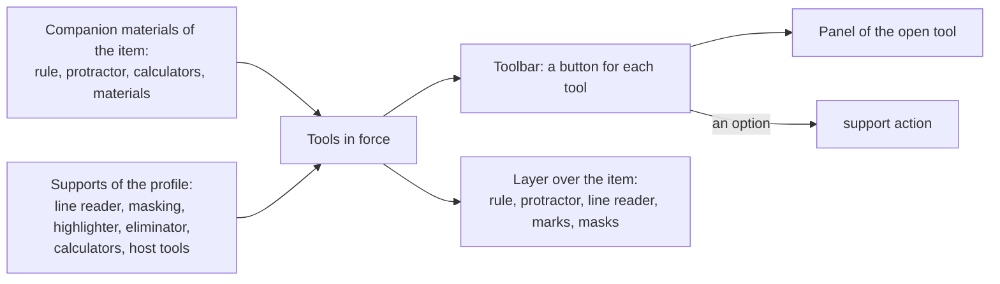
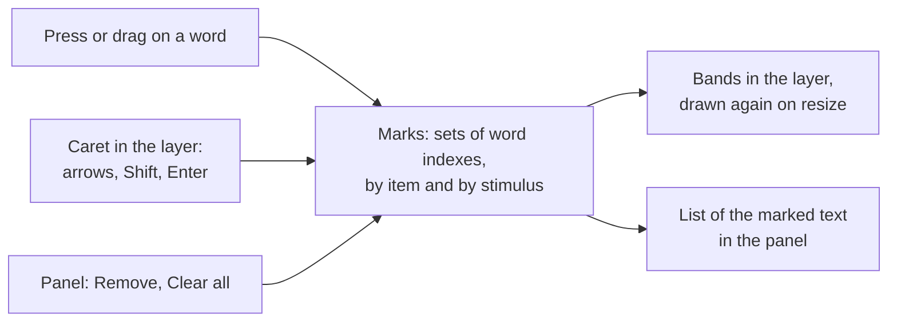

# Tools of the host

The tools of an item are what the item's companion materials ask the player to provide and what the candidate's profile
puts on the screen: a rule, a protractor, calculators, digital and physical materials, a line reader, answer masking, a
highlighter, an answer eliminator and the tools that the host provides, such as a dictionary. `mountTools` of `@assesskit/player/player` shows them.



| Tool                                                                                                         | Comes from                               | Built in |
| ------------------------------------------------------------------------------------------------------------ | ---------------------------------------- | -------- |
| Rule                                                                                                         | `qti-rule`                               | yes      |
| Protractor                                                                                                   | `qti-protractor`                         | yes      |
| Basic, standard and scientific calculators                                                                   | `qti-calculator`, `calculator-on-screen` | yes      |
| Graphing calculator                                                                                          | the same                                 | host     |
| Digital material                                                                                             | `qti-digital-material`                   | a viewer |
| Physical material                                                                                            | `qti-physical-material`                  | a notice |
| Line reader                                                                                                  | `line-reader`                            | yes      |
| Answer masking                                                                                               | `answer-masking`                         | yes      |
| Highlighter                                                                                                  | `ext:highlighter`                        | yes      |
| Answer eliminator                                                                                            | `ext:eliminator`                         | yes      |
| Dictionary, thesaurus, homophone checker, notes, visual organizer, outliner, peer interaction, spell checker | `*-on-screen` supports                   | host     |

## Quick start

Mount the tools that the profile puts on the screen, press the button of one and see the request that the host gets:

```ts
import { selectMessages } from "@assesskit/player";
import { mountTools } from "@assesskit/player/player";

const toolbar = document.createElement("div");
const item = document.createElement("div");
item.style.position = "relative";
document.body.append(toolbar, item);

const requests = [];
const tools = mountTools(toolbar, {
  messages: selectMessages("en"),
  language: "en",
  stage: item,
  assets: (path) => `https://assets.example/g/token/${path}`,
  slots: {
    dictionary: (host, { language }) => {
      host.textContent = `A dictionary for ${language}`;
      return () => host.replaceChildren();
    },
  },
  onSupport: (name, active) => requests.push([name, active]),
});

tools.update({
  companion: null,
  supports: [
    {
      name: "line-reader",
      state: "option",
      active: false,
      settings: { name: "line-reader", replaceAccessModes: [], highlightColor: "#336699" },
    },
  ],
});
toolbar.querySelector("button")?.textContent; // => "Line reader"
toolbar.querySelector("button")?.click();
requests; // => [["line-reader", true]]
tools.destroy();
```

## In the player

`mountDelivery` ([delivery](delivery.md)) mounts the tools of the item presented and of the profile. The toolbar and the
panels go above the content, in the chrome; what lies over the item goes into the stage of the content root
(`ContentRoot.stage`, [content](content.md#the-stage)), which holds the item and stays when the item changes. With every view
that has another item or other supports, and with every view whose content was drawn again, the shell gives `update` the
`companionMaterials` of the item, the `supports` of the view and the names of the content, once the content is shown. A tool that stays in force stays open where the candidate put it when the next item
comes, and the others close; with no item presented there are no tools. A button for a tool of the profile that is an
option sends the `support` action, and the tool opens when the next view says it is on. The tools of the host come from
`hooks.tools`. A host that draws its own chrome (`chrome: false`) gets no tools from the shell and mounts `mountTools` itself.

The stage takes only the stylesheet of what lies over the item (the layer, the line reader, the marks and the masks); the toolbar and
the panels have another, adopted into the chrome, so that their classes do not restyle the interactions of the item.

## Mounting

`mountTools(host, options)` puts a region named Tools into `host`: a toolbar with a button for each tool, the physical
materials, and a tray with the panel of each open tool. The tools that lie over the item go into a layer that the mount
appends to `stage`. It adopts its stylesheet into the document or shadow root of `host` and of `stage`, and gives it back
on `destroy`.

| Option      | Type                                           | Meaning                                                                                                                                     |
| ----------- | ---------------------------------------------- | ------------------------------------------------------------------------------------------------------------------------------------------- |
| `messages`  | `Messages`                                     | The text of the interface, from `selectMessages`.                                                                                           |
| `language`  | `string`                                       | The language of the interface, a BCP 47 tag, which the tools of the host get.                                                               |
| `stage`     | `HTMLElement`                                  | The element that holds the rendered item, in a document or a shadow root. Its `position` must not be `static`.                              |
| `assets`    | `(path: string) => string`                     | Turns the path of a file in the package into the URL to load it from.                                                                       |
| `slots`     | `ToolSlots`                                    | The tools that the host provides, by name. A function builds the tool in `host` and returns the function that takes it down. Default: `{}`. |
| `onSupport` | `(name: SupportName, active: boolean) => void` | Called when the candidate turns a tool of the profile that is an option on or off: the host sends the `support` action.                     |

`tools.update(input)` shows the tools for an item and a candidate. Call it with every new view. A tool that stays in force
stays open, where the candidate put it; the others go, and the focus goes to the button of a tool that took it down.
`tools.destroy()` takes everything down and leaves the item as it was.

`mountTools` and `update` throw `DataError` for a `host`, an option or an input of the wrong type. A function of `slots` that
throws, or that returns something other than a function, makes `update` throw after it has shown the other tools; its
panel is taken down.

### Input

`update` takes the companion materials of the item, or `null`, the supports of the view: the `supports` of the runtime's
`CandidateView`, as they are, and the names of the content. The supports that put no tool on the screen are ignored.

| Field                 | Meaning                                                                                                                                                                                                                                                                                                                                                                                          |
| --------------------- | ------------------------------------------------------------------------------------------------------------------------------------------------------------------------------------------------------------------------------------------------------------------------------------------------------------------------------------------------------------------------------------------------ |
| `companion`           | The `CompanionMaterialsInfo` of the runtime's `asi` module, which `readAsi` gives as `item.companionMaterials`, or `null`                                                                                                                                                                                                                                                                        |
| `supports[].name`     | The support. Those that put a tool on the screen are `line-reader`, `answer-masking`, `calculator-on-screen`, `dictionary-on-screen`, `thesaurus-on-screen`, `homophone-checker-on-screen`, `note-taking-on-screen`, `visual-organizer-on-screen`, `outliner-on-screen`, `peer-interaction-on-screen`, `spell-checker-on-screen`, and the custom supports `ext:highlighter` and `ext:eliminator` |
| `supports[].state`    | `prohibited`, `active`, `option` or `assigned`, the `SupportState` of the runtime's `pnp` module                                                                                                                                                                                                                                                                                                 |
| `supports[].active`   | Whether the tool is on                                                                                                                                                                                                                                                                                                                                                                           |
| `content`             | `{ item, stimuli }`: names of the item presented and of the stimuli it shares, in the order they are shown, so that what the highlighter and the answer eliminator keep comes back with the content. Default `null`: it lasts until the next `update`                                                                                                                                            |
| `supports[].settings` | The settings of the profile: `highlightColor` (`#RGB` or `#RRGGBB`) of `line-reader`, default the player's own; `calculatorType` of `calculator-on-screen`, a calculator type or an extension term, default `basic`                                                                                                                                                                              |

The tools read these parts of the companion materials; the runtime keeps a decimal as the text that the document has, and the player
reads it as a number.

| Element                 | Parts read                                                                                    |
| ----------------------- | --------------------------------------------------------------------------------------------- |
| `qti-calculator`        | `calculatorType`, `description` and `calculatorInfo`                                          |
| `qti-rule`              | `description`, and of `ruleSystem` the `minimumLength`, `minorIncrement` and `majorIncrement` |
| `qti-protractor`        | `description`, and of `increment` the `minorIncrement` and `majorIncrement`                   |
| `qti-digital-material`  | `fileHref`, `label`, `mimeType` and `resourceIcon`                                            |
| `qti-physical-material` | the text                                                                                      |

`update` checks the parts it reads, and throws `DataError` for a model of another shape, such as one that a plain JavaScript
or JSON caller builds by hand. Units of length are `Millimeter`, `Centimeter`, `Meter`, `Kilometer`, `Inch`, `Foot`, `Yard`
and `Mile`; units of angle are `Radian`, `Degree`, `Minute` and `Second`.

## Tools in force

- The item's rules, protractors, calculators and digital materials are in force, and the physical materials are listed.
- Each support of the profile that is not `prohibited` puts its tool in force, whatever the item asks for: a candidate with
  `calculator-on-screen` has a calculator when the item has none.
- A calculator that the item and the profile both name is one tool. The profile's `calculator-on-screen` without a type
  asks for a basic calculator, and with an extension term for no calculator that the player knows.
- A prohibited `calculator-on-screen` removes the item's calculators too: the profile says that the candidate may not use
  one. A prohibited `line-reader`, `answer-masking` or other support removes that tool.
- The toolbar lists the item's tools in the order rule, protractor, calculator, digital material, then the profile's tools.
  Tools of one name are numbered: Ruler 1, Ruler 2.

A tool whose support is an `option` follows the `active` flag of the input, never the candidate's own request: pressing its
button calls `onSupport(name, !active)`, and the tool opens or closes when the next input says so. The focus then moves into
a tool that the candidate opened. The runtime turns only an option on and off, so a tool whose
support is `active` or `assigned` is open at first when its `active` flag is on, and then the candidate opens and closes it
like a tool that only the item asks for, which opens and closes at once.

## The tools

Every tool has a panel in the tray with a heading, its description when the item gives one, and a button that closes it and
gives the focus back to the toolbar. Controls are at least 2.75rem square.

### Rule

A bar as long as `minimumLength` in the unit of the major increment, with a tick at each minor and major increment and
a number at each major tick, in the unit of the major increment, and the symbol of the unit at the bottom. It is drawn at
the size of CSS units (96 pixels to the inch) when it fits in the width of the stage less 32 pixels, and smaller, with the
same proportions, when it does not. Ticks closer than 3 pixels are left out, and numbers closer than 32 pixels are
thinned, so that an increment of a millionth of the length costs nothing.

### Protractor

A half circle that measures 180 degrees, with ticks at the minor and major increments along the arc, and numbers at the
major ticks on two rings: from the right end of the base line on the outer one, from the left end on the inner one. The
radius is half the width of the stage less 16 pixels, between 96 and 200. It turns about the center of its base line.

### Moving and turning

The rule and the protractor lie over the item and are placed by the candidate.

| Operation | Pointer                                                             | Keyboard, on the tool                                  |
| --------- | ------------------------------------------------------------------- | ------------------------------------------------------ |
| Move      | Drag the tool, or the four buttons of the panel (10 pixels)         | Arrow keys (10 pixels), with Shift 1 pixel             |
| Turn      | The two rotate buttons (5 degrees), or the angle field of the panel | Page Up and Page Down (5 degrees), with Shift 1 degree |

The angle field takes whole degrees; angles are kept between -180 and 180. A tool stays in the stage, which clips it. When
an element takes the focus and the tool would hide it, the tool moves out of its way.

### Line reader

A band of the profile's highlight color, 40 percent opaque, over one line of the item's text at a time. The lines come from
the text on the page, so the band follows wrapped text, resizing and changes of the item. It moves with Up and Down on the
band, Home and End, and the Previous line and Next line buttons of the panel, and it scrolls into view. The band takes no
pointer events and lets the text show through. An item without text has no band; the panel says so.

### Answer masking

The choices of every `qti-choice-interaction` in the stage are hidden, visually and to assistive technology, and a mask in
their place says so and has a button that shows them. The mask covers an interaction that the renderer adds
later and comes back if the renderer removes it. The button stays, to hide the choices again; the focus stays on it. The
support's `active` flag turns masking on for the item and off again.

### Highlighter

The custom support `ext:highlighter` (a term of the PNP schema allows no hyphen) marks the words of the item's text. QTI
names no highlighter, and a text selection inside a shadow root cannot be read in every browser of the baseline, so the
highlighter works on words, drawn in the layer; it never changes the DOM of the item.



| Part            | Rule                                                                                                                                                                                                                                                         |
| --------------- | ------------------------------------------------------------------------------------------------------------------------------------------------------------------------------------------------------------------------------------------------------------ |
| A word          | A run of characters that are no space, or one Han, Hiragana or Katakana character. A word lies in one text node. Text in inputs, text areas, selects and buttons is left out; a script that writes no spaces, Thai for one, has whole phrases for words      |
| Pointer         | A press on a word marks it or takes its mark away, and a drag from one word to another marks the run; a press on a link, a button, a label or a field is for that control. A press needs no drag (2.5.7)                                                     |
| Keyboard        | The caret is a focusable element in the layer. Left and Right move to the next and the previous word, Up and Down to the word nearest in the line below and above. Shift with an arrow extends from where the caret was, within the part, and Escape lets go |
| Enter           | Marks the words from the caret, or from where the extension began; when each of them is marked already, it takes the marks away                                                                                                                              |
| Marks           | Bands in the layer, one for each line a run takes, drawn again when the stage changes size. They never enter a response, an action or a report                                                                                                               |
| Panel           | Lists the runs of marked words with their text and a Remove button that names the text, and has Clear all marks, so that marks have a non-visual form; a status line says each word and each change                                                          |
| Parts           | The stimuli (`ak-stimulus`) and the item (`ak-body`) of the content root are parts; a stage without them is one part. A mark is kept by the name of its part and the index of its word, so a stimulus that items share keeps its marks across items          |
| Memory          | The marks stay in the mount: turning the tool off and on again brings them back. Without `content` in the input they last until the next `update`. They are lost on reload; keeping them needs a store of the host                                           |
| Content changes | The index of a mark that the content no longer has is out of range, and the mark is dropped when the mount is told of the content; marks of another item or stimulus are not drawn over it                                                                   |

### Answer eliminator

The custom support `ext:eliminator` puts a toggle button, named with the choice ("Cross out Alpha") and with `aria-pressed`,
at the end of each `qti-simple-choice` of a `qti-choice-interaction`. A crossed-out choice has a line through its text and
stays selectable; the cross-out never reaches a response. It is not answer masking, which hides the choices until they are shown.
The cross-outs stay in the mount by item and come back with the item; the buttons go with the tool and return with it.

### Calculators

The type of a calculator comes from the item's `qti-calculator-type` or from the `calculator-type` of the candidate's
`calculator-on-screen`, which the candidate gets even when the item has no calculator; a profile that names no type gets the
basic calculator. The basic calculator has the digits, the decimal point, the four operations, equals and clear. The standard
calculator adds memory (MC, MR, M+, M−), percent, square root and change of sign. The scientific calculator adds the keys that
the best practices guide lists for it. Results are rounded to 12 significant digits on the display, each number keeps all its
digits for the next operation, and at most 12 digits can be typed.

| Calculator | Order of operations                                                                                                                              |
| ---------- | ------------------------------------------------------------------------------------------------------------------------------------------------ |
| Basic      | As entered, from left to right, as on a desktop calculator: 2 + 3 × 4 = gives 20                                                                 |
| Standard   | The same                                                                                                                                         |
| Scientific | Powers and roots (grouped from the right: 2 ^ 3 ^ 2 is 512), then nPr and nCr, then × and ÷, then + and −, and parentheses: 2 + 3 × 4 = gives 14 |

| Key                | Result                                                                                                                                                     |
| ------------------ | ---------------------------------------------------------------------------------------------------------------------------------------------------------- |
| %                  | After + or −, that percent of the left operand (200 + 10 % is 200 + 20); after × or ÷, or alone, a hundredth                                               |
| √, ÷               | An error for a negative number and for a division by zero; only clear takes the error away                                                                 |
| ±                  | Changes the sign of the number typed, or of the result                                                                                                     |
| C                  | Clears the calculation and keeps the memory, and on the scientific calculator the unit of angle                                                            |
| M+, M−             | Adds to or subtracts from the memory; a sign "Memory in use" shows while the memory is not 0                                                               |
| sin, cos, tan      | In the unit of angle of the list above the keys: degrees, radians or gradians; a right angle gives an exact result, and the tangent of 90 degrees an error |
| Inv, Hyp           | The next trigonometric function is the inverse one, the hyperbolic one, or both; they show as pressed, and a function turns them off                       |
| π, e               | The number, with all its digits                                                                                                                            |
| x², x³, xʸ, ∛, ʸ√x | Square, cube, power and roots; ʸ√x takes the root of the degree typed after it, and a negative number has a root of an odd degree only                     |
| log, ln, 10ˣ, eˣ   | The logarithms to base 10 and e, and their inverses; an error for the logarithm of a number that is not positive                                           |
| 1/x, x!            | The reciprocal, and the factorial of a whole number from 0 to 170                                                                                          |
| nPr, nCr           | Permutations and combinations of the number typed after the key out of the one before it; an error unless both are whole and the second is not larger      |
| ( and )            | A parenthesis starts a number of its own, so an operation comes before it; equals closes those left open                                                   |

The display is an `output` element, so that assistive technology reads each result. Above it a line shows the operations that
wait, such as `2 + 3 × (`. Typing works anywhere in the panel except that Enter presses a focused button:

| Typed            | Key                                           |
| ---------------- | --------------------------------------------- |
| `0` to `9`       | digits                                        |
| `.` or `,`       | decimal point                                 |
| `+` `-` `*` `/`  | the operations                                |
| `=` or Enter     | equals                                        |
| `%`              | percent (standard)                            |
| Escape or Delete | clear                                         |
| `^` `(` `)` `!`  | power, parentheses and factorial (scientific) |

The item can say where a calculator is available: `qti-calculator-info` names a file of the package, which is content for
the candidate. The panel of a built-in calculator shows that file below the keys, in the viewer of
the digital materials, and the panel of a host's tool that has no function shows it below the notice. The tool that the
host builds gets it in `options.file`. The `description` of the calculator is shown above the keys. A host whose program
requires a scientific calculator of its own gives it as the slot `scientific-calculator`, which then replaces the built-in one.

### Digital materials

A button opens a viewer for the file of the package, by the URL that `assets` gives. The button has the label of the
material, or the name of its file, and its icon. The viewer shows the file by its media type, and runs nothing of it:

| Media type             | Viewer                                                                  |
| ---------------------- | ----------------------------------------------------------------------- |
| `image/*`              | an image, with the label as its alternative text                        |
| `audio/*`, `video/*`   | the element, with controls                                              |
| `text/html`            | a frame with an empty `sandbox`                                         |
| anything else, or none | a link that opens in a tab of its own, with `rel="noopener noreferrer"` |

A path with a scheme is not a package path: nothing is loaded, and the panel says that the tool is not available. The
viewer is also the one of the file of a calculator.

### Physical materials

The descriptions are listed under the heading "Materials to have ready", as text.

### Tools of the host

Each tool of the host has a button and a panel, and `slots[name](host, options)` builds the tool in the panel.
The names are `scientific-calculator` (in place of the built-in one), `graphing-calculator`, `dictionary`, `thesaurus`, `homophone-checker`,
`note-taking`, `visual-organizer`, `outliner`, `peer-interaction` and `spell-checker`. The function returns the function
that takes the tool down, which runs when the tool closes and on `destroy`. A tool without a function says that it is not
available. Host tools are not built in: the player does not test them.

| Option     | Meaning                                                                                                                                    |
| ---------- | ------------------------------------------------------------------------------------------------------------------------------------------ |
| `name`     | The tool that the host builds                                                                                                              |
| `language` | The language of the interface, a BCP 47 tag                                                                                                |
| `file`     | For a calculator, the file at which the item says it is available, as `{ url, mimeType, label }` (`url` from `assets`), or `null` for none |

## Accessibility

| Criterion                           | How the tools meet it                                                                                                                                                               |
| ----------------------------------- | ----------------------------------------------------------------------------------------------------------------------------------------------------------------------------------- |
| 2.1.1 Keyboard                      | Every tool and every control works by keyboard: the toolbar, the panels, the keys of the tools above, the calculator by typing                                                      |
| 2.1.4 Character Key Shortcuts       | The typing of the calculator, and the keys of a tool, work only while the focus is in that tool                                                                                     |
| 2.4.11 Focus Not Obscured (Minimum) | The line reader and the masks hide no element that can take focus; the rule and the protractor move away from one that they would hide; panels are in the tray, never over the item |
| 2.5.7 Dragging Movements            | Every move and turn has buttons and keys, the line reader has no drag, and the highlighter marks a word with a press or the keyboard, as a drag does                                |
| 2.5.8 Target Size (Minimum)         | Buttons and fields are at least 2.75rem by 2.75rem                                                                                                                                  |
| 2.5.3 Label in Name                 | A key's name starts with the letters on it: "MC, clear memory"; symbols such as ÷ are named by what they do                                                                         |

The stylesheet uses system colors, so that the tools follow the color scheme and the forced colors of the browser.

## Differences from the references

| Case                                                            | Resolution                                                                                                                                                                                                                                                                                                                                                                                                                                        |
| --------------------------------------------------------------- | ------------------------------------------------------------------------------------------------------------------------------------------------------------------------------------------------------------------------------------------------------------------------------------------------------------------------------------------------------------------------------------------------------------------------------------------------- |
| The length of a rule                                            | A rule is exactly `minimumLength` long, in the unit of the major increment                                                                                                                                                                                                                                                                                                                                                                        |
| The unit of the numbers of a rule and a protractor              | The unit of the major increment; the unit symbols are not translated                                                                                                                                                                                                                                                                                                                                                                              |
| The extent of a protractor                                      | 180 degrees                                                                                                                                                                                                                                                                                                                                                                                                                                       |
| `qti-calculator-info`                                           | Content for the candidate: the information model says that the calculator is available at the location it names, and that the file is information "to be made available to the learner". The player builds the basic, standard and scientific calculators in and takes the graphing one from the host, so it shows the file and gives it to the host's tool, and never runs it. It is not metadata, and it does not change the type of calculator |
| A highlighter and an answer eliminator, which QTI does not name | Custom supports, `ext:highlighter` and `ext:eliminator`, which `universalSupports` of the engine can give every candidate of a form as an option                                                                                                                                                                                                                                                                                                  |
| Masks                                                           | Only `qti-choice-interaction` is masked: the best practices guide requires masks for choice interactions only                                                                                                                                                                                                                                                                                                                                     |
| A digital material that is an LTI resource                      | A file here; the launch belongs to the host ([LTI items](lti-items.md))                                                                                                                                                                                                                                                                                                                                                                           |
| The decimal separator of the display of a calculator            | A decimal point in every language                                                                                                                                                                                                                                                                                                                                                                                                                 |

## Errors

| Error                                  | When                                                                                                                | What to do                                                                                                                 |
| -------------------------------------- | ------------------------------------------------------------------------------------------------------------------- | -------------------------------------------------------------------------------------------------------------------------- |
| `DataError`                            | The host or the `stage` is not an element in a document, or an option or the input of `update` is of the wrong type | Mount after the elements are in the page; the message names the option                                                     |
| `DataError`                            | The `stage` is positioned `static`                                                                                  | Give it a `position` such as `relative`: the layer of the rule, the protractor, the line reader and the masks goes over it |
| `DataError`                            | The companion materials are not a `CompanionMaterialsInfo` of the runtime's `asi`, as a hand-built object may be    | Pass `item.companionMaterials` as `readAsi` gave it                                                                        |
| `DataError`                            | A function of `slots` returns something other than a function, or throws                                            | `update` shows the other tools first and then throws; the panel of that tool is taken down. Fix the function               |
| "Not available" in a panel             | The item or the profile asks for a tool of the host and `slots` has no function for it                              | Provide the function of that name ([tools of the host](#tools-of-the-host))                                                |
| "Not available" for a digital material | Its path has a scheme, so it is not a package path and nothing is loaded                                            | Give the path of a file of the package ([digital materials](#digital-materials))                                           |

## Not included

| Not included                                                                                                                                     | Why                                                                                                                                                                                                                                                             |
| ------------------------------------------------------------------------------------------------------------------------------------------------ | --------------------------------------------------------------------------------------------------------------------------------------------------------------------------------------------------------------------------------------------------------------- |
| The graphing calculator, and the dictionary, thesaurus, homophone checker, notes, visual organizer, outliner, peer interaction and spell checker | The host provides them through `slots`; the player has a slot, a button and a panel for each, and tests none of them. No open comparator ships a graphing calculator                                                                                            |
| Metric conversion, and a key that converts the number on the display between units of angle                                                      | The guide says the functions of a scientific calculator "may include" them. The calculator has every other key it names, and its list sets the unit in which the functions read and give angles; a program that needs more gives its own calculator in the slot |
| A viewer for every file type of a digital material                                                                                               | The viewer shows the types in [Digital materials](#digital-materials) and runs nothing of the file; any other type is a link that opens in a tab of its own                                                                                                     |
| Physical materials                                                                                                                               | They are things to have ready: the player lists their descriptions under a heading                                                                                                                                                                              |
| Deciding which candidate has which tool                                                                                                          | The profile decides; the player shows the tools in force                                                                                                                                                                                                        |

## Files

Each file of `src/player/tools/` holds one concept.

| File                   | Concept                                                                       |
| ---------------------- | ----------------------------------------------------------------------------- |
| `answer-masking.ts`    | Answer masking                                                                |
| `calculator-engine.ts` | The state and the keys of the calculators                                     |
| `calculator.ts`        | The panel of the basic, standard and scientific calculators                   |
| `check-input.ts`       | The check of the input of the tools                                           |
| `context.ts`           | What a tool needs from the mount                                              |
| `digital.ts`           | A digital material                                                            |
| `eliminator.ts`        | The answer eliminator                                                         |
| `file-viewer.ts`       | Showing a file of the package                                                 |
| `highlighter.ts`       | The highlighter                                                               |
| `index.ts`             | The public API                                                                |
| `internal.ts`          | Helpers that other folders and tests share, which the package does not export |
| `line-reader.ts`       | The line reader                                                               |
| `model.ts`             | The model of the tools in force                                               |
| `mount.ts`             | `mountTools`                                                                  |
| `names.ts`             | The names of the tools                                                        |
| `numbers.ts`           | Numbers on a display                                                          |
| `open.ts`              | Opening a tool                                                                |
| `package-path.ts`      | Package paths and absolute URLs                                               |
| `panel.ts`             | The panel of an open tool                                                     |
| `placed-tool.ts`       | A tool that the candidate places over the item                                |
| `protractor.ts`        | The protractor                                                                |
| `resolve.ts`           | The tools in force for an item and a candidate                                |
| `ruler.ts`             | The rule                                                                      |
| `scale.ts`             | The scales of the rule and the protractor                                     |
| `slot.ts`              | A tool that the host provides                                                 |
| `styles.ts`            | The stylesheets of the toolbar and the stage                                  |
| `word-layout.ts`       | The words of a text, where they are on the page, and their lines              |

## References

| Specification                                                                                    | Topics                                                                                                                                       |
| ------------------------------------------------------------------------------------------------ | -------------------------------------------------------------------------------------------------------------------------------------------- |
| [QTI 3.0 ASI Information Model](https://www.imsglobal.org/spec/qti/v3p0/info/)                   | calculator info, calculator type, companion materials info, digital material, protractor, rule, rule system, units of angle, units of length |
| [CSS Values and Units 4](https://www.w3.org/TR/css-values-4/#absolute-lengths)                   | absolute lengths                                                                                                                             |
| [QTI 3.0 Best Practices and Implementation Guide](https://www.imsglobal.org/spec/qti/v3p0/impl/) | answer masking, calculators, support states, tools                                                                                           |
| [WCAG 2.2](https://www.w3.org/TR/WCAG22/#focus-not-obscured-minimum)                             | focus not obscured                                                                                                                           |
| [WCAG 2.2](https://www.w3.org/TR/WCAG22/#dragging-movements)                                     | dragging movements                                                                                                                           |
| [WCAG 2.2](https://www.w3.org/TR/WCAG22/#contrast-minimum)                                       | contrast minimum                                                                                                                             |
| [WCAG 2.2](https://www.w3.org/TR/WCAG22/#target-size-minimum)                                    | target size                                                                                                                                  |
| [QTI 3.0 Conformance and Certification](https://www.imsglobal.org/spec/qti/v3p0/conf/)           | calculator, line reader                                                                                                                      |
