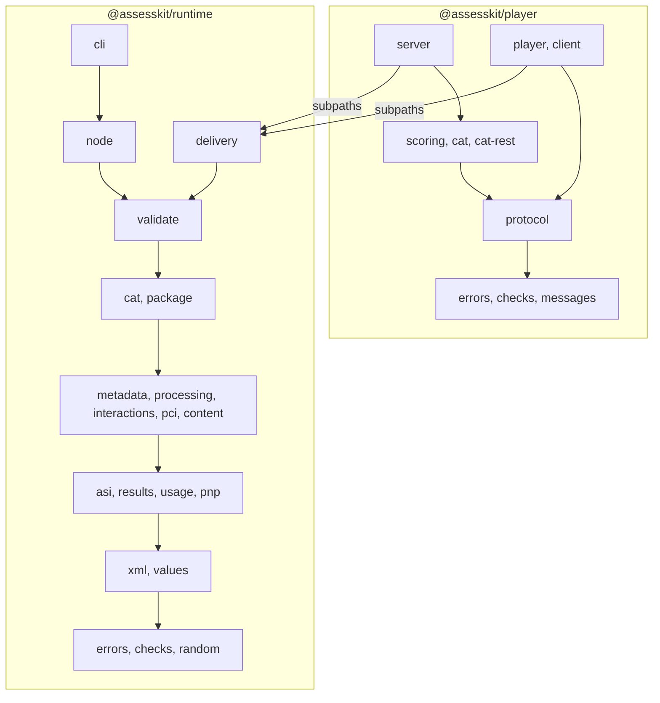

# Architecture

The runtime is one package with a subpath per module. These principles hold for every module; Biome enforces the ones marked
lint, and the rest are checked in review.

| Principle              | Rule                                                                                                                                                                                                                                                     |
| ---------------------- | -------------------------------------------------------------------------------------------------------------------------------------------------------------------------------------------------------------------------------------------------------- |
| Pure core              | Every module except `node` and `cli` uses ECMAScript 2023 and no platform API: no `node:*`, `fetch`, timers, `window`, `document` or `process` (lint). It runs in any JavaScript runtime.                                                                |
| Deterministic          | Randomness comes from a `Random` the caller passes, time from an argument the caller passes. `Math.random`, `Date.now()`, `new Date()` and `performance.now()` fail lint.                                                                                |
| No backtracking regexp | `new RegExp` and `RegExp(` fail lint everywhere in `src/`. Patterns that authors write run on the runtime's linear-time automaton, never on a backtracking engine.                                                                                       |
| No code execution      | No `eval` (lint) and no code loading. Extension points are functions the caller registers.                                                                                                                                                               |
| Untrusted input        | Every input is untrusted: documents, packages, actions, and what resolvers return. Entry points validate deeply, and the JSON they read is read with valibot schemas; inner functions validate shallowly, so a call does not cost the size of the model. |
| Cited rules            | Every semantic rule cites the specification section that defines it, and what the specifications declare has a test that derives it from them ([evidence](evidence.md#completeness)).                                                                    |

## Layers

An arrow points from a layer to the layers it imports. `@assesskit/player` imports the runtime only through its published
subpaths.



A module imports only from lower layers, and imports never form cycles (lint). Every module may import `errors.ts`,
`checks.ts` and `random.ts`; `checks.ts` imports `errors.ts` and valibot only, and `random.ts` imports `errors.ts` and `checks.ts`.
`delivery` is the top library layer, and no runtime module imports it. `packages/runtime` never imports `@assesskit/player`, and
`@assesskit/player` imports the runtime only through its published subpaths, never by relative path.

| Layer | Modules                                | Imports                                                                                                                    |
| ----- | -------------------------------------- | -------------------------------------------------------------------------------------------------------------------------- |
| 1     | `errors.ts`, `checks.ts`, `random.ts`  | as above                                                                                                                   |
| 2     | `xml/`, `values/`                      | none                                                                                                                       |
| 3     | `asi/`, `results/`, `usage/`           | `xml/`, `values/`                                                                                                          |
| 3     | `pnp/`                                 | `xml/`                                                                                                                     |
| 4     | `metadata/`                            | `xml/`, `asi/`                                                                                                             |
| 4     | `processing/`, `interactions/`, `pci/` | `values/`, `asi/`                                                                                                          |
| 4     | `content/`                             | `values/`, `asi/`, `pnp/`                                                                                                  |
| 5     | `cat/`                                 | `values/`, `asi/`, `results/`, `metadata/`                                                                                 |
| 5     | `package/`                             | `xml/`, `asi/`, `metadata/`, `usage/`                                                                                      |
| 6     | `validate/`                            | every module of layers 2 to 5                                                                                              |
| 7     | `delivery/`                            | `values/`, `asi/`, `results/`, `pnp/`, `processing/`, `interactions/`, `pci/`, `content/`, `cat/`, `package/`, `validate/` |
| 8     | `node/`                                | `xml/`, `package/`, `validate/`, `node:*`                                                                                  |
| 9     | `cli/`                                 | `xml/`, `asi/`, `results/`, `usage/`, `pnp/`, `package/`, `validate/`, `node/`, `node:*`                                   |

## Subpaths

Each module is a folder of `src/` with an `index.ts` and a subpath of `exports`. The root `.` re-exports every module
except `node` and `cli`, so the root stays portable. `bin` maps `assesskit` to the CLI.

## Errors and issues

All errors extend `AssesskitError`, and their messages are full sentences that say what is wrong and what is expected.

| Class             | Thrown when                                                                                                               | Carries             |
| ----------------- | ------------------------------------------------------------------------------------------------------------------------- | ------------------- |
| `DataError`       | An argument has the wrong type or is out of range, an untrusted action is not an action, or a state has an unknown format | the message         |
| `ReadError`       | A document is not well-formed, not in the expected namespace, or cannot be mapped to the model                            | `issues`            |
| `SecurityError`   | Input breaks a security rule or a limit: a DOCTYPE, a path escape, a size, depth or ratio above its limit                 | `limit` and `value` |
| `ProcessingError` | Processing meets a condition the specification does not define as NULL                                                    | `identifier`        |

The subpath `errors` exports the errors and the types `Issue` and `IssueLocation` without any other module. The player imports
`AssesskitError` and `DataError` from it.

Validation does not throw. It returns `Issue`s: a severity, a code (`assesskit/<module>/<name>`, or the identifier of a rule
set in BIND section 5), a message and, when known, a location with the file path, line, column and element path.

## Determinism

`Random` is `{ uniform(): number }`: any object with that method can be passed wherever the runtime takes one.
`createRandom(seed)` is xoshiro128** seeded through the MurmurHash3 finalizer, with 53-bit uniform draws from integer
arithmetic, so equal seeds give equal streams in every runtime. A `SeededRandom` also exposes `state()`, four 32-bit words,
and `restoreRandom(state)` continues the sequence from it.

```ts
import { createRandom, restoreRandom } from "@assesskit/runtime";

const random = createRandom(42);
random.uniform(); // 0.6606157208001621
const saved = random.state(); // [3799000961, 1141679633, 2034301298, 2592122788]
random.uniform(); // 0.1117019639532224

// Continues where the state was taken, so a stored session never draws differently.
restoreRandom(saved).uniform(); // 0.1117019639532224
```

Draw procedures are part of the behavior of a module, are documented there, and changing one is a breaking change.
Collections keep document order, maps keep insertion order, and output never depends on hash order.

The runtime reads no clock. A time is an argument of the function that needs it, in epoch milliseconds: the `at` of an action, the
`now` of `view` and of `stamp`. Every duration and every datestamp of a results report derives from these values, so a
session replays to the same state and events from its seed and its actions.

## Performance

- A package is read lazily. `readPackage` parses the manifest only, and a document is parsed on first use and kept per path.
  `createEngine` resolves each item of its test once, and one engine serves every session of the test, so a session parses
  nothing.
- The engine reaches items, sections and stimuli through resolvers, which are synchronous: the host keeps the pool a session
  can reach in memory. An in-memory `QtiPackage` meets this, a pool of an adaptive section included.
- State holds variables, positions in the plan, times, states of portable custom interactions and pending work, never item
  content. One engine serves every session of a test.
- Processing interprets the model. Outcome processing runs after each submission in individual mode, so a step costs the rules
  of the test times the item instances they read ([Performance](performance.md#outcome-processing)). What a session reads of
  an item that does not change, such as its interactions or its declared values, is read once and kept for the item.
- A `SchemaSet` is compiled once and reused for every document.
- Entry points validate deeply and inner functions shallowly, so that a call does not cost the size of the model.

No compiled or indexed form of the model exists, because the budgets hold. [Performance](performance.md) lists the
budgets and the runtime's times against Longsight `qti3-core`.

## Security

Every input is untrusted. The controls are structural. Limits with defaults bound documents, archives, processing and
actions. A DOCTYPE is refused. Author patterns run on a linear-time automaton. No code is loaded, and extension points are
functions the caller registers. Identifier-keyed data lives in `Map`s. The view of a candidate is built field by field, so no
answer key reaches it. [SECURITY](https://github.com/assesskit/assesskit/blob/main/SECURITY.md) has the threat model, every
default limit and the deployment advice.

## Boundary with the player

The runtime owns everything QTI defines that is not presentation or platform. The player owns presentation and the platform, and uses
the runtime only through its published subpaths. The two meet in JSON: `viewToJson` and `viewFromJson` for views, `actionToJson` and
`parseCandidateAction` for actions, `serializeState` for state, with values as `WireValue`.

| Concern                                                                               | runtime                                      | player                                                             | Host application                                             |
| ------------------------------------------------------------------------------------- | -------------------------------------------- | ------------------------------------------------------------------ | ------------------------------------------------------------ |
| Reading, writing and validating content, packages, results, usage data, metadata, PNP | yes                                          | uses                                                               |                                                              |
| Response, template and outcome processing                                             | yes                                          |                                                                    |                                                              |
| Session rules: navigation, submission, time limits, attempts, variants                | yes (the engine)                             | applies them on the device                                         |                                                              |
| Clocks and the firing of timers                                                       |                                              | yes                                                                |                                                              |
| Time extensions that a proctor grants during a session (not QTI)                      |                                              |                                                                    | yes                                                          |
| Rendering, MathML, stylesheets, mapping package paths to URLs                         |                                              | yes                                                                |                                                              |
| Portable custom interactions: loading and API; storage of their state                 | the data, the codec and the state            | yes                                                                |                                                              |
| Accessibility applied in the interface                                                | resolution, settings, hazards, supports used | yes                                                                | assigns PNPs                                                 |
| The candidate-safe view                                                               | yes                                          | transports and consumes it                                         |                                                              |
| External scoring                                                                      | requests, covers, scorer view, application   | the scorer interface and service calls                             | the scorers                                                  |
| LTI-launched items                                                                    | the item model, the launch URL and the link  | shows the frame and takes the score through ports                  | registers the tool                                           |
| Computer adaptive testing                                                             | section semantics, `CatPort`, the flow       | the adapter to an engine                                           | deploys the engine                                           |
| LTI 1.3 and its grade services, Caliper                                               | the results and the events                   | the ports `LtiLogin`, `forward.log`, `sessionScore` and the intake | an LTI library, such as interopkit, implements the protocols |
| Storage of states, results and files                                                  | serialization and file references            | uses the host's store                                              | yes                                                          |
| The validator command line                                                            | yes                                          |                                                                    |                                                              |
| Authoring, test administration, proctoring                                            |                                              |                                                                    | yes                                                          |

The engine runs on a server, where clients hold only views and send actions, or on the device for practice. [Delivery](delivery.md#modes)
describes both. A client-action policy is the player's, not the runtime's.
