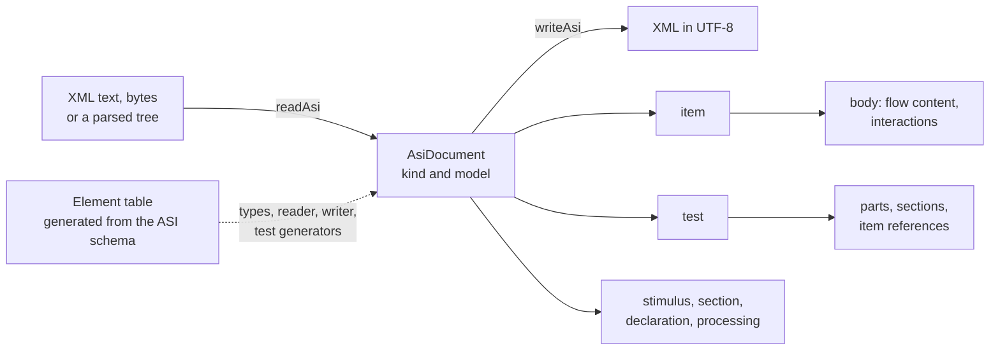

# Assessment documents

`asi` reads and writes the assessment documents of QTI 3.0: items, stimuli, tests, sections, outcome declarations, response
processing templates and outcome processing, and the content they hold: HTML, MathML, SSML, interactions, feedback,
templates, rubric blocks, catalogs and companion materials. Its model has a property for every attribute and child element
of the ASI schema, with types derived from the same table that drives the reader, the writer and the generators of the
tests. It imports `xml` and `values` and runs in any JavaScript runtime.



| Export                                                                                                              | Purpose                                                                                                                             |
| ------------------------------------------------------------------------------------------------------------------- | ----------------------------------------------------------------------------------------------------------------------------------- |
| `readAsi(input, options?)`                                                                                          | Reads text, bytes or a parsed tree into an `AsiDocument`.                                                                           |
| `writeAsi(document)`                                                                                                | Writes an `AsiDocument` as XML in UTF-8.                                                                                            |
| `AsiDocument`, `ReadAsiOptions`                                                                                     | The seven document kinds, and the options of the reader.                                                                            |
| `ASI_NAMESPACE`                                                                                                     | The namespace of every element of an assessment document.                                                                           |
| `AssessmentItem`, `AssessmentTest`, …                                                                               | The model of each element of documents, declarations, processing and structure, such as `ResponseCondition`.                        |
| `ChoiceInteraction`, `SimpleChoice`, `Card`, …                                                                      | The model of each element of content: interactions, choices, feedback, catalogs and companion materials, such as `PrintedVariable`. |
| `Expression`, `NumericExpression`                                                                                   | The 64 expressions, and the 44 that yield numbers.                                                                                  |
| `ResponseRule`, `OutcomeRule`, `TemplateRule`                                                                       | The rules of the three kinds of processing.                                                                                         |
| `Interaction`                                                                                                       | The 22 interactions.                                                                                                                |
| `HtmlElement`                                                                                                       | The 76 HTML elements; narrow it by `kind`, such as `"p"`.                                                                           |
| `BodyNode`, `TextNode`                                                                                              | A node of flow content: an element, text, or XML for MathML, SSML and `xi:include`.                                                 |
| `RubricBlock`, `TestRubricBlock`                                                                                    | A rubric block wherever it occurs, and the one of a test, test part or section.                                                     |
| `ElementModel`                                                                                                      | The model of any element of the table.                                                                                              |
| `readScoreCovers(test)`, `buildScoreCoversBlock(…)`                                                                 | The covers of externally scored outcomes: read them from a test, build the rubric block that names them.                            |
| `ScoreCover`                                                                                                        | One covered response.                                                                                                               |
| `readScoringRubrics(document)`, `buildScoringRubricBlock(…)`                                                        | The scoring rubrics of an item or a test: read them, build the rubric block that holds one.                                         |
| `rubricScore(rubric, ratings)`, `checkScoringRubric(value)`                                                         | The score that ratings give under a rubric; the check of a rubric that arrived as JSON.                                             |
| `ScoringRubric`, `RubricCriterion`, `RubricLevel`, `RubricKind`, `RUBRIC_KINDS`, `RubricRating`, `RubricScoreRange` | The rubric, its criteria and levels, its four kinds with the list they come from, and a rating of a criterion.                      |
| `ScoringRubricBlock`, `RubricContent`, `RubricNotes`, `RubricBlockOptions`                                          | The block that fits an item body and a test; the content that both accept; the notes and the options of the two builders.           |

## Quick start

```ts
import { readAsi, writeAsi } from "@assesskit/runtime/asi";

const document = readAsi(`<qti-assessment-item xmlns="http://www.imsglobal.org/xsd/imsqtiasi_v3p0"
    identifier="capital" title="Capital" time-dependent="false">
  <qti-response-declaration identifier="RESPONSE" cardinality="single" base-type="identifier">
    <qti-correct-response><qti-value>Paris</qti-value></qti-correct-response>
  </qti-response-declaration>
  <qti-item-body><p>Which city is the capital of France?</p></qti-item-body>
  <qti-response-processing>
    <qti-response-condition>
      <qti-response-if>
        <qti-match><qti-variable identifier="RESPONSE"/><qti-correct identifier="RESPONSE"/></qti-match>
        <qti-set-outcome-value identifier="SCORE"><qti-base-value base-type="float">1</qti-base-value></qti-set-outcome-value>
      </qti-response-if>
    </qti-response-condition>
  </qti-response-processing>
</qti-assessment-item>`);

const item = document.kind === "item" ? document.item : undefined;
item?.kind; // => "assessment-item"
item?.timeDependent; // => false
item?.responseDeclarations[0]?.correctResponse?.values; // => [{ kind: "value", value: "Paris" }]
const rule = item?.responseProcessing?.rules[0];
rule?.kind === "response-condition" && rule.responseIf.condition;
// => { kind: "match", operands: [{ kind: "variable", identifier: "RESPONSE" }, { kind: "correct", identifier: "RESPONSE" }] }

writeAsi(document).startsWith(
  '<?xml version="1.0" encoding="UTF-8"?>\n<qti-assessment-item xmlns="http://www.imsglobal.org/xsd/imsqtiasi_v3p0"',
); // => true
```

### Content

```ts
import { readAsi } from "@assesskit/runtime/asi";

const document = readAsi(`<qti-assessment-item xmlns="http://www.imsglobal.org/xsd/imsqtiasi_v3p0"
    identifier="capital" title="Capital" time-dependent="false">
  <qti-item-body>
    <p>Which city is the capital of <b>France</b>?</p>
    <qti-choice-interaction response-identifier="RESPONSE" max-choices="1">
      <qti-simple-choice identifier="Paris">Paris</qti-simple-choice>
      <qti-simple-choice identifier="Lyon">Lyon</qti-simple-choice>
    </qti-choice-interaction>
  </qti-item-body>
</qti-assessment-item>`);

const [paragraph, interaction] = (document.kind === "item" ? document.item.body?.children : undefined) ?? [];
paragraph?.kind === "p" && paragraph.children.map((child) => child.kind); // => ["text", "b", "text"]
interaction?.kind === "choice-interaction" && interaction.maxChoices; // => 1
interaction?.kind === "choice-interaction" && interaction.simpleChoices.map(({ identifier }) => identifier); // => ["Paris", "Lyon"]
```

## The model

Every element is an object with the properties below, and the types are derived from the element table
(`src/asi/element-table.ts`), so a property exists exactly when the schema has the attribute or child element.

| Part of the element                         | Property of the model                                                                                                                              |
| ------------------------------------------- | -------------------------------------------------------------------------------------------------------------------------------------------------- |
| The element                                 | `kind`: its name without `qti-`, such as `"assessment-item"` or `"and"`. Every model has it.                                                       |
| An attribute                                | Its name in camel case: `max-attempts` is `maxAttempts`. `xml:lang` is `language` and `xml:base` is `xmlBase`. Omitted when the document omits it. |
| Child elements, one kind, at most one       | The element's name in camel case, omitted when there is none: `timeLimits`, `body`.                                                                |
| Child elements, one kind, several           | The plural, always an array: `responseDeclarations`, `weights`, `mapEntries`.                                                                      |
| Child elements, several kinds in a place    | One array in document order: `children` of a section, `rules` of a processing, `operands` of an operator.                                          |
| The expression of a condition or operator   | `operand` for one, `operands` for several, `condition` for the `if` of a condition, `expression` for the value of a rule.                          |
| Attributes the schema allows beyond its own | `extensions`: `XmlAttribute`s in document order, such as `data-*` attributes.                                                                      |
| Elements of other namespaces                | `extensionElements`: `XmlElement`s, where the schema allows them. An `xi:include` is an `XmlElement` in the array of its place.                    |
| Text                                        | `value`.                                                                                                                                           |
| Flow content                                | `children`: elements, `TextNode`s and `XmlElement`s in document order (see [Flow content](#flow-content)).                                         |

The values of attributes follow their types in the schema:

| Type in the schema                         | Value                                                                                         |
| ------------------------------------------ | --------------------------------------------------------------------------------------------- |
| String, identifier, URI                    | `string`, as written                                                                          |
| Boolean                                    | `boolean`                                                                                     |
| Integer, double                            | `number`; a double may be `Infinity`, `-Infinity` or `NaN`; an integer must be a safe integer |
| Enumeration                                | The term; where the vocabulary can be extended (`use`, `support`), also `ext:` terms          |
| List (`class`, `view`, `category`)         | `readonly` array of the items                                                                 |
| Number or variable (`min`, `figures`, `n`) | `number`, or the identifier of the variable as a `string`                                     |
| `tolerance` of `qti-equal`                 | The same; the reader takes `{identifier}` and `identifier`, the writer writes `{identifier}`  |

An attribute named `kind` (the kind of a `track`) is `trackKind`, because `kind` names the element in the model. The
parameters of `ElementModel` are invariant: a `p` is never an `h1`, though both have the type of the table that models them.

Defaults of the schema are not applied: an attribute the document omits is omitted from the model, and
`writeAsi` does not write it. The semantic modules apply defaults with their sources.

### Flow content

Where the schema mixes text with elements, or lets a place take HTML, MathML or SSML, the place is the array `children`.
Its members are in document order:

| Member                              | Model                                                                                                             |
| ----------------------------------- | ----------------------------------------------------------------------------------------------------------------- |
| An element of the ASI namespace     | Its model, such as `{ kind: "b", children: […], extensions: [] }`. The schema fixes which elements a place takes. |
| Text                                | `{ kind: "text", value }`: one node for each run of characters, CDATA sections and entities included.             |
| `m3:math`, `ssml11:*`, `xi:include` | The `XmlElement` as parsed, with its namespace, prefix and attributes. Nothing inside it is read.                 |

White space between elements is text where the schema mixes text with elements (`p`, `li`, `td`, `blockquote`) and is
dropped where it does not (`qti-item-body`, `table`, `ul`). Comments and processing instructions are not part of the
model. An element or text that a place does not take is an `assesskit/asi/element` or `assesskit/asi/text` error, as for any other
place: `div` in `p`, or text in `qti-item-body`.

The content of a type that mixes text with elements in a fixed order, such as the `source` and `track` elements and the
fallback of a `video`, is one array of `children`; the writer does not check the order, and the schema does.

### HTML

The 76 HTML elements have the attributes the schema gives them, typed like any other (`rowspan` is a number,
`scope` one of its four terms), and `extensions` for `data-*` and other attributes. A place that holds only one kind of
element has a name of its own:

| Element                   | Property                                                                                                 |
| ------------------------- | -------------------------------------------------------------------------------------------------------- |
| `ul`, `ol`, `dl`          | `items`: the `li`, or the `dt` and `dd` in document order.                                               |
| `table`                   | `caption`, `cols`, `colgroups`, `thead`, then `bodies` (`tbody`) or `rows` (`tr`) but not both, `tfoot`. |
| `thead`, `tbody`, `tfoot` | `rows`.                                                                                                  |
| `tr`                      | `cells`: the `td` and `th`.                                                                              |
| `colgroup`                | `cols`.                                                                                                  |
| `picture`                 | `sources`, `img`.                                                                                        |
| `details`                 | `summary`, then `children`.                                                                              |
| `track`                   | `trackKind` for the attribute `kind`.                                                                    |

### Interactions

The 22 interactions (`Interaction`) have the attributes of the schema and these places:

| Interaction                                                                         | Places                                                                                                                      |
| ----------------------------------------------------------------------------------- | --------------------------------------------------------------------------------------------------------------------------- |
| `qti-choice-interaction`, `qti-order-interaction`                                   | `prompt`, `simpleChoices`.                                                                                                  |
| `qti-associate-interaction`                                                         | `prompt`, `simpleAssociableChoices`.                                                                                        |
| `qti-match-interaction`                                                             | `prompt`, `simpleMatchSets`, each with `simpleAssociableChoices`.                                                           |
| `qti-gap-match-interaction`                                                         | `prompt`, `choices` (`qti-gap-text`, `qti-gap-img`), `children`: the text with `qti-gap`s.                                  |
| `qti-hottext-interaction`                                                           | `prompt`, `children`: the text with `qti-hottext`s.                                                                         |
| `qti-inline-choice-interaction`                                                     | `labelElement` (`qti-label`; `label` is the attribute), `inlineChoices`.                                                    |
| `qti-hotspot-interaction`, `qti-graphic-order-interaction`                          | `prompt`, `image`, `hotspotChoices`.                                                                                        |
| `qti-graphic-associate-interaction`                                                 | `prompt`, `image`, `associableHotspots`.                                                                                    |
| `qti-graphic-gap-match-interaction`                                                 | `prompt`, `image`, `choices`, `associableHotspots`.                                                                         |
| `qti-select-point-interaction`, `qti-drawing-interaction`                           | `prompt`, `image`.                                                                                                          |
| `qti-position-object-stage`                                                         | `image`, `positionObjectInteractions` (`image` in each).                                                                    |
| `qti-media-interaction`                                                             | `prompt`, `media` (`object`, `audio` or `video`).                                                                           |
| `qti-extended-text-interaction`, `qti-slider-interaction`, `qti-upload-interaction` | `prompt`.                                                                                                                   |
| `qti-text-entry-interaction`, `qti-end-attempt-interaction`                         | none.                                                                                                                       |
| `qti-custom-interaction`                                                            | `extensionElements`: any elements, in any namespace.                                                                        |
| `qti-portable-custom-interaction`                                                   | `prompt`, `interactionModules`, `interactionMarkup`, `templateVariables`, `contextVariables`, `stylesheets`, `catalogInfo`. |

`image` is an `img`, `picture` or `object`. A choice (`qti-simple-choice`, `qti-gap-text`, `qti-hottext`, …) holds flow
content in `children`. An attribute whose value is a list, such as `center-point`, `match-group` and `type` of an upload,
is an array.

### Feedback, templates, rubric blocks and catalogs

| Element                                                                                                   | Places                                                                                              |
| --------------------------------------------------------------------------------------------------------- | --------------------------------------------------------------------------------------------------- |
| `qti-feedback-inline`, `qti-template-inline`                                                              | `children`.                                                                                         |
| `qti-feedback-block`, `qti-template-block`, `qti-modal-feedback`, `qti-test-feedback`, `qti-rubric-block` | `stylesheets`, `contentBody` (`qti-content-body`, whose `children` are flow), `catalogInfo`.        |
| `qti-printed-variable`                                                                                    | none; the attributes `base` and `index` may name a variable.                                        |
| `qti-catalog-info`                                                                                        | `catalogs`: `qti-catalog` with `cards`; a card has `htmlContent` and `fileHrefs`, or `cardEntries`. |

An element that occurs in several places can have a type in each, with content that differs: the exported model is the union
of them. A `qti-rubric-block` has one model in a body and another in a test, test part or section. `RubricBlock` is the
union, and `TestRubricBlock` the second, which `AssessmentTest.rubricBlocks` holds and `buildScoreCoversBlock` builds. `buildScoringRubricBlock`
builds a `ScoringRubricBlock`, which is both models at once, so that it fits an item body and `rubricBlocks` without a cast.

### Companion materials

`qti-companion-materials-info` has `calculators`, `rules`, `protractors`, `digitalMaterials` and `physicalMaterials`. A
`qti-calculator` has `calculatorType`, `description` and `calculatorInfo`. A `qti-rule` has `description` and a
`ruleSystem` (`qti-rule-system-si` or `-us`) with `minimumLength`, `minorIncrement` and `majorIncrement`; a
`qti-protractor` has `description` and an `increment` (`qti-increment-si` or `-us`). A length is the text of the
schema's decimal, as written: `"1"`, not `1`.

### MathML and SSML

An `m3:math` subtree and the twelve SSML elements the schema takes in flow content are `XmlElement`s, as written. A PLS
pronunciation lexicon is an `ssml11:lexicon` in an `ssml11:speak`; the model keeps the reference, and the package module
carries the file.

### Vocabularies of the content

Each vocabulary below is the type of an attribute; the reader refuses any other text with `assesskit/asi/invalid-value`.

| Vocabulary                 | Attribute               | On                                       |
| -------------------------- | ----------------------- | ---------------------------------------- |
| `ARIAAutoCompleteEnum`     | `aria-autocomplete`     | every element with the common attributes |
| `ARIACheckedEnum`          | `aria-checked`          | the same                                 |
| `ARIACurrentEnum`          | `aria-current`          | the same                                 |
| `ARIAExpandedEnum`         | `aria-expanded`         | the same                                 |
| `ARIAInvalidEnum`          | `aria-invalid`          | the same                                 |
| `ARIALiveValueEnum`        | `aria-live`             | the same                                 |
| `ARIAOrientationValueEnum` | `aria-orientation`      | the same                                 |
| `ARIAPressedEnum`          | `aria-pressed`          | the same                                 |
| `ARIARoleValue`            | `role`                  | the same                                 |
| `ARIASelectedEnum`         | `aria-selected`         | the same                                 |
| `ARIASortEnum`             | `aria-sort`             | the same                                 |
| `AlignEnum`                | `align`                 | `td`, `th`                               |
| `CORSSettingsEnum`         | `crossorigin`           | `audio`, `video`                         |
| `DIR`                      | `dir`                   | every element with the common attributes |
| `KindValueEnum`            | `kind` (`trackKind`)    | `track`                                  |
| `ParamTypeEnum`            | `valuetype`             | `param`                                  |
| `PreLoadValueEnum`         | `preload`               | `audio`, `video`                         |
| `SuppressTTSEnum`          | `data-qti-suppress-tts` | every element with the common attributes |
| `TableCellScopeEnum`       | `scope`                 | `td`, `th`                               |
| `ValignEnum`               | `valign`                | `td`, `th`                               |
| `StringList`               | `class`                 | every element with the common attributes |
| `ARIARelevantList`         | `aria-relevant`         | every element with the common attributes |

The lists are arrays of their items; `aria-relevant` takes `additions`, `all`, `removals` and `text`.

### Walking the content

The model is plain data, and `ModelNode` is what every node of it has: the `kind` that names its element. The functions
below find nodes without knowing which place of which element holds them.

| Function                    | Returns                                                                                                                         |
| --------------------------- | ------------------------------------------------------------------------------------------------------------------------------- |
| `listChildNodes(node)`      | The nodes directly below a node, in every place the model keeps them: `children`, a prompt, choices, a content body, and so on. |
| `listDescendantNodes(node)` | The nodes at any depth in document order, without the node itself.                                                              |
| `isModelNode(value)`        | Whether a value is an object with a string `kind`; the check is shallow.                                                        |

MathML, SSML and `xi:include` are leaves: the model keeps them as XML, and the functions above do not walk their children. Narrow a node by
its `kind` with a guard of your own, such as `(node): node is HotText => node.kind === "hottext"`.

### Extensions and includes

Where the schema has a wildcard, attributes and elements of other namespaces are kept as written. Where the schema allows
`xi:include` (sections, rules, bodies), the model keeps it as an `XmlElement` of the XInclude namespace. To read the included
content, resolve the includes of the tree with `resolveIncludes` of [xml](xml.md) and pass the result to `readAsi`.

## Reading

`readAsi` reads the elements of the ASI namespace by name, whatever their prefix, and accepts documents written for 3.0.0 and
3.0.1, which share the namespace. It ignores `xsi:schemaLocation`. It throws a `ReadError` when it cannot map a document to the
model; each issue has the code, a sentence, and the path, line, column and element path.

| Rule                              | When                                                                                                                          |
| --------------------------------- | ----------------------------------------------------------------------------------------------------------------------------- |
| `assesskit/asi/document-element`  | The root is not one of the seven document elements in the ASI namespace.                                                      |
| `assesskit/asi/attribute`         | An attribute the schema does not have, and no wildcard allows.                                                                |
| `assesskit/asi/missing-attribute` | A required attribute is absent.                                                                                               |
| `assesskit/asi/invalid-value`     | A value is not in the lexical form of its type, or not one of the terms of its vocabulary.                                    |
| `assesskit/asi/element`           | A child element the place does not accept (such as `div` in `p`), too many of one, or an element in an empty or text element. |
| `assesskit/asi/missing-element`   | A required single child element is absent.                                                                                    |
| `assesskit/asi/text`              | Text where only elements go, or in an empty element.                                                                          |
| `assesskit/asi/exclusive`         | Two child elements the schema allows only one of, such as an adaptive selection and a selection.                              |

The reader is not a validator: [Not included](#not-included) lists what it leaves to the schema and to `validate`. A value that
must be a number or a boolean cannot be represented otherwise, so it is checked.

## Writing

`writeAsi` writes the document with `xmlns`, `xmlns:xsi` and `xsi:schemaLocation` that names the 3.0.1 ASI schema. Attributes
and child elements are in the order of the schema, so a valid model gives a valid document. Text without characters writes
nothing, and two texts in a row read back as one.

`writeAsi` writes a document, not a node: a node that a builder returns, such as the block of `buildScoringRubricBlock`, goes into the model of its
document first ([Conventions](conventions.md#placing-a-block-in-a-document)).

## Conventions

Two conventions of the runtime are rubric blocks for scorers that a class token marks. They are not part of QTI;
[Conventions](conventions.md) describes both. In the model each is an ordinary rubric block, and nothing is copied out of it.

| Convention     | Functions                                                                                                | Reads and builds                                                                                             |
| -------------- | -------------------------------------------------------------------------------------------------------- | ------------------------------------------------------------------------------------------------------------ |
| Covers         | `readScoreCovers`, `buildScoreCoversBlock`                                                               | The responses that an externally scored outcome of a test rates, in a block of the test                      |
| Scoring rubric | `readScoringRubrics`, `buildScoringRubricBlock`, `checkScoringRubric`, `rubricScore`, `rubricScoreRange` | The criteria, levels and weights of an outcome, in a block of an item or of a test, and the score of ratings |

## The element table

`src/asi/element-table.ts` is generated by `pnpm asi-table` from the pinned ASI schema (`imsqti_asiv3p0p1_v1p0.xsd`; run
`pnpm schemas` first). It holds the 203 element types reachable from the seven document elements, content included. For
each type it has the attributes it inherits (`inherited`) and adds (`attributes`: name, property, use, default, type), its
child elements in slots (property, accepted elements, limits, exclusions), whether it takes wildcards, and its content
(`empty`, `text` or `slots`). The reader, the writer, the types of the model and the generators of the tests all read this
one table; a test fails when the committed file differs from the schema.

| Part of a slot | Meaning                                                                                                                    |
| -------------- | -------------------------------------------------------------------------------------------------------------------------- |
| `accepts`      | The elements of the ASI namespace, each with the type that models it.                                                      |
| `foreign`      | The elements of other namespaces that it accepts: `m3:math` and the SSML elements.                                         |
| `include`      | It accepts `xi:include`.                                                                                                   |
| `text`         | It takes text between its elements, because the schema mixes them. The slot is `children`, with every element of the type. |
| `excludes`     | The slots that cannot be used together with it.                                                                            |

Two lists keep the table small. The attributes that many types inherit (the `role` and 46 `aria-*` attributes, the common
attributes) are one constant, and a list of accepted elements that two or more slots share is one constant. The
constants are used through a type alias of their own, so that the declaration file names a list instead of repeating it:
without that, the declaration of the table is too large for the compiler to write.

`scripts/asi-table.ts` names what the schema leaves open: the property of a slot that holds several kinds of elements, the
property of elements whose plural is not a word to add `s` to, and the attribute whose name the model uses itself (`kind`).
A schema that needs a name the script lacks stops the script with the slot to name. `pnpm test:xsd` compares the committed
table with the one the script generates, and validates documents that fast-check generates from the table.

## Evidence

The generated documents use every element and attribute that the schema declares, and the schema accepts them. The 1EdTech
examples contain every interaction but the custom one; the other elements have no corpus evidence, only the schema and the
unit tests. The two examples that the schema rejects are in [Differences from the references](#differences-from-the-references).

## Errors

| Situation                                                                                                                                                                                                                                                                                      | Class                                                    | What to do                                                                                              |
| ---------------------------------------------------------------------------------------------------------------------------------------------------------------------------------------------------------------------------------------------------------------------------------------------- | -------------------------------------------------------- | ------------------------------------------------------------------------------------------------------- |
| The document is not well-formed, declares XML 1.1 or an encoding the reader cannot use                                                                                                                                                                                                         | `ReadError`, rule `assesskit/xml/...`                    | See the [rules of the XML reader](xml.md#errors); fix the document at the line and column of the issue. |
| The document does not map to the model                                                                                                                                                                                                                                                         | `ReadError`, a rule of the table under Reading           | Fix the document where the issue says: its `location` has the path, line, column and element path.      |
| The document has a DOCTYPE, or is above a limit of the XML reader                                                                                                                                                                                                                              | `SecurityError`, `limit` names the limit                 | Do not read it. For a document you trust, raise the limit with the option `limits`.                     |
| An argument is not of its type: a document that is neither text, bytes nor an element, or bad options                                                                                                                                                                                          | `DataError` that says what is wrong and what is expected | Pass the type that the message names.                                                                   |
| `writeAsi` is given a model that is not the model of its element: a property the element does not have, a missing required property, a value of the wrong type, a `kind` that does not match, more members than a place takes, a member the place does not accept, or text where it takes none | `DataError` that names the property                      | Build the model with the types of this module, and fix the property that the message names.             |

## Not included

| Not included                                          | Why                                                                                            |
| ----------------------------------------------------- | ---------------------------------------------------------------------------------------------- |
| Defaults of the schema                                | The model keeps what the document says; the semantic modules apply defaults with their sources |
| The order of child elements and the minimum of a list | The schema checks them; `validateXmlFiles` of [node](node.md) reports them                     |
| Patterns, ranges and the uniqueness of `id`s          | `validate` checks them                                                                         |
| MathML and SSML as typed models                       | The model keeps them as XML, where the schema lets them occur                                  |
| Resolving `xi:include`                                | `resolveIncludes` of [xml](xml.md) does it before the document is read                         |
| Comments and processing instructions                  | The model carries none, so a written document has none of the source                           |

## Differences from the references

| Case                                                                                                                          | Resolution                                                                                                                                |
| ----------------------------------------------------------------------------------------------------------------------------- | ----------------------------------------------------------------------------------------------------------------------------------------- |
| The 3.0.1 schema gives `normal-minimum` the default 0.0                                                                       | An absent `normal-minimum` stays absent: the information model is normative, and a schema default is binding detail ([G11](spec-gaps.md)) |
| The schema types the target value of a match table entry as a base type name                                                  | The runtime follows the schema; a numeric table is an interpolation table ([G53](spec-gaps.md))                                           |
| The namespaces in the samples of the specifications differ from those of the schemas                                          | The schemas decide, and the namespace of an assessment document is strict ([G12](spec-gaps.md))                                           |
| Two 1EdTech examples that the schema rejects: a rubric block without `use`, an attribute that `qti-interaction-modules` lacks | Not read, as the schema refuses them                                                                                                      |

## Files

Each file of `src/asi/` holds one concept.

| File                                            | Concept                                                              |
| ----------------------------------------------- | -------------------------------------------------------------------- |
| `element-table.ts`, `table.ts`, `type-index.ts` | The generated table of element types, its types, and its lookups     |
| `model.ts`, `body.ts`, `nodes.ts`               | The types of the model, of flow content, and the nodes of content    |
| `document.ts`                                   | Reading and writing a document of any kind                           |
| `read.ts`, `write.ts`, `attribute-value.ts`     | Mapping an element to the model and back, and attribute values       |
| `walk.ts`                                       | Visiting the elements of a document                                  |
| `covers.ts`                                     | The covers of externally scored outcomes                             |
| `scoring-rubric.ts`, `scoring-rubric-block.ts`  | The scoring rubric: its data and checks, and its rubric block        |
| `rubric-ratings.ts`                             | The score that ratings give under a scoring rubric                   |
| `convention-markup.ts`                          | The attributes and text of list entries that the conventions share   |
| `guards.ts`, `read-error.ts`, `namespace.ts`    | Guards of the tree, the error of the reader, the namespace           |
| `internal.ts`                                   | What other modules and the tests use and the package does not export |

## References

| Topic                                  | Specification                                                                                    |
| -------------------------------------- | ------------------------------------------------------------------------------------------------ |
| Elements, attributes, vocabularies     | [QTI 3.0 ASI Information Model](https://www.imsglobal.org/spec/qti/v3p0/info/)                   |
| Schema, namespaces, rule sets          | [QTI 3.0 ASI XML Binding](https://www.imsglobal.org/spec/qti/v3p0/bind/)                         |
| Packages, portable custom interactions | [QTI 3.0 Best Practices and Implementation Guide](https://www.imsglobal.org/spec/qti/v3p0/impl/) |
| Places where the specifications differ | [Spec gaps](spec-gaps.md)                                                                        |
