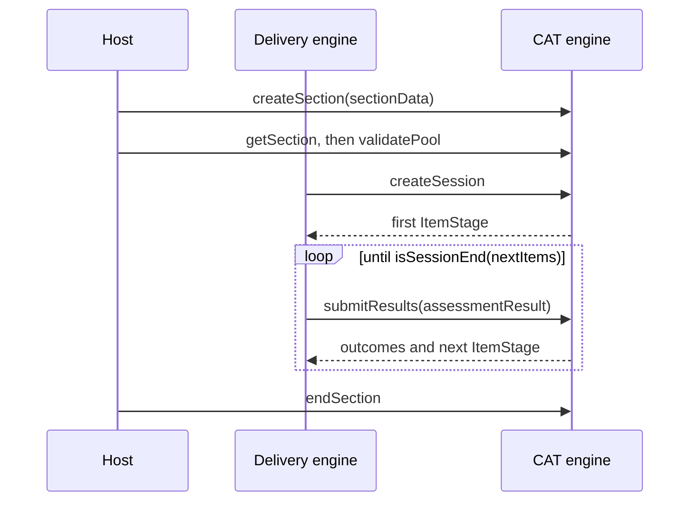

# CAT

`cat` is the runtime's side of computer adaptive testing (CAT 1.0), which QTI 3.0 references through `qti-adaptive-selection`: the
port to a CAT engine, the models of its requests and responses, the JSON form of the assessment result and the item stage, the
section data that configures a section, the check of its item pool and the metadata file. It imports `values`, `asi`, `results` and
`metadata` and runs in any JavaScript runtime. The runtime makes no network request and implements no CAT algorithm: the host
implements `CatPort`, for example over an IRT library or over the REST API of CAT 1.0.



| Function                                            | Does                                                                                       |
| --------------------------------------------------- | ------------------------------------------------------------------------------------------ |
| `buildSectionData(selection, files)`                | Builds the `SectionData` of Create Section from the files of an adaptive section           |
| `isSessionEnd(stage)`                               | Tells whether a stage, or a missing one, ends the session                                  |
| `validatePool(section, pool)`                       | Compares the item references of an adaptive section with the pool that Get Section returns |
| `buildCatMetadata(items, options?)`                 | Builds the metadata JSON from the QTI metadata of the items                                |
| `writeResultsJson(result)`, `readResultsJson(json)` | Write and read an assessment result in the JSON of the public binding                      |
| `readItemStage(json, noun)`                         | Reads an item stage of the binding                                                         |

| Type                                                                                             | Is                                                                                   |
| ------------------------------------------------------------------------------------------------ | ------------------------------------------------------------------------------------ |
| `CatPort`                                                                                        | The six requests of a CAT engine, which the host implements                          |
| `CatSessionPort`                                                                                 | The three requests that a session makes: Create Session, Submit Results, End Session |
| `SectionData`, `ItemStage`, `PriorDataEntry`                                                     | The data types of CAT                                                                |
| `CreateSectionResponse`, `GetSectionResponse`                                                    | The answers to Create Section and Get Section                                        |
| `CreateSessionRequest`, `CreateSessionResponse`, `SubmitResultsRequest`, `SubmitResultsResponse` | The bodies and answers of Create Session and Submit Results                          |
| `CatResponse`                                                                                    | What the host answers to a request of the delivery engine                            |
| `SectionFiles`, `CatPoolItem`, `CatMetadataFile`, `BuildCatMetadataOptions`                      | The arguments of `buildSectionData` and `buildCatMetadata`                           |
| `CatMetadata`, `CatItemMetadata`, `CatExternalMetadata`                                          | The metadata JSON                                                                    |

## The port

`CatPort` has one method for each endpoint of CAT. Every method takes `prefix` first: the URL prefix that `qti-adaptive-engine-ref`
gives. A document names the prefix, so the host checks it against the engines it trusts before it sends a candidate's results
there. `CatSessionPort` is the three methods of the delivery of a session, `createSession`, `submitResults` and `endSession`: `drainCat`,
`sendCatRequest` and the option `cat` of the player take it, so that a port without the deployment of sections serves.

| Method                                                                 | Request                                | Made by                       |
| ---------------------------------------------------------------------- | -------------------------------------- | ----------------------------- |
| `createSection(prefix, data)`                                          | `POST {prefix}/sections`               | The host, once, at deployment |
| `getSection(prefix, sectionIdentifier)`                                | `GET {prefix}/sections/{id}`           | The host, to verify the pool  |
| `createSession(prefix, sectionIdentifier, request)`                    | `POST {prefix}/sections/{id}/sessions` | The delivery engine           |
| `submitResults(prefix, sectionIdentifier, sessionIdentifier, request)` | `POST .../sessions/{id}/results`       | The delivery engine           |
| `endSession(prefix, sectionIdentifier, sessionIdentifier)`             | `DELETE .../sessions/{id}`             | The delivery engine           |
| `endSection(prefix, sectionIdentifier)`                                | `DELETE /sections/{id}`                | The host                      |

- Create Section is not idempotent: the host makes it once and gives the returned identifier to the delivery definition.
- A missing `sessionState` in an answer means there is none. A stateless engine sends one, and the next Submit Results request
  returns it unchanged.
- The port carries the typed `AssessmentResult` of [results](results.md). The JSON binding below writes and reads it in the form of
  the public binding.
- The HTTP client, access tokens, OAuth and HTTPS are the adapter's concern.

## Section data

`buildSectionData(selection, files)` builds the body of Create Section. Each field is the base64 (RFC 4648, with padding) of the file
that a reference of the `qti-adaptive-selection` names.

| Field                  | File              | Rule                                                                         |
| ---------------------- | ----------------- | ---------------------------------------------------------------------------- |
| `sectionConfiguration` | `files.settings`  | Always sent, whether or not the selection has a `qti-adaptive-settings-ref`. |
| `qtiUsagedata`         | `files.usageData` | Sent when the selection has a `qti-usagedata-ref`, and only then.            |
| `qtiMetadata`          | `files.metadata`  | Sent when the selection has a `qti-metadata-ref`, and only then.             |

`SectionData` has a further field, `qtiMetadataRecord`, which `buildSectionData` never sets: the one QTI metadata record that the REST binding carries as
`qtiMetadata` (the runtime's `QtiMetadata`), which an engine returns from Get Section and a client may send with Create Section. It is not the
metadata file above ([spec-gaps](spec-gaps.md)). A `PriorDataEntry` has an optional `glossaryUri`, the address of the glossary that defines its name.

The files are bytes, which the host reads from the package or from wherever each `href` points. The usage data is the XML of
[usage](usage.md) (`writeUsageData`), whose statistics the engine may use as its item parameters. The metadata is the JSON of
`buildCatMetadata`. A file that the selection does not reference, or a referenced file that is missing, is a `DataError`.

```ts
import { readAsi } from "@assesskit/runtime/asi";
import { validatePool, buildSectionData } from "@assesskit/runtime/cat";

const { section } = readAsi(`<qti-assessment-section xmlns="http://www.imsglobal.org/xsd/imsqtiasi_v3p0"
    identifier="sec" title="Adaptive" visible="true">
  <qti-adaptive-selection>
    <qti-adaptive-engine-ref identifier="engine" href="http://example.org/engine"/>
    <qti-adaptive-settings-ref identifier="settings" href="settings.data"/>
  </qti-adaptive-selection>
  <qti-assessment-item-ref identifier="item434" href="item434.xml"/>
  <qti-assessment-item-ref identifier="item065" href="item065.xml"/>
</qti-assessment-section>`);
buildSectionData(section.adaptiveSelection, { settings: new TextEncoder().encode("{}") }); // => { sectionConfiguration: "e30=" }
validatePool(section, { itemIdentifiers: ["item434", "item999"] }).map(({ rule }) => rule);
// => ["assesskit/cat/item-not-in-pool", "assesskit/cat/item-not-in-section"]
```

## Item stages

An `ItemStage` lists the identifiers of the items to present, in order, and a `stageLength` hint: the number of items the
candidate should answer before the delivery engine submits. Get Section reports the whole pool as one stage.

`isSessionEnd(stage)` is true for a `null` or `undefined` stage, and for a stage that lists no item, whatever its `stageLength`.
An identifier may occur more than once; the delivery engine then instances the item as in a selection with replacement. A stage
that is not an object, whose identifiers are not strings or whose length is not a non-negative integer or `null` is a `DataError`.

```ts
import { isSessionEnd } from "@assesskit/runtime/cat";

isSessionEnd({ itemIdentifiers: ["item434"], stageLength: 1 }); // => false
isSessionEnd({ itemIdentifiers: [] }); // => true
isSessionEnd(null); // => true
```

## Pool check

`validatePool(section, pool)` compares the `qti-assessment-item-ref` children of an adaptive section with the pool of Get Section.
The result is empty, or has one error for each identifier that only one side lists, first the item references and then the pool,
each in list order.

| Rule                                | Meaning                                                                                                    |
| ----------------------------------- | ---------------------------------------------------------------------------------------------------------- |
| `assesskit/cat/item-not-in-pool`    | The section lists an item that the pool lacks: the engine can never select it.                             |
| `assesskit/cat/item-not-in-section` | The pool has an item that the section does not list: the engine can select it, and it cannot be presented. |

An adaptive section has no nested sections, so only the item references that are children count. The section must have its
includes resolved, as `QtiPackage.document` has. An identifier counts once however often a side lists it.

## JSON binding

`writeResultsJson(result)` and `readResultsJson(json)` convert an assessment result to and from the JSON of the
public REST binding of CAT 1.0. The OpenAPI files that the binding names do not serve, so the field names come from its listing.
`readItemStage(json, noun)` reads an item stage; `noun` names it in the error message, such as `nextItems of the answer`. The
functions make no request: the adapter that talks to the engine owns the transport.

| Runtime                      | Binding                                                                                             |
| ---------------------------- | --------------------------------------------------------------------------------------------------- |
| `itemResults`                | `itemResult`                                                                                        |
| `variables` of a result      | `responseVariables`, `templateVariables`, `outcomeVariables`                                        |
| `SessionIdentifier.sourceId` | `sourceID`                                                                                          |
| A value                      | `value`: a list of `{ value }` in lexical form; a record's fields add `fieldIdentifier`, `baseType` |
| NULL                         | An empty `value` list                                                                               |

| Case          | Behavior                                                                                                                                                                                                |
| ------------- | ------------------------------------------------------------------------------------------------------------------------------------------------------------------------------------------------------- |
| Left out      | The binding has no field for context variables, supports, `scoreStatus`, `answeredStatus`, `externalScored`, `variableIdentifierRef` and `outcomeInformation`: they are not written, and read as empty  |
| Status        | The `sessionStatus` of the binding lacks `pendingExternalScoring`; it is written as `pendingResponseProcessing`                                                                                         |
| Context       | An engine may leave out the context of the result it returns. The model requires one, so the result then has no session identifiers                                                                     |
| Order         | The three lists of variables are joined in the order responses, templates, outcomes                                                                                                                     |
| Stage         | `itemIdentifiers` and `stageLength` may be absent or `null`, which is the stage that ends the session; they are read as `null`                                                                          |
| Date and time | The binding declares `datestamp` as `format: date-time`, RFC 3339 with an offset, while an `xs:dateTime` of Results Reporting may lack one; the reports that the delivery engine builds always have `Z` |

```ts
import { readResultsJson, writeResultsJson } from "@assesskit/runtime/cat";
import { buildSingle } from "@assesskit/runtime/values";

const json = writeResultsJson({
  context: { sessionIdentifiers: [{ sourceId: "https://delivery.example", identifier: "s1" }] },
  itemResults: [
    {
      identifier: "q1",
      sequenceIndex: 1,
      datestamp: "2026-10-30T10:00:00Z",
      sessionStatus: "final",
      variables: [
        {
          kind: "outcome",
          identifier: "SCORE",
          cardinality: "single",
          baseType: "float",
          value: buildSingle("float", 1),
        },
      ],
      supports: [],
    },
  ],
});
readResultsJson(JSON.parse(JSON.stringify(json))).itemResults[0].identifier; // => "q1"
```

## Metadata JSON

`buildCatMetadata(items, options?)` builds the content of the file that `qti-metadata-ref` references, in the JSON binding of the CAT
metadata, which is non-normative. Write the result with `JSON.stringify` in UTF-8 and pass the bytes as `files.metadata`.

| Binding field                                | From                                                                                               |
| -------------------------------------------- | -------------------------------------------------------------------------------------------------- |
| `itemMetadata[].identifier`                  | `CatPoolItem.identifier`, unique in the list                                                       |
| `itemTemplate`, `timeDependent`, `composite` | The fields of `QtiMetadata` of that name                                                           |
| `interactionType`                            | `interactionTypes`; an empty array says that the item has no interaction                           |
| `feedbackType`, `solutionAvailable`          | The fields of that name                                                                            |
| `scoringMode`                                | `scoringModes`; left out when empty                                                                |
| `toolName`, `toolVersion`, `toolVendor`      | The fields of that name                                                                            |
| `itemMetadata[].externalMetadata`            | `CatPoolItem.externalMetadata`: files with a `type` and their base64 `content`, left out when none |
| `externalMetadata`                           | The option `externalMetadata`: the same for the section as a whole, left out when none             |

| Option             | Default | Meaning                                                  |
| ------------------ | ------- | -------------------------------------------------------- |
| `externalMetadata` | none    | Metadata files of other types for the section as a whole |

A field that the QTI metadata omits is left out of the JSON. The portable custom interaction context has no field in the binding
and is not carried. The reserved types of an external file are `lom` (IEEE LOM XML) and `csmd` (curriculum standards metadata
XML); any other type is allowed by agreement. The content is bytes: serialize LOM or curriculum standards with `serializeXml` of
[xml](xml.md). An item whose QTI metadata is not valid, or a repeated identifier, is a `DataError`.

```ts
import { buildCatMetadata } from "@assesskit/runtime/cat";

const metadata = buildCatMetadata([
  {
    identifier: "item434",
    metadata: { interactionTypes: ["choiceInteraction"], scoringModes: ["responseprocessing"] },
  },
  { identifier: "item065", metadata: { interactionTypes: [], scoringModes: [] } },
]);
JSON.stringify(metadata);
// => '{"itemMetadata":[{"identifier":"item434","interactionType":["choiceInteraction"],"scoringMode":["responseprocessing"]},{"identifier":"item065","interactionType":[]}]}'
```

## Errors

| Situation                                                              | Result                                                            |
| ---------------------------------------------------------------------- | ----------------------------------------------------------------- |
| An argument of the wrong type, as plain JavaScript or JSON passes it   | `DataError` that says what is wrong and what is expected          |
| JSON that is not the binding's, or a value not in the form of its type | `DataError` that names the path of the first problem              |
| A stage that is not an item stage                                      | `DataError`                                                       |
| A file that nothing references, or a referenced file that is missing   | `DataError`                                                       |
| A repeated item identifier in the metadata                             | `DataError`                                                       |
| An item reference and the pool that disagree                           | `Issue`s from `validatePool`; the only function that returns them |

## Not included

| Not included                                                                                              | Owner                                            |
| --------------------------------------------------------------------------------------------------------- | ------------------------------------------------ |
| The delivery of a session: when each request is made, the merge of the engine's outcomes into the results | `delivery`                                       |
| The HTTP client of the REST binding, access tokens, OAuth, HTTPS                                          | The adapter in the player                        |
| `adaptiveItemSelection` inside the `selection` of QTI 2.x                                                 | QTI 2.x content, which the runtime does not read |
| The algorithm that selects items                                                                          | The CAT engine                                   |

## Files

| File                                          | Concept                                             |
| --------------------------------------------- | --------------------------------------------------- |
| `port.ts`, `model.ts`                         | The port, and the data of its requests and answers  |
| `section-data.ts`, `item-metadata.ts`         | The files that configure a section                  |
| `item-stage.ts`, `check-pool.ts`              | The item stage, and the comparison with the section |
| `result-json-write.ts`, `result-json-read.ts` | The assessment result in the JSON of the binding    |

## References

| Topic                                  | Specification                                                                          |
| -------------------------------------- | -------------------------------------------------------------------------------------- |
| Port, section data, stages, metadata   | [1EdTech Computer Adaptive Testing 1.0](https://www.imsglobal.org/spec/cat/v1p0/impl/) |
| JSON binding                           | [CAT 1.0 REST binding](https://www.imsglobal.org/spec/cat/v1p0/bind/)                  |
| Base64                                 | [RFC 4648](https://www.rfc-editor.org/rfc/rfc4648)                                     |
| Places where the specifications differ | [Spec gaps](spec-gaps.md)                                                              |
