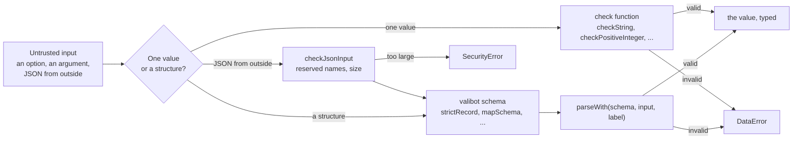

# Checks of untrusted values

`checks` validates what a host or a network passes in: the checks of one value, the options of a call that waits, the check of JSON
from outside and the valibot schemas that read it. A check throws `DataError` with a full sentence that names the value and what
was expected, such as `The option maxBytes must be a positive integer, found 1.5.` The runtime and the player read every entry
point with it, and a package built on the runtime may do the same. It imports `errors` and valibot only and runs in any
JavaScript runtime.



| Export                                                                                  | Does                                                                               |
| --------------------------------------------------------------------------------------- | ---------------------------------------------------------------------------------- |
| `checkRecord`, `checkArray`, `checkFunction`, `checkProperties`, `checkOptional`        | Check the shape of a value, an array or an object                                  |
| `checkString`, `checkNonEmptyString`, `checkBoolean`, `checkChoice`, `checkAbortSignal` | Check a string, a boolean, one of some strings or an `AbortSignal`                 |
| `checkNonNegativeInteger`, `checkPositive`, `checkPositiveInteger`                      | Check a count, a length and a limit                                                |
| `CallOptions`, `checkCallOptions`, `raceAbort`                                          | The options of a call that waits, their check, and the end of a wait               |
| `checkJsonInput`                                                                        | Checks JSON that `JSON.parse` returned, for reserved names and size                |
| `parseWith`, `transformWith`, `describeIssue`                                           | Parse with a schema and stop at the first issue; read with domain code in a schema |
| `recordSchema`, `looseRecord`, `strictRecord`, `mapSchema`, `plainSchema`               | Schemas of objects, of a map and of plain JSON                                     |
| `finiteSchema`, `positiveSchema`, `nonNegativeIntegerSchema`, `positiveIntegerSchema`   | Schemas of numbers                                                                 |
| `nonEmptyStringSchema`, `definedSchema`, `functionSchema`, `abortSignalSchema`          | Schemas of a string, of a present value, of a function and of an `AbortSignal`     |
| `objectSchema`, `methodsSchema`, `guardSchema`, `Schema`                                | Schemas of a host's object, of an object with methods and of a type guard          |
| `describe`, `isRecord`                                                                  | Write a value into a message; tell whether a value is an object                    |

## Quick start

```ts
import {
  checkJsonInput,
  checkPositiveInteger,
  looseRecord,
  mapSchema,
  nonEmptyStringSchema,
  parseWith,
  positiveIntegerSchema,
  raceAbort,
} from "@assesskit/runtime/checks";

checkPositiveInteger(10_000, "The option maxBytes");

const json = JSON.parse('{"session":"s1","limit":3}');
checkJsonInput(json, "The request", 100, "maxRequestSize");
const schema = looseRecord({ session: nonEmptyStringSchema, limit: positiveIntegerSchema });
const request = parseWith(schema, json, "The request");
request; // => { session: "s1", limit: 3 }

// The names of a map are data, so that a module id such as __proto__ stays one.
const names = JSON.parse('{"a":"modules/a","__proto__":"modules/p"}');
const paths = parseWith(mapSchema(nonEmptyStringSchema), names, "The paths");
[...paths.keys()]; // => ["a", "__proto__"]

await raceAbort(Promise.resolve(7), { signal: new AbortController().signal }); // => 7
```

## Checks of one value

An entry point checks each argument once, where it reads it, with the `label` that names it: `The option <name>` for an option.
Inner functions trust their callers. A check returns nothing, but `checkOptional`, which returns the field; a TypeScript caller gets the narrowed type from it.

| Check                                   | Accepts                                                               | Message                                                                                |
| --------------------------------------- | --------------------------------------------------------------------- | -------------------------------------------------------------------------------------- |
| `checkRecord(value, message)`           | An object that is neither `null` nor an array                         | `<message>, found <value>.`                                                            |
| `checkArray(value, message)`            | An array with no hole: a hole is no value of JSON, and `map` skips it | `<message>, found <value>.` or `<message>, found an array with a hole at index <i>.`   |
| `checkFunction(value, message)`         | A function                                                            | `<message>, found <value>.`                                                            |
| `checkProperties(record, label, known)` | A record with no property but the names in `known`                    | `<label> has the properties "a" and "b", found "c".` (`the property "a"` for one name) |
| `checkOptional(value, check)`           | `undefined`, or a value that `check` accepts; `null` is checked       | The message of `check`; the call returns the value                                     |
| `checkString(value, label)`             | A string                                                              | `<label> must be a string, found <value>.`                                             |
| `checkNonEmptyString(value, label)`     | A string of at least one character                                    | `<label> must be a non-empty string, found <value>.`                                   |
| `checkBoolean(value, label)`            | `true` or `false`                                                     | `<label> must be a boolean, found <value>.`                                            |
| `checkChoice(value, label, choices)`    | One of the strings in `choices`                                       | `<label> must be "a", "b" or "c", found <value>.`                                      |
| `checkNonNegativeInteger(value, label)` | A safe integer from 0                                                 | `<label> must be a non-negative integer, found <value>.`                               |
| `checkPositive(value, label)`           | A finite number above 0                                               | `<label> must be a positive number, found <value>.`                                    |
| `checkPositiveInteger(value, label)`    | A safe integer from 1                                                 | `<label> must be a positive integer, found <value>.`                                   |
| `checkAbortSignal(value, label)`        | An `AbortSignal`                                                      | `<label> must be an AbortSignal, found <value>.`                                       |

`describe(value)` writes `<value>` into a message: a string quoted, an array, a function and any other object as `an array`,
`a function` and `an object`, and any other value as `String` prints it. `isRecord(value)` is the test that `checkRecord` makes.

## Call options

A call that waits on I/O takes `options?: CallOptions` last, with the `signal` that ends this caller's wait (default none).

| Export                         | Does                                                                                                                                                                                                                      |
| ------------------------------ | ------------------------------------------------------------------------------------------------------------------------------------------------------------------------------------------------------------------------- |
| `CallOptions`                  | `{ signal?: AbortSignal }`                                                                                                                                                                                                |
| `checkCallOptions(options)`    | Accepts `undefined`, or an object with no property but `signal`, which must be an `AbortSignal`: `The options has the property "signal", found "x".`                                                                      |
| `raceAbort(promise, options?)` | Returns `promise` as it is without a signal; with one, a promise that settles with `promise` or rejects with `signal.reason` as soon as the signal aborts, also if it aborted before the call. The promise itself goes on |

## JSON from outside

`checkJsonInput(json, label, limit?, limitName?)` checks JSON as `JSON.parse` returned it, before a schema reads it.

| Parameter   | Default                    | Meaning                                                                                                              |
| ----------- | -------------------------- | -------------------------------------------------------------------------------------------------------------------- |
| `json`      |                            | The parsed value                                                                                                     |
| `label`     |                            | Begins the sentence of the message, such as `The action`                                                             |
| `limit`     | `Number.POSITIVE_INFINITY` | The largest size; without it the caller must bound the text before it parses it                                      |
| `limitName` | `""`                       | The name that the `SecurityError` carries as `limit`, such as `maxActionSize`; its `maximum` is the value of `limit` |

No object at any depth may have an own property named `__proto__`, `prototype` or `constructor`: valibot drops such a property
unseen, and an assignment of `__proto__` sets a prototype. The size counts 1 for each string, number, boolean, `null`, array and
object, and the length in code units of each string and property name. The check walks without recursion, so that nesting cannot
overflow the stack, and stops once the limit is passed, so that it costs no more than the limit whatever the input. The memory of a
parse follows the tokens, not the bytes: bound the text before `JSON.parse`, as a server does with the size of a body.

## Schemas

`parseWith(schema, input, label)` parses with any valibot schema and stops at the first issue. Its message names the path and
what was expected: `The request is invalid at items[0].id: expected a string, found 1.`; for a missing property,
`The request is invalid: missing the property "a".` `describeIssue(issue)` gives the text of one issue with its path, for a
message that wraps the issue of a nested parse.

| Export                                              | Reads                                                                                                                                                                                                                                        |
| --------------------------------------------------- | -------------------------------------------------------------------------------------------------------------------------------------------------------------------------------------------------------------------------------------------- |
| `recordSchema`                                      | An object that is not an array and has no property of a reserved name, in front of every schema of an object                                                                                                                                 |
| `looseRecord(entries)`                              | An object with the given entries that keeps the properties it does not know, and refuses an array and a reserved name                                                                                                                        |
| `strictRecord(entries)`                             | An object with the given entries that refuses a property it does not know, as `additionalProperties: false` does, and an array                                                                                                               |
| `mapSchema(value)`                                  | An object whose property names are data, such as identifiers or module ids, into a `Map`; a name such as `__proto__` is a name like any other                                                                                                |
| `plainSchema`                                       | JSON that survives `JSON.stringify` and `JSON.parse` as it is: strings, finite numbers, booleans, arrays and plain objects, nested at most 256 levels (the depth of `DEFAULT_XML_LIMITS.maxDepth`); `undefined` is absent, `null` is refused |
| `finiteSchema`, `positiveSchema`                    | A finite number; a finite number above 0                                                                                                                                                                                                     |
| `nonNegativeIntegerSchema`, `positiveIntegerSchema` | A safe integer from 0, and from 1                                                                                                                                                                                                            |
| `nonEmptyStringSchema`                              | A string of at least one character                                                                                                                                                                                                           |
| `definedSchema`                                     | Any value but `undefined`: a property that must be present                                                                                                                                                                                   |
| `functionSchema()`                                  | A function; its parameters and result are the host's                                                                                                                                                                                         |
| `abortSignalSchema`                                 | An `AbortSignal`                                                                                                                                                                                                                             |
| `objectSchema()`                                    | A host's object, passed on whole                                                                                                                                                                                                             |
| `methodsSchema(...names)`                           | A host's object with the given functions, such as a store; it passes on whole, so a class instance keeps its methods                                                                                                                         |
| `guardSchema(guard, expected)`                      | A value that a type guard accepts, passed on whole; `expected` says what it should be, such as `an object`                                                                                                                                   |
| `transformWith(read)`                               | A step of a schema that reads with domain code: a `DataError` of `read` becomes an issue at the path of the data, and any other error passes                                                                                                 |

An array is no object here: valibot reads one as an object whose entries are all optional, so every object schema of this module
starts with `recordSchema`. `Schema<TOutput>` is the type of a valibot schema of unknown input.

## Errors

| Error           | When                                                                                                                     | What to do                                                                                                      |
| --------------- | ------------------------------------------------------------------------------------------------------------------------ | --------------------------------------------------------------------------------------------------------------- |
| `DataError`     | A value fails its check or schema, or JSON from outside holds a property named `__proto__`, `prototype` or `constructor` | Read the message: it names the value and what was expected. Input from users or files can be passed in directly |
| `SecurityError` | `checkJsonInput` finds JSON larger than its `limit`; the error carries `limit` (`limitName`) and `maximum`               | Refuse the input, or raise the limit of the caller that passed `limit`                                          |
| `signal.reason` | The `signal` of `raceAbort` aborted                                                                                      | Nothing: the caller ended the wait                                                                              |

## Limits

| Limit               | Value                         | Applies to                                   |
| ------------------- | ----------------------------- | -------------------------------------------- |
| `limit` of the JSON | The caller's; none by default | `checkJsonInput`, a `SecurityError` above it |
| Depth of plain JSON | 256 levels, fixed             | `plainSchema`, a `DataError`                 |

## Not included

| Not included                                  | Why                                                                                                                    |
| --------------------------------------------- | ---------------------------------------------------------------------------------------------------------------------- |
| Findings returned as data                     | A check throws; `validate` and the readers of the models of the runtime return `Issue`s ([validate](validate.md))      |
| Bounding the bytes or the tokens of a text    | The caller bounds the text before `JSON.parse`; `checkJsonInput` bounds what the parse built, by the limit it is given |
| More than the first issue of a parse          | `parseWith` stops at the first, so that a value wrong in a million places costs one                                    |
| The fields of an options object of a function | Each function reads its own options with these schemas, and a misspelled option is refused by `strictRecord`           |

## Differences from the references

None. No specification defines these checks. `@interopkit/core/checks` is a copy of this module with checks of its own, since the
packages of different families never import each other.

## Files

| File        | Concept                                                   |
| ----------- | --------------------------------------------------------- |
| `checks.ts` | This module: the checks, the call options and the schemas |

`checks-internal.ts` holds the checks that only the runtime uses and the player does not; it is not exported
([architecture](architecture.md#layers)).
