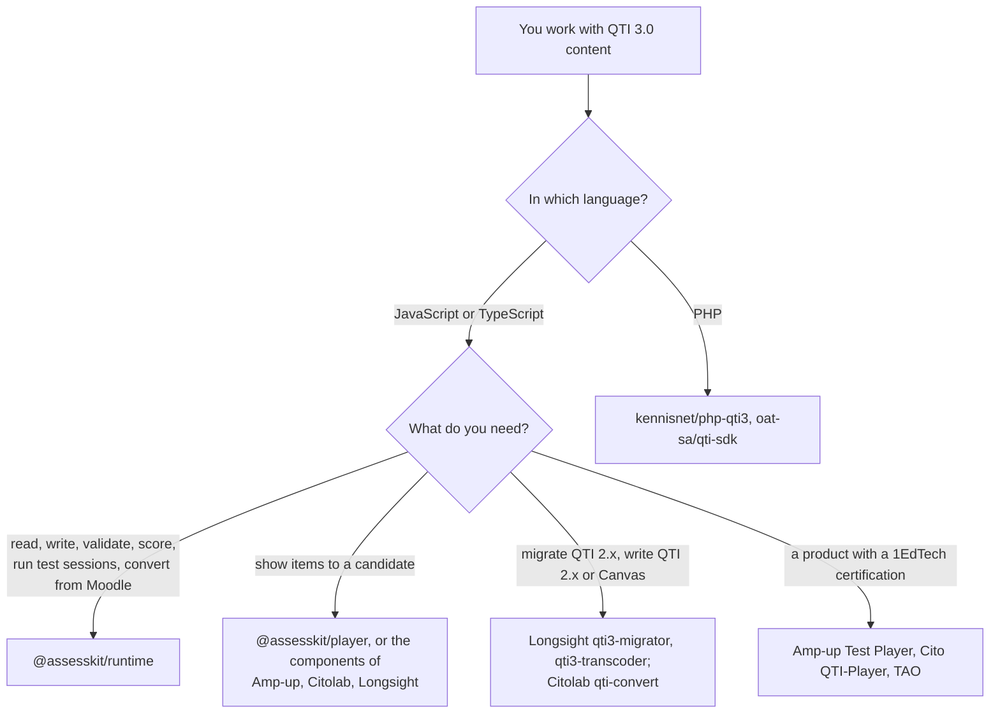

# Choosing the runtime

When `@assesskit/runtime` fits a project that reads, writes, validates, scores or runs QTI 3.0 content in JavaScript or
TypeScript, and when another library fits better. The comparators were read on 2026-11-02, at the versions that the rows give,
from their READMEs, source trees, open issues and the 1EdTech certification listings; the runtime's column was checked against
this repository on 2026-11-05. No comparator was run, and a file missing from a source tree means that the feature is not
implemented there, which a maintainer could contradict.

| You need                                                                                         | Use                                                                                                                   |
| ------------------------------------------------------------------------------------------------ | --------------------------------------------------------------------------------------------------------------------- |
| Items, tests, packages, results, usage data and profiles of QTI 3.0, read, written and validated | This package: [asi](asi.md), [package](package.md), [results](results.md), [usage](usage.md), [validate](validate.md) |
| Response, template and outcome processing, with the answer keys compiled into it                 | This package: [processing](processing.md), [keys](keys.md), [scoring](scoring.md), [operators](operators.md)          |
| A whole test session on a server or a device: selection, ordering, time limits, branching        | This package: [delivery](delivery.md)                                                                                 |
| Computer adaptive testing against a CAT engine                                                   | This package: [cat](cat.md); the player has both sides of the REST binding                                            |
| Questions from a Moodle question bank, in GIFT or Moodle XML, as QTI items and back              | This package: [item-formats](item-formats.md)                                                                         |
| Validation in any JavaScript runtime, and against the published schemas in Node.js               | This package: [validate](validate.md), [node](node.md), [cli](cli.md)                                                 |
| Validation in a PHP service, or over HTTP from a container                                       | kennisnet/php-qti3, or feyst/qti3-validator                                                                           |
| Migration of QTI 1.2 and 2.x content to QTI 3                                                    | Longsight `qti3-migrator`, Citolab `qti-convert`, wylovan/qti30Upgrader                                               |
| QTI 3 content written as QTI 1.2, 2.1 or 2.2, or as Canvas quizzes                               | Longsight `qti3-transcoder`                                                                                           |
| An editor for items and tests                                                                    | TAO                                                                                                                   |
| Delivery in a Vue or React page                                                                  | Amp-up (Vue 2, Vue 3), agencyenterprise/qti-3-player (React, Vue), or the [player](../player/choosing.md)             |

## What the others have that the runtime lacks

| Comparator, version                                                                                              | What it has                                                                                                     | Here                                                                                                                                                                   |
| ---------------------------------------------------------------------------------------------------------------- | --------------------------------------------------------------------------------------------------------------- | ---------------------------------------------------------------------------------------------------------------------------------------------------------------------- |
| [Longsight qti3](https://github.com/LongsightGroup/qti3) 0.13.3 (MIT)                                            | A transcoder from QTI 3 to QTI 1.2, 2.1 and 2.2, Canvas Classic and New Quizzes, and Moodle XML                 | Excluded: [supported](supported.md#not-included). GIFT and Moodle XML are in [item-formats](item-formats.md); the other targets are not                                |
| Longsight qti3 0.13.3                                                                                            | A migrator from QTI 1.2 and 2.x to QTI 3                                                                        | Excluded: [supported](supported.md#not-included); a [tested example](https://github.com/assesskit/assesskit/blob/main/examples/runtime/migrate-qti2/README.md) runs it |
| Longsight qti3 0.13.3                                                                                            | A command line that scores, inspects and prepares delivery, and a machine-readable support matrix               | Partly: [cli](cli.md) validates and fetches schemas, and the functions exist in the library; no matrix is exported                                                     |
| [feyst/qti3-validator](https://github.com/feyst/qti3-validator)                                                  | A validation service over HTTP in a container, which reports more than 7,400 Schematron rules                   | Not included: a host wraps `validate`, which reports each rule set of the schema under its identifier ([evidence](evidence.md#completeness))                           |
| [Citolab qti-components](https://github.com/Citolab/qti-components) 9.6.2 (GPL-3.0)                              | Conversion of QTI 2 to QTI 3 (`qti-convert`), CSV and XLSX to a QTI package, and Word and PDF export for paper  | Excluded: migration and authoring ([supported](supported.md#not-included)); paper export belongs to an application                                                     |
| [Amp-up](https://github.com/amp-up-io/qti3-item-player) `qti3-item-player` 1.1.20 (MIT)                          | A 1EdTech certification of its Test Player at Basic and Advanced, listed 2025-11-25                             | None: 1EdTech grants certification to products, and [conformance](conformance.md) maps each of 150 feature IDs to a guide and a test                                   |
| Citolab, Cito QTI-Player                                                                                         | A 1EdTech certification at Basic, listed 2025-04-25                                                             | None, as above                                                                                                                                                         |
| [TAO](https://github.com/oat-sa/extension-tao-itemqti) (Open Assessment Technologies)                            | A 1EdTech certification for QTI 2.2 at Basic and Advanced, listed 2026-01-30; item and test authoring; printing | Excluded: authoring, certification; no print ([supported](supported.md#not-included))                                                                                  |
| [oat-sa/qti-sdk](https://github.com/oat-sa/qti-sdk), [kennisnet/php-qti3](https://github.com/kennisnet/php-qti3) | QTI in PHP                                                                                                      | Not applicable: this package is JavaScript and TypeScript                                                                                                              |
| 1EdTech conformance evidence                                                                                     | A page for each conformance criterion with its result (Citolab); member-only test sets and a validator          | Partly: [conformance](conformance.md) maps each of 150 feature IDs to a guide and a test; the member-only test sets and validator have never been run on its output    |

By their documentation and source trees of 2026-11-02:

| Comparator         | Results Reporting, usage data, a CAT port, an exam server | A whole test session                                              |
| ------------------ | --------------------------------------------------------- | ----------------------------------------------------------------- |
| Amp-up             | None                                                      | Exposes the test information model                                |
| Citolab `qti-test` | None                                                      | Lacks time limits and section references (its issues 296 and 301) |
| Longsight          | None                                                      | A non-goal                                                        |
| The runtime        | All four                                                  | Runs sessions ([delivery](delivery.md))                           |

## Where the evidence is

[Evidence](evidence.md) gives the counts of tests, the corpus and the schemas, and the comparison with Longsight `qti3-core` and Amp-up
`qti3-item-player`; [conformance](conformance.md) maps every feature ID of the conformance document; [performance](performance.md) times the
runtime against Longsight and libxml2; [supported](supported.md) says what is read, written, validated and run, and what is left out.
