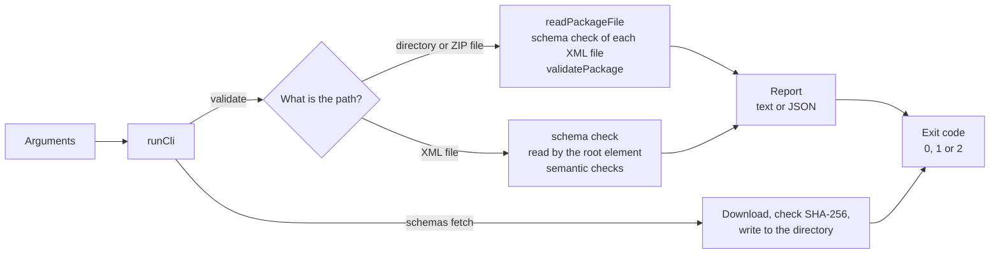

# Command line

`cli` is the command line of the runtime, for Node.js 22 and later. The package installs it as the program `assesskit`. It
validates a content package or an XML document against the official schemas and with the semantic checks of
[validate](validate.md), and it downloads the schemas, which the runtime does not ship. `assesskit schemas fetch` is the only
code in the runtime that uses the network.



| Command                                                             | Purpose                                                           |
| ------------------------------------------------------------------- | ----------------------------------------------------------------- |
| `assesskit validate <path> [--schemas <dir>] [--format text\|json]` | Validates a package or a document and reports the issues.         |
| `assesskit schemas fetch [--dir <dir>]`                             | Downloads the schemas of `SCHEMA_FILES` and checks their SHA-256. |
| `assesskit --help`                                                  | Prints the commands to the standard output, and exits with 0.     |

```bash
npm install @assesskit/runtime
npx assesskit schemas fetch
npx assesskit validate packaging/items/feedback_adaptive.xml
```

## assesskit validate

| Argument or option    | Default                                 | Meaning                                                                                                   |
| --------------------- | --------------------------------------- | --------------------------------------------------------------------------------------------------------- |
| `<path>`              | required                                | A ZIP file, an unpacked package directory, or one XML document. A path that starts with `-` follows `--`. |
| `--schemas <dir>`     | the directory `schemas fetch` writes to | The directory that holds the schemas, under the file names of `SCHEMA_FILES`.                             |
| `--format text\|json` | `text`                                  | `text` prints a line for each issue and a verdict; `json` prints one report.                              |

What the path is decides what is validated:

| Path                                   | Validated as                                                                                               |
| -------------------------------------- | ---------------------------------------------------------------------------------------------------------- |
| A directory                            | A package, read as [`readPackageFile`](node.md#package-files) reads a directory: symbolic links refused.   |
| A file that starts with the bytes `PK` | A package, read as `readPackageFile` reads a ZIP file.                                                     |
| Any other file                         | One XML document, read whole; a file above `maxBytes` of `parseXml` (10 MiB) is refused before it is read. |

The checks run in this order, and the report lists their issues in the same order.

1. **Schema check.** Every document goes through `parseXml`, so that a DOCTYPE, a limit and a document that is not well-formed
   are reported without libxml2 seeing the document. Then `validateXmlFiles` validates it against its schema, with one
   `SchemaSet` that is compiled once for the whole run.
2. **Semantic checks.** The document is read into its model and checked by `validate`.

A defect that the schema and the reader both find, such as a missing attribute, is reported twice, once with the code
`assesskit/node/xsd-invalid` and once with the code of the reader.

### A document

The root element decides how a document is read. The schema check applies to every kind with a schema (see
[Choosing the schema](node.md#choosing-the-schema)); the semantic checks are these.

| Root element                                                                                              | Semantic checks                                                                                                             |
| --------------------------------------------------------------------------------------------------------- | --------------------------------------------------------------------------------------------------------------------------- |
| Any element of the ASI namespace: item, test, section, stimulus, outcome declaration, response processing | `readAsi`, then `validateAsi`: a test is checked by its own document, without its items.                                    |
| `assessmentResult`                                                                                        | `readResults`, then `validateResults`.                                                                                      |
| `access-for-all-pnp`, `access-for-all-pnp-records`                                                        | `readPnp`, then `validatePnp` for each profile, and `validatePnpNamespace` (the two namespaces of the examples are errors). |
| `usageData`                                                                                               | `readUsageData`.                                                                                                            |
| `manifest`                                                                                                | `readManifest`.                                                                                                             |
| Any other element                                                                                         | None; the schema check reports a namespace without a schema as `assesskit/node/no-schema`.                                  |

A document is checked alone: an `xi:include` in it is not resolved and `validateAsi` reports it as unresolved
(`assesskit/validate/unresolved-include`), and a test's items are not read. Validate the package to check them together.

### A package

1. `readPackageFile` reads the package. A manifest that cannot be read ends the validation with the issues of its reader.
2. Every file of the package with the extension `.xml` goes through the schema check, one file at a time. An XML file whose
   root is in a namespace without a schema, such as an LTI link, is left out.
3. `validatePackage` checks the files, the resources and every document with the packages around them.

### Output

`--format text` prints a line for each issue, then the verdict. The parts of a location that the issue lacks are left out:

```
path:line:column (element): severity: message [rule]
```

```console
$ assesskit validate packaging/items/feedback_adaptive.xml
packaging/items/feedback_adaptive.xml (qti-assessment-item/qti-response-processing/qti-response-condition/qti-response-if/qti-set-outcome-value): error: The variable "FEEDBACK" is a multiple identifier and cannot be set to a single identifier. [assesskit/validate/assignment-type]
packaging/items/feedback_adaptive.xml (qti-assessment-item/qti-response-processing/qti-response-condition/qti-response-if/qti-member): error: The operator qti-member takes single boolean or directedPair or file or float or identifier or integer or pair or point or string or uri operands, found a multiple identifier as operand 1. [assesskit/validate/operand-type]
packaging/items/feedback_adaptive.xml (qti-assessment-item/qti-response-processing/qti-response-condition/qti-response-if/qti-member): error: The operator qti-member takes multiple or ordered boolean or directedPair or file or float or identifier or integer or pair or point or string or uri operands, found a single identifier as operand 2. [assesskit/validate/operand-type]
packaging/items/feedback_adaptive.xml: invalid (3 errors, 0 warnings)
```

`--format json` prints one object and a newline, with these fields in this order:

| Field     | Value                                                                                                       |
| --------- | ----------------------------------------------------------------------------------------------------------- |
| `tool`    | `"assesskit"`.                                                                                              |
| `version` | The version of the runtime package.                                                                         |
| `target`  | The path as the command line gave it.                                                                       |
| `valid`   | `true` when no issue has the severity `error`.                                                              |
| `summary` | `{ errors, warnings }`: the number of issues of each severity.                                              |
| `issues`  | The `Issue`s of [Errors and issues](architecture.md#errors-and-issues), every one with its `location.path`. |

```console
$ assesskit validate --format json packaging/items/Example03-feedbackBlock-solution-random.xml
{
  "tool": "assesskit",
  "version": "0.0.0",
  "target": "packaging/items/Example03-feedbackBlock-solution-random.xml",
  "valid": true,
  "summary": {
    "errors": 0,
    "warnings": 1
  },
  "issues": [
    {
      "severity": "warning",
      "rule": "assesskit/validate/identifier-style",
      "message": "The identifier \"Example03-feedbackBlock-solution-random\" of the qti-assessment-item has more than 32 characters, which version 1 of QTI does not take.",
      "location": {
        "path": "packaging/items/Example03-feedbackBlock-solution-random.xml",
        "element": "qti-assessment-item"
      }
    }
  ]
}
```

### Exit codes

| Code | Meaning                                                                                                                                         |
| ---- | ----------------------------------------------------------------------------------------------------------------------------------------------- |
| 0    | The command succeeded. For `validate`: no issue has the severity `error`; warnings do not change the code.                                      |
| 1    | `validate` found at least one issue with the severity `error`, including a document that is not well-formed and a manifest that cannot be read. |
| 2    | No verdict: the command line is wrong, the path cannot be read, the schemas are missing or changed, or the input is refused.                    |

The report goes to the standard output; every message of an exit with 2 goes to the standard error as `assesskit: <message>`, and
a wrong command line adds the commands. Input is refused with the code 2, before any of its content is checked, when it is a
package that breaks a rule of the security model of [SECURITY.md](../../SECURITY.md) (a path that leaves the package, a symbolic link, an
encrypted entry, a size, count or ratio above its limit) or an XML file above `maxBytes`. A DOCTYPE inside a document is an
issue, not a refusal.

## assesskit schemas fetch

| Option        | Default             | Meaning                                                            |
| ------------- | ------------------- | ------------------------------------------------------------------ |
| `--dir <dir>` | the directory below | The directory to write the schemas to; it is created when missing. |

The command downloads the files of `SCHEMA_FILES` from their fixed addresses, four at a time, and writes a file only when the
SHA-256 of what it received is the pinned one. A file that is in the directory with its pinned hash is not downloaded again.
The addresses cannot be changed from the command line. A download that gets no answer in 30 seconds, whose body brings no byte
for 30 seconds, or that fails with a network error or the status 408, 429 or 5xx is tried again after 2 and then after 4
seconds, three tries in all, and the command says so on the standard error; any other status is not tried again. When some
downloads fail, the others are written, the command lists the failures and exits with 2, and running it again downloads the
rest.

```console
$ assesskit schemas fetch
Downloaded 33 schemas to /Users/ada/Library/Caches/assesskit/schemas/d48c89edf713.
$ assesskit schemas fetch
The schemas in /Users/ada/Library/Caches/assesskit/schemas/d48c89edf713 are current.
```

The default directory, for `--dir` and for `--schemas`, is `assesskit/schemas/<version>` in the user cache directory of the
platform. `<version>` is the first 12 characters of the SHA-256 of the lines `<file> <sha256>` of `SCHEMA_FILES`, so that a
release that pins other schemas uses another directory and a release that pins the same schemas shares the first.

| Platform | User cache directory                                                                |
| -------- | ----------------------------------------------------------------------------------- |
| macOS    | `~/Library/Caches`                                                                  |
| Windows  | `%LOCALAPPDATA%`, else `~\AppData\Local`                                            |
| Others   | `$XDG_CACHE_HOME`, else `~/.cache`; a value that is not an absolute path is ignored |

`assesskit validate` without the schemas exits with 2 and says which command downloads them.

## runCli

`runCli(args, options?)` runs the command line and returns the exit code; the program sets it as `process.exitCode`. It is for
tests and for programs that embed the command.

```ts
import { runCli } from "@assesskit/runtime/cli";

const output = [];
const code = await runCli(["--help"], { stdout: (text) => output.push(text) });
code; // => 0
output[0]?.startsWith("Usage:"); // => true

const errors = [];
await runCli(["validate"], { stderr: (text) => errors.push(text) }); // => 2
errors[0]?.startsWith("assesskit: The command validate takes one path."); // => true
```

| Option            | Default                     | Meaning                                                                                                    |
| ----------------- | --------------------------- | ---------------------------------------------------------------------------------------------------------- |
| `stdout`          | `process.stdout.write`      | Receives the report and the messages of success.                                                           |
| `stderr`          | `process.stderr.write`      | Receives the messages of an exit with 2.                                                                   |
| `schemaDirectory` | the default directory above | The directory when no `--schemas` or `--dir` is given.                                                     |
| `fetch`           | the global `fetch`          | Downloads an address for `schemas fetch`; tests pass a function that serves the files from a local server. |

It throws a `DataError` when an argument or an option has the wrong type. Every other failure is an exit code.

## Not included

| Not included                        | Why                                                                                          |
| ----------------------------------- | -------------------------------------------------------------------------------------------- |
| Other addresses for the schemas     | The addresses are pinned with the hashes, so that a download cannot change what is validated |
| Fixing the issues it reports        | The command reports; the author or the generating program fixes                              |
| Validating several paths in one run | A shell loop does it, and each report names its path                                         |
| Colors and progress output          | The text format is one line for each issue, which other programs read                        |

## Files

Each file of `src/cli/` holds one concept.

| File                                                            | Concept                                                              |
| --------------------------------------------------------------- | -------------------------------------------------------------------- |
| `bin.ts`, `run.ts`, `options.ts`, `usage.ts`                    | The program, the dispatch of a command and its options               |
| `validate-command.ts`, `schemas-command.ts`                     | The two commands                                                     |
| `check-path.ts`, `check-document.ts`, `check-package.ts`        | What a path names, and the issues of a document or package           |
| `report.ts`                                                     | The report, its formats and the exit codes                           |
| `fetch-schemas.ts`, `schema-directory.ts`, `package-version.ts` | Downloading the schemas, where they live, the version                |
| `internal.ts`                                                   | What other modules and the tests use and the package does not export |

## References

| Topic                        | Specification                                                                                   |
| ---------------------------- | ----------------------------------------------------------------------------------------------- |
| Cache directory on Linux     | [XDG Base Directory Specification](https://specifications.freedesktop.org/basedir-spec/latest/) |
| The schemas and their hashes | [node](node.md#getting-the-schemas)                                                             |
| The checks that run          | [validate](validate.md)                                                                         |
